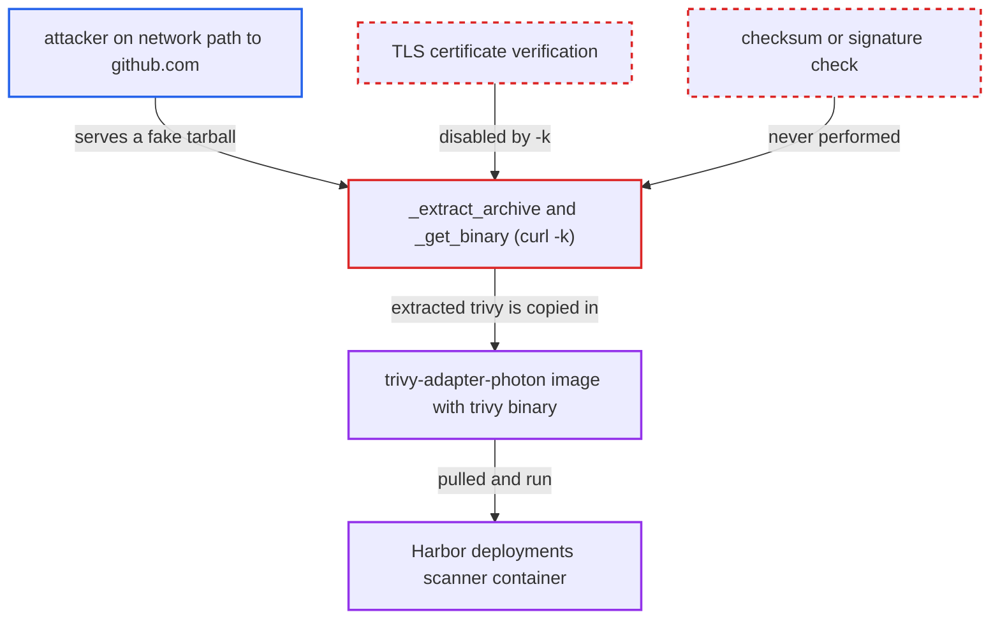

# Image build downloads Trivy and registry binaries with TLS verification disabled and no checksum

| Field | Value |
|---|---|
| ID | `find_01FdDoC1mewVkQoRSrqLBAq6` |
| Severity | **Critical** |
| Status | open |
| CWE | CWE-494 — Download without integrity check |
| Created | 2026-10-27T21:13:29.710114Z |
| Claude Security | https://claude.ai/security/findings/find_01FdDoC1mewVkQoRSrqLBAq6 |

## Description

Someone who can intercept or redirect the build host's traffic to `github.com` can swap the Trivy scanner binary shipped in the `goharbor/trivy-adapter-photon` image for their own. Every Harbor deployment that runs that image would then execute the attacker's code. The attack needs no credentials, only that network position. The cause is `curl -k` in `_extract_archive` and `_get_binary` in `make/photon/Makefile`, plus no checksum check.

1. **attacker on the network path** intercepts or redirects the build host's connection to github.com. The attacker is in a machine-in-the-middle position or can poison the build host's DNS, so they can answer in place of the real server.
2. **the release build** runs `make` with `TRIVYFLAG=true`. The official release workflow sets this flag, so the unsafe download path runs for the published images. ([`.github/workflows/build-package.yml:135-136`](https://github.com/cx-benchmark/harbor/blob/d822d80c2e6edb2c85538d4b9cd73c0c375a5596/.github/workflows/build-package.yml#L135-L136))
3. **the helper `_extract_archive`** downloads the Trivy tarball from `TRIVY_DOWNLOAD_URL` with `curl -k`. The `-k` flag makes curl accept any TLS certificate, so it accepts the attacker's server, and no checksum or signature is checked afterwards. ([`make/photon/Makefile:221-229`](https://github.com/cx-benchmark/harbor/blob/d822d80c2e6edb2c85538d4b9cd73c0c375a5596/make/photon/Makefile#L221-L229))
4. **the function `_build_trivy_adapter`** pipes the download into `tar xvz` under `make/photon/trivy-adapter/binary/`. The attacker's tarball is unpacked as if it were the real Trivy release, so its `trivy` file is the attacker's binary. ([`make/photon/Makefile:158-176`](https://github.com/cx-benchmark/harbor/blob/d822d80c2e6edb2c85538d4b9cd73c0c375a5596/make/photon/Makefile#L158-L176))
5. **the `make/photon/trivy-adapter/Dockerfile`** copies the extracted `trivy` into `/usr/local/bin/trivy` in the final image. Nothing between the download and this `COPY` checks the binary. ([`make/photon/trivy-adapter/Dockerfile:9-10`](https://github.com/cx-benchmark/harbor/blob/d822d80c2e6edb2c85538d4b9cd73c0c375a5596/make/photon/trivy-adapter/Dockerfile#L9-L10))
6. **Harbor deployments** pull the published image and run the scanner. The attacker's binary runs inside the scanner container of every deployment.

## Assessment

The attacker must be able to interpose on the connection from the build or release host to `github.com`, or poison that host's DNS. They need no credentials and no user action. The attack triggers when the build runs `_build_trivy_adapter`, which always downloads Trivy through `_extract_archive`. Two other downloads are affected the same way. When `BUILDTRIVYADP` is false, the adapter source is fetched through `_extract_archive`. When `BUILDREG` is false, `_build_registry` fetches a prebuilt registry binary through `_get_binary`, from a URL that the operator supplies as `REGISTRYURL`. The official release workflow builds with `TRIVYFLAG=true`.

Impact: The attacker controls the content of the `trivy` binary, or of the registry binary, in the images the project ships. The integrity of the distributed software is lost.

Subsequent-system impact: Every Harbor deployment that runs the poisoned `trivy-adapter-photon` image executes the attacker's code in its scanner container. That container receives robot credentials to pull artifacts from any project it scans, so private images could be exposed. The code could also return fabricated vulnerability reports that defeat the vulnerability-based deployment-prevention policy. It also sits on the internal docker network with the shared Redis. Availability impact is limited to scanning.

## Recommendation

(1) The build downloads executable code (the Trivy scanner, the adapter source and the registry binary) with `curl -k`, so TLS certificate verification is off and the connection proves nothing about who the server is.

Fix criteria: Downloads verify the server certificate: `-k` is dropped, or the expected CA is pinned. An interposed server with an untrusted certificate makes the build fail. To check, point the download URL at a host with a self-signed certificate and confirm `make` aborts.

(2) No checksum or signature is verified for the downloaded Trivy, adapter and registry artifacts before they are baked into shipped images.

Fix criteria: Each downloaded artifact is checked against a pinned SHA-256, or an upstream signature such as cosign or GPG for Trivy releases. The pin is recorded next to the version in the Makefile, as `VALKEY_SHA256` is. Altering a single byte of the downloaded tarball makes the build fail before any `COPY` into an image.

## Evidence

**https://github.com/cx-benchmark/harbor**

- [`make/photon/Makefile:221-229`](https://github.com/cx-benchmark/harbor/blob/d822d80c2e6edb2c85538d4b9cd73c0c375a5596/make/photon/Makefile#L221-L229)
- [`make/photon/Makefile:158-176`](https://github.com/cx-benchmark/harbor/blob/d822d80c2e6edb2c85538d4b9cd73c0c375a5596/make/photon/Makefile#L158-L176)
- [`make/photon/Makefile:184-192`](https://github.com/cx-benchmark/harbor/blob/d822d80c2e6edb2c85538d4b9cd73c0c375a5596/make/photon/Makefile#L184-L192)
- [`make/photon/trivy-adapter/Dockerfile:9-10`](https://github.com/cx-benchmark/harbor/blob/d822d80c2e6edb2c85538d4b9cd73c0c375a5596/make/photon/trivy-adapter/Dockerfile#L9-L10)
- [`Makefile:149-155`](https://github.com/cx-benchmark/harbor/blob/d822d80c2e6edb2c85538d4b9cd73c0c375a5596/Makefile#L149-L155)
- [`.github/workflows/build-package.yml:135-136`](https://github.com/cx-benchmark/harbor/blob/d822d80c2e6edb2c85538d4b9cd73c0c375a5596/.github/workflows/build-package.yml#L135-L136)
- [`make/photon/valkey/Dockerfile.base:20-26`](https://github.com/cx-benchmark/harbor/blob/d822d80c2e6edb2c85538d4b9cd73c0c375a5596/make/photon/valkey/Dockerfile.base#L20-L26)

