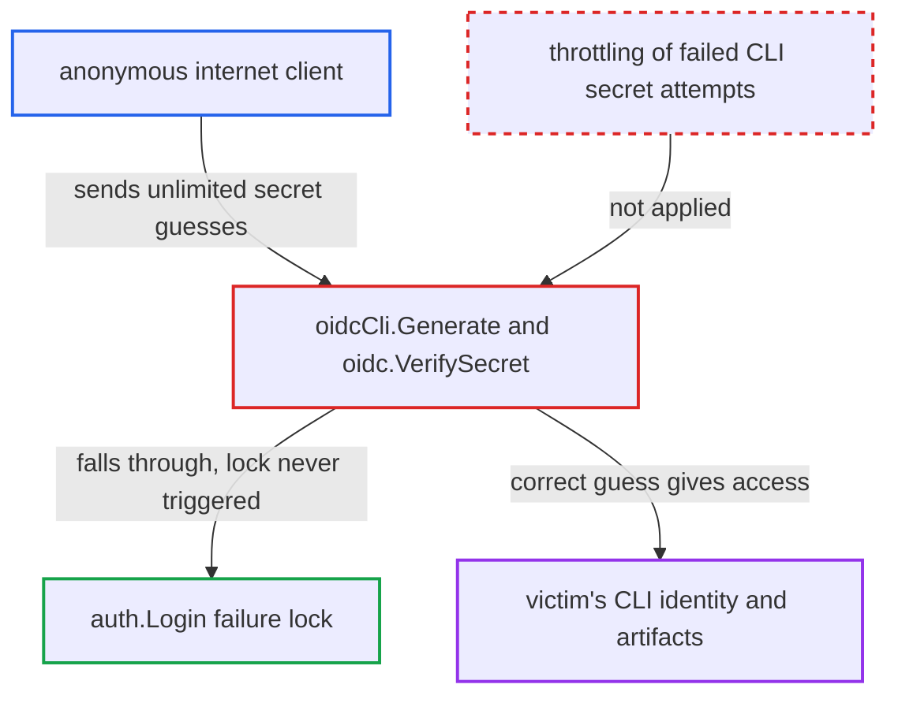

# OIDC CLI secret verification has no failed-attempt throttling, unlike password login

| Field | Value |
|---|---|
| ID | `find_01KRggERwz1C2K4gZrmrbmqZ` |
| Severity | **Critical** |
| Status | open |
| CWE | CWE-307 — Improper Restriction of Excessive Authentication Attempts |
| Created | 2026-10-27T21:19:26.071350Z |
| Claude Security | https://claude.ai/security/findings/find_01KRggERwz1C2K4gZrmrbmqZ |

## Description

An anonymous internet client can guess a Harbor OIDC user's CLI secret with no limit on attempts. A correct guess gives that user's full CLI identity to pull, push and delete artifacts. It works only in OIDC mode, against a user who set a guessable secret in place of the 32-character random default. The cause is that `oidcCli.Generate` and `oidc.VerifySecret` have no failure lock, delay or counter.

1. **attacker** picks a known OIDC username and sends many Basic-auth requests to `/service/token`. Each request carries `Authorization: Basic base64(user:guess)`, with a different guess from a dictionary of common passwords that satisfy the secret policy. ([`src/core/service/token/creator.go:209-213`](https://github.com/cx-benchmark/harbor/blob/d822d80c2e6edb2c85538d4b9cd73c0c375a5596/src/core/service/token/creator.go#L209-L213))
2. **the generator `oidcCli.Generate`** reads the username and secret and calls `oidc.VerifySecret`. It applies no failure lock, counter or delay, and a mismatch is only logged before it returns `nil`. ([`src/server/middleware/security/oidc_cli.go:48-83`](https://github.com/cx-benchmark/harbor/blob/d822d80c2e6edb2c85538d4b9cd73c0c375a5596/src/server/middleware/security/oidc_cli.go#L48-L83))
3. **the function `oidc.VerifySecret`** decrypts the stored secret and compares it with the guess. A mismatch returns `SecretVerifyError` at once and keeps no throttling state. ([`src/pkg/oidc/secret.go:87-106`](https://github.com/cx-benchmark/harbor/blob/d822d80c2e6edb2c85538d4b9cd73c0c375a5596/src/pkg/oidc/secret.go#L87-L106))
4. **the security chain** falls through to `basicAuth`, which calls `auth.Login`. The OIDC authenticator inherits `DefaultAuthenticateHelper.Authenticate`, which returns `ErrNotSupported` and not an `ErrAuth`. ([`src/core/auth/authenticator.go:91-93`](https://github.com/cx-benchmark/harbor/blob/d822d80c2e6edb2c85538d4b9cd73c0c375a5596/src/core/auth/authenticator.go#L91-L93))
5. **`auth.Login`** skips the failure freeze for the failed guess. The `lock.IsLocked` and `lock.Lock` calls and the 1.5 s sleep run only for `ErrAuth`, so a non-admin OIDC user is never locked and the guess costs no delay. ([`src/core/auth/authenticator.go:151-161`](https://github.com/cx-benchmark/harbor/blob/d822d80c2e6edb2c85538d4b9cd73c0c375a5596/src/core/auth/authenticator.go#L151-L161))
6. **attacker** repeats guesses until one returns 200 with a token. A wrong guess gets 401 and a correct one gets a token, so each attempt gives a clear yes or no answer. ([`src/core/service/token/creator.go:209-213`](https://github.com/cx-benchmark/harbor/blob/d822d80c2e6edb2c85538d4b9cd73c0c375a5596/src/core/service/token/creator.go#L209-L213))

## Assessment

The attacker is an anonymous internet client who can reach a public Harbor instance in OIDC auth mode. The attacker needs a known OIDC username. The victim must have replaced the 32-character random default CLI secret with a guessable one. The user, or an admin acting for them, can do this with `PUT /api/v2.0/users/{id}/cli_secret`. The only policy is `requireValidSecret`, which asks for 8-128 characters with upper case, lower case and a digit, so a value such as `Password1` is accepted. The guesses go to `/service/token`. The same CLI-secret check also accepts Basic auth on `/v2/*` and a few allow-listed API paths. Harbor has no other inbound throttling: `src/server/middleware` has no rate-limiting middleware and the shipped nginx templates have no `limit_req`.

Impact: A correct guess gives the attacker the victim's CLI identity with the victim's OIDC groups. The attacker can pull, push and delete through `/v2/*` and `/service/token` in every project the victim can reach. The attacker can also create projects and delete tags through the allow-listed API paths. This exposes private artifacts and lets the attacker tamper with them. If the victim is in the OIDC admin group, the attacker gets system-admin scope on those paths. Availability impact is limited to deleting the victim's reachable artifacts.

## Recommendation

The OIDC CLI-secret path bypasses Harbor's failed-login throttling (`auth.UserLock`) and has no throttling of its own. An unlimited number of guesses can be made against a user-chosen secret.

Fix criteria: Failed CLI-secret verifications are subject to the same or stronger per-principal throttling as password logins, ideally also per source. This is a freeze or backoff after failures that makes online dictionary attacks impractical, and failures can be audited. Repeated wrong secrets for one user on `/service/token` are delayed or rejected after a small number of failures. A correct secret still works after the window.

## Evidence

**https://github.com/cx-benchmark/harbor**

- [`src/server/middleware/security/oidc_cli.go:48-83`](https://github.com/cx-benchmark/harbor/blob/d822d80c2e6edb2c85538d4b9cd73c0c375a5596/src/server/middleware/security/oidc_cli.go#L48-L83)
- [`src/pkg/oidc/secret.go:87-106`](https://github.com/cx-benchmark/harbor/blob/d822d80c2e6edb2c85538d4b9cd73c0c375a5596/src/pkg/oidc/secret.go#L87-L106)
- [`src/server/middleware/security/security.go:30-67`](https://github.com/cx-benchmark/harbor/blob/d822d80c2e6edb2c85538d4b9cd73c0c375a5596/src/server/middleware/security/security.go#L30-L67)
- [`src/core/auth/authenticator.go:91-93`](https://github.com/cx-benchmark/harbor/blob/d822d80c2e6edb2c85538d4b9cd73c0c375a5596/src/core/auth/authenticator.go#L91-L93)
- [`src/core/auth/authenticator.go:151-161`](https://github.com/cx-benchmark/harbor/blob/d822d80c2e6edb2c85538d4b9cd73c0c375a5596/src/core/auth/authenticator.go#L151-L161)
- [`src/core/service/token/creator.go:209-213`](https://github.com/cx-benchmark/harbor/blob/d822d80c2e6edb2c85538d4b9cd73c0c375a5596/src/core/service/token/creator.go#L209-L213)
- [`src/server/v2.0/handler/user.go:58-78`](https://github.com/cx-benchmark/harbor/blob/d822d80c2e6edb2c85538d4b9cd73c0c375a5596/src/server/v2.0/handler/user.go#L58-L78)

