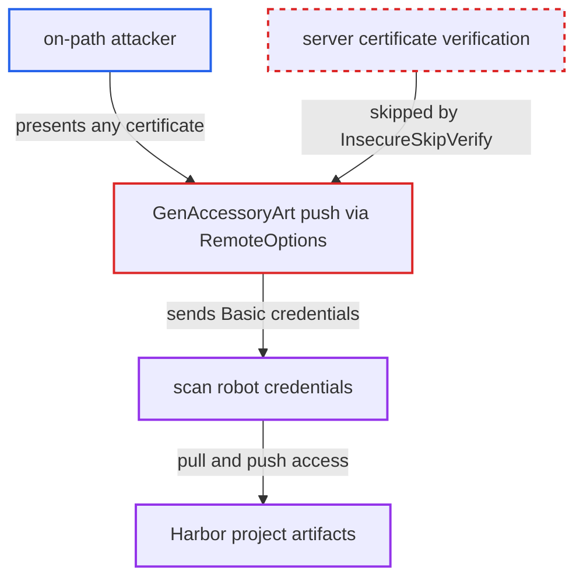

# SBOM accessory push disables TLS verification, exposing scan robot credentials to on-path attacker

| Field | Value |
|---|---|
| ID | `find_019F6vkUcj1MC5QCXmumMfbr` |
| Severity | **Critical** |
| Status | open |
| CWE | CWE-295 — Improper certificate validation |
| Created | 2026-10-27T21:13:29.581900Z |
| Claude Security | https://claude.ai/security/findings/find_019F6vkUcj1MC5QCXmumMfbr |

## Description

An attacker positioned on the network path between jobservice and the Harbor endpoint can steal the credentials of a scan robot account. With them the attacker can read every artifact in the scanned project and push arbitrary images, tags or a forged SBOM accessory. It needs no Harbor account and no user action, but it does need a machine-in-the-middle position and a running SBOM scan. The cause is `RemoteOptions` in `src/pkg/scan/util.go`, which always uses a transport that skips TLS certificate checks, so `GenAccessoryArt` sends the robot secret to an unverified server.

1. **the function `RemoteOptions`** selects a transport that skips certificate verification. It always calls `http_common.GetHTTPTransport(http_common.WithInsecure(true))`, which returns the shared `insecureHTTPTransport` built with `InsecureSkipVerify: true`. ([`src/pkg/scan/util.go:38-41`](https://github.com/cx-benchmark/harbor/blob/d822d80c2e6edb2c85538d4b9cd73c0c375a5596/src/pkg/scan/util.go#L38-L41))
2. **the function `PostScan`** marks the registry reference insecure only for `http://` URLs. It strips the scheme, so an `https://` registry URL still gets a TLS connection whose server certificate is never checked. ([`src/pkg/scan/sbom/sbom.go:86-110`](https://github.com/cx-benchmark/harbor/blob/d822d80c2e6edb2c85538d4b9cd73c0c375a5596/src/pkg/scan/sbom/sbom.go#L86-L110))
3. **the function `GenAccessoryArt`** pushes the SBOM accessory to `sq.Registry.URL` with the robot's Basic credentials. It adds `remote.WithAuth` with the robot name and secret and then calls `remote.Write` over the unverified transport. ([`src/pkg/scan/util.go:86-94`](https://github.com/cx-benchmark/harbor/blob/d822d80c2e6edb2c85538d4b9cd73c0c375a5596/src/pkg/scan/util.go#L86-L94))
4. **on-path attacker** answers the TLS connection with any certificate. Because verification is off, the client accepts it and sends the robot credentials, either directly or through the `/v2/` challenge and token request.
5. **on-path attacker** stalls the push and uses the captured robot credentials against Harbor. The robot is deleted only when the task reaches a final state, so stalling keeps it valid, and it has `Duration: -1`. ([`src/controller/scan/base_controller.go:856-898`](https://github.com/cx-benchmark/harbor/blob/d822d80c2e6edb2c85538d4b9cd73c0c375a5596/src/controller/scan/base_controller.go#L856-L898))

## Assessment

The attacker is an on-path party between jobservice and the Harbor endpoint in `sq.Registry.URL`, positioned through DNS, routing or an egress proxy. An SBOM scan must run and finish. For admin-registered scanners `use_internal_addr` defaults to false, so the URL is `config.ExtEndpoint()`, the public Harbor URL, which is https by default. For the built-in Trivy `use_internal_addr` is true, so the URL is `core_url`, which is `https://core:8443` when internal TLS is enabled. Core's TLS listener does not require client certificates, so the unverified push succeeds there too. Verification would work, because the internal CA and custom CAs are installed into jobservice's trust bundle.

Impact: The attacker gets the per-scan robot's credentials, which hold project-wide `repository:pull`, `repository:scanner-pull` and `repository:push`. They can read all artifacts of the scanned project and push arbitrary images, tags or a forged SBOM accessory, which can poison what downstream consumers pull. Reach is limited to one project per captured robot, and the robot has no delete right.

## Recommendation

`RemoteOptions` hard-codes a transport with `InsecureSkipVerify` for the SBOM accessory push, so the registry endpoint's identity is never verified before the robot secret is sent.

Fix criteria: The accessory push verifies the server certificate using Harbor's trust configuration: the system bundle with internal and custom CAs, plus the internal client certificate when internal TLS is on. Skipping verification happens only through an explicit, operator-configured insecure option. Pushing to an endpoint that presents an untrusted certificate fails before any `Authorization` header is sent. Pushing to a correctly configured external or internal endpoint still succeeds.

## Evidence

**https://github.com/cx-benchmark/harbor**

- [`src/pkg/scan/util.go:38-41`](https://github.com/cx-benchmark/harbor/blob/d822d80c2e6edb2c85538d4b9cd73c0c375a5596/src/pkg/scan/util.go#L38-L41)
- [`src/pkg/scan/util.go:86-94`](https://github.com/cx-benchmark/harbor/blob/d822d80c2e6edb2c85538d4b9cd73c0c375a5596/src/pkg/scan/util.go#L86-L94)
- [`src/common/http/transport.go:46-53`](https://github.com/cx-benchmark/harbor/blob/d822d80c2e6edb2c85538d4b9cd73c0c375a5596/src/common/http/transport.go#L46-L53)
- [`src/pkg/scan/sbom/sbom.go:86-110`](https://github.com/cx-benchmark/harbor/blob/d822d80c2e6edb2c85538d4b9cd73c0c375a5596/src/pkg/scan/sbom/sbom.go#L86-L110)
- [`src/controller/scan/base_controller.go:907-933`](https://github.com/cx-benchmark/harbor/blob/d822d80c2e6edb2c85538d4b9cd73c0c375a5596/src/controller/scan/base_controller.go#L907-L933)
- [`src/server/v2.0/handler/scanner.go:253`](https://github.com/cx-benchmark/harbor/blob/d822d80c2e6edb2c85538d4b9cd73c0c375a5596/src/server/v2.0/handler/scanner.go#L253)
- [`src/core/main.go:267-279`](https://github.com/cx-benchmark/harbor/blob/d822d80c2e6edb2c85538d4b9cd73c0c375a5596/src/core/main.go#L267-L279)
- [`src/pkg/scan/sbom/sbom.go:118-132`](https://github.com/cx-benchmark/harbor/blob/d822d80c2e6edb2c85538d4b9cd73c0c375a5596/src/pkg/scan/sbom/sbom.go#L118-L132)
- [`src/controller/scan/base_controller.go:856-898`](https://github.com/cx-benchmark/harbor/blob/d822d80c2e6edb2c85538d4b9cd73c0c375a5596/src/controller/scan/base_controller.go#L856-L898)
- [`src/pkg/scan/job.go:588-597`](https://github.com/cx-benchmark/harbor/blob/d822d80c2e6edb2c85538d4b9cd73c0c375a5596/src/pkg/scan/job.go#L588-L597)
- [`make/photon/prepare/utils/cert.py:116-146`](https://github.com/cx-benchmark/harbor/blob/d822d80c2e6edb2c85538d4b9cd73c0c375a5596/make/photon/prepare/utils/cert.py#L116-L146)

