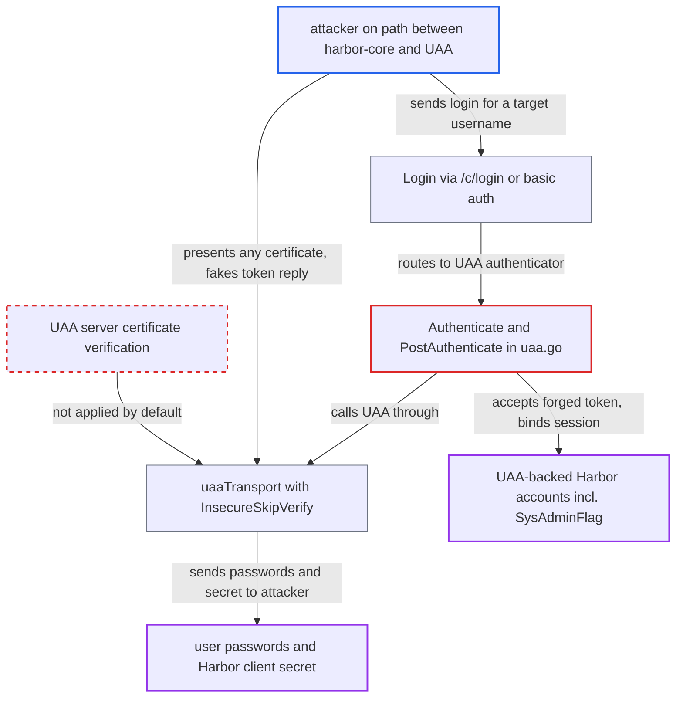

# UAA client skips TLS certificate verification by default, so authentication can be spoofed

| Field | Value |
|---|---|
| ID | `find_01WWEPwA6pKRT14zbuSkeJEX` |
| Severity | **Critical** |
| Status | open |
| CWE | CWE-295 — Improper certificate validation |
| Created | 2026-10-27T21:11:45.150528Z |
| Claude Security | https://claude.ai/security/findings/find_01WWEPwA6pKRT14zbuSkeJEX |

## Description

An attacker on the network path between Harbor and its UAA server can log in as almost any UAA-backed Harbor user, including administrators. The attacker can also read the passwords of users who log in. The attack needs UAA auth with `uaa_verify_cert` left at its default of `false`. That default makes the UAA client skip TLS certificate checks, and `Authenticate` trusts whatever token comes back.

1. **the config metadata** ships `uaa_verify_cert` defaulting to false. The LDAP, auth-proxy and OIDC verify flags default to `"true"`, so the UAA flag is the odd one out and applies whenever nothing is stored. ([`src/lib/config/metadata/metadatalist.go:128`](https://github.com/cx-benchmark/harbor/blob/d822d80c2e6edb2c85538d4b9cd73c0c375a5596/src/lib/config/metadata/metadatalist.go#L128))
2. **the function `ensureClient`** turns the setting into `SkipTLSVerify: !VerifyCert`. With the default `false`, certificate verification is skipped. ([`src/core/auth/uaa/uaa.go:143-149`](https://github.com/cx-benchmark/harbor/blob/d822d80c2e6edb2c85538d4b9cd73c0c375a5596/src/core/auth/uaa/uaa.go#L143-L149))
3. **the function `UpdateConfig`** installs `InsecureSkipVerify: true` on the shared `uaaTransport`. The CA bundle (`CARootPath`) is loaded only when verification is on, and this transport is used for the password grant, `/userinfo` and the `/Users` search. ([`src/common/utils/uaa/client.go:184-205`](https://github.com/cx-benchmark/harbor/blob/d822d80c2e6edb2c85538d4b9cd73c0c375a5596/src/common/utils/uaa/client.go#L184-L205))
4. **the attacker on the path to UAA** sends a login for a target username and answers Harbor's UAA calls. No Harbor account is needed. The login goes to `/c/login` or uses Docker basic auth, and every user except user_id 1 is sent to the UAA authenticator. ([`src/core/auth/authenticator.go:137-166`](https://github.com/cx-benchmark/harbor/blob/d822d80c2e6edb2c85538d4b9cd73c0c375a5596/src/core/auth/authenticator.go#L137-L166))
5. **the method `Authenticate`** accepts the dummy `access_token` as proof of the password. It only logs a `GetUserInfo` failure and takes the username from the login request. ([`src/core/auth/uaa/uaa.go:44-62`](https://github.com/cx-benchmark/harbor/blob/d822d80c2e6edb2c85538d4b9cd73c0c375a5596/src/core/auth/uaa/uaa.go#L44-L62))
6. **the method `PostAuthenticate`** loads the local user with that name and copies `UserID` and `SysAdminFlag`. The attacker's session is bound to the existing user, with admin rights if that user has them. ([`src/core/auth/uaa/uaa.go:94-108`](https://github.com/cx-benchmark/harbor/blob/d822d80c2e6edb2c85538d4b9cd73c0c375a5596/src/core/auth/uaa/uaa.go#L94-L108))

## Assessment

The deployment must use `uaa_auth` with the shipped `uaa_verify_cert=false`. The attacker must be on the path between harbor-core and the UAA host, for example through DNS spoofing, ARP or BGP tricks, or a proxy on the path. The report treats this position as outside the attacker's control. The attacker needs no Harbor account. To take over an account, they send a login for a target username to `/c/login` or through Docker basic auth. They present any certificate and answer `/oauth/token` with a dummy `access_token`. Passively capturing the passwords of real users' logins needs no further steps. Following the installer guidance to set `uaa.ca_file` (`UAA_CA_ROOT`) does not help, because that bundle is ignored unless `uaa_verify_cert` is also enabled.

Impact: The attacker can log in as any Harbor account backed by UAA and inherit its project roles and any `SysAdminFlag`. That allows reading private artifacts, pushing or deleting images and changing system configuration. The passwords of users who log in during the interception are disclosed. The built-in user_id 1 is not affected, because it always uses DB auth.

Subsequent-system impact: The intercepted passwords are real credentials for the UAA identity provider, so the attacker can log into UAA as those users. The Harbor UAA client secret is sent on every token request and is also exposed. It allows the client-credentials grant and the SCIM `/Users` search that Harbor uses.

## Recommendation

(1) `uaa_verify_cert` defaults to `false`, so the UAA client runs with `InsecureSkipVerify: true` unless the administrator opts in. Requests that carry user passwords and the client secret are sent without authenticating the server. Replies that Harbor treats as proof of login are not authenticated either.

Fix criteria: With UAA auth enabled and the verify setting left at its default, the client rejects a UAA certificate that does not chain to the system roots or to the configured `UAA_CA_ROOT`. Turning verification off is an explicit opt-out. To check, point Harbor at a UAA endpoint with an untrusted certificate. Login must fail and the password grant must never be sent, until a trusted CA is supplied or verification is explicitly disabled.

(2) The CA bundle mounted through harbor.yml `uaa.ca_file` (`UAA_CA_ROOT`) is ignored while verification is off. Operators who follow the installer guidance still get an unverified client.

Fix criteria: Whenever a UAA CA bundle is configured, it is used to verify the UAA server, and verification is never left disabled without a warning. A deployment that sets only `uaa.ca_file` rejects a certificate that the bundle does not sign.

## Evidence

**https://github.com/cx-benchmark/harbor**

- [`src/lib/config/metadata/metadatalist.go:128`](https://github.com/cx-benchmark/harbor/blob/d822d80c2e6edb2c85538d4b9cd73c0c375a5596/src/lib/config/metadata/metadatalist.go#L128)
- [`src/common/utils/uaa/client.go:184-205`](https://github.com/cx-benchmark/harbor/blob/d822d80c2e6edb2c85538d4b9cd73c0c375a5596/src/common/utils/uaa/client.go#L184-L205)
- [`src/core/auth/uaa/uaa.go:143-149`](https://github.com/cx-benchmark/harbor/blob/d822d80c2e6edb2c85538d4b9cd73c0c375a5596/src/core/auth/uaa/uaa.go#L143-L149)
- [`src/core/auth/uaa/uaa.go:44-62`](https://github.com/cx-benchmark/harbor/blob/d822d80c2e6edb2c85538d4b9cd73c0c375a5596/src/core/auth/uaa/uaa.go#L44-L62)
- [`src/core/auth/uaa/uaa.go:94-108`](https://github.com/cx-benchmark/harbor/blob/d822d80c2e6edb2c85538d4b9cd73c0c375a5596/src/core/auth/uaa/uaa.go#L94-L108)
- [`src/core/auth/authenticator.go:137-166`](https://github.com/cx-benchmark/harbor/blob/d822d80c2e6edb2c85538d4b9cd73c0c375a5596/src/core/auth/authenticator.go#L137-L166)
- [`make/harbor.yml.tmpl:239-241`](https://github.com/cx-benchmark/harbor/blob/d822d80c2e6edb2c85538d4b9cd73c0c375a5596/make/harbor.yml.tmpl#L239-L241)

