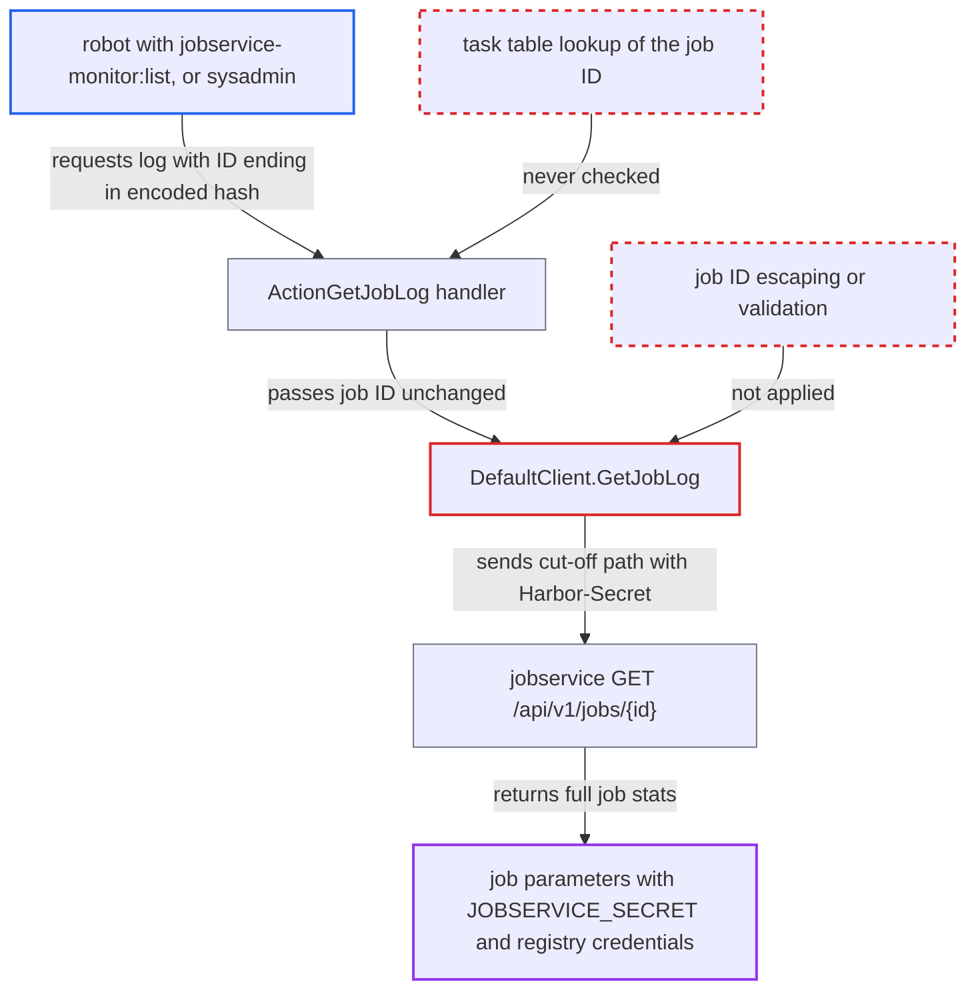

# Unescaped job ID in core's job-log proxy exposes jobservice job secrets to monitor robots

| Field | Value |
|---|---|
| ID | `find_01E5tW4GAuht4XapEcUUyfga` |
| Severity | **Critical** |
| Status | open |
| CWE | CWE-918 — Server-Side Request Forgery |
| Created | 2026-10-27T21:13:29.517522Z |
| Claude Security | https://claude.ai/security/findings/find_01E5tW4GAuht4XapEcUUyfga |

## Description

A system robot holding only the `jobservice-monitor:list` permission, or a sysadmin, can read internal job data that Harbor never exposes. That data includes the internal `JOBSERVICE_SECRET` and stored registry credentials, and the secret gives full control of Harbor core. The cause is `DefaultClient.GetJobLog`, which puts the caller's job ID into the jobservice URL without escaping or validation. The ID can therefore cut off `/log` and redirect the request.

1. **attacker** reads a valid job ID and requests the log with an encoded hash. The ID comes from `GET /api/v2.0/jobservice/workers/all` or any task listing, and the request is `GET /api/v2.0/jobservice/jobs/<jobid>%23/log`; the shipped nginx decodes `%23` and re-escapes it, so it reaches core intact. ([`make/photon/prepare/templates/nginx/nginx.http.conf.jinja:109-120`](https://github.com/cx-benchmark/harbor/blob/d822d80c2e6edb2c85538d4b9cd73c0c375a5596/make/photon/prepare/templates/nginx/nginx.http.conf.jinja#L109-L120))
2. **the handler `ActionGetJobLog`** forwards the `{job_id}` path parameter unchanged. It requires only `jobservice-monitor:list` and does not look the ID up in the task table. ([`src/server/v2.0/handler/jobservice.go:200-208`](https://github.com/cx-benchmark/harbor/blob/d822d80c2e6edb2c85538d4b9cd73c0c375a5596/src/server/v2.0/handler/jobservice.go#L200-L208))
3. **`monitorController.GetJobLog` and `GetLogByJobID`** pass the raw string on to the jobservice client. Neither checks that the ID belongs to a known task or matches a job-ID format. ([`src/pkg/task/task.go:286-288`](https://github.com/cx-benchmark/harbor/blob/d822d80c2e6edb2c85538d4b9cd73c0c375a5596/src/pkg/task/task.go#L286-L288))
4. **the client `DefaultClient.GetJobLog`** concatenates the ID into the URL and sends it with core's `Authorization: Harbor-Secret` header. The decoded `#` makes `url.Parse` treat `/log` as a fragment, so jobservice receives `GET /api/v1/jobs/<id>` instead of the log path. ([`src/common/job/client.go:155-157`](https://github.com/cx-benchmark/harbor/blob/d822d80c2e6edb2c85538d4b9cd73c0c375a5596/src/common/job/client.go#L155-L157))
5. **jobservice `HandleGetJobReq`** returns the full job stats, including `parameters`. Job parameters are stored with the job stats and loaded back when the stats are requested, and core returns the response body to the caller. ([`src/jobservice/job/tracker.go:344-347`](https://github.com/cx-benchmark/harbor/blob/d822d80c2e6edb2c85538d4b9cd73c0c375a5596/src/jobservice/job/tracker.go#L344-L347))
6. **attacker** extracts secrets from the parameters of replication or scan jobs. Replication `src_resource`/`dst_resource` carry `access_secret`, which is the decrypted remote registry credential or, for the local side, `JOBSERVICE_SECRET`; scan jobs carry the scanner robot account. ([`src/controller/replication/flow/copy.go:147-157`](https://github.com/cx-benchmark/harbor/blob/d822d80c2e6edb2c85538d4b9cd73c0c375a5596/src/controller/replication/flow/copy.go#L147-L157))
7. **attacker** sends the `JOBSERVICE_SECRET` in an `Authorization` header to core. Core builds a secret security context whose `Can()` is true for every action and resource. ([`src/common/security/secret/context.go:80-86`](https://github.com/cx-benchmark/harbor/blob/d822d80c2e6edb2c85538d4b9cd73c0c375a5596/src/common/security/secret/context.go#L80-L86))

## Assessment

The attacker needs a system robot granted only `jobservice-monitor:list`, which a sysadmin can grant on its own, or a sysadmin account. They use the public API and need no victim action. Besides `#`, an ID ending in `?` also cuts the path. With gorilla/mux v1.8.1 default `cleanPath` redirects, `.%23` reaches the job list `GET /api/v1/jobs`, and `..%252Fconfig%23` reaches `GET /api/v1/config`, which exposes the Redis URL. A single-encoded `..%2F` is likely normalized away by nginx. The sibling methods `PostAction` and `GetExecutions` build paths from caller-controlled identifiers in the same way.

Impact: A read-only monitoring robot can escalate to full control of Harbor core. It can push or overwrite artifacts in any project, change configuration, and delete projects and artifacts. It can also read stored third-party registry credentials and scanner robot secrets.

Subsequent-system impact: The leaked `access_secret` values are the credentials Harbor uses against external registries configured as replication endpoints. For push-based replication they must have push rights, so the attacker can read from and write to those third-party registries.

## Recommendation

(1) `DefaultClient.GetJobLog`, and the sibling `PostAction` and `GetExecutions`, put a caller-controlled identifier into the jobservice request path without escaping. The identifier can therefore retarget a secret-authenticated request to another jobservice endpoint.

Fix criteria: A job ID is always sent as a single opaque path segment: IDs not in the jobservice job-ID format are rejected, or they are path-escaped before the URL is built. `GET /api/v2.0/jobservice/jobs/<id>%23/log`, `<id>%3F`, `.%23` and `..%252Fconfig%23` return 4xx. Jobservice only ever receives `/api/v1/jobs/<id>/log` from this path.

(2) The monitor log endpoint proxies logs for arbitrary job IDs instead of IDs core knows about, unlike `stopJob`, which resolves the ID in the task table.

Fix criteria: Logs are proxied only for job IDs that exist in core's task records, or that match the strict job-ID format. Other IDs get a 404. Unknown or malformed IDs produce no outbound jobservice request.

(3) Job parameters stored and served by jobservice contain decrypted registry credentials and the internal jobservice secret, so any read of job stats discloses them.

Fix criteria: Job stats returned by jobservice GET endpoints contain no credential material. `access_secret`, robot secrets and auth headers are redacted, or references are passed instead of secrets. `GET /api/v1/jobs/{id}` for a replication or scan job contains no secret values.

## Evidence

**https://github.com/cx-benchmark/harbor**

- [`src/common/job/client.go:155-157`](https://github.com/cx-benchmark/harbor/blob/d822d80c2e6edb2c85538d4b9cd73c0c375a5596/src/common/job/client.go#L155-L157)
- [`src/server/v2.0/handler/jobservice.go:200-208`](https://github.com/cx-benchmark/harbor/blob/d822d80c2e6edb2c85538d4b9cd73c0c375a5596/src/server/v2.0/handler/jobservice.go#L200-L208)
- [`src/controller/jobmonitor/monitor.go:367-369`](https://github.com/cx-benchmark/harbor/blob/d822d80c2e6edb2c85538d4b9cd73c0c375a5596/src/controller/jobmonitor/monitor.go#L367-L369)
- [`src/pkg/task/task.go:286-288`](https://github.com/cx-benchmark/harbor/blob/d822d80c2e6edb2c85538d4b9cd73c0c375a5596/src/pkg/task/task.go#L286-L288)
- [`src/jobservice/api/router.go:76-104`](https://github.com/cx-benchmark/harbor/blob/d822d80c2e6edb2c85538d4b9cd73c0c375a5596/src/jobservice/api/router.go#L76-L104)
- [`src/jobservice/job/tracker.go:344-347`](https://github.com/cx-benchmark/harbor/blob/d822d80c2e6edb2c85538d4b9cd73c0c375a5596/src/jobservice/job/tracker.go#L344-L347)
- [`src/controller/replication/flow/copy.go:147-157`](https://github.com/cx-benchmark/harbor/blob/d822d80c2e6edb2c85538d4b9cd73c0c375a5596/src/controller/replication/flow/copy.go#L147-L157)
- [`src/pkg/reg/manager.go:165-177`](https://github.com/cx-benchmark/harbor/blob/d822d80c2e6edb2c85538d4b9cd73c0c375a5596/src/pkg/reg/manager.go#L165-L177)
- [`src/common/security/secret/context.go:80-86`](https://github.com/cx-benchmark/harbor/blob/d822d80c2e6edb2c85538d4b9cd73c0c375a5596/src/common/security/secret/context.go#L80-L86)
- [`src/common/rbac/const.go:220-221`](https://github.com/cx-benchmark/harbor/blob/d822d80c2e6edb2c85538d4b9cd73c0c375a5596/src/common/rbac/const.go#L220-L221)
- [`make/photon/prepare/templates/nginx/nginx.http.conf.jinja:109-120`](https://github.com/cx-benchmark/harbor/blob/d822d80c2e6edb2c85538d4b9cd73c0c375a5596/make/photon/prepare/templates/nginx/nginx.http.conf.jinja#L109-L120)

