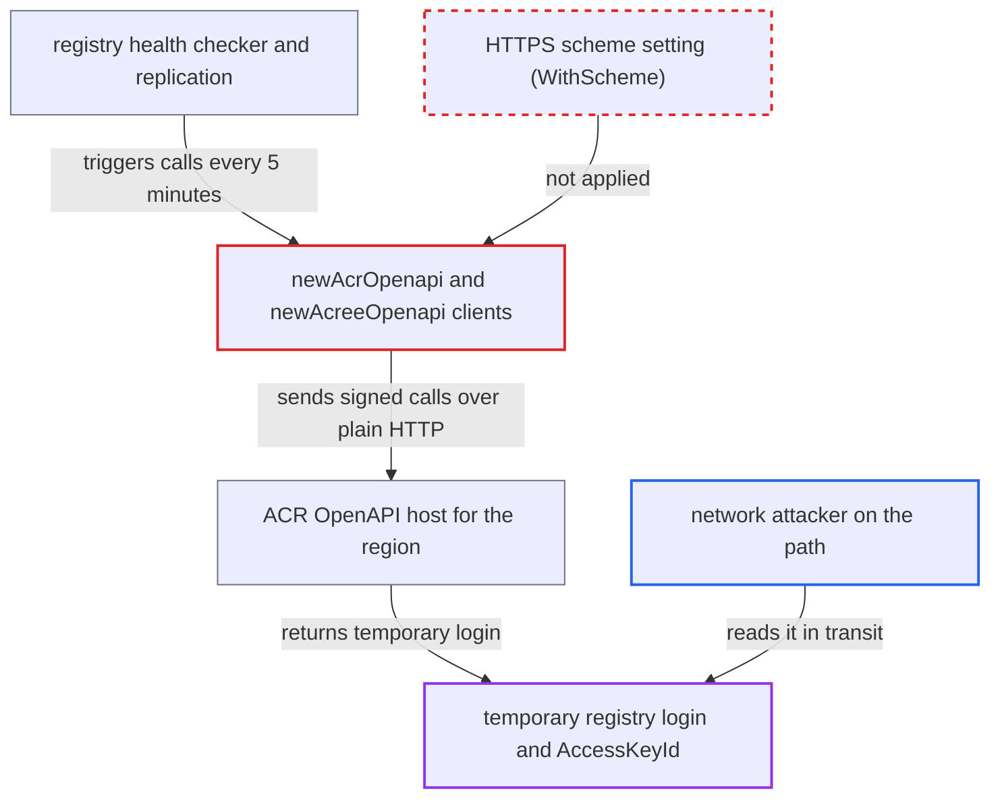

# Alibaba ACR adapter sends signed OpenAPI calls and receives temporary registry credentials over plaintext HTTP

| Field | Value |
|---|---|
| ID | `find_01WCHTVu3BePvjL7fxCdGbUw` |
| Severity | **High** |
| Status | open |
| CWE | CWE-319 — Cleartext transmission |
| Created | 2026-10-27T21:15:19.078310Z |
| Claude Security | https://claude.ai/security/findings/find_01WCHTVu3BePvjL7fxCdGbUw |

## Description

A network attacker between Harbor and Alibaba's `cr.<region>.aliyuncs.com` API can read the temporary Docker login that the ACR replication adapter fetches. An active attacker can also change the namespace, repository and tag listings. It needs an admin-configured ACR registry and an on-path position, and no Harbor account. The adapter clients never set HTTPS, so they probably use the SDK's plaintext HTTP default. That default is an assumption about the SDK, whose source is not in the checkout.

1. **the health checker in `controller.go`** creates a fresh adapter for each configured registry and pings it. This runs every 5 minutes with no user action. Replication in jobservice reaches the same code. ([`src/controller/registry/controller.go:256-290`](https://github.com/cx-benchmark/harbor/blob/d822d80c2e6edb2c85538d4b9cd73c0c375a5596/src/controller/registry/controller.go#L256-L290))
2. **the bearer authorizer** asks the ACR credential modifier for a token. Every ping or registry operation on an uncached adapter triggers a new `GetAuthorizationToken` call. ([`src/pkg/registry/auth/bearer/authorizer.go:101-125`](https://github.com/cx-benchmark/harbor/blob/d822d80c2e6edb2c85538d4b9cd73c0c375a5596/src/pkg/registry/auth/bearer/authorizer.go#L101-L125))
3. **the clients from `newAcrOpenapi` and `newAcreeOpenapi`** are built without a pinned scheme. The config comes from `sdk.NewConfig()` and never calls `WithScheme("HTTPS")`. The report assumes that in `github.com/aliyun/alibaba-cloud-sdk-go` `v1.63.107` the default is HTTP. ([`src/pkg/reg/adapter/aliacr/openapi.go:66-78`](https://github.com/cx-benchmark/harbor/blob/d822d80c2e6edb2c85538d4b9cd73c0c375a5596/src/pkg/reg/adapter/aliacr/openapi.go#L66-L78))
4. **`GetAuthorizationToken`** calls the API with only a bare host from `SetDomain`. `endpointTpl` is `cr.%s.aliyuncs.com` with no scheme, so the SDK builds an `http://` URL. The request carries the `AccessKeyId` and its HMAC signature in cleartext. ([`src/pkg/reg/adapter/aliacr/types.go:19-21`](https://github.com/cx-benchmark/harbor/blob/d822d80c2e6edb2c85538d4b9cd73c0c375a5596/src/pkg/reg/adapter/aliacr/types.go#L19-L21))
5. **the network attacker** reads the cleartext response, or intercepts the signed request and relays it over HTTPS. The response holds `TempUserName` and `AuthorizationToken` (`TempUsername` in the EE client). These are a live Docker login for the victim's ACR account or EE instance. ([`src/pkg/reg/adapter/aliacr/openapi.go:166-184`](https://github.com/cx-benchmark/harbor/blob/d822d80c2e6edb2c85538d4b9cd73c0c375a5596/src/pkg/reg/adapter/aliacr/openapi.go#L166-L184))
6. **`aliyunAuthCredential.Modify`** uses the same values as HTTP Basic credentials for the registry token service. This shows the exposed values are working registry credentials. ([`src/pkg/reg/adapter/aliacr/auth.go:51-69`](https://github.com/cx-benchmark/harbor/blob/d822d80c2e6edb2c85538d4b9cd73c0c375a5596/src/pkg/reg/adapter/aliacr/auth.go#L51-L69))

## Assessment

The attacker must sit on the network path between Harbor (core or jobservice) and `cr.<region>.aliyuncs.com`. An admin must have configured an Alibaba ACR registry. No Harbor account and no victim action are needed, because the core health checker triggers the call every 5 minutes and jobservice replication does the same. The attacker can passively read the cleartext `GetAuthorizationToken` response. Alternatively, the attacker can actively intercept the signed request and relay it over HTTPS. All of this relies on the report's assumption that the SDK defaults to HTTP. The `rateLimiterTransport` does not help, because certificate verification only applies to `https://` URLs and `limitTransport.RoundTrip` does not change the scheme.

Impact: The attacker learns the configured `AccessKeyId` and gets a live credential derived from Harbor's stored replication secret. The `AccessKeySecret` is used only for the HMAC and is not disclosed. An active attacker can rewrite namespace, repository and tag listings and so steer which artifacts Harbor replicates. Manifests and blobs still come from the TLS registry endpoint, so direct tampering is limited to that selection.

Subsequent-system impact: The temporary username and password are a Docker login to the victim's Alibaba ACR account or EE instance. They stay valid until they expire and are re-issued on every health check. Within the RAM permissions of the configured key, the attacker can pull private images and push or overwrite tags. Images pushed there can then be pull-replicated back into Harbor by the existing policy.

## Recommendation

The adapter builds the Alibaba SDK clients and requests without pinning the URL scheme. The SDK's plaintext HTTP default is therefore used for OpenAPI calls that carry signed AccessKey requests and return temporary registry credentials.

Fix criteria: Every OpenAPI request from `acrOpenapi` and `acreeOpenapi`, including `GetAuthorizationToken` and all list operations, goes to an `https://` URL with certificate verification. A test or debug hook shows that the URLs built for `cr.<region>.aliyuncs.com` begin with `https://`. A plaintext interceptor on port 80 sees no `AccessKeyId`, no signature and no `authorizationToken`.

## Evidence

**https://github.com/cx-benchmark/harbor**

- [`src/pkg/reg/adapter/aliacr/openapi.go:66-78`](https://github.com/cx-benchmark/harbor/blob/d822d80c2e6edb2c85538d4b9cd73c0c375a5596/src/pkg/reg/adapter/aliacr/openapi.go#L66-L78)
- [`src/pkg/reg/adapter/aliacr/openapi.go:195-210`](https://github.com/cx-benchmark/harbor/blob/d822d80c2e6edb2c85538d4b9cd73c0c375a5596/src/pkg/reg/adapter/aliacr/openapi.go#L195-L210)
- [`src/pkg/reg/adapter/aliacr/openapi.go:166-184`](https://github.com/cx-benchmark/harbor/blob/d822d80c2e6edb2c85538d4b9cd73c0c375a5596/src/pkg/reg/adapter/aliacr/openapi.go#L166-L184)
- [`src/pkg/reg/adapter/aliacr/openapi.go:312-330`](https://github.com/cx-benchmark/harbor/blob/d822d80c2e6edb2c85538d4b9cd73c0c375a5596/src/pkg/reg/adapter/aliacr/openapi.go#L312-L330)
- [`src/pkg/reg/adapter/aliacr/types.go:19-21`](https://github.com/cx-benchmark/harbor/blob/d822d80c2e6edb2c85538d4b9cd73c0c375a5596/src/pkg/reg/adapter/aliacr/types.go#L19-L21)
- [`src/pkg/reg/adapter/aliacr/auth.go:51-69`](https://github.com/cx-benchmark/harbor/blob/d822d80c2e6edb2c85538d4b9cd73c0c375a5596/src/pkg/reg/adapter/aliacr/auth.go#L51-L69)
- [`src/pkg/registry/auth/bearer/authorizer.go:101-125`](https://github.com/cx-benchmark/harbor/blob/d822d80c2e6edb2c85538d4b9cd73c0c375a5596/src/pkg/registry/auth/bearer/authorizer.go#L101-L125)
- [`src/controller/registry/controller.go:256-290`](https://github.com/cx-benchmark/harbor/blob/d822d80c2e6edb2c85538d4b9cd73c0c375a5596/src/controller/registry/controller.go#L256-L290)
- [`src/pkg/reg/adapter/aliacr/adapter.go:43-48`](https://github.com/cx-benchmark/harbor/blob/d822d80c2e6edb2c85538d4b9cd73c0c375a5596/src/pkg/reg/adapter/aliacr/adapter.go#L43-L48)

