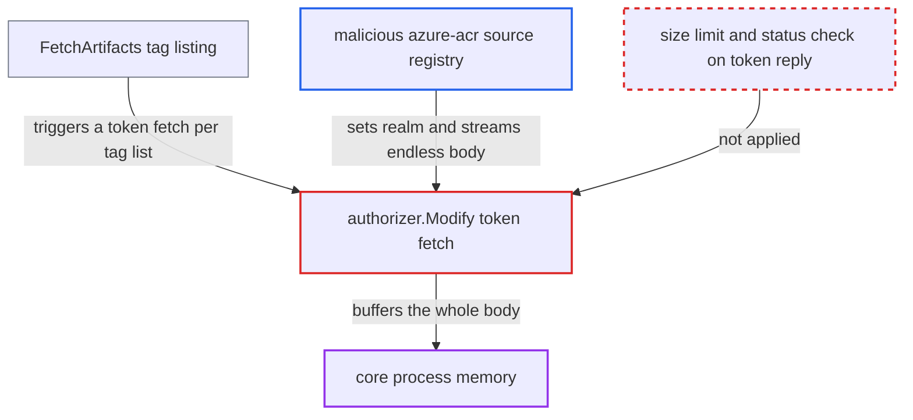

# Azure ACR adapter reads token-service response without size limit

| Field | Value |
|---|---|
| ID | `find_01AGfU8w8BXxG8mttfmsTTuV` |
| Severity | **High** |
| Status | open |
| CWE | CWE-770 — Uncontrolled resource consumption |
| Created | 2026-10-27T21:15:18.937391Z |
| Claude Security | https://claude.ai/security/findings/find_01AGfU8w8BXxG8mttfmsTTuV |

## Description

A malicious or compromised registry set up as an `azure-acr` replication source can crash Harbor's core process, which takes down the API, the UI and registry traffic for all users. It needs no Harbor privileges, only that an admin has configured that registry and the replication policy runs. The cause is `authorizer.Modify`, which reads the token reply with `io.ReadAll` and no size limit.

1. **Harbor core** starts a replication run that lists tags. `FetchArtifacts` calls `ListTags` for each repository, up to `adp.MaxConcurrency` (100) at a time, inside the core process. ([`src/pkg/reg/adapter/native/adapter.go:134-229`](https://github.com/cx-benchmark/harbor/blob/d822d80c2e6edb2c85538d4b9cd73c0c375a5596/src/pkg/reg/adapter/native/adapter.go#L134-L229))
2. **the client `do()`** calls `authorizer.Modify` on each request. Every tag-list request therefore triggers a separate token fetch. ([`src/pkg/registry/client.go:665-675`](https://github.com/cx-benchmark/harbor/blob/d822d80c2e6edb2c85538d4b9cd73c0c375a5596/src/pkg/registry/client.go#L665-L675))
3. **the function `buildTokenAPI`** takes the token URL from the remote's bearer challenge. The `realm` parameter of the `WWW-Authenticate` header on `GET <host>/v2/` is used as is, so the remote registry chooses which server answers the token request. ([`src/pkg/reg/adapter/azurecr/auth.go:118-160`](https://github.com/cx-benchmark/harbor/blob/d822d80c2e6edb2c85538d4b9cd73c0c375a5596/src/pkg/reg/adapter/azurecr/auth.go#L118-L160))
4. **the attacker's token server** answers the token request with a multi-gigabyte or never-ending chunked body. The only limit on the client is a timeout, `config.RegistryHTTPClientTimeout()`, which defaults to 30 minutes. That limits time, not bytes. ([`src/pkg/reg/adapter/azurecr/auth.go:55-72`](https://github.com/cx-benchmark/harbor/blob/d822d80c2e6edb2c85538d4b9cd73c0c375a5596/src/pkg/reg/adapter/azurecr/auth.go#L55-L72))
5. **the handler `authorizer.Modify`** buffers the whole reply with `io.ReadAll(resp.Body)`. The read has no `io.LimitReader`, no `Content-Length` check and no status-code check, and it happens before `json.Unmarshal`. ([`src/pkg/reg/adapter/azurecr/auth.go:96-110`](https://github.com/cx-benchmark/harbor/blob/d822d80c2e6edb2c85538d4b9cd73c0c375a5596/src/pkg/reg/adapter/azurecr/auth.go#L96-L110))
6. **Harbor core** runs out of memory and is killed by the OS. The replication flow runs in a goroutine inside core, so the heap growth lands on the core process itself. ([`src/controller/replication/execution.go:147-175`](https://github.com/cx-benchmark/harbor/blob/d822d80c2e6edb2c85538d4b9cd73c0c375a5596/src/controller/replication/execution.go#L147-L175))

## Assessment

The attacker runs, or has compromised, a registry that a Harbor admin configured as an `azure-acr` replication source. The attacker needs no Harbor privileges. No victim has to act once the policy exists. The policy can run manually or on its schedule. The attacker points the `realm` in the bearer challenge at a server they control and streams an endless or multi-GB body. Core buffers it for up to 30 minutes per request, across up to 100 concurrent requests.

Impact: Core's memory fills until the process is OOM-killed, which interrupts the REST API, the UI and `/v2/` registry traffic for every user. The attacker can repeat this on every scheduled run. No data is disclosed or changed.

## Recommendation

The token-service response body, from a server chosen by the remote registry through the `realm`, is read into memory in `authorizer.Modify` without a size bound or a status check.

Fix criteria: The token response read in `authorizer.Modify` is bounded to a small fixed size, since a token is well under 1 MiB. The operation fails when the bound is exceeded or when the status is not `200`. A test token server that returns an endless chunked body makes the tag-list request fail with an error quickly and with bounded memory, instead of the process growing until killed.

## Evidence

**https://github.com/cx-benchmark/harbor**

- [`src/pkg/reg/adapter/azurecr/auth.go:96-110`](https://github.com/cx-benchmark/harbor/blob/d822d80c2e6edb2c85538d4b9cd73c0c375a5596/src/pkg/reg/adapter/azurecr/auth.go#L96-L110)
- [`src/pkg/reg/adapter/azurecr/auth.go:118-160`](https://github.com/cx-benchmark/harbor/blob/d822d80c2e6edb2c85538d4b9cd73c0c375a5596/src/pkg/reg/adapter/azurecr/auth.go#L118-L160)
- [`src/pkg/reg/adapter/azurecr/auth.go:55-72`](https://github.com/cx-benchmark/harbor/blob/d822d80c2e6edb2c85538d4b9cd73c0c375a5596/src/pkg/reg/adapter/azurecr/auth.go#L55-L72)
- [`src/pkg/registry/client.go:665-675`](https://github.com/cx-benchmark/harbor/blob/d822d80c2e6edb2c85538d4b9cd73c0c375a5596/src/pkg/registry/client.go#L665-L675)
- [`src/pkg/reg/adapter/native/adapter.go:134-229`](https://github.com/cx-benchmark/harbor/blob/d822d80c2e6edb2c85538d4b9cd73c0c375a5596/src/pkg/reg/adapter/native/adapter.go#L134-L229)
- [`src/controller/replication/execution.go:147-175`](https://github.com/cx-benchmark/harbor/blob/d822d80c2e6edb2c85538d4b9cd73c0c375a5596/src/controller/replication/execution.go#L147-L175)
- [`src/pkg/scan/job.go:60-63`](https://github.com/cx-benchmark/harbor/blob/d822d80c2e6edb2c85538d4b9cd73c0c375a5596/src/pkg/scan/job.go#L60-L63)

