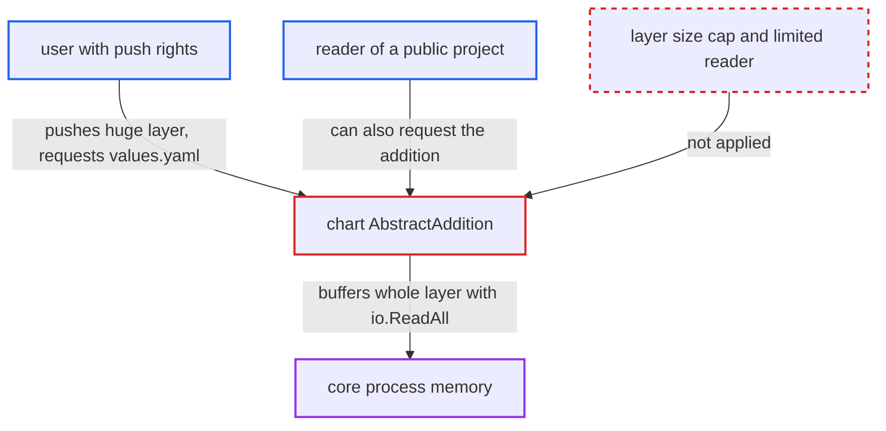

# Chart addition endpoint reads entire attacker-sized chart layer into memory

| Field | Value |
|---|---|
| ID | `find_0125LGyuRbThrfAzVLKssRE6` |
| Severity | **High** |
| Status | open |
| CWE | CWE-770 — Resource exhaustion |
| Created | 2026-10-27T21:10:25.364696Z |
| Claude Security | https://claude.ai/security/findings/find_0125LGyuRbThrfAzVLKssRE6 |

## Description

A user who can push to any project can crash Harbor's core service and take down the API, portal and registry proxying for all users until restart. The attacker pushes a fake chart with a multi-gigabyte layer, then requests its `values.yaml` addition, alone or in parallel. The cause is `AbstractAddition`, which reads the whole layer with `io.ReadAll(blob)` and has no size limit.

1. **attacker with push rights** pushes a manifest with the Helm config media type and one very large layer. The artifact is routed to the chart processor only by its config media type `application/vnd.cncf.helm.config.v1+json`, so the layer can hold any bytes. ([`src/controller/artifact/manifest/v2.go:48`](https://github.com/cx-benchmark/harbor/blob/d822d80c2e6edb2c85538d4b9cd73c0c375a5596/src/controller/artifact/manifest/v2.go#L48))
2. **Harbor storage** accepts and stores the oversized layer. By default `storage_per_project` is `-1` (unlimited) and nginx ships `client_max_body_size 0`, so nothing limits the layer size. ([`src/lib/config/metadata/metadatalist.go:164`](https://github.com/cx-benchmark/harbor/blob/d822d80c2e6edb2c85538d4b9cd73c0c375a5596/src/lib/config/metadata/metadatalist.go#L164))
3. **attacker or any reader** requests `GET /api/v2.0/projects/
/repositories/<r>/artifacts/<digest>/additions/values.yaml`. The endpoint needs only read access to artifact-addition, which guests have and anonymous users have on public projects. ([`src/server/v2.0/handler/artifact.go:445-462`](https://github.com/cx-benchmark/harbor/blob/d822d80c2e6edb2c85538d4b9cd73c0c375a5596/src/server/v2.0/handler/artifact.go#L445-L462))
4. **the handler `GetAddition`** loads the artifact and calls the chart processor's `AbstractAddition` on every request. The parsed result is not cached, so each request repeats the full work. ([`src/controller/artifact/controller.go:629-635`](https://github.com/cx-benchmark/harbor/blob/d822d80c2e6edb2c85538d4b9cd73c0c375a5596/src/controller/artifact/controller.go#L629-L635))
5. **the function `AbstractAddition`** pulls the first non-config layer and reads it fully into memory with `io.ReadAll(blob)`. It checks neither the manifest-declared `layer.Size` nor the number of bytes read, so core's heap grows by the full layer size. ([`src/controller/artifact/processor/chart/chart.go:80-96`](https://github.com/cx-benchmark/harbor/blob/d822d80c2e6edb2c85538d4b9cd73c0c375a5596/src/controller/artifact/processor/chart/chart.go#L80-L96))
6. **the function `GetData`** passes the fully buffered bytes to helm's `loader.LoadArchive`. Any decompressed-size limit inside helm applies only after the compressed layer is already in memory. ([`src/pkg/chart/operator.go:116-128`](https://github.com/cx-benchmark/harbor/blob/d822d80c2e6edb2c85538d4b9cd73c0c375a5596/src/pkg/chart/operator.go#L116-L128))
7. **attacker** repeats the request several times in parallel. Each request allocates its own copy, so memory use multiplies until core is OOM-killed; the attack can be repeated after a restart.

## Assessment

The attacker needs a low-privileged account or robot with push rights to any project. The report names no other setting, because Harbor's defaults allow blobs of any size. After the push, the attacker can request the addition themselves. Any reader of a public project can also trigger it, since anonymous users have read access to additions there. Parallel requests make it worse.

Impact: Core's memory grows by at least the full layer size on each request. With a multi-gigabyte layer or several concurrent requests, the core process is OOM-killed. That takes down the API, portal and registry proxying for all users until restart, and the attack can be repeated. The report finds no confidentiality or integrity impact.

## Recommendation

`chart.AbstractAddition` reads an attacker-sized registry blob with `io.ReadAll` before parsing. It checks neither the manifest-declared `layer.Size` nor the bytes actually read.

Fix criteria: The addition is rejected when the manifest-declared `layer.Size` exceeds a fixed cap. The blob is read through a limited reader that fails with HTTP 413 once more than the cap has been read, before any parsing. Requesting `values.yaml` for a chart whose tarball layer is larger than the cap returns an error promptly, and core memory growth stays bounded by the cap. Legitimate charts under the cap still render.

## Evidence

**https://github.com/cx-benchmark/harbor**

- [`src/controller/artifact/processor/chart/chart.go:80-96`](https://github.com/cx-benchmark/harbor/blob/d822d80c2e6edb2c85538d4b9cd73c0c375a5596/src/controller/artifact/processor/chart/chart.go#L80-L96)
- [`src/controller/artifact/controller.go:629-635`](https://github.com/cx-benchmark/harbor/blob/d822d80c2e6edb2c85538d4b9cd73c0c375a5596/src/controller/artifact/controller.go#L629-L635)
- [`src/controller/artifact/manifest/v2.go:48`](https://github.com/cx-benchmark/harbor/blob/d822d80c2e6edb2c85538d4b9cd73c0c375a5596/src/controller/artifact/manifest/v2.go#L48)
- [`src/server/v2.0/handler/artifact.go:445-462`](https://github.com/cx-benchmark/harbor/blob/d822d80c2e6edb2c85538d4b9cd73c0c375a5596/src/server/v2.0/handler/artifact.go#L445-L462)
- [`src/pkg/chart/operator.go:116-128`](https://github.com/cx-benchmark/harbor/blob/d822d80c2e6edb2c85538d4b9cd73c0c375a5596/src/pkg/chart/operator.go#L116-L128)
- [`src/lib/config/metadata/metadatalist.go:164`](https://github.com/cx-benchmark/harbor/blob/d822d80c2e6edb2c85538d4b9cd73c0c375a5596/src/lib/config/metadata/metadatalist.go#L164)
- [`src/controller/artifact/processor/cnai/parser/base.go:66-94`](https://github.com/cx-benchmark/harbor/blob/d822d80c2e6edb2c85538d4b9cd73c0c375a5596/src/controller/artifact/processor/cnai/parser/base.go#L66-L94)

