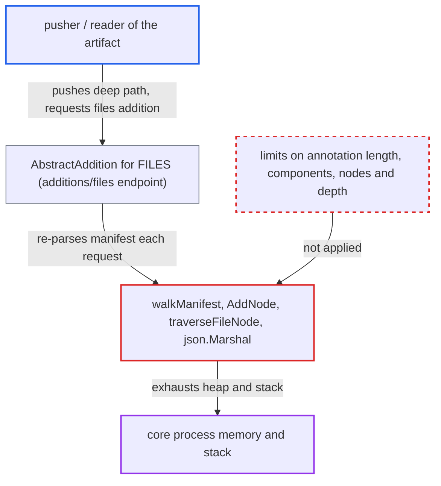

# CNAI files addition builds unbounded-depth tree from layer path annotation, recursing without limit

| Field | Value |
|---|---|
| ID | `find_01Cb1nNv1Q5Jqrv65TK6zh4n` |
| Severity | **High** |
| Status | open |
| CWE | CWE-674 — Uncontrolled recursion |
| Created | 2026-10-27T21:17:45.863209Z |
| Claude Security | https://claude.ai/security/findings/find_01Cb1nNv1Q5Jqrv65TK6zh4n |

## Description

A user with push rights can crash or exhaust the core process, which takes the API, portal and registry proxy down for all users. The attacker pushes one model manifest whose layer path annotation is about 4MB of `a/` repeated. Anyone who can read the artifact, including anonymous readers of a public project, then requests its `files` addition. The files parser in `files.go` and `AddNode` in `util.go` put no limit on path length, depth or output size.

1. **attacker with push rights** pushes a manifest with a huge path annotation. The manifest has `artifactType` set to `application/vnd.cnai.model.manifest.v1+json` and one layer whose `org.cnai.model.filepath` annotation is about 4MB of `a/` repeated, roughly 2 million components. The registry's 4MB manifest body limit is the only cap.
2. **attacker or any reader of the artifact** requests `GET .../artifacts/{ref}/additions/files`. `AbstractAddition` for `FILES` handles this for any artifact of the CNAI type and re-parses the manifest on every request, with no caching. ([`src/controller/artifact/processor/cnai/cnai.go:58-95`](https://github.com/cx-benchmark/harbor/blob/d822d80c2e6edb2c85538d4b9cd73c0c375a5596/src/controller/artifact/processor/cnai/cnai.go#L58-L95))
3. **`walkManifest`** passes each layer's annotation unchanged to `root.AddNode`. No check is made on the length of the path or the number of `/`-separated components. ([`src/controller/artifact/processor/cnai/parser/files.go:71-86`](https://github.com/cx-benchmark/harbor/blob/d822d80c2e6edb2c85538d4b9cd73c0c375a5596/src/controller/artifact/processor/cnai/parser/files.go#L71-L86))
4. **`AddNode`** allocates a `FileNode` for every path component. Each node has its own map and `sync.RWMutex` and takes roughly 300 bytes, so heap use grows with the attacker's component count, to about 600MB or more for 2 million levels. ([`src/controller/artifact/processor/cnai/parser/util.go:147-196`](https://github.com/cx-benchmark/harbor/blob/d822d80c2e6edb2c85538d4b9cd73c0c375a5596/src/controller/artifact/processor/cnai/parser/util.go#L147-L196))
5. **`traverseFileNode`** recurses once per directory level and builds a `FileList` for each node. There is no depth guard, so the recursion goes about 2 million levels deep. ([`src/controller/artifact/processor/cnai/parser/files.go:88-115`](https://github.com/cx-benchmark/harbor/blob/d822d80c2e6edb2c85538d4b9cd73c0c375a5596/src/controller/artifact/processor/cnai/parser/files.go#L88-L115))
6. **`json.Marshal`** encodes the nested `[]FileList` by recursing per nesting level. It uses about three stack frames per level and records every slice in its cycle-detection map once nesting passes 1000. This adds hundreds of MB of goroutine stack and a response of about 100MB. ([`src/controller/artifact/processor/cnai/parser/files.go:88-115`](https://github.com/cx-benchmark/harbor/blob/d822d80c2e6edb2c85538d4b9cd73c0c375a5596/src/controller/artifact/processor/cnai/parser/files.go#L88-L115))

## Assessment

The attacker needs push rights, such as a low-privileged user or robot account. They push a manifest with `artifactType` `application/vnd.cnai.model.manifest.v1+json` and one layer annotated `org.cnai.model.filepath` with about 4MB of `a/` repeated. The attacker, or any reader of a public project (anonymously), then requests `GET /api/v2.0/projects/
/repositories/<r>/artifacts/<digest>/additions/files`. The request can be repeated at will. The README and LICENSE parsers in the same package already cap sizes at 4MB, but the files parser has no such protection.

Impact: One request makes the core process use gigabytes of transient memory. It may also hit Go's 1GB per-goroutine stack cap, a fatal `stack overflow` that kills the whole core process. One or a handful of requests can exhaust a normally sized core container, and this is repeatable. The report describes no disclosure or modification of data.

## Recommendation

The files parser accepts pusher-controlled `org.cnai.model.filepath` annotations of any length and depth. It processes them with unbounded allocation and recursion in `AddNode`, `traverseFileNode` and `json.Marshal`.

Fix criteria: Fixed limits apply to the annotation length, the number of path components per layer, the total node count and the tree depth. When a limit is exceeded, the addition is rejected with a 4xx. Alternatively, the listing is built iteratively and the response size is bounded. A manifest with a multi-MB, million-component path annotation makes `GET .../additions/files` fail fast with bounded memory. Normal model manifests still list correctly.

## Evidence

**https://github.com/cx-benchmark/harbor**

- [`src/controller/artifact/processor/cnai/parser/files.go:71-86`](https://github.com/cx-benchmark/harbor/blob/d822d80c2e6edb2c85538d4b9cd73c0c375a5596/src/controller/artifact/processor/cnai/parser/files.go#L71-L86)
- [`src/controller/artifact/processor/cnai/parser/files.go:88-115`](https://github.com/cx-benchmark/harbor/blob/d822d80c2e6edb2c85538d4b9cd73c0c375a5596/src/controller/artifact/processor/cnai/parser/files.go#L88-L115)
- [`src/controller/artifact/processor/cnai/parser/util.go:147-196`](https://github.com/cx-benchmark/harbor/blob/d822d80c2e6edb2c85538d4b9cd73c0c375a5596/src/controller/artifact/processor/cnai/parser/util.go#L147-L196)
- [`src/controller/artifact/processor/cnai/cnai.go:58-95`](https://github.com/cx-benchmark/harbor/blob/d822d80c2e6edb2c85538d4b9cd73c0c375a5596/src/controller/artifact/processor/cnai/cnai.go#L58-L95)
- [`src/controller/artifact/processor/cnai/parser/base.go:66-94`](https://github.com/cx-benchmark/harbor/blob/d822d80c2e6edb2c85538d4b9cd73c0c375a5596/src/controller/artifact/processor/cnai/parser/base.go#L66-L94)

