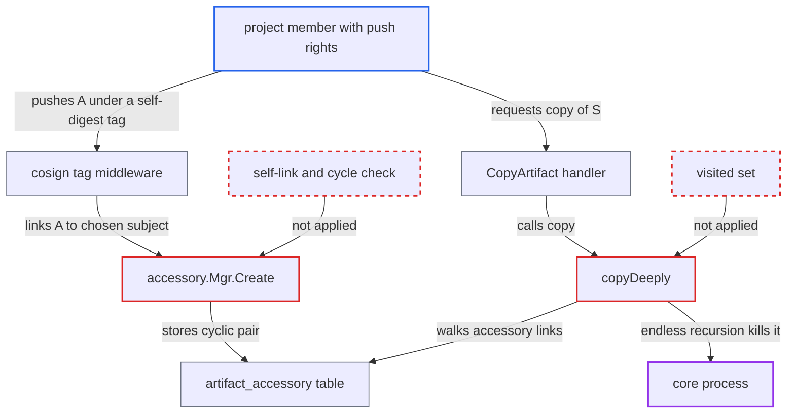

# Cyclic cosign accessory links cause unbounded recursion in artifact copy and undeletable artifacts

| Field | Value |
|---|---|
| ID | `find_01MmvHcxxvX5xm15xhUv2HR7` |
| Severity | **High** |
| Status | open |
| CWE | CWE-674 — Uncontrolled recursion |
| Created | 2026-10-27T21:19:02.852351Z |
| Claude Security | https://claude.ai/security/findings/find_01MmvHcxxvX5xm15xhUv2HR7 |

## Description

A project member who can push images (a Developer, or a robot with `repository:push`) can crash the Harbor `core` process with one copy request. They can also plant artifacts that cannot be deleted through the API. The cause is that `copyDeeply` and `deleteDeeply` walk the accessory graph with no visited set, and the accessory creation code accepts self-referencing or cyclic links.

1. **pusher** pushes manifest `A` with a cosign simplesigning layer under the tag `sha256-<digest(A)>.sig`. `putManifest` saves the artifact and its tag before the cosign middleware runs, so a lookup of `A` by its own digest succeeds. ([`src/server/registry/manifest.go:220-233`](https://github.com/cx-benchmark/harbor/blob/d822d80c2e6edb2c85538d4b9cd73c0c375a5596/src/server/registry/manifest.go#L220-L233))
2. **cosign middleware** takes the subject digest from the pushed tag name and finds that artifact in the same repository. The digest in the tag is chosen by the pusher, so the subject can be the pushed manifest itself or any earlier manifest. ([`src/server/middleware/cosign/cosign.go:146-176`](https://github.com/cx-benchmark/harbor/blob/d822d80c2e6edb2c85538d4b9cd73c0c375a5596/src/server/middleware/cosign/cosign.go#L146-L176))
3. **`accessory.Mgr.Create`** stores the pair `(A, A)` in `artifact_accessory`. Nothing in the manager or DAO rejects a self-reference or a pair that closes a cycle. The only unique constraint is on the pair. ([`src/pkg/accessory/manager.go:145-157`](https://github.com/cx-benchmark/harbor/blob/d822d80c2e6edb2c85538d4b9cd73c0c375a5596/src/pkg/accessory/manager.go#L145-L157))
4. **pusher** pushes an ordinary artifact `S`, then pushes `A` again under `sha256-<digest(S)>.sig`. This attaches the cycle to `S`. A 2-cycle also works: push `A` tagged `sha256-<digest(B)>.sig` and `B` tagged `sha256-<digest(A)>.sig`. ([`src/server/middleware/cosign/cosign.go:146-176`](https://github.com/cx-benchmark/harbor/blob/d822d80c2e6edb2c85538d4b9cd73c0c375a5596/src/server/middleware/cosign/cosign.go#L146-L176))
5. **caller** sends `POST /api/v2.0/projects/{p}/repositories/{r}/artifacts?from=p/repo:S-tag`. `CopyArtifact` only refuses to copy an artifact that is itself a hard accessory. It does not look at `S`'s accessory graph, so it calls `artCtl.Copy` on `S`. ([`src/server/v2.0/handler/artifact.go:188-215`](https://github.com/cx-benchmark/harbor/blob/d822d80c2e6edb2c85538d4b9cd73c0c375a5596/src/server/v2.0/handler/artifact.go#L188-L215))
6. **`copyDeeply`** recurses through the accessories forever: `S`, then `A`, then `A` again (or `A`, `B`, `A`). For each accessory it lists accessories whose subject is that accessory and recurses with `isRoot=true` before writing anything to the destination. `GetByReference(dstRepo, digest)` therefore never short-circuits, and only a `UTTEST` environment check stops it. ([`src/controller/artifact/controller.go:551-575`](https://github.com/cx-benchmark/harbor/blob/d822d80c2e6edb2c85538d4b9cd73c0c375a5596/src/controller/artifact/controller.go#L551-L575))
7. **`core` process** runs out of stack or memory and dies with a fatal error. Each level runs several DB queries and keeps heap. The ORM calls ignore request cancellation, so the recursion goes on even if the client disconnects.
8. **`deleteDeeply`** fails on any later delete of `S`, `A` or their repository. The inner recursion deletes `A` and its tags. The outer frame then calls `tagCtl.DeleteTags` on rows that are already gone, gets not-found, and the transaction rolls back. ([`src/controller/artifact/controller.go:389-468`](https://github.com/cx-benchmark/harbor/blob/d822d80c2e6edb2c85538d4b9cd73c0c375a5596/src/controller/artifact/controller.go#L389-L468))

## Assessment

The attacker is a project member with push rights (Developer) or a robot with `repository:push`. They plant the cycle by pushing manifests under crafted `sha256-<digest>.sig` tags. The copy request can come from the attacker or from anyone with read on the source project and create on some project. Deleting `S`, `A` or the repository fails for every role. The same broken delete also stops repository deletion through `src/controller/repository/controller.go` `Delete`, retention, and GC untagged cleanup.

Impact: One copy request crashes the `core` process and denies service to all users until restart, and the attacker can repeat it at will. The planted artifacts cannot be deleted through the API, and repository deletion, retention and GC untagged cleanup for them abort. This lasts until the database is repaired by hand. The report says no data is disclosed.

## Recommendation

(1) `copyDeeply` and `deleteDeeply` walk the accessory graph recursively with no visited set or depth bound. A cyclic graph in the database therefore causes endless recursion in copy and double processing in delete.

Fix criteria: Traversal of accessories and references ends on any graph shape. Each operation tracks visited artifact ids, as `Walk` does, and skips nodes it has already seen. Copying or deleting an artifact whose accessory graph has a self-loop or cycle finishes in a bounded number of steps, and the stack does not grow without limit. Verify by creating the cyclic rows and confirming that copy and delete both finish.

(2) Accessory creation accepts self-referencing and cycle-closing `(artifact_id, subject_artifact_id)` pairs. The cosign tag convention lets the pusher pick any subject digest, including the pushed manifest's own digest.

Fix criteria: An accessory can never be its own subject, and creating a link can never close a cycle. `accessory.Mgr.Create` or `Ensure` (or the cosign or subject middlewares) rejects such links, so the stored graph is always acyclic. Verify that pushing `A` under `sha256-<digest(A)>.sig` does not create an accessory row.

## Evidence

**https://github.com/cx-benchmark/harbor**

- [`src/controller/artifact/controller.go:551-575`](https://github.com/cx-benchmark/harbor/blob/d822d80c2e6edb2c85538d4b9cd73c0c375a5596/src/controller/artifact/controller.go#L551-L575)
- [`src/pkg/accessory/manager.go:145-157`](https://github.com/cx-benchmark/harbor/blob/d822d80c2e6edb2c85538d4b9cd73c0c375a5596/src/pkg/accessory/manager.go#L145-L157)
- [`src/server/middleware/cosign/cosign.go:146-176`](https://github.com/cx-benchmark/harbor/blob/d822d80c2e6edb2c85538d4b9cd73c0c375a5596/src/server/middleware/cosign/cosign.go#L146-L176)
- [`src/controller/artifact/controller.go:389-468`](https://github.com/cx-benchmark/harbor/blob/d822d80c2e6edb2c85538d4b9cd73c0c375a5596/src/controller/artifact/controller.go#L389-L468)
- [`src/server/v2.0/handler/artifact.go:188-215`](https://github.com/cx-benchmark/harbor/blob/d822d80c2e6edb2c85538d4b9cd73c0c375a5596/src/server/v2.0/handler/artifact.go#L188-L215)
- [`src/server/registry/manifest.go:220-233`](https://github.com/cx-benchmark/harbor/blob/d822d80c2e6edb2c85538d4b9cd73c0c375a5596/src/server/registry/manifest.go#L220-L233)

