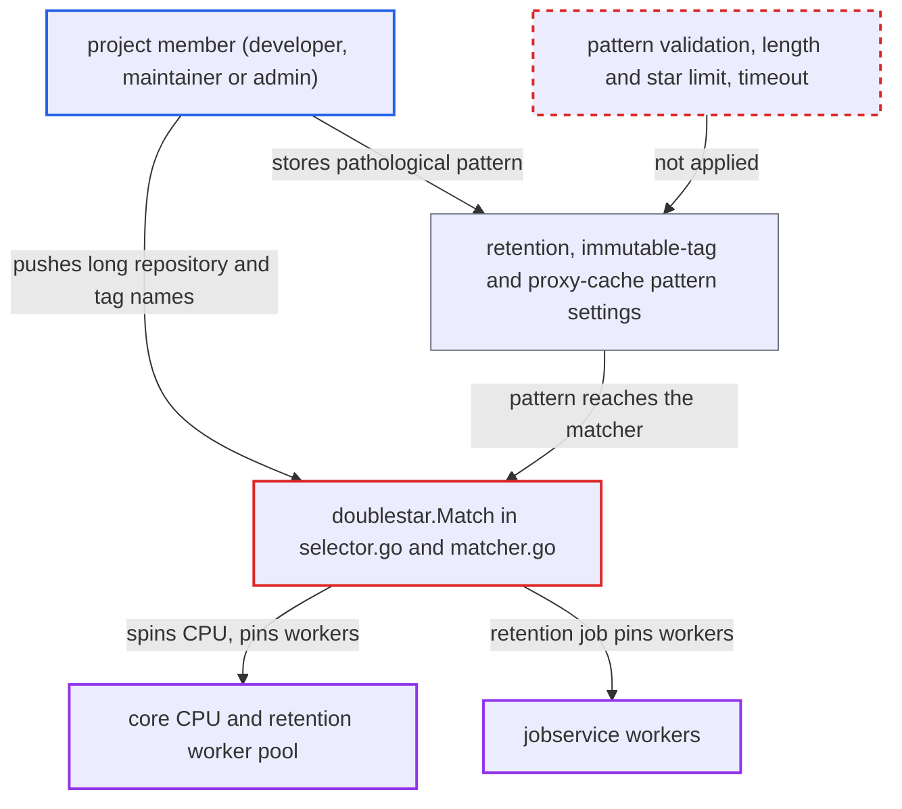

# Exponential doublestar glob matching lets rule authors hang core and jobservice

| Field | Value |
|---|---|
| ID | `find_018x34AieRa8hSZr399H85qv` |
| Severity | **High** |
| Status | open |
| CWE | CWE-407 — Inefficient Algorithmic Complexity |
| Created | 2026-10-27T21:18:25.937385Z |
| Claude Security | https://claude.ai/security/findings/find_018x34AieRa8hSZr399H85qv |

## Description

A developer-role member of one project can freeze Harbor's core retention workers and jobservice. A project admin or maintainer can also drive core CPU to saturation, which denies service to all tenants. The attacker needs to store a glob pattern through the retention API, the immutable-tag API or `proxy_cache_filter_pattern`, and to push long repository or tag names. The cause is `doublestar.Match` in `src/lib/selector/selectors/doublestar/selector.go`, which takes exponential time on patterns with many `*` and has no pattern limit or timeout.

1. **developer-role user** pushes repositories with names of about 200 `a` characters. Repository names can be up to 255 characters and tag names up to 128, and the attacker controls both, so the matcher's subject strings are chosen by the attacker.
2. **developer-role user** creates a retention policy through `POST /api/v2.0/retentions` with a pathological repository selector pattern. The pattern is `*a*a*a*a*a*a*a*a*a*a*a*a*a*a*a*a*a*a*a*a*b`, which ends in a `b` that no name contains. Nothing validates the selector: no limit on length or number of `*`, and `policy.Metadata.Valid` is dead code. ([`src/lib/selector/selectors/doublestar/selector.go:164-169`](https://github.com/cx-benchmark/harbor/blob/d822d80c2e6edb2c85538d4b9cd73c0c375a5596/src/lib/selector/selectors/doublestar/selector.go#L164-L169))
3. **developer-role user** calls `POST /retentions/{id}/executions` ten times. Each call starts `launcher.Launch` in a goroutine that takes one of the 10 pooled workers created by `lib.NewWorkerPool(10)`, with no deadline. ([`src/controller/retention/controller.go:261-290`](https://github.com/cx-benchmark/harbor/blob/d822d80c2e6edb2c85538d4b9cd73c0c375a5596/src/controller/retention/controller.go#L261-L290))
4. **the retention launcher** applies the selector to every repository name of the project. Both the pattern and the names come from the attacker. ([`src/pkg/retention/launcher.go:158-168`](https://github.com/cx-benchmark/harbor/blob/d822d80c2e6edb2c85538d4b9cd73c0c375a5596/src/pkg/retention/launcher.go#L158-L168))
5. **`doublestar.Match`** retries the rest of the pattern at every later position of the name for each `*`. With about 20 stars and a name of 128 to 255 characters this takes roughly C(n,k) steps, which is on the order of 10^20 or more, so the call effectively never returns and one CPU core stays busy. ([`src/lib/selector/selectors/doublestar/selector.go:164-169`](https://github.com/cx-benchmark/harbor/blob/d822d80c2e6edb2c85538d4b9cd73c0c375a5596/src/lib/selector/selectors/doublestar/selector.go#L164-L169))
6. **core worker pool** has all 10 workers stuck and no core available. Retention stops for every project on the instance until core is restarted. ([`src/controller/retention/controller.go:261-290`](https://github.com/cx-benchmark/harbor/blob/d822d80c2e6edb2c85538d4b9cd73c0c375a5596/src/controller/retention/controller.go#L261-L290))

## Assessment

The lowest-privilege route needs a developer-role user in any project. The user pushes repositories with long names, stores the pathological selector through `POST /api/v2.0/retentions`, and triggers `POST /retentions/{id}/executions` ten times. A project admin or maintainer has a second route. They store the pattern as an immutable-tag selector (`POST/PUT /api/v2.0/projects/{p}/immutabletagrules`, also unvalidated) and concurrently push tags of 128 `a` characters. Each manifest push, tag deletion and artifact listing with immutable status then runs the matcher synchronously in a core handler goroutine. There are two more entry points. The retention job in jobservice applies tag selectors to every artifact's tags with the same matcher and no timeout. The project metadata `proxy_cache_filter_pattern` is matched against the repository name on every proxied pull (`ValidateRepositoryFilter` only matches the empty string, so the pattern passes validation). No victim action and no non-default configuration are needed.

Impact: The attacker can saturate core CPU and permanently occupy the 10-worker retention pool, so retention stops for every project until core restarts. Jobservice workers can also be pinned, which stalls replication, scanning, GC and webhooks instance-wide. The attack itself discloses and modifies no data.

## Recommendation

User-written glob patterns are matched with the backtracking matcher from `doublestar` v1.3.4, whose cost grows exponentially with the number of wildcards. Patterns are not validated and matching has no time bound, in request-handling and job paths. A `Match` error is also treated as 'not immutable', so a malformed pattern silently disables immutability (fail-open).

Fix criteria: Matching of selector and filter patterns costs linear or low-polynomial time in pattern and subject length, for example with `doublestar` v4 or a translation to RE2 `regexp`. Patterns are validated when a rule is created, with limits on length and wildcard count, and malformed patterns are refused with a 400 by the retention and immutable-rule APIs instead of silently disabling immutability. Check: a selector pattern of 20 or more stars against a 255-character non-matching repository or tag name completes in milliseconds in the launcher, the immutable matcher and the retention job.

## Evidence

**https://github.com/cx-benchmark/harbor**

- [`src/lib/selector/selectors/doublestar/selector.go:164-169`](https://github.com/cx-benchmark/harbor/blob/d822d80c2e6edb2c85538d4b9cd73c0c375a5596/src/lib/selector/selectors/doublestar/selector.go#L164-L169)
- [`src/pkg/retention/launcher.go:158-168`](https://github.com/cx-benchmark/harbor/blob/d822d80c2e6edb2c85538d4b9cd73c0c375a5596/src/pkg/retention/launcher.go#L158-L168)
- [`src/controller/retention/controller.go:261-290`](https://github.com/cx-benchmark/harbor/blob/d822d80c2e6edb2c85538d4b9cd73c0c375a5596/src/controller/retention/controller.go#L261-L290)
- [`src/pkg/immutable/match/rule/match.go:102-124`](https://github.com/cx-benchmark/harbor/blob/d822d80c2e6edb2c85538d4b9cd73c0c375a5596/src/pkg/immutable/match/rule/match.go#L102-L124)
- [`src/pkg/retention/policy/alg/or/processor.go:128-146`](https://github.com/cx-benchmark/harbor/blob/d822d80c2e6edb2c85538d4b9cd73c0c375a5596/src/pkg/retention/policy/alg/or/processor.go#L128-L146)
- [`src/lib/pattern/matcher.go:72-75`](https://github.com/cx-benchmark/harbor/blob/d822d80c2e6edb2c85538d4b9cd73c0c375a5596/src/lib/pattern/matcher.go#L72-L75)

