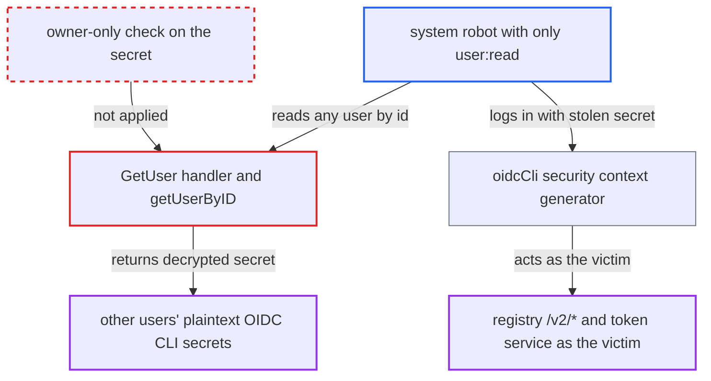

# GET /users/{id} returns other users' plaintext OIDC CLI secrets to user:read robots

| Field | Value |
|---|---|
| ID | `find_01QaEGeS2EefPTS6F6Psh3yJ` |
| Severity | **High** |
| Status | open |
| CWE | CWE-522 — Insufficiently protected credentials |
| Created | 2026-10-27T21:17:04.950678Z |
| Claude Security | https://claude.ai/security/findings/find_01QaEGeS2EefPTS6F6Psh3yJ |

## Description

A system robot account that holds only `user:read` can read other users' plaintext OIDC CLI secrets. It can then log in as any OIDC user, including members of the OIDC admin group. This applies only when Harbor uses OIDC authentication. `GetUser` returns the decrypted secret in `oidc_user_meta.secret` to anyone who passes `requireReadable`.

1. **attacker with a system robot** calls `GET /api/v2.0/users/{id}` for ids 2 and up. The robot was granted only `user:read`, and `requireReadable` accepts any caller holding system `user:read`. ([`src/server/v2.0/handler/user.go:394-399`](https://github.com/cx-benchmark/harbor/blob/d822d80c2e6edb2c85538d4b9cd73c0c375a5596/src/server/v2.0/handler/user.go#L394-L399))
2. **the handler `GetUser`** asks for OIDC info through `getUserByID`. Under OIDC auth, `getUserByID` sets `WithOIDCInfo` for every target id above 1, whoever the caller is. ([`src/server/v2.0/handler/user.go:211-242`](https://github.com/cx-benchmark/harbor/blob/d822d80c2e6edb2c85538d4b9cd73c0c375a5596/src/server/v2.0/handler/user.go#L211-L242))
3. **`controller.Get`** loads the target's OIDC metadata with `oidcMetaMgr.GetByUserID`. `GetByUserID` decrypts the stored CLI secret and puts the plaintext in `PlainSecret`. ([`src/pkg/oidc/metamanager.go:74-98`](https://github.com/cx-benchmark/harbor/blob/d822d80c2e6edb2c85538d4b9cd73c0c375a5596/src/pkg/oidc/metamanager.go#L74-L98))
4. **`ToUserResp`** copies the plaintext into the response. The secret is returned to the robot as `oidc_user_meta.secret`. ([`src/server/v2.0/handler/model/user.go:58-68`](https://github.com/cx-benchmark/harbor/blob/d822d80c2e6edb2c85538d4b9cd73c0c375a5596/src/server/v2.0/handler/model/user.go#L58-L68))
5. **attacker** sends the victim's username and stolen secret as Basic auth to `/v2/*`, for example with `docker login`. The `oidcCli` generator accepts the pair for `/v2/*`, `/service/token` and selected API routes, and builds a local security context for the victim. ([`src/server/middleware/security/oidc_cli.go:48-80`](https://github.com/cx-benchmark/harbor/blob/d822d80c2e6edb2c85538d4b9cd73c0c375a5596/src/server/middleware/security/oidc_cli.go#L48-L80))
6. **Harbor** treats the request as the victim, with sysadmin rights if the victim is in the OIDC admin group. `AdminRoleInAuth`, taken from the IdP admin-group claim, makes `IsSysAdmin` return true. ([`src/common/security/local/context.go:77-82`](https://github.com/cx-benchmark/harbor/blob/d822d80c2e6edb2c85538d4b9cd73c0c375a5596/src/common/security/local/context.go#L77-L82))

## Assessment

The attacker holds a system-level robot account that was granted only `user:read`. Harbor must be configured for OIDC authentication. The robot permission catalog lets a system robot be granted `user:read` on its own, and robot creation and update accept it. No user interaction is needed. The attacker calls the user endpoint for ids 2 to N and collects each secret. The attacker then uses `docker login` or `/v2/*` with `victim:secret`.

Impact: The attacker obtains the long-lived CLI secret of every OIDC user and can impersonate any of them, including OIDC admin-group members, who get sysadmin rights. With an admin identity the attacker can pull every private artifact, push or delete artifacts in any project, and delete repositories. The CLI secret context is limited to `/v2/*`, the token service and a few API routes.

## Recommendation

`GetUser` returns the target user's decrypted OIDC CLI secret to any caller that passes `requireReadable`, including system robots holding only `user:read`. A read permission therefore exposes a reusable credential that belongs to someone else.

Fix criteria: `oidc_user_meta.secret` appears only in responses to the authenticated owner of the account, for example `GET /users/current`. It is never returned when another user's record is read, whatever RBAC permissions the caller holds. To verify, a system robot holding only `user:read` and a sysadmin both call `GET /api/v2.0/users/{id}` for another OIDC user. The response has no secret or an empty one.

## Evidence

**https://github.com/cx-benchmark/harbor**

- [`src/server/v2.0/handler/user.go:211-242`](https://github.com/cx-benchmark/harbor/blob/d822d80c2e6edb2c85538d4b9cd73c0c375a5596/src/server/v2.0/handler/user.go#L211-L242)
- [`src/controller/user/controller.go:156-174`](https://github.com/cx-benchmark/harbor/blob/d822d80c2e6edb2c85538d4b9cd73c0c375a5596/src/controller/user/controller.go#L156-L174)
- [`src/pkg/oidc/metamanager.go:74-98`](https://github.com/cx-benchmark/harbor/blob/d822d80c2e6edb2c85538d4b9cd73c0c375a5596/src/pkg/oidc/metamanager.go#L74-L98)
- [`src/server/v2.0/handler/model/user.go:58-68`](https://github.com/cx-benchmark/harbor/blob/d822d80c2e6edb2c85538d4b9cd73c0c375a5596/src/server/v2.0/handler/model/user.go#L58-L68)
- [`src/server/v2.0/handler/user.go:394-399`](https://github.com/cx-benchmark/harbor/blob/d822d80c2e6edb2c85538d4b9cd73c0c375a5596/src/server/v2.0/handler/user.go#L394-L399)
- [`src/common/rbac/const.go:121-133`](https://github.com/cx-benchmark/harbor/blob/d822d80c2e6edb2c85538d4b9cd73c0c375a5596/src/common/rbac/const.go#L121-L133)
- [`src/server/v2.0/handler/robot.go:390-399`](https://github.com/cx-benchmark/harbor/blob/d822d80c2e6edb2c85538d4b9cd73c0c375a5596/src/server/v2.0/handler/robot.go#L390-L399)
- [`src/server/middleware/security/oidc_cli.go:48-80`](https://github.com/cx-benchmark/harbor/blob/d822d80c2e6edb2c85538d4b9cd73c0c375a5596/src/server/middleware/security/oidc_cli.go#L48-L80)
- [`src/common/security/local/context.go:77-82`](https://github.com/cx-benchmark/harbor/blob/d822d80c2e6edb2c85538d4b9cd73c0c375a5596/src/common/security/local/context.go#L77-L82)

