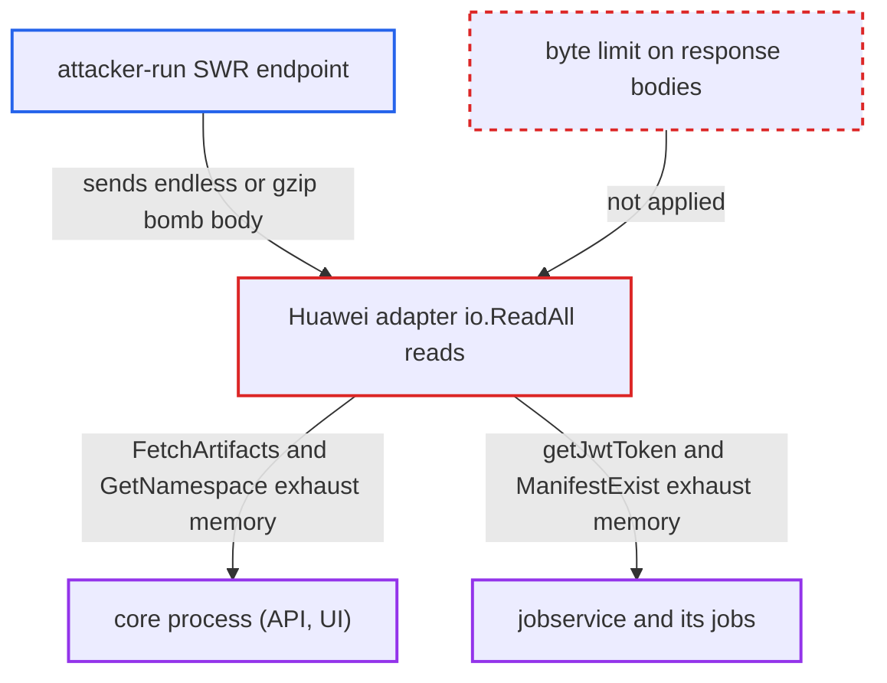

# Huawei SWR adapter buffers unbounded remote responses, exhausting core and jobservice memory

| Field | Value |
|---|---|
| ID | `find_014Gjoy2vsH8S35HB6MQRzJn` |
| Severity | **High** |
| Status | open |
| CWE | CWE-770 — Uncontrolled resource consumption |
| Created | 2026-10-27T21:14:55.772889Z |
| Claude Security | https://claude.ai/security/findings/find_014Gjoy2vsH8S35HB6MQRzJn |

## Description

An attacker who runs, or has taken over, the endpoint set up as a Huawei SWR registry can crash Harbor's core process and jobservice by running them out of memory. No Harbor credentials are needed, but a replication policy must point at the attacker's host. The Huawei adapter reads every response with `io.ReadAll` and no size limit.

1. **Harbor admin** configures a replication policy that points at the SWR endpoint. This is the precondition: the endpoint is run or taken over by the attacker, and the policy runs either manually or on a schedule. ([`src/controller/replication/flow/copy.go:52-95`](https://github.com/cx-benchmark/harbor/blob/d822d80c2e6edb2c85538d4b9cd73c0c375a5596/src/controller/replication/flow/copy.go#L52-L95))
2. **core replication flow** calls `FetchArtifacts` and `PrepareForPush`, which calls `GetNamespace`. These adapter methods send requests to the configured SWR URL inside the core API process. ([`src/controller/replication/flow/copy.go:52-95`](https://github.com/cx-benchmark/harbor/blob/d822d80c2e6edb2c85538d4b9cd73c0c375a5596/src/controller/replication/flow/copy.go#L52-L95))
3. **jobservice transfer** calls `ManifestExist` and `DeleteManifest` on the adapter, and `getJwtToken` runs before them. These calls send requests to the same endpoint from inside jobservice. ([`src/controller/replication/transfer/image/transfer.go:477-530`](https://github.com/cx-benchmark/harbor/blob/d822d80c2e6edb2c85538d4b9cd73c0c375a5596/src/controller/replication/transfer/image/transfer.go#L477-L530))
4. **attacker's endpoint** answers with an endless chunked body or a small gzip body that inflates to many GB. The shared transport leaves `DisableCompression` unset, so Go unpacks gzip on its own. The 30-minute timeout from `config.RegistryHTTPClientTimeout()` limits time, not bytes. ([`src/pkg/reg/adapter/huawei/huawei_adapter.go:272-290`](https://github.com/cx-benchmark/harbor/blob/d822d80c2e6edb2c85538d4b9cd73c0c375a5596/src/pkg/reg/adapter/huawei/huawei_adapter.go#L272-L290))
5. **the adapter's read calls** buffer the whole body with `io.ReadAll`, then pass it to `json.Unmarshal` or copy it into an error string. No `io.LimitReader`, `Content-Length` check or byte cap applies. Examples are the repository listing in `FetchArtifacts`, the namespace reads in `GetNamespace` and the manifest read in `ManifestExist`. ([`src/pkg/reg/adapter/huawei/image_registry.go:43-62`](https://github.com/cx-benchmark/harbor/blob/d822d80c2e6edb2c85538d4b9cd73c0c375a5596/src/pkg/reg/adapter/huawei/image_registry.go#L43-L62))
6. **core or jobservice process** runs out of memory and is killed. The crash repeats on each scheduled run of the policy. ([`src/pkg/reg/adapter/huawei/image_registry.go:214-230`](https://github.com/cx-benchmark/harbor/blob/d822d80c2e6edb2c85538d4b9cd73c0c375a5596/src/pkg/reg/adapter/huawei/image_registry.go#L214-L230))

## Assessment

The attacker operates, or has compromised, the endpoint that a Harbor admin configured as a Huawei SWR registry in a replication policy. No Harbor credentials are needed, but the policy must point at the attacker's host. The attack starts when the policy runs, manually or on a schedule. There are two ways in. In core, `FetchArtifacts` or `PrepareForPush` with `GetNamespace` reads the response. In jobservice, `getJwtToken`, `ManifestExist` or `DeleteManifest` reads it. `ListNamespaces` has the same pattern, but no shipped code calls it.

Impact: A single response can get the core process killed for lack of memory. That takes down the REST API, the UI and the registry front-end for all users. A response on the jobservice path kills jobservice and every job running on it. The crash repeats on each scheduled run. The report says no data is disclosed or modified.

## Recommendation

The Huawei adapter buffers remote response bodies, both success and error, with `io.ReadAll` and no byte limit. The untrusted remote therefore decides how much memory core and jobservice allocate, and transparent gzip decoding makes this worse.

Fix criteria: Every body read in the adapter stops at a fixed size suited to its payload, measured after decompression. This covers the repository list, namespace get and create, token, manifest and all error bodies. The operation fails once that size is exceeded. To verify, point a Huawei-type registry at a stub that streams an endless body or a gzip bomb for each endpoint. Each call should return an error promptly. Core and jobservice memory should stay bounded.

## Evidence

**https://github.com/cx-benchmark/harbor**

- [`src/pkg/reg/adapter/huawei/image_registry.go:43-62`](https://github.com/cx-benchmark/harbor/blob/d822d80c2e6edb2c85538d4b9cd73c0c375a5596/src/pkg/reg/adapter/huawei/image_registry.go#L43-L62)
- [`src/pkg/reg/adapter/huawei/huawei_adapter.go:227-247`](https://github.com/cx-benchmark/harbor/blob/d822d80c2e6edb2c85538d4b9cd73c0c375a5596/src/pkg/reg/adapter/huawei/huawei_adapter.go#L227-L247)
- [`src/pkg/reg/adapter/huawei/image_registry.go:88-110`](https://github.com/cx-benchmark/harbor/blob/d822d80c2e6edb2c85538d4b9cd73c0c375a5596/src/pkg/reg/adapter/huawei/image_registry.go#L88-L110)
- [`src/pkg/reg/adapter/huawei/image_registry.go:214-230`](https://github.com/cx-benchmark/harbor/blob/d822d80c2e6edb2c85538d4b9cd73c0c375a5596/src/pkg/reg/adapter/huawei/image_registry.go#L214-L230)
- [`src/pkg/reg/adapter/huawei/huawei_adapter.go:272-290`](https://github.com/cx-benchmark/harbor/blob/d822d80c2e6edb2c85538d4b9cd73c0c375a5596/src/pkg/reg/adapter/huawei/huawei_adapter.go#L272-L290)
- [`src/controller/replication/flow/copy.go:52-95`](https://github.com/cx-benchmark/harbor/blob/d822d80c2e6edb2c85538d4b9cd73c0c375a5596/src/controller/replication/flow/copy.go#L52-L95)
- [`src/controller/replication/transfer/image/transfer.go:477-530`](https://github.com/cx-benchmark/harbor/blob/d822d80c2e6edb2c85538d4b9cd73c0c375a5596/src/controller/replication/transfer/image/transfer.go#L477-L530)
- [`src/pkg/scan/job.go:60-63`](https://github.com/cx-benchmark/harbor/blob/d822d80c2e6edb2c85538d4b9cd73c0c375a5596/src/pkg/scan/job.go#L60-L63)

