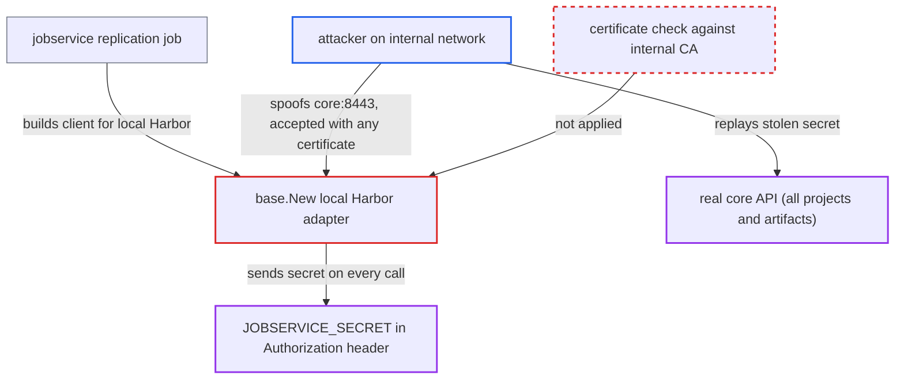

# Jobservice's local Harbor adapter sends JOBSERVICE_SECRET over unverified TLS under internal TLS

| Field | Value |
|---|---|
| ID | `find_016ns8qnhsW8FRvTmwnYzGu1` |
| Severity | **High** |
| Status | open |
| CWE | CWE-295 — Improper certificate validation |
| Created | 2026-10-27T21:34:06.131853Z |
| Claude Security | https://claude.ai/security/findings/find_016ns8qnhsW8FRvTmwnYzGu1 |

## Description

An attacker on Harbor's internal container network can steal the jobservice secret and use it against Harbor's core API. The secret grants access to every project and artifact. This works only when internal TLS is enabled, which is off by default. The cause is `base.New`, which builds the local Harbor client with certificate checking turned off, even in jobservice where it connects to core over the network.

1. **core** passes the local registry to jobservice in the replication job parameters. The local registry has URL `CORE_URL`, `AccessSecret` set to `JOBSERVICE_SECRET`, and `Insecure` set to `!InternalTLSEnabled()`. ([`src/pkg/reg/manager.go:165-179`](https://github.com/cx-benchmark/harbor/blob/d822d80c2e6edb2c85538d4b9cd73c0c375a5596/src/pkg/reg/manager.go#L165-L179))
2. **the replication job in jobservice** rebuilds the local Harbor adapter through `createRegistry` and `base.New`. Every replication policy has the local Harbor as its source or destination, so every replication task does this. ([`src/controller/replication/transfer/image/transfer.go:132-170`](https://github.com/cx-benchmark/harbor/blob/d822d80c2e6edb2c85538d4b9cd73c0c375a5596/src/controller/replication/transfer/image/transfer.go#L132-L170))
3. **`base.New`** picks the insecure transport and the secret authorizer for the local Harbor. The registry URL equals `CORE_URL`, so it uses `WithInsecure(true)` and ignores `registry.Insecure`. ([`src/pkg/reg/adapter/harbor/base/adapter.go:38-60`](https://github.com/cx-benchmark/harbor/blob/d822d80c2e6edb2c85538d4b9cd73c0c375a5596/src/pkg/reg/adapter/harbor/base/adapter.go#L38-L60))
4. **`Client.GetURL`** does not rewrite the address to 127.0.0.1. The rewrite runs only when `isInCore()` is true, and it checks `EXT_ENDPOINT`, which only core's environment sets, so jobservice keeps dialing `CORE_URL`. ([`src/pkg/reg/adapter/harbor/base/client.go:142-155`](https://github.com/cx-benchmark/harbor/blob/d822d80c2e6edb2c85538d4b9cd73c0c375a5596/src/pkg/reg/adapter/harbor/base/client.go#L142-L155))
5. **`NewClient`** calls `GetAPIVersion` against `https://core:8443`. With `internal_tls.enabled` set, `CORE_URL` is an https address on the container network. `SecretAuthorizer.Modify` adds `Authorization: Harbor-Secret <JOBSERVICE_SECRET>` to the request. ([`src/common/http/modifier/auth/auth.go:41-47`](https://github.com/cx-benchmark/harbor/blob/d822d80c2e6edb2c85538d4b9cd73c0c375a5596/src/common/http/modifier/auth/auth.go#L41-L47))
6. **attacker on the internal network** answers for `core:8443` with any certificate and reads the header. The transport sets `InsecureSkipVerify: true`, so jobservice accepts the attacker's certificate. ([`src/common/http/transport.go:46-53`](https://github.com/cx-benchmark/harbor/blob/d822d80c2e6edb2c85538d4b9cd73c0c375a5596/src/common/http/transport.go#L46-L53))
7. **attacker** replays the `Authorization` header to the real core. Core's internal TLS listener requires no client certificate. The secret makes the caller a solution user for whom `Can()` is always true. ([`src/common/security/secret/context.go:77-86`](https://github.com/cx-benchmark/harbor/blob/d822d80c2e6edb2c85538d4b9cd73c0c375a5596/src/common/security/secret/context.go#L77-L86))

## Assessment

The attacker is on Harbor's internal container network (Docker bridge or Kubernetes pod network), for example in a compromised neighbouring container. They must be able to spoof or redirect `core`, for example by ARP or DNS. Internal TLS must be enabled. It is off by default, and with it off `CORE_URL` is plain `http://core:8080` by design. The attacker then waits for any replication task, whether scheduled, manual or event-driven. No Harbor account and no user action are needed.

Impact: The attacker can read every private project and artifact, push or overwrite images in any repository (supply-chain poisoning), and delete artifacts and projects or stop jobs. Endpoints that check `IsSysAdmin()` directly are not reachable this way. The secret stays valid until both services are redeployed with a new one.

## Recommendation

`base.New` always uses the verification-disabled transport for the local Harbor adapter. It assumes the caller is core dialing loopback. In jobservice the client dials `CORE_URL` over the network with the jobservice secret attached, so core's identity is never checked.

Fix criteria: Every request from the Harbor adapter to the local core that leaves the process's loopback verifies core's certificate against the internal CA, for example by honouring `registry.Insecure` and the internal-TLS transport. Any exception is limited to core's own 127.0.0.1 rewrite. Test: run a replication under internal TLS while a server with an untrusted certificate answers for `core:8443`. Jobservice must fail the handshake before any `Authorization: Harbor-Secret` header is sent.

## Evidence

**https://github.com/cx-benchmark/harbor**

- [`src/pkg/reg/adapter/harbor/base/adapter.go:38-60`](https://github.com/cx-benchmark/harbor/blob/d822d80c2e6edb2c85538d4b9cd73c0c375a5596/src/pkg/reg/adapter/harbor/base/adapter.go#L38-L60)
- [`src/pkg/reg/adapter/harbor/base/adapter.go:321-332`](https://github.com/cx-benchmark/harbor/blob/d822d80c2e6edb2c85538d4b9cd73c0c375a5596/src/pkg/reg/adapter/harbor/base/adapter.go#L321-L332)
- [`src/pkg/reg/adapter/harbor/base/client.go:142-155`](https://github.com/cx-benchmark/harbor/blob/d822d80c2e6edb2c85538d4b9cd73c0c375a5596/src/pkg/reg/adapter/harbor/base/client.go#L142-L155)
- [`make/photon/prepare/templates/jobservice/env.jinja:1-16`](https://github.com/cx-benchmark/harbor/blob/d822d80c2e6edb2c85538d4b9cd73c0c375a5596/make/photon/prepare/templates/jobservice/env.jinja#L1-L16)
- [`make/photon/prepare/utils/configs.py:358-366`](https://github.com/cx-benchmark/harbor/blob/d822d80c2e6edb2c85538d4b9cd73c0c375a5596/make/photon/prepare/utils/configs.py#L358-L366)
- [`src/pkg/reg/adapter/harbor/base/client.go:27-61`](https://github.com/cx-benchmark/harbor/blob/d822d80c2e6edb2c85538d4b9cd73c0c375a5596/src/pkg/reg/adapter/harbor/base/client.go#L27-L61)
- [`src/pkg/reg/manager.go:165-179`](https://github.com/cx-benchmark/harbor/blob/d822d80c2e6edb2c85538d4b9cd73c0c375a5596/src/pkg/reg/manager.go#L165-L179)
- [`src/controller/replication/model/model.go:77-82`](https://github.com/cx-benchmark/harbor/blob/d822d80c2e6edb2c85538d4b9cd73c0c375a5596/src/controller/replication/model/model.go#L77-L82)
- [`src/controller/replication/transfer/image/transfer.go:132-170`](https://github.com/cx-benchmark/harbor/blob/d822d80c2e6edb2c85538d4b9cd73c0c375a5596/src/controller/replication/transfer/image/transfer.go#L132-L170)
- [`src/common/http/transport.go:46-53`](https://github.com/cx-benchmark/harbor/blob/d822d80c2e6edb2c85538d4b9cd73c0c375a5596/src/common/http/transport.go#L46-L53)
- [`src/common/http/modifier/auth/auth.go:41-47`](https://github.com/cx-benchmark/harbor/blob/d822d80c2e6edb2c85538d4b9cd73c0c375a5596/src/common/http/modifier/auth/auth.go#L41-L47)
- [`src/core/main.go:267-280`](https://github.com/cx-benchmark/harbor/blob/d822d80c2e6edb2c85538d4b9cd73c0c375a5596/src/core/main.go#L267-L280)
- [`src/common/security/secret/context.go:77-86`](https://github.com/cx-benchmark/harbor/blob/d822d80c2e6edb2c85538d4b9cd73c0c375a5596/src/common/security/secret/context.go#L77-L86)
- [`src/pkg/scan/job.go:588-597`](https://github.com/cx-benchmark/harbor/blob/d822d80c2e6edb2c85538d4b9cd73c0c375a5596/src/pkg/scan/job.go#L588-L597)

