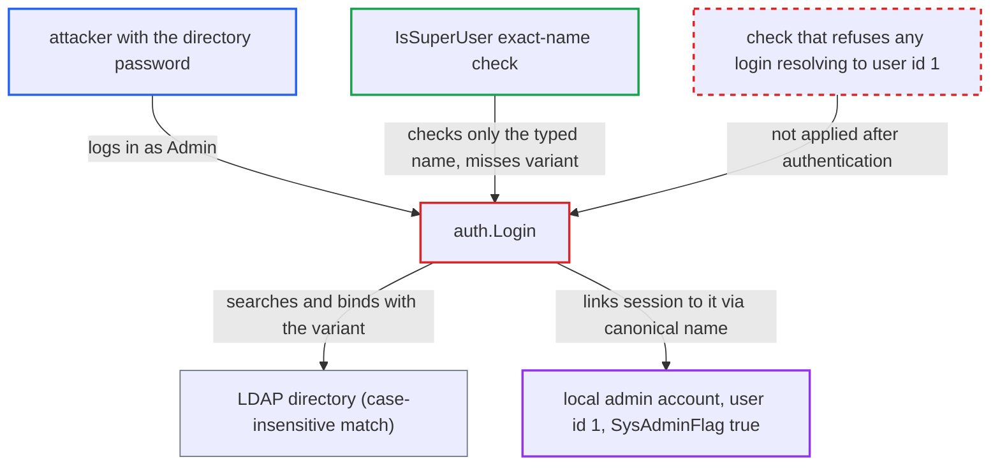

# LDAP login maps case-variant principal to Harbor superuser, bypassing IsSuperUser guard

| Field | Value |
|---|---|
| ID | `find_01RmosriXkp5BxaMmTagpAjv` |
| Severity | **High** |
| Status | open |
| CWE | CWE-289 — Authentication bypass by alternate name |
| Created | 2026-10-27T21:17:25.549801Z |
| Claude Security | https://claude.ai/security/findings/find_01RmosriXkp5BxaMmTagpAjv |

## Description

Someone who knows the password of a directory account whose login name is `admin` can become Harbor's built-in system administrator (user id 1). This works only in `ldap_auth` mode, and only if the local admin has not been renamed. `auth.Login` checks the typed name with an exact, case-sensitive match, but the directory matches names case-insensitively and Harbor then links the canonical name `admin` to user id 1.

1. **attacker** sends a login with principal `Admin` and the directory account's password. The request goes to `/c/login`, or to any API or `/v2` endpoint using Basic auth, and the controller passes the principal to `auth.Login` unchanged. ([`src/core/controllers/base.go:74-109`](https://github.com/cx-benchmark/harbor/blob/d822d80c2e6edb2c85538d4b9cd73c0c375a5596/src/core/controllers/base.go#L74-L109))
2. **`IsSuperUser`** fails to recognise the typed name as the superuser. It calls `user.Mgr.GetByName`, an exact match on a case-sensitive column, so `Admin`, `ADMIN` or `admin ` returns false and `auth.Login` does not force DB auth but uses `ldap_auth`. ([`src/core/auth/authenticator.go:259-267`](https://github.com/cx-benchmark/harbor/blob/d822d80c2e6edb2c85538d4b9cd73c0c375a5596/src/core/auth/authenticator.go#L259-L267))
3. **`SearchUser` in the LDAP code** finds the directory entry for the variant name. The directory server matches the attribute case-insensitively, so the entry whose value is exactly `admin` is returned, and `Authenticate` binds with that entry's DN and the supplied password. ([`src/pkg/ldap/ldap.go:139-187`](https://github.com/cx-benchmark/harbor/blob/d822d80c2e6edb2c85538d4b9cd73c0c375a5596/src/pkg/ldap/ldap.go#L139-L187))
4. **`Authenticate` in the LDAP code** replaces the typed name with the directory's canonical username. It sets `u.Username` to `admin`, so the later steps work with the name `admin` and not with what the attacker typed. ([`src/core/auth/ldap/ldap.go:72-101`](https://github.com/cx-benchmark/harbor/blob/d822d80c2e6edb2c85538d4b9cd73c0c375a5596/src/core/auth/ldap/ldap.go#L72-L101))
5. **`syncUserInfoFromDB`** loads the local `admin` row and copies `SysAdminFlag=true` into the model. The lookup uses the canonical username, which now matches the built-in superuser row, user id 1. ([`src/core/auth/ldap/ldap.go:213-223`](https://github.com/cx-benchmark/harbor/blob/d822d80c2e6edb2c85538d4b9cd73c0c375a5596/src/core/auth/ldap/ldap.go#L213-L223))
6. **`PostAuthenticate`** calls onboarding because its `Count` does not see the admin row. `Count` excludes user id 1, so the code falls through to `auth.OnBoardUser`. ([`src/core/auth/ldap/ldap.go:329-368`](https://github.com/cx-benchmark/harbor/blob/d822d80c2e6edb2c85538d4b9cd73c0c375a5596/src/core/auth/ldap/ldap.go#L329-L368))
7. **`Onboard`** links the login to the local admin account. It calls `GetByName` without excluding the admin, finds user id 1, and copies `UserID=1` and `SysAdminFlag=true` into the returned model. ([`src/pkg/user/manager.go:81-100`](https://github.com/cx-benchmark/harbor/blob/d822d80c2e6edb2c85538d4b9cd73c0c375a5596/src/pkg/user/manager.go#L81-L100))
8. **`/c/login` or the Basic-auth middleware** gives the attacker a superuser session or security context. The session or security context is built from the returned model, and `IsSysAdmin` returns `SysAdminFlag`, which is true. ([`src/core/controllers/base.go:74-109`](https://github.com/cx-benchmark/harbor/blob/d822d80c2e6edb2c85538d4b9cd73c0c375a5596/src/core/controllers/base.go#L74-L109))

## Assessment

The attacker holds the password of a directory account whose configured uid attribute is exactly `admin`. The default uid attribute is `cn`, and many OpenLDAP deployments have an entry `cn=admin`. Harbor must run in `ldap_auth` mode and its local superuser must not have been renamed, for example to `admin@harbor.local` through `/api/internal/renameadmin`. The attacker logs in with a case or whitespace variant such as `Admin` or `admin `, either by POST to `/c/login` or with Basic auth on any API or `/v2` endpoint. The auth mode and the directory entry are deployment conditions outside the attacker's control. No victim action is needed. The report assumes the directory uses a case-insensitive equality rule for the uid attribute. RFC 4519 `caseIgnoreMatch` does this for `cn` and `uid`, and AD does it for `sAMAccountName`. This is server-side behaviour, not set by the pinned `go-ldap/v3` client.

Impact: The attacker becomes the Harbor system administrator (user id 1). They can read every private project, artifact and scan report, and change system configuration, users, robot accounts, replication and policies. They can also push or overwrite artifacts in any project, delete projects and run GC.

## Recommendation

(1) `auth.Login` decides whether a login is for the superuser from the raw typed principal. External authenticators then link the session to the local account named by the backend's canonical username, and the two names can differ in case or whitespace.

Fix criteria: After any non-DB authenticator succeeds, an identity whose canonical username or onboarded `UserID` resolves to user id 1 is refused and never returned with `SysAdminFlag=true`. Logging in as `Admin`, `ADMIN` or `admin ` against a directory entry `cn=admin` gives 401 and never a session or security context for user id 1.

(2) `syncUserInfoFromDB` and `user.Manager.Onboard` attach an external login to any existing local row with the same name and copy its `SysAdminFlag` and `UserID`, including the admin row. Meanwhile `PostAuthenticate` uses a `Count` that hides the admin row.

Fix criteria: Linking an external identity to an existing local account excludes the built-in superuser in both the flag sync and onboarding. No LDAP (or UAA) login path can produce a user model with `UserID=1`, and this has been verified.

## Evidence

**https://github.com/cx-benchmark/harbor**

- [`src/core/auth/authenticator.go:137-166`](https://github.com/cx-benchmark/harbor/blob/d822d80c2e6edb2c85538d4b9cd73c0c375a5596/src/core/auth/authenticator.go#L137-L166)
- [`src/core/auth/authenticator.go:259-267`](https://github.com/cx-benchmark/harbor/blob/d822d80c2e6edb2c85538d4b9cd73c0c375a5596/src/core/auth/authenticator.go#L259-L267)
- [`src/core/auth/ldap/ldap.go:72-101`](https://github.com/cx-benchmark/harbor/blob/d822d80c2e6edb2c85538d4b9cd73c0c375a5596/src/core/auth/ldap/ldap.go#L72-L101)
- [`src/pkg/ldap/ldap.go:139-187`](https://github.com/cx-benchmark/harbor/blob/d822d80c2e6edb2c85538d4b9cd73c0c375a5596/src/pkg/ldap/ldap.go#L139-L187)
- [`src/core/auth/ldap/ldap.go:213-223`](https://github.com/cx-benchmark/harbor/blob/d822d80c2e6edb2c85538d4b9cd73c0c375a5596/src/core/auth/ldap/ldap.go#L213-L223)
- [`src/core/auth/ldap/ldap.go:329-368`](https://github.com/cx-benchmark/harbor/blob/d822d80c2e6edb2c85538d4b9cd73c0c375a5596/src/core/auth/ldap/ldap.go#L329-L368)
- [`src/pkg/user/manager.go:81-100`](https://github.com/cx-benchmark/harbor/blob/d822d80c2e6edb2c85538d4b9cd73c0c375a5596/src/pkg/user/manager.go#L81-L100)
- [`src/core/controllers/base.go:74-109`](https://github.com/cx-benchmark/harbor/blob/d822d80c2e6edb2c85538d4b9cd73c0c375a5596/src/core/controllers/base.go#L74-L109)

