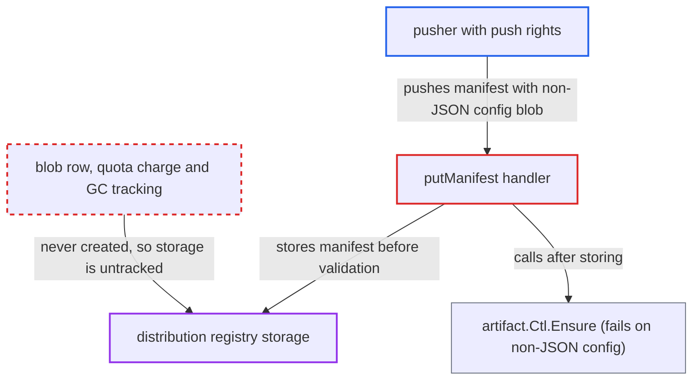

# Manifest left in registry storage after failed artifact Ensure escapes quota and GC

| Field | Value |
|---|---|
| ID | `find_01MZL6NWwxgW9D6Du3wZM3h7` |
| Severity | **High** |
| Status | open |
| CWE | CWE-459 — Incomplete cleanup |
| Created | 2026-10-27T21:44:27.177399Z |
| Claude Security | https://claude.ai/security/findings/find_01MZL6NWwxgW9D6Du3wZM3h7 |

## Description

A user with push rights to a project, including a robot account, can fill the shared registry storage with manifests that Harbor cannot see, count or delete. Each push leaves up to 4 MiB behind, and the leak is permanent under the default configuration. The cause is `putManifest`, which stores the manifest in distribution before `artifact.Ctl.Ensure` validates it. If `Ensure` fails, nothing is cleaned up or recorded.

1. **pusher** uploads a config blob whose content is not JSON. The pusher controls this blob, and distribution is assumed to check only that the config blob exists in the repository.
2. **pusher** sends `PUT /v2/<name>/manifests/<ref>` with a manifest of up to 4 MiB that points at that config blob. Distinct annotations give each manifest a distinct digest, so the request can be repeated without limit. ([`src/common/const.go:253-255`](https://github.com/cx-benchmark/harbor/blob/d822d80c2e6edb2c85538d4b9cd73c0c375a5596/src/common/const.go#L253-L255))
3. **handler `putManifest`** forwards the request to distribution before any Harbor validation. Distribution writes the manifest blob and its `_manifests/revisions` link, and answers into a private `ResponseBuffer`. ([`src/server/registry/manifest.go:186-233`](https://github.com/cx-benchmark/harbor/blob/d822d80c2e6edb2c85538d4b9cd73c0c375a5596/src/server/registry/manifest.go#L186-L233))
4. **`UnmarshalConfig`** pulls the config blob and fails to JSON-decode it. The image processor calls it for image config media types, so non-JSON content always makes `Ensure` fail, and no artifact row is created. ([`src/controller/artifact/processor/base/manifest.go:83-102`](https://github.com/cx-benchmark/harbor/blob/d822d80c2e6edb2c85538d4b9cd73c0c375a5596/src/controller/artifact/processor/base/manifest.go#L83-L102))
5. **handler `putManifest`** writes the error to the outer writer and returns. It neither deletes the stored manifest nor records it in Harbor, and the outer `ResponseBuffer` now holds a 500. ([`src/server/registry/manifest.go:186-233`](https://github.com/cx-benchmark/harbor/blob/d822d80c2e6edb2c85538d4b9cd73c0c375a5596/src/server/registry/manifest.go#L186-L233))
6. **after-response hooks and quota middleware** skip their work and roll back the quota reservation. `blob.PutManifestMiddleware` returns early for any status other than 201, so no `blob` row is made. The quota reservation is released, so the bytes are never charged. ([`src/server/middleware/blob/put_manifest.go:55-58`](https://github.com/cx-benchmark/harbor/blob/d822d80c2e6edb2c85538d4b9cd73c0c375a5596/src/server/middleware/blob/put_manifest.go#L55-L58))
7. **garbage collection** never selects the manifest. GC candidates come only from the `blob` table, and `registryctl` offers only per-digest deletes, so nothing reclaims the data. ([`src/jobservice/job/impl/gc/garbage_collection.go:228-240`](https://github.com/cx-benchmark/harbor/blob/d822d80c2e6edb2c85538d4b9cd73c0c375a5596/src/jobservice/job/impl/gc/garbage_collection.go#L228-L240))

## Assessment

The attacker is a project member or robot account with push rights. No victim action is needed. No non-default setting is needed for the permanent leak. The quota bypass matters only where an operator has set a finite `storage_per_project`, since the default is `-1`. The attacker uploads a small non-JSON blob, then sends many manifest PUT requests that reference it. The report assumes the bundled `goharbor/distribution` checks only that the config blob exists, does not parse it, and caps manifests at 4 MiB, as upstream v2.8 does. It is not in the checkout, so this is unverified. A variant using `urls` on the config descriptor to skip distribution's existence check rests on the same unverified behaviour and is not needed for the main path.

Impact: Each request permanently adds up to 4 MiB to shared registry storage that Harbor does not count and cannot reclaim. Repeated pushes can exhaust storage for every project, and this persists after the attacker is removed. A finite project quota is bypassed and Harbor's database falls out of sync with storage. No data is disclosed.

## Recommendation

(1) `putManifest` commits the manifest to the registry before Harbor validates and records the artifact. When `Ensure` fails, it neither removes the stored manifest nor records a `blob` row, so no accounting or GC path can reach the data.

Fix criteria: After a failed `Ensure`, the registry holds no untracked manifest. Either the revision link and blob are removed before the error is returned, or a `blob`/`project_blob` record is written so quota and GC can see and reclaim it. To verify, push a manifest whose config blob is not JSON. Afterwards the registry must hold no revision for that digest, or the next GC must remove it. Project usage must reflect any bytes kept.

(2) Harbor treats the registry's success as final before its own validation (config parsing, child lookups) has run. Validation failures a client can trigger therefore leave registry storage and Harbor's database inconsistent.

Fix criteria: Validation that can fail on pusher-controlled content runs before the manifest is forwarded to the registry, or the push is compensated on failure. To verify, check that no sequence of client requests leaves a manifest in registry storage without a matching Harbor record.

## Evidence

**https://github.com/cx-benchmark/harbor**

- [`src/server/registry/manifest.go:186-233`](https://github.com/cx-benchmark/harbor/blob/d822d80c2e6edb2c85538d4b9cd73c0c375a5596/src/server/registry/manifest.go#L186-L233)
- [`src/controller/artifact/processor/base/manifest.go:83-102`](https://github.com/cx-benchmark/harbor/blob/d822d80c2e6edb2c85538d4b9cd73c0c375a5596/src/controller/artifact/processor/base/manifest.go#L83-L102)
- [`src/controller/artifact/processor/image/manifest_v2.go:56-60`](https://github.com/cx-benchmark/harbor/blob/d822d80c2e6edb2c85538d4b9cd73c0c375a5596/src/controller/artifact/processor/image/manifest_v2.go#L56-L60)
- [`src/controller/artifact/controller.go:232-235`](https://github.com/cx-benchmark/harbor/blob/d822d80c2e6edb2c85538d4b9cd73c0c375a5596/src/controller/artifact/controller.go#L232-L235)
- [`src/server/middleware/middleware.go:75-90`](https://github.com/cx-benchmark/harbor/blob/d822d80c2e6edb2c85538d4b9cd73c0c375a5596/src/server/middleware/middleware.go#L75-L90)
- [`src/server/middleware/blob/put_manifest.go:55-58`](https://github.com/cx-benchmark/harbor/blob/d822d80c2e6edb2c85538d4b9cd73c0c375a5596/src/server/middleware/blob/put_manifest.go#L55-L58)
- [`src/server/middleware/quota/quota.go:114-118`](https://github.com/cx-benchmark/harbor/blob/d822d80c2e6edb2c85538d4b9cd73c0c375a5596/src/server/middleware/quota/quota.go#L114-L118)
- [`src/jobservice/job/impl/gc/garbage_collection.go:228-240`](https://github.com/cx-benchmark/harbor/blob/d822d80c2e6edb2c85538d4b9cd73c0c375a5596/src/jobservice/job/impl/gc/garbage_collection.go#L228-L240)
- [`src/common/const.go:253-255`](https://github.com/cx-benchmark/harbor/blob/d822d80c2e6edb2c85538d4b9cd73c0c375a5596/src/common/const.go#L253-L255)

