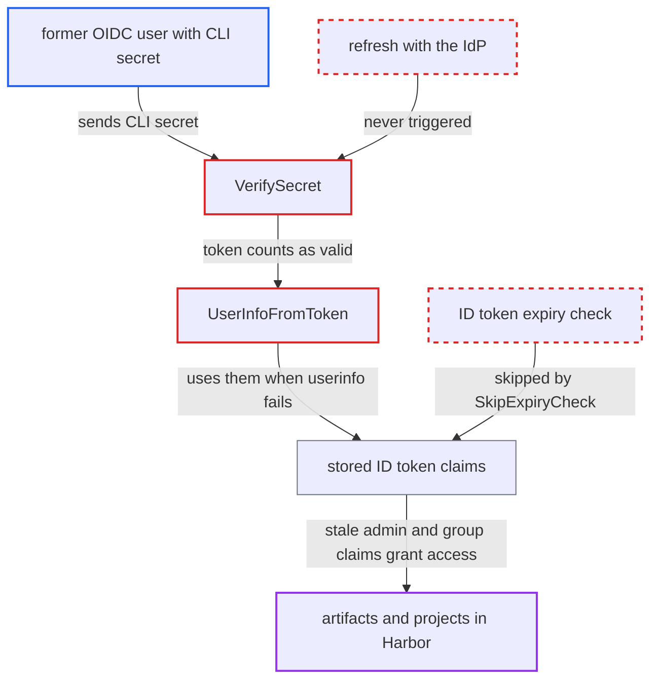

# OIDC CLI secret keeps working on expired ID-token claims when the stored token has no expiry

| Field | Value |
|---|---|
| ID | `find_01Aqv5836UY1ov42FPKQsXKm` |
| Severity | **High** |
| Status | open |
| CWE | CWE-613 — Insufficient Session Expiration |
| Created | 2026-10-27T21:18:25.838553Z |
| Claude Security | https://claude.ai/security/findings/find_01Aqv5836UY1ov42FPKQsXKm |

## Description

A former Harbor OIDC user, such as one disabled at the IdP or removed from admin or project groups, can keep using their CLI secret with no time limit. They keep the access they had at their last web login, which is system admin if they were in the admin group. This needs an IdP that omits `expires_in` from its token response. The cause is that `VerifySecret` never refreshes a token with zero `Expiry`, and `UserInfoFromToken` falls back to expired ID-token claims.

1. **IdP** returns a token response without `expires_in`. RFC 6749 allows this, so the stored token's `Expiry` stays zero.
2. **former OIDC user** sends HTTP Basic `username:cli-secret` to `/service/token` or `/v2/*`. The account was disabled or the user removed from groups at the IdP, but the user still holds the CLI secret. ([`src/server/middleware/security/oidc_cli.go:72-82`](https://github.com/cx-benchmark/harbor/blob/d822d80c2e6edb2c85538d4b9cd73c0c375a5596/src/server/middleware/security/oidc_cli.go#L72-L82))
3. **`VerifySecret`** skips the refresh with the IdP. It refreshes only when `token.Valid()` is false, and oauth2 v0.36.0 treats a non-empty access token with zero `Expiry` as valid. ([`src/pkg/oidc/secret.go:116-139`](https://github.com/cx-benchmark/harbor/blob/d822d80c2e6edb2c85538d4b9cd73c0c375a5596/src/pkg/oidc/secret.go#L116-L139))
4. **`UserInfoFromToken`** falls back to the stored ID token's claims after the userinfo call fails. The failure is only logged at `helper.go:301`, so a revoked account or session does not deny authentication. ([`src/pkg/oidc/helper.go:284-316`](https://github.com/cx-benchmark/harbor/blob/d822d80c2e6edb2c85538d4b9cd73c0c375a5596/src/pkg/oidc/helper.go#L284-L316))
5. **`parseIDToken`** decodes the old ID token without checking its expiry. It uses `SkipExpiryCheck: true`, so claims issued at the last web login are accepted however old they are. ([`src/pkg/oidc/helper.go:217-220`](https://github.com/cx-benchmark/harbor/blob/d822d80c2e6edb2c85538d4b9cd73c0c375a5596/src/pkg/oidc/helper.go#L217-L220))
6. **`InjectGroupsToUser`** copies the stale groups and admin-group flag into the user model. It fills `GroupIDs` and sets `AdminRoleInAuth` from `AdminGroupMember`. ([`src/pkg/oidc/helper.go:482-499`](https://github.com/cx-benchmark/harbor/blob/d822d80c2e6edb2c85538d4b9cd73c0c375a5596/src/pkg/oidc/helper.go#L482-L499))
7. **`IsSysAdmin()`** treats `AdminRoleInAuth` as system admin. It returns `SysAdminFlag || AdminRoleInAuth`, so a registry token with the former privileges is issued. ([`src/common/security/local/context.go:79-82`](https://github.com/cx-benchmark/harbor/blob/d822d80c2e6edb2c85538d4b9cd73c0c375a5596/src/common/security/local/context.go#L79-L82))

## Assessment

The attacker is a former Harbor OIDC user who still holds the CLI secret they were issued. They were disabled at the IdP or removed from the admin or project groups. The deployment's IdP must omit `expires_in`, which the attacker does not control. They send HTTP Basic `username:cli-secret` to `/service/token?scope=repository:<project>/<repo>:pull,push,delete`, to `/v2/*`, or to the other paths `oidcCli.valid` allows. No victim action is needed. When the IdP does send `expires_in`, the stale window is limited to the access-token lifetime, after which a refresh is attempted and fails for a disabled user. The report treats that window as the same staleness Harbor already accepts for web sessions, so it is not part of this finding.

Impact: The attacker keeps, with no time limit, whatever the last ID token encoded. A former admin-group member is system admin on the CLI surface and can pull, push and delete artifacts in every project and create projects. Otherwise the attacker keeps the former group-derived project roles. Availability is not affected. Access ends only when a Harbor admin rotates the user's CLI secret (`PUT /api/v2.0/users/{id}/cli_secret`) or deletes the user.

## Recommendation

(1) `VerifySecret` re-validates with the IdP only when the locally recorded access-token expiry has passed. A token with zero `Expiry` counts as valid forever, so the IdP is never asked again.

Fix criteria: A CLI-secret authentication never relies on authorization data older than a bounded interval, whether or not the IdP sent `expires_in`. For example, the ID token's `exp` or a Harbor-side last-validation time forces a refresh. Test: store a token with zero `Expiry` and an expired ID token. The next CLI-secret request must trigger a refresh and be rejected if the refresh fails.

(2) `UserInfoFromToken` ignores a userinfo failure and falls back to ID-token claims decoded with `SkipExpiryCheck: true`. Stale claims therefore override an IdP signal that the token or account is revoked.

Fix criteria: In the CLI-secret path, an expired ID token no longer supplies identity, groups or admin-group membership. If userinfo fails and the ID token is expired, authentication fails. Test: disable the user at the IdP. Requests to `/service/token` and `/v2/` with their CLI secret must then return 401.

## Evidence

**https://github.com/cx-benchmark/harbor**

- [`src/pkg/oidc/secret.go:116-139`](https://github.com/cx-benchmark/harbor/blob/d822d80c2e6edb2c85538d4b9cd73c0c375a5596/src/pkg/oidc/secret.go#L116-L139)
- [`src/pkg/oidc/helper.go:284-316`](https://github.com/cx-benchmark/harbor/blob/d822d80c2e6edb2c85538d4b9cd73c0c375a5596/src/pkg/oidc/helper.go#L284-L316)
- [`src/pkg/oidc/helper.go:217-220`](https://github.com/cx-benchmark/harbor/blob/d822d80c2e6edb2c85538d4b9cd73c0c375a5596/src/pkg/oidc/helper.go#L217-L220)
- [`src/pkg/oidc/helper.go:482-499`](https://github.com/cx-benchmark/harbor/blob/d822d80c2e6edb2c85538d4b9cd73c0c375a5596/src/pkg/oidc/helper.go#L482-L499)
- [`src/server/middleware/security/oidc_cli.go:72-82`](https://github.com/cx-benchmark/harbor/blob/d822d80c2e6edb2c85538d4b9cd73c0c375a5596/src/server/middleware/security/oidc_cli.go#L72-L82)
- [`src/common/security/local/context.go:79-82`](https://github.com/cx-benchmark/harbor/blob/d822d80c2e6edb2c85538d4b9cd73c0c375a5596/src/common/security/local/context.go#L79-L82)
- [`src/server/middleware/security/idtoken.go:46-50`](https://github.com/cx-benchmark/harbor/blob/d822d80c2e6edb2c85538d4b9cd73c0c375a5596/src/server/middleware/security/idtoken.go#L46-L50)

