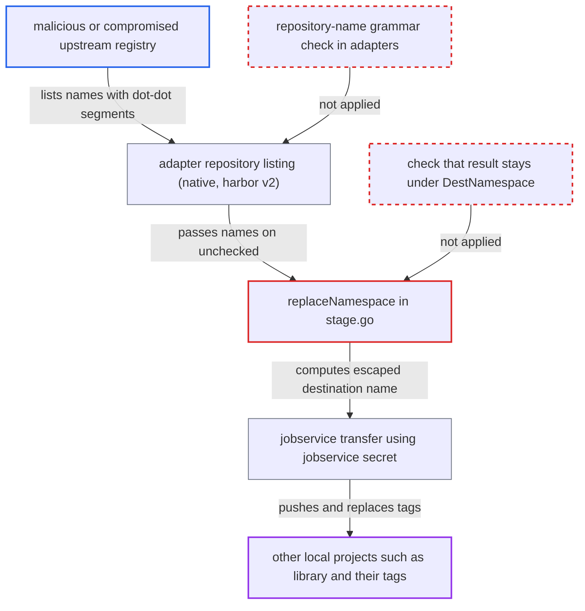

# Pull replication destination namespace escaped via '..' in upstream repository names

| Field | Value |
|---|---|
| ID | `find_01QRAcNKsDiP5adZiamTTrLp` |
| Severity | **High** |
| Status | open |
| CWE | CWE-23 — Path traversal |
| Created | 2026-10-27T21:12:50.924680Z |
| Claude Security | https://claude.ai/security/findings/find_01QRAcNKsDiP5adZiamTTrLp |

## Description

A malicious or compromised upstream registry can make pull-mode replication write images into any project on the local Harbor. That includes `library`, and the tags it replaces are existing ones. It needs no Harbor account. A Harbor admin must have set that registry as the source of a pull policy with a destination namespace, flattening level 0 or higher and an empty or wildcard name filter. `replaceNamespace` joins source names with `path.Join` and never checks that the result stays under the namespace.

1. **attacker's registry** lists a repository name containing dot-dot segments. A name such as `x/../library/evil` (flattening level 1) or `../library/evil` (level 0) is returned in `/v2/_catalog`, and the registry also serves a manifest for it. ([`src/pkg/reg/adapter/native/adapter.go:185-213`](https://github.com/cx-benchmark/harbor/blob/d822d80c2e6edb2c85538d4b9cd73c0c375a5596/src/pkg/reg/adapter/native/adapter.go#L185-L213))
2. **Harbor v2 client** copies the remote name unchanged. For Harbor-type sources, `repository.Name` is taken straight from the remote JSON, with no check against a repository-name grammar. ([`src/pkg/reg/adapter/harbor/v2/client.go:36-51`](https://github.com/cx-benchmark/harbor/blob/d822d80c2e6edb2c85538d4b9cd73c0c375a5596/src/pkg/reg/adapter/harbor/v2/client.go#L36-L51))
3. **the function `replaceNamespace`** computes the destination name with `path.Join`. `path.Join` collapses the `..` segments, so with destination namespace `target` the name becomes `library/evil`. Only the number of components is checked afterwards, not that the result still begins with `target/`. ([`src/controller/replication/flow/stage.go:194-231`](https://github.com/cx-benchmark/harbor/blob/d822d80c2e6edb2c85538d4b9cd73c0c375a5596/src/controller/replication/flow/stage.go#L194-L231))
4. **the copy flow** prepares the destination and creates transfer tasks with the escaped name. `PrepareForPush` takes the first component as the project and creates it if it is missing. An existing project such as `library` is used as it is. ([`src/pkg/reg/adapter/harbor/base/adapter.go:158-213`](https://github.com/cx-benchmark/harbor/blob/d822d80c2e6edb2c85538d4b9cd73c0c375a5596/src/pkg/reg/adapter/harbor/base/adapter.go#L158-L213))
5. **the jobservice transfer** pushes the image to the escaped name using the jobservice secret. The secret security context's `Can` returns true for every action and resource, so the push is allowed in any project. With `override: true` (the portal default), existing tags are replaced. ([`src/common/security/secret/context.go:80-86`](https://github.com/cx-benchmark/harbor/blob/d822d80c2e6edb2c85538d4b9cd73c0c375a5596/src/common/security/secret/context.go#L80-L86))

## Assessment

The attacker runs, or has taken over, a registry that a Harbor admin set as the source of a pull-mode replication policy. The policy needs a destination namespace, flattening level 0 or higher (the portal default is 1) and an empty or wildcard name filter. A name filter that is a specific path skips the catalog, so the attack does not work then. The registry lists a repository such as `x/../library/evil` and serves a manifest for it. The attack runs on the next scheduled or manual replication run. The legacy mode (`-1`, used by the API when the field is omitted) keeps only the last name component and is not affected. The native adapter is inherited by the awsecr, azurecr, googlegcr and quay adapters, and the Harbor v2 client is a second way in.

Impact: The upstream can write arbitrary images into any project on the Harbor instance instead of only the configured namespace. This includes `library`, production projects and new projects that `PrepareForPush` creates. With the default `override: true` it also replaces existing tags, so artifacts that downstream clusters pull can be poisoned. The attacker gets no read access and no availability impact.

## Recommendation

(1) `replaceNamespace` resolves source-supplied path components with `path.Join`, which collapses `.` and `..` segments. It never checks that the computed destination stays under `policy.DestNamespace`.

Fix criteria: When a destination namespace is set, every computed destination repository begins with `DestNamespace` followed by `/`. A source name with empty, `.` or `..` components, or one that fails the OCI repository-name grammar (`lib.RepositoryNameRe`), makes the resource fail or be skipped and is not rewritten. A test shows that `x/../library/evil` and `../library/evil` with namespace `target` at flattening levels -1, 0 and 1 produce no task outside `target/`.

(2) Adapters such as native `listRepositories` and harbor v2 `listRepositories` accept repository names from remote responses without validation. Untrusted names therefore reach the shared `model.Resource`.

Fix criteria: Every repository name an adapter returns from a remote listing matches the OCI distribution repository-name grammar. Names that do not match are dropped and a logged error is written. A test serves a catalog with `a/../b` and `..` entries from a stub registry and confirms they never appear in `FetchArtifacts` output.

## Evidence

**https://github.com/cx-benchmark/harbor**

- [`src/controller/replication/flow/stage.go:194-231`](https://github.com/cx-benchmark/harbor/blob/d822d80c2e6edb2c85538d4b9cd73c0c375a5596/src/controller/replication/flow/stage.go#L194-L231)
- [`src/pkg/reg/adapter/native/adapter.go:185-213`](https://github.com/cx-benchmark/harbor/blob/d822d80c2e6edb2c85538d4b9cd73c0c375a5596/src/pkg/reg/adapter/native/adapter.go#L185-L213)
- [`src/pkg/reg/adapter/harbor/v2/client.go:36-51`](https://github.com/cx-benchmark/harbor/blob/d822d80c2e6edb2c85538d4b9cd73c0c375a5596/src/pkg/reg/adapter/harbor/v2/client.go#L36-L51)
- [`src/controller/replication/flow/copy.go:85-96`](https://github.com/cx-benchmark/harbor/blob/d822d80c2e6edb2c85538d4b9cd73c0c375a5596/src/controller/replication/flow/copy.go#L85-L96)
- [`src/pkg/reg/adapter/harbor/base/adapter.go:158-213`](https://github.com/cx-benchmark/harbor/blob/d822d80c2e6edb2c85538d4b9cd73c0c375a5596/src/pkg/reg/adapter/harbor/base/adapter.go#L158-L213)
- [`src/controller/replication/transfer/image/transfer.go:107-113`](https://github.com/cx-benchmark/harbor/blob/d822d80c2e6edb2c85538d4b9cd73c0c375a5596/src/controller/replication/transfer/image/transfer.go#L107-L113)
- [`src/pkg/reg/manager.go:165-178`](https://github.com/cx-benchmark/harbor/blob/d822d80c2e6edb2c85538d4b9cd73c0c375a5596/src/pkg/reg/manager.go#L165-L178)
- [`src/common/security/secret/context.go:80-86`](https://github.com/cx-benchmark/harbor/blob/d822d80c2e6edb2c85538d4b9cd73c0c375a5596/src/common/security/secret/context.go#L80-L86)
- [`src/controller/replication/model/model.go:91-97`](https://github.com/cx-benchmark/harbor/blob/d822d80c2e6edb2c85538d4b9cd73c0c375a5596/src/controller/replication/model/model.go#L91-L97)
- [`src/portal/src/app/base/left-side-nav/replication/replication/create-edit-rule/create-edit-rule.component.ts:358-376`](https://github.com/cx-benchmark/harbor/blob/d822d80c2e6edb2c85538d4b9cd73c0c375a5596/src/portal/src/app/base/left-side-nav/replication/replication/create-edit-rule/create-edit-rule.component.ts#L358-L376)

