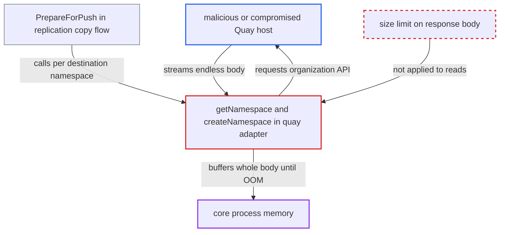

# Quay adapter buffers unbounded organization API responses in core during replication

| Field | Value |
|---|---|
| ID | `find_01YHGZ9o34MaR1oD6ZwqNr9i` |
| Severity | **High** |
| Status | open |
| CWE | CWE-770 — Uncontrolled resource consumption |
| Created | 2026-10-27T21:15:10.673506Z |
| Claude Security | https://claude.ai/security/findings/find_01YHGZ9o34MaR1oD6ZwqNr9i |

## Description

A malicious or compromised Quay registry that Harbor replicates to can crash Harbor's core process by sending an endless or gzip-inflating response body. This takes down the REST API, UI and `/v2` front end for all users. It needs a system admin to have configured the host as a `quay` replication destination with an `oauth2_token`, and it needs no Harbor credentials. `getNamespace` and `createNamespace` read response bodies with `io.ReadAll` and no size limit.

1. **Harbor system admin** configures a Quay endpoint with an `oauth2_token` in its credential JSON. This sets `autoCreateNs`, so the adapter will look up and create organizations on the destination. ([`src/pkg/reg/adapter/quay/adapter.go:64-97`](https://github.com/cx-benchmark/harbor/blob/d822d80c2e6edb2c85538d4b9cd73c0c375a5596/src/pkg/reg/adapter/quay/adapter.go#L64-L97))
2. **replication copy flow** runs inside the core process on a manual or scheduled push-mode run and calls `PrepareForPush` on the destination adapter. This happens in a goroutine in core, before any jobservice task exists, so the memory used is core's. ([`src/controller/replication/execution.go:147-177`](https://github.com/cx-benchmark/harbor/blob/d822d80c2e6edb2c85538d4b9cd73c0c375a5596/src/controller/replication/execution.go#L147-L177))
3. **`PrepareForPush`** calls `createNamespace`, which calls `getNamespace`, for each destination namespace. This happens only when `autoCreateNs` is set. ([`src/pkg/reg/adapter/quay/adapter.go:148-181`](https://github.com/cx-benchmark/harbor/blob/d822d80c2e6edb2c85538d4b9cd73c0c375a5596/src/pkg/reg/adapter/quay/adapter.go#L148-L181))
4. **the method `getNamespace`** sends `GET <registry.URL>/api/v1/organization/<ns>` and reads the whole body with `io.ReadAll`. The read happens before the status code is checked, and nothing limits its size. ([`src/pkg/reg/adapter/quay/adapter.go:230-254`](https://github.com/cx-benchmark/harbor/blob/d822d80c2e6edb2c85538d4b9cd73c0c375a5596/src/pkg/reg/adapter/quay/adapter.go#L230-L254))
5. **attacker-controlled Quay host** streams an endless or gzip-inflating response body. The only limit is the `http.Client` timeout from `config.RegistryHTTPClientTimeout()`, which is 30 minutes by default and limits time, not bytes. ([`src/lib/config/systemconfig.go:34-67`](https://github.com/cx-benchmark/harbor/blob/d822d80c2e6edb2c85538d4b9cd73c0c375a5596/src/lib/config/systemconfig.go#L34-L67))
6. **core process** buffers the body in memory until the process is OOM-killed. `createNamespace` has the same unbounded read on the error body of its POST to `/api/v1/organization/`, and on an error both methods copy the body again into a log line and an error string. ([`src/pkg/reg/adapter/quay/adapter.go:205-226`](https://github.com/cx-benchmark/harbor/blob/d822d80c2e6edb2c85538d4b9cd73c0c375a5596/src/pkg/reg/adapter/quay/adapter.go#L205-L226))

## Assessment

The attacker runs, or has taken over, a host that a Harbor system admin set up as a `quay` replication destination with an `oauth2_token` in its credential JSON. No Harbor credentials are needed. The attack happens when core runs a manual or scheduled push-mode replication to that endpoint. The attacker can answer either the organization lookup in `getNamespace` or the error response of `createNamespace`.

Impact: Core's memory grows with the attacker's body until the process is OOM-killed. The REST API, the UI and the `/v2` registry front end are interrupted for all users, and this repeats on every scheduled run. Nothing is disclosed or modified.

## Recommendation

`getNamespace` and `createNamespace` read Quay organization API response and error bodies into memory with `io.ReadAll` and no size bound, so the remote host decides how much memory core allocates.

Fix criteria: Both reads are capped at a small fixed size suitable for a JSON organization document or an error message. The operation fails cleanly when the cap is exceeded, including after transparent gzip decoding. Verification: against a stub that streams an endless or highly compressed body for `/api/v1/organization/<ns>`, `PrepareForPush` returns an error promptly with bounded memory use.

## Evidence

**https://github.com/cx-benchmark/harbor**

- [`src/pkg/reg/adapter/quay/adapter.go:230-254`](https://github.com/cx-benchmark/harbor/blob/d822d80c2e6edb2c85538d4b9cd73c0c375a5596/src/pkg/reg/adapter/quay/adapter.go#L230-L254)
- [`src/pkg/reg/adapter/quay/adapter.go:205-226`](https://github.com/cx-benchmark/harbor/blob/d822d80c2e6edb2c85538d4b9cd73c0c375a5596/src/pkg/reg/adapter/quay/adapter.go#L205-L226)
- [`src/pkg/reg/adapter/quay/adapter.go:148-181`](https://github.com/cx-benchmark/harbor/blob/d822d80c2e6edb2c85538d4b9cd73c0c375a5596/src/pkg/reg/adapter/quay/adapter.go#L148-L181)
- [`src/pkg/reg/adapter/quay/adapter.go:64-97`](https://github.com/cx-benchmark/harbor/blob/d822d80c2e6edb2c85538d4b9cd73c0c375a5596/src/pkg/reg/adapter/quay/adapter.go#L64-L97)
- [`src/controller/replication/flow/copy.go:84-95`](https://github.com/cx-benchmark/harbor/blob/d822d80c2e6edb2c85538d4b9cd73c0c375a5596/src/controller/replication/flow/copy.go#L84-L95)
- [`src/controller/replication/execution.go:147-177`](https://github.com/cx-benchmark/harbor/blob/d822d80c2e6edb2c85538d4b9cd73c0c375a5596/src/controller/replication/execution.go#L147-L177)
- [`src/lib/config/systemconfig.go:34-67`](https://github.com/cx-benchmark/harbor/blob/d822d80c2e6edb2c85538d4b9cd73c0c375a5596/src/lib/config/systemconfig.go#L34-L67)
- [`src/pkg/scan/job.go:60-63`](https://github.com/cx-benchmark/harbor/blob/d822d80c2e6edb2c85538d4b9cd73c0c375a5596/src/pkg/scan/job.go#L60-L63)

