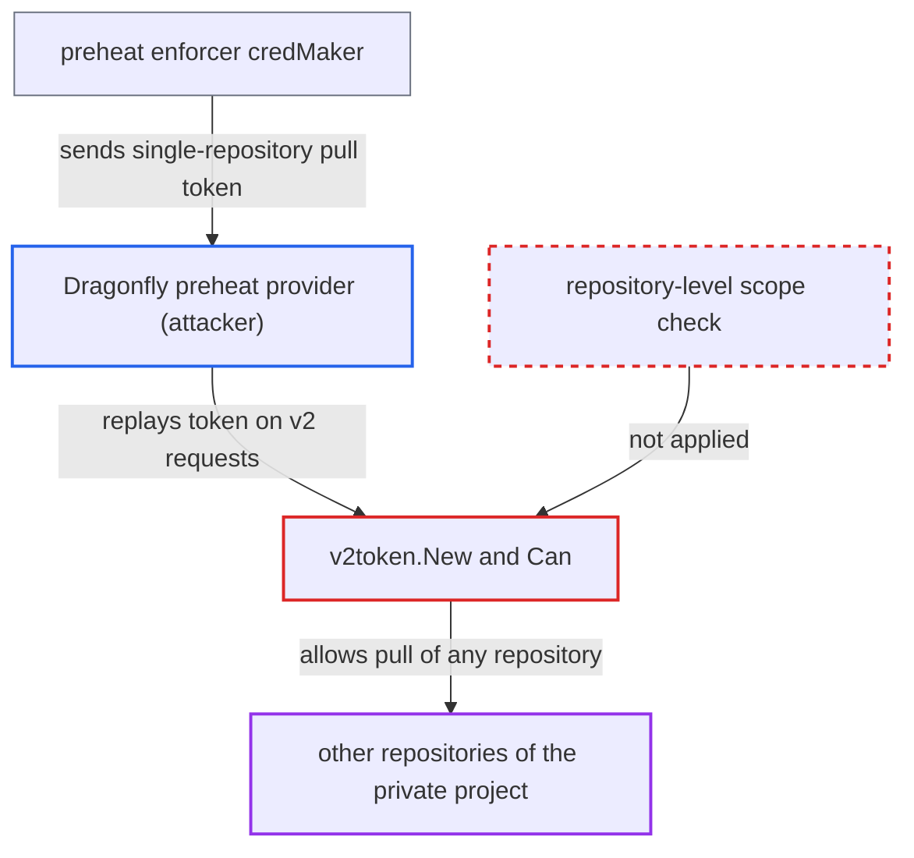

# Registry token ignores repository scope, so preheat token lets P2P provider pull whole project

| Field | Value |
|---|---|
| ID | `find_01GLTrsXneiiTZhyjaAoDncF` |
| Severity | **High** |
| Status | open |
| CWE | CWE-863 — Incorrect Authorization |
| Created | 2026-10-27T21:18:25.755638Z |
| Claude Security | https://claude.ai/security/findings/find_01GLTrsXneiiTZhyjaAoDncF |

## Description

A Dragonfly preheat provider can pull every repository in a private project, not just the image being preheated. It needs only the bearer token Harbor sends it when a preheat policy runs, and no Harbor account. The cause is `v2token.New` and `Can`, which key a token's access by project name and never compare the repository.

1. **preheat enforcer** mints a pull token limited to one `namespace/repository`. The `credMaker` issues it as `distributor` and relies on that narrow scope to limit what it delegates. ([`src/controller/p2p/preheat/enforcer.go:159-176`](https://github.com/cx-benchmark/harbor/blob/d822d80c2e6edb2c85538d4b9cd73c0c375a5596/src/controller/p2p/preheat/enforcer.go#L159-L176))
2. **`startTask`** puts the token in the preheat request's `Authorization` header. The header goes to jobservice as part of `PreheatImage.Headers`. ([`src/controller/p2p/preheat/enforcer.go:436-447`](https://github.com/cx-benchmark/harbor/blob/d822d80c2e6edb2c85538d4b9cd73c0c375a5596/src/controller/p2p/preheat/enforcer.go#L436-L447))
3. **Dragonfly driver** forwards the headers to the external provider. The provider now holds a Harbor token it can replay. ([`src/pkg/p2p/preheat/provider/dragonfly.go:244-251`](https://github.com/cx-benchmark/harbor/blob/d822d80c2e6edb2c85538d4b9cd73c0c375a5596/src/pkg/p2p/preheat/provider/dragonfly.go#L244-L251))
4. **the provider** sends the token to `/v2/<project>/<other-repo>/...` on Harbor. The target is a repository the preheat policy never selected.
5. **`v2Token.Generate`** accepts the token. It checks signature, audience and issued-after-project-creation, and none of these checks looks at the repository. ([`src/server/middleware/security/v2_token.go:44-78`](https://github.com/cx-benchmark/harbor/blob/d822d80c2e6edb2c85538d4b9cd73c0c375a5596/src/server/middleware/security/v2_token.go#L44-L78))
6. **`v2token.New` and `Can`** treat the token as valid for the whole project. `New` stores the actions under the first path segment only, and `Can` checks `t.accessMap[p.Name]`, so any repository of the project passes. ([`src/common/security/v2token/context.go:98-129`](https://github.com/cx-benchmark/harbor/blob/d822d80c2e6edb2c85538d4b9cd73c0c375a5596/src/common/security/v2token/context.go#L98-L129))
7. **Harbor core** serves the pull from the backend registry. The `v2auth` middleware asks only a project-level question, and core proxies with its own registry credentials, so nothing downstream checks the repository. ([`src/server/registry/proxy.go:56-61`](https://github.com/cx-benchmark/harbor/blob/d822d80c2e6edb2c85538d4b9cd73c0c375a5596/src/server/registry/proxy.go#L56-L61))

## Assessment

The attacker controls or has compromised a Dragonfly preheat provider. A sysadmin registered that provider and a project admin bound it to a preheat policy on a private project. When the policy fires (by event, schedule or manual run), jobservice sends the bearer token to the provider. The provider replays it within `token_expiration` minutes (default 30) against `/v2/<project>/<other-repo>/tags/list`, `/manifests/` and `/blobs/`. This includes repositories the policy's repository, tag, label or vulnerability filters excluded, and non-image artifacts. Every preheat run issues a new token. Tokens from `/service/token` are not affected in practice, because `repositoryFilter` already grants project-wide permissions there.

Impact: The provider can download all manifests and layers of any repository it can name in the private project, on every preheat run. Catalog listing is denied and `/api/v2.0` does not accept the token, so the provider must know or guess repository names. Only `pull` is granted, so nothing can be changed.

## Recommendation

(1) `v2token.New` and `Can` reduce repository-scoped access entries to project scope. A token naming one repository therefore authorizes every repository of its project.

Fix criteria: A Harbor-signed registry token authorizes only the repositories its `access` entries name, unless an entry explicitly grants project-wide access. A preheat token minted for `proj/a` gets 401 or 403 on `GET /v2/proj/b/manifests/<tag>` and `/blobs/<digest>`, while `proj/a` still pulls. Ordinary `/service/token` docker pull and push still work.

(2) The preheat enforcer gives an external provider a bearer token valid for the full `token_expiration` window and for the whole repository, not just the artifact being preheated.

Fix criteria: Tokens delegated to preheat providers are limited to the exact repository, and ideally the digest, being preheated. Their lifetime is no longer than the preheat task needs. A captured token cannot read another repository or be used after the task window.

## Evidence

**https://github.com/cx-benchmark/harbor**

- [`src/common/security/v2token/context.go:98-129`](https://github.com/cx-benchmark/harbor/blob/d822d80c2e6edb2c85538d4b9cd73c0c375a5596/src/common/security/v2token/context.go#L98-L129)
- [`src/common/security/v2token/context.go:70-95`](https://github.com/cx-benchmark/harbor/blob/d822d80c2e6edb2c85538d4b9cd73c0c375a5596/src/common/security/v2token/context.go#L70-L95)
- [`src/controller/p2p/preheat/enforcer.go:159-176`](https://github.com/cx-benchmark/harbor/blob/d822d80c2e6edb2c85538d4b9cd73c0c375a5596/src/controller/p2p/preheat/enforcer.go#L159-L176)
- [`src/controller/p2p/preheat/enforcer.go:436-447`](https://github.com/cx-benchmark/harbor/blob/d822d80c2e6edb2c85538d4b9cd73c0c375a5596/src/controller/p2p/preheat/enforcer.go#L436-L447)
- [`src/pkg/p2p/preheat/provider/dragonfly.go:244-251`](https://github.com/cx-benchmark/harbor/blob/d822d80c2e6edb2c85538d4b9cd73c0c375a5596/src/pkg/p2p/preheat/provider/dragonfly.go#L244-L251)
- [`src/server/middleware/security/v2_token.go:44-78`](https://github.com/cx-benchmark/harbor/blob/d822d80c2e6edb2c85538d4b9cd73c0c375a5596/src/server/middleware/security/v2_token.go#L44-L78)
- [`src/server/middleware/v2auth/auth.go:68-77`](https://github.com/cx-benchmark/harbor/blob/d822d80c2e6edb2c85538d4b9cd73c0c375a5596/src/server/middleware/v2auth/auth.go#L68-L77)
- [`src/server/registry/proxy.go:56-61`](https://github.com/cx-benchmark/harbor/blob/d822d80c2e6edb2c85538d4b9cd73c0c375a5596/src/server/registry/proxy.go#L56-L61)
- [`src/core/service/token/creator.go:147-173`](https://github.com/cx-benchmark/harbor/blob/d822d80c2e6edb2c85538d4b9cd73c0c375a5596/src/core/service/token/creator.go#L147-L173)

