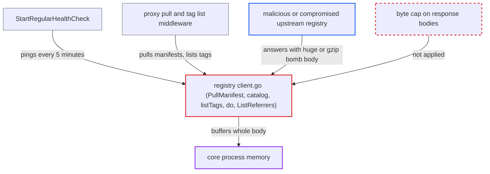

# Registry v2 client buffers unbounded upstream response bodies, exhausting core memory

| Field | Value |
|---|---|
| ID | `find_01RZ6mpFK5dt6TZXNb2UZQMU` |
| Severity | **High** |
| Status | open |
| CWE | CWE-770 — Resource exhaustion |
| Created | 2026-10-27T21:16:59.262589Z |
| Claude Security | https://claude.ai/security/findings/find_01RZ6mpFK5dt6TZXNb2UZQMU |

## Description

An attacker who runs or has taken over a registry that an admin registered as a proxy-cache or replication endpoint can crash Harbor's core process for every tenant. The upstream sends an oversized or gzip-compressed response, and core reads it all into memory. The attacker needs no Harbor privileges. The cause is the registry client in `src/pkg/registry/client.go`, which calls `io.ReadAll` on remote bodies with no byte limit.

1. **attacker's registry** is registered as a proxy-cache or replication endpoint by an admin. The report treats this as the only precondition, and no Harbor privileges or victim action are needed after it.
2. **core health check `StartRegularHealthCheck`** pings every registered endpoint every 5 minutes. For native-based adapters the ping goes through `HealthCheck`, then `Ping`, then `do()`, so it needs no user action. ([`src/controller/registry/controller.go:256-290`](https://github.com/cx-benchmark/harbor/blob/d822d80c2e6edb2c85538d4b9cd73c0c375a5596/src/controller/registry/controller.go#L256-L290))
3. **proxy flow `UseLocalManifest`** sends a HEAD request to the upstream on a pull by tag and falls through to `ProxyManifest` when the returned digest is not stored locally. This is the second way in. Any client allowed to pull from the proxy project can trigger it, including an anonymous client on a public project, and the attacker's registry answers with a new digest. ([`src/controller/proxy/controller.go:172-190`](https://github.com/cx-benchmark/harbor/blob/d822d80c2e6edb2c85538d4b9cd73c0c375a5596/src/controller/proxy/controller.go#L172-L190))
4. **`PullManifest`** reads the whole upstream manifest body with `io.ReadAll`. The read happens before any size or media-type check and before `distribution.UnmarshalManifest`, so the upstream decides how much memory is used. ([`src/pkg/registry/client.go:272-297`](https://github.com/cx-benchmark/harbor/blob/d822d80c2e6edb2c85538d4b9cd73c0c375a5596/src/pkg/registry/client.go#L272-L297))
5. **the shared `do()`** reads the full body of any non-2xx answer with `io.ReadAll` to build an error message. The attacker's registry can answer the health-check `Ping` with a non-2xx status and a huge body. ([`src/pkg/registry/client.go:665-700`](https://github.com/cx-benchmark/harbor/blob/d822d80c2e6edb2c85538d4b9cd73c0c375a5596/src/pkg/registry/client.go#L665-L700))
6. **Go transport from `commonhttp.GetHTTPTransport`** asks for gzip and inflates the response before the read. `DisableCompression` is unset and these requests send no `Accept-Encoding`, so a few MB on the wire can become GBs in memory. ([`src/common/http/transport.go:61-82`](https://github.com/cx-benchmark/harbor/blob/d822d80c2e6edb2c85538d4b9cd73c0c375a5596/src/common/http/transport.go#L61-L82))
7. **core process** allocates memory until the Go runtime aborts or the kernel OOM-kills it. The only limit is the 30-minute client timeout, which bounds time and not bytes. ([`src/lib/config/systemconfig.go:34-66`](https://github.com/cx-benchmark/harbor/blob/d822d80c2e6edb2c85538d4b9cd73c0c375a5596/src/lib/config/systemconfig.go#L34-L66))

## Assessment

The attacker operates, or has compromised, a registry that an admin registered as a proxy-cache or replication endpoint. No Harbor privileges or victim action are needed. There are two ways in. The first is the core health check, which pings every endpoint every 5 minutes, so a non-2xx answer with a huge body is buffered with no user action. The second is a proxied pull, where the upstream answers the manifest HEAD with a new digest and the GET with a multi-GB or gzip-inflated body. Any routine pull can trigger that, and so can the attacker anonymously on a public proxy project. `TagsListMiddleware` reaches `listTags` on every tag-list request. `ProxyReferrerMiddleware` reaches `ListReferrers` only when the project has enabled the opt-in proxy referrer API.

Impact: Core allocates as much memory as the upstream chooses, until the Go runtime aborts with an out-of-memory error or the kernel kills the process. This takes down the OCI registry API, REST API, portal and token service for every tenant, not just the proxy project. The attack repeats on every health-check tick or pull. The report establishes no data exposure or tampering.

## Recommendation

`PullManifest`, `catalog`, `listTags`, `do()` and `ListReferrers` in `src/pkg/registry/client.go` read remote bodies with `io.ReadAll` or a JSON decoder and no byte cap, after transparent gzip inflation. An untrusted upstream therefore decides how much memory core allocates.

Fix criteria: Every body read from a remote registry in this client is bounded by a fixed maximum suited to its payload: a few MiB for manifests and referrer indexes, a small cap for error bodies, and a bounded size per list page. The cap applies to decompressed bytes, and a body over it fails with an error before parsing. A test upstream that serves a 1 GiB or gzip-bombed manifest, tag page, referrers index or error body leaves core memory flat and returns an error.

## Evidence

**https://github.com/cx-benchmark/harbor**

- [`src/pkg/registry/client.go:272-297`](https://github.com/cx-benchmark/harbor/blob/d822d80c2e6edb2c85538d4b9cd73c0c375a5596/src/pkg/registry/client.go#L272-L297)
- [`src/pkg/registry/client.go:665-700`](https://github.com/cx-benchmark/harbor/blob/d822d80c2e6edb2c85538d4b9cd73c0c375a5596/src/pkg/registry/client.go#L665-L700)
- [`src/pkg/registry/client.go:225-246`](https://github.com/cx-benchmark/harbor/blob/d822d80c2e6edb2c85538d4b9cd73c0c375a5596/src/pkg/registry/client.go#L225-L246)
- [`src/pkg/registry/client.go:704-740`](https://github.com/cx-benchmark/harbor/blob/d822d80c2e6edb2c85538d4b9cd73c0c375a5596/src/pkg/registry/client.go#L704-L740)
- [`src/controller/proxy/controller.go:172-190`](https://github.com/cx-benchmark/harbor/blob/d822d80c2e6edb2c85538d4b9cd73c0c375a5596/src/controller/proxy/controller.go#L172-L190)
- [`src/controller/proxy/controller.go:236-248`](https://github.com/cx-benchmark/harbor/blob/d822d80c2e6edb2c85538d4b9cd73c0c375a5596/src/controller/proxy/controller.go#L236-L248)
- [`src/server/middleware/repoproxy/proxy.go:298-385`](https://github.com/cx-benchmark/harbor/blob/d822d80c2e6edb2c85538d4b9cd73c0c375a5596/src/server/middleware/repoproxy/proxy.go#L298-L385)
- [`src/server/middleware/repoproxy/tag.go:88-100`](https://github.com/cx-benchmark/harbor/blob/d822d80c2e6edb2c85538d4b9cd73c0c375a5596/src/server/middleware/repoproxy/tag.go#L88-L100)
- [`src/controller/registry/controller.go:256-290`](https://github.com/cx-benchmark/harbor/blob/d822d80c2e6edb2c85538d4b9cd73c0c375a5596/src/controller/registry/controller.go#L256-L290)
- [`src/common/http/transport.go:61-82`](https://github.com/cx-benchmark/harbor/blob/d822d80c2e6edb2c85538d4b9cd73c0c375a5596/src/common/http/transport.go#L61-L82)
- [`src/lib/config/systemconfig.go:34-66`](https://github.com/cx-benchmark/harbor/blob/d822d80c2e6edb2c85538d4b9cd73c0c375a5596/src/lib/config/systemconfig.go#L34-L66)

