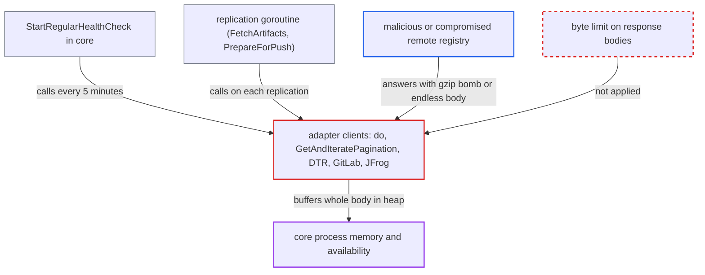

# Replication adapter API clients buffer unbounded remote responses, exhausting core memory

| Field | Value |
|---|---|
| ID | `find_01KYmZ4ZJWE4bSrUpLbVPuyQ` |
| Severity | **High** |
| Status | open |
| CWE | CWE-770 — Resource allocation without limits |
| Created | 2026-10-27T21:14:55.864826Z |
| Claude Security | https://claude.ai/security/findings/find_01KYmZ4ZJWE4bSrUpLbVPuyQ |

## Description

A malicious or compromised remote registry can crash Harbor's core process, which takes down the REST API, UI, token service and `/v2` front end for all users. The registry must have been registered by a system admin as a Harbor, DTR, GitLab or JFrog endpoint. The adapter clients read whole response bodies with `io.ReadAll` and no size limit, even after gzip inflation.

1. **core health checker `StartRegularHealthCheck`** contacts every registered endpoint, including the attacker's registry. It runs `IsHealthy`, then `CreateAdapter`, then `HealthCheck` every 5 minutes, with no admin action. ([`src/controller/registry/controller.go:256-289`](https://github.com/cx-benchmark/harbor/blob/d822d80c2e6edb2c85538d4b9cd73c0c375a5596/src/controller/registry/controller.go#L256-L289))
2. **Harbor adapter** calls `GetAPIVersion` for the `/api/version` path through the shared client. This happens on every `CreateAdapter` and goes through the unbounded `do`. ([`src/pkg/reg/adapter/harbor/base/client.go:26-60`](https://github.com/cx-benchmark/harbor/blob/d822d80c2e6edb2c85538d4b9cd73c0c375a5596/src/pkg/reg/adapter/harbor/base/client.go#L26-L60))
3. **attacker's registry** answers with a small gzip body that inflates to many GB, or with an endless stream. The transport leaves `DisableCompression` unset and the requests set no `Accept-Encoding`, so Go asks for gzip and inflates the body before the code reads it. ([`src/common/http/transport.go:61-82`](https://github.com/cx-benchmark/harbor/blob/d822d80c2e6edb2c85538d4b9cd73c0c375a5596/src/common/http/transport.go#L61-L82))
4. **client method `do`** reads the whole response with `io.ReadAll(resp.Body)`. There is no `io.LimitReader`, no `Content-Length` check and no cap, and the body is read before the status is checked. ([`src/common/http/client.go:157-176`](https://github.com/cx-benchmark/harbor/blob/d822d80c2e6edb2c85538d4b9cd73c0c375a5596/src/common/http/client.go#L157-L176))
5. **replication run in a core goroutine** fetches listings through `GetAndIteratePagination` and the DTR, GitLab and JFrog clients. Each page is read with `io.ReadAll` and appended to one slice, with no cap on page size or page count. ([`src/common/http/client.go:181-243`](https://github.com/cx-benchmark/harbor/blob/d822d80c2e6edb2c85538d4b9cd73c0c375a5596/src/common/http/client.go#L181-L243))
6. **core process** grows its heap until the Go runtime aborts or the container is OOM-killed. The only bound is the 30 minute client timeout, which limits time and not bytes, and the `recover()` in the replication goroutine cannot catch this failure. ([`src/lib/config/systemconfig.go:34-66`](https://github.com/cx-benchmark/harbor/blob/d822d80c2e6edb2c85538d4b9cd73c0c375a5596/src/lib/config/systemconfig.go#L34-L66))

## Assessment

The attacker runs, or has compromised, a registry that a system admin registered as a Harbor, DTR, GitLab or JFrog endpoint. No Harbor credentials are needed. For a Harbor-type endpoint, core's health checker contacts the registry every 5 minutes by itself. Each scheduled or manual replication also requests project, repository and tag listings from it. Docker Hub and GCR use the same unbounded reads, but against their fixed vendor hosts.

Impact: One response can exhaust core's memory and stop the REST API, UI, token service and `/v2` front end for all users. For a Harbor-type endpoint the health checker triggers it again within 5 minutes of each restart, with no admin action. No data is disclosed or modified.

## Recommendation

The adapter API clients (`common_http.Client.do`, `GetAndIteratePagination`, and the DTR, GitLab, JFrog, Docker Hub and GCR clients) buffer remote response bodies with `io.ReadAll` after gzip inflation, with no byte limit. Paginated walks also add pages without a cap, so the remote registry decides how much memory core allocates.

Fix criteria: Every response body read from a remote registry API passes through a hard byte limit on the decoded stream, and an oversized body makes the call fail. Paginated walks stop at a bounded page count or total size. Error and log messages hold only a bounded prefix of the body. To verify, point Harbor, DTR, GitLab and JFrog endpoints at a stub that answers `/api/version` and the listing endpoints with a gzip body inflating to several GB, and with an endless chunked body. Core memory must stay bounded and the call must return an error.

## Evidence

**https://github.com/cx-benchmark/harbor**

- [`src/common/http/client.go:157-176`](https://github.com/cx-benchmark/harbor/blob/d822d80c2e6edb2c85538d4b9cd73c0c375a5596/src/common/http/client.go#L157-L176)
- [`src/common/http/client.go:181-243`](https://github.com/cx-benchmark/harbor/blob/d822d80c2e6edb2c85538d4b9cd73c0c375a5596/src/common/http/client.go#L181-L243)
- [`src/pkg/reg/adapter/dtr/client.go:61-116`](https://github.com/cx-benchmark/harbor/blob/d822d80c2e6edb2c85538d4b9cd73c0c375a5596/src/pkg/reg/adapter/dtr/client.go#L61-L116)
- [`src/pkg/reg/adapter/gitlab/client.go:119-171`](https://github.com/cx-benchmark/harbor/blob/d822d80c2e6edb2c85538d4b9cd73c0c375a5596/src/pkg/reg/adapter/gitlab/client.go#L119-L171)
- [`src/pkg/reg/adapter/jfrog/client.go:66-85`](https://github.com/cx-benchmark/harbor/blob/d822d80c2e6edb2c85538d4b9cd73c0c375a5596/src/pkg/reg/adapter/jfrog/client.go#L66-L85)
- [`src/pkg/reg/adapter/harbor/base/client.go:26-60`](https://github.com/cx-benchmark/harbor/blob/d822d80c2e6edb2c85538d4b9cd73c0c375a5596/src/pkg/reg/adapter/harbor/base/client.go#L26-L60)
- [`src/controller/registry/controller.go:256-289`](https://github.com/cx-benchmark/harbor/blob/d822d80c2e6edb2c85538d4b9cd73c0c375a5596/src/controller/registry/controller.go#L256-L289)
- [`src/controller/replication/execution.go:147-175`](https://github.com/cx-benchmark/harbor/blob/d822d80c2e6edb2c85538d4b9cd73c0c375a5596/src/controller/replication/execution.go#L147-L175)
- [`src/common/http/transport.go:61-82`](https://github.com/cx-benchmark/harbor/blob/d822d80c2e6edb2c85538d4b9cd73c0c375a5596/src/common/http/transport.go#L61-L82)
- [`src/lib/config/systemconfig.go:34-66`](https://github.com/cx-benchmark/harbor/blob/d822d80c2e6edb2c85538d4b9cd73c0c375a5596/src/lib/config/systemconfig.go#L34-L66)

