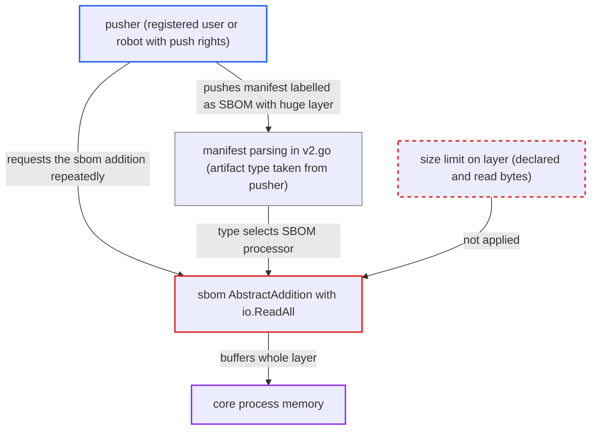

# SBOM addition endpoint reads entire attacker-sized SBOM layer into memory

| Field | Value |
|---|---|
| ID | `find_01LJTry8mf2HQxAFQkYYbHLK` |
| Severity | **High** |
| Status | open |
| CWE | CWE-770 — Resource exhaustion |
| Created | 2026-10-27T21:10:25.279784Z |
| Claude Security | https://claude.ai/security/findings/find_01LJTry8mf2HQxAFQkYYbHLK |

## Description

A user who can push to a project can crash Harbor's core service for everyone by making it load a huge file into memory. The attacker needs an account that can create a project or has push rights, since by default any registered user can create a project. The cause is `AbstractAddition` in the SBOM processor, which reads the whole layer with `io.ReadAll` and never checks its size.

1. **attacker** pushes a manifest labelled as an SBOM with one very large layer. The manifest sets `artifactType` to `application/vnd.goharbor.harbor.sbom.v1`, has an empty config and a single layer of several gigabytes. ([`src/controller/artifact/manifest/v2.go:47-66`](https://github.com/cx-benchmark/harbor/blob/d822d80c2e6edb2c85538d4b9cd73c0c375a5596/src/controller/artifact/manifest/v2.go#L47-L66))
2. **Harbor storage settings** accept the oversized layer. The default `storage_per_project` is `-1` (unlimited), and the report says nothing on the push path restricts this media type to Harbor-generated SBOMs. ([`src/lib/config/metadata/metadatalist.go:164`](https://github.com/cx-benchmark/harbor/blob/d822d80c2e6edb2c85538d4b9cd73c0c375a5596/src/lib/config/metadata/metadatalist.go#L164))
3. **attacker** sends several concurrent GET requests to the `additions/sbom` endpoint of that artifact. The endpoint only requires project read permission on `ResourceArtifactAddition`, and the report says anonymous users get this permission on public projects. ([`src/server/v2.0/handler/artifact.go:445-464`](https://github.com/cx-benchmark/harbor/blob/d822d80c2e6edb2c85538d4b9cd73c0c375a5596/src/server/v2.0/handler/artifact.go#L445-L464))
4. **the controller `GetAddition`** selects the SBOM processor from the artifact's resolved type. The type comes from the attacker's manifest, so the SBOM processor handles the request. ([`src/controller/artifact/controller.go:629-635`](https://github.com/cx-benchmark/harbor/blob/d822d80c2e6edb2c85538d4b9cd73c0c375a5596/src/controller/artifact/controller.go#L629-L635))
5. **the processor `AbstractAddition`** pulls the single layer and buffers all of it with `io.ReadAll(blob)`. Neither `manifest.Layers[0].Size` nor the number of bytes read is checked, so each request allocates the full layer plus growth overhead in core's heap. ([`src/controller/artifact/processor/sbom/sbom.go:53-84`](https://github.com/cx-benchmark/harbor/blob/d822d80c2e6edb2c85538d4b9cd73c0c375a5596/src/controller/artifact/processor/sbom/sbom.go#L53-L84))
6. **core process** runs out of memory and is killed. Repeated or concurrent requests keep allocating until memory is exhausted.

## Assessment

The attacker is any registered user, since project creation is open by default, or a robot with push rights. They push a single-layer manifest with `artifactType` set to `application/vnd.goharbor.harbor.sbom.v1` and a layer of several gigabytes. The shipped defaults do not limit its size: the per-project storage quota is `-1` and nginx has `client_max_body_size 0`. They then send several concurrent `GET /api/v2.0/projects/{p}/repositories/{r}/artifacts/{ref}/additions/sbom` requests. The report says the read permission needed for this endpoint is granted to anonymous users on public projects.

Impact: Core's memory is exhausted and the process is killed by the out-of-memory handler. The API, portal, token service and registry proxy are then down for all users until restart, and the attacker can repeat this at will. The report says no data is disclosed or modified.

## Recommendation

`sbom.AbstractAddition` reads an attacker-sized blob fully into memory with `io.ReadAll`. It applies no limit on the declared size or on the bytes actually read. The CNAI parser enforces a 4MB limit on both, but the SBOM processor does not.

Fix criteria: A fixed maximum SBOM size is enforced. A layer whose `manifest.Layers[0].Size` exceeds it is rejected, and the blob is read through a limited reader that fails with 413 once the limit is exceeded (or the body is streamed to the response writer instead of being buffered). Requesting the `sbom` addition for an artifact whose layer exceeds the cap returns an error promptly while core memory stays bounded. Normal Harbor-generated SBOMs are still returned.

## Evidence

**https://github.com/cx-benchmark/harbor**

- [`src/controller/artifact/processor/sbom/sbom.go:53-84`](https://github.com/cx-benchmark/harbor/blob/d822d80c2e6edb2c85538d4b9cd73c0c375a5596/src/controller/artifact/processor/sbom/sbom.go#L53-L84)
- [`src/controller/artifact/controller.go:629-635`](https://github.com/cx-benchmark/harbor/blob/d822d80c2e6edb2c85538d4b9cd73c0c375a5596/src/controller/artifact/controller.go#L629-L635)
- [`src/controller/artifact/manifest/v2.go:47-66`](https://github.com/cx-benchmark/harbor/blob/d822d80c2e6edb2c85538d4b9cd73c0c375a5596/src/controller/artifact/manifest/v2.go#L47-L66)
- [`src/server/v2.0/handler/artifact.go:445-464`](https://github.com/cx-benchmark/harbor/blob/d822d80c2e6edb2c85538d4b9cd73c0c375a5596/src/server/v2.0/handler/artifact.go#L445-L464)
- [`src/lib/config/metadata/metadatalist.go:164`](https://github.com/cx-benchmark/harbor/blob/d822d80c2e6edb2c85538d4b9cd73c0c375a5596/src/lib/config/metadata/metadatalist.go#L164)
- [`src/controller/artifact/processor/cnai/parser/base.go:66-94`](https://github.com/cx-benchmark/harbor/blob/d822d80c2e6edb2c85538d4b9cd73c0c375a5596/src/controller/artifact/processor/cnai/parser/base.go#L66-L94)

