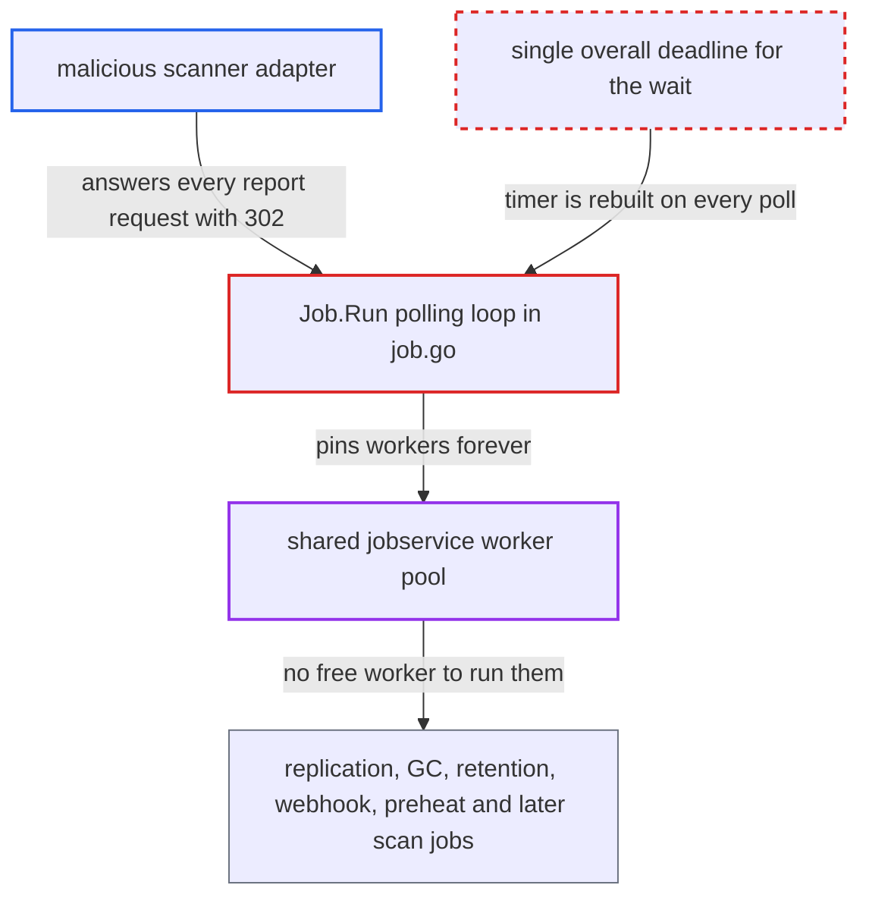

# Scan report wait timeout re-armed every poll, letting a scanner pin jobservice workers forever

| Field | Value |
|---|---|
| ID | `find_01LCKHL4bgrctbraNS4ct22X` |
| Severity | **High** |
| Status | open |
| CWE | CWE-400 — Uncontrolled resource consumption |
| Created | 2026-10-27T21:13:45.741885Z |
| Claude Security | https://claude.ai/security/findings/find_01LCKHL4bgrctbraNS4ct22X |

## Description

A malicious or compromised scanner adapter registered with Harbor can stop replication, garbage collection, retention, webhooks, preheat and later scans from running. It needs no Harbor privileges, only to be the configured scanner. The cause is in `Job.Run` in `src/pkg/scan/job.go`. The 30-minute `checkTimeout` is rebuilt on every poll, so it never fires.

1. **the malicious scanner adapter** accepts the scan and then answers every report request with a 302. It accepts `SubmitScan` with `202`, then replies to each `GET .../report` with `302` and a small `Refresh-After` header. ([`src/pkg/scan/rest/v1/client.go:239-256`](https://github.com/cx-benchmark/harbor/blob/d822d80c2e6edb2c85538d4b9cd73c0c375a5596/src/pkg/scan/rest/v1/client.go#L239-L256))
2. **the client `reportResponseHandler`** turns each 302 into a `ReportNotReadyError`. `RetryAfter` comes from the scanner-controlled `Refresh-After` header, parsed with `ParseInt(v, 10, 8)`, so it is at most 127 seconds and can be 0 or negative. ([`src/pkg/scan/rest/v1/client.go:239-256`](https://github.com/cx-benchmark/harbor/blob/d822d80c2e6edb2c85538d4b9cd73c0c375a5596/src/pkg/scan/rest/v1/client.go#L239-L256))
3. **the polling loop in `Job.Run`** resets the poll timer and continues. On `ReportNotReadyError` it calls `tm.Reset` and `continue`s, with no count of attempts and no check of elapsed time. ([`src/pkg/scan/job.go:256-264`](https://github.com/cx-benchmark/harbor/blob/d822d80c2e6edb2c85538d4b9cd73c0c375a5596/src/pkg/scan/job.go#L256-L264))
4. **the polling loop in `Job.Run`** creates a new 30-minute timer on every pass. `time.After(checkTimeout)` sits inside the `select`, so each pass builds a fresh timer and the old one is thrown away. The timeout case never wins while polls come less than 30 minutes apart. ([`src/pkg/scan/job.go:242-277`](https://github.com/cx-benchmark/harbor/blob/d822d80c2e6edb2c85538d4b9cd73c0c375a5596/src/pkg/scan/job.go#L242-L277))
5. **the scan job** keeps its jobservice worker forever. The goroutine never ends, so `wg.Wait()` never returns. The 5-second request timeout does not help, because each single request completes quickly. ([`src/pkg/scan/rest/v1/client.go:100-107`](https://github.com/cx-benchmark/harbor/blob/d822d80c2e6edb2c85538d4b9cd73c0c375a5596/src/pkg/scan/rest/v1/client.go#L100-L107))
6. **the shared gocraft worker pool** runs out of free workers. Scan jobs have `MaxConcurrency` 0 and share one pool of `max_job_workers` (default 10) with every other job type, so about that many hung scans block all other jobs. ([`src/jobservice/worker/cworker/c_worker.go:431-437`](https://github.com/cx-benchmark/harbor/blob/d822d80c2e6edb2c85538d4b9cd73c0c375a5596/src/jobservice/worker/cworker/c_worker.go#L431-L437))
7. **the reaper** marks the job Error after 24 hours but does not free the worker. The reaper does not cancel the running goroutine, and the Error hook lets `callback.go` delete the scan robot. ([`src/jobservice/worker/cworker/reaper.go:172-183`](https://github.com/cx-benchmark/harbor/blob/d822d80c2e6edb2c85538d4b9cd73c0c375a5596/src/jobservice/worker/cworker/reaper.go#L172-L183))

## Assessment

The attacker is a malicious or compromised scanner adapter registered with Harbor, which treats scanner data as untrusted. It needs no Harbor privileges, only to be the configured scanner, which is a deployment condition. Each scan job started by scan-all, a schedule or auto-scan on push then loops forever. Once about `max_job_workers` (default 10) such jobs run, the shared pool has no free worker. A `Refresh-After` of 0 or below also turns the loop into a busy loop. That means back-to-back HTTP requests and one Info line per pass in the job log.

Impact: Replication, GC, retention, webhook, preheat and later scan jobs stop running until an operator stops the scan tasks or restarts jobservice. It returns with the next scan while the scanner stays configured. Registry pull, push and the API keep serving, and nothing is disclosed or modified.

## Recommendation

(1) The deadline for waiting on a report is built inside the polling `select` with `time.After(checkTimeout)` at `job.go:273`. It restarts on every poll, so the 30-minute cap is never enforced.

Fix criteria: One deadline, such as a timer or a context with timeout, is set once before the polling loop and bounds the total wait however many not-ready responses arrive. With an adapter that always answers `302`, the job fails with the timeout error after the configured bound and frees its worker.

(2) The scanner-supplied `Refresh-After` value is used without a lower bound. A value of 0 or a negative one turns the poll into a busy loop of requests and log writes.

Fix criteria: The retry interval is clamped to a sane minimum and a maximum. With a `Refresh-After: 0` or negative header, requests are still spaced by at least the minimum interval.

## Evidence

**https://github.com/cx-benchmark/harbor**

- [`src/pkg/scan/job.go:242-277`](https://github.com/cx-benchmark/harbor/blob/d822d80c2e6edb2c85538d4b9cd73c0c375a5596/src/pkg/scan/job.go#L242-L277)
- [`src/pkg/scan/job.go:256-264`](https://github.com/cx-benchmark/harbor/blob/d822d80c2e6edb2c85538d4b9cd73c0c375a5596/src/pkg/scan/job.go#L256-L264)
- [`src/pkg/scan/rest/v1/client.go:239-256`](https://github.com/cx-benchmark/harbor/blob/d822d80c2e6edb2c85538d4b9cd73c0c375a5596/src/pkg/scan/rest/v1/client.go#L239-L256)
- [`src/pkg/scan/rest/v1/client.go:100-107`](https://github.com/cx-benchmark/harbor/blob/d822d80c2e6edb2c85538d4b9cd73c0c375a5596/src/pkg/scan/rest/v1/client.go#L100-L107)
- [`src/pkg/scan/job.go:54-55`](https://github.com/cx-benchmark/harbor/blob/d822d80c2e6edb2c85538d4b9cd73c0c375a5596/src/pkg/scan/job.go#L54-L55)
- [`src/jobservice/worker/cworker/c_worker.go:431-437`](https://github.com/cx-benchmark/harbor/blob/d822d80c2e6edb2c85538d4b9cd73c0c375a5596/src/jobservice/worker/cworker/c_worker.go#L431-L437)
- [`src/jobservice/worker/cworker/reaper.go:172-183`](https://github.com/cx-benchmark/harbor/blob/d822d80c2e6edb2c85538d4b9cd73c0c375a5596/src/jobservice/worker/cworker/reaper.go#L172-L183)

