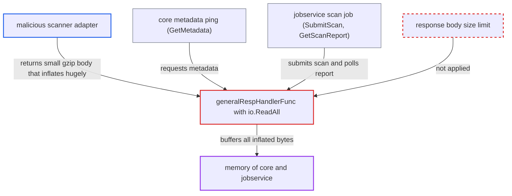

# Scanner adapter responses read into memory without size limit (decompression bomb)

| Field | Value |
|---|---|
| ID | `find_011sFipinakvb7XFVfte1ot9` |
| Severity | **High** |
| Status | open |
| CWE | CWE-770 — Unbounded resource allocation |
| Created | 2026-10-27T21:11:17.744617Z |
| Claude Security | https://claude.ai/security/findings/find_011sFipinakvb7XFVfte1ot9 |

## Description

A malicious or compromised scanner adapter registered in Harbor can crash or stall the core API and registry service, and the jobservice scan workers, by exhausting their memory. It needs no Harbor credentials, but a scanner the attacker controls must be registered. The scanner client's `generalRespHandlerFunc` reads every adapter response with `io.ReadAll` and no size limit, and gzip bodies are inflated automatically.

1. **attacker** runs or compromises a scanner adapter registered in Harbor. The report says the attacker needs no Harbor credentials, but a scanner they control must be registered.
2. **core controller** calls the adapter's `/api/v1/metadata` through `GetMetadata`. `GetRegistrationByProject` pings by default, and `getScannerAdapterMetadata` caches the result for 30 s for stored registrations, while `POST /scanners/ping` is not cached. ([`src/controller/scanner/base_controller.go:353-378`](https://github.com/cx-benchmark/harbor/blob/d822d80c2e6edb2c85538d4b9cd73c0c375a5596/src/controller/scanner/base_controller.go#L353-L378))
3. **jobservice scan job** calls `SubmitScan` and then polls `GetScanReport`, one goroutine per mime type. This is the second way in. Each scan job does it, and the default of 10 concurrent workers multiplies the memory used. ([`src/pkg/scan/job.go:213-270`](https://github.com/cx-benchmark/harbor/blob/d822d80c2e6edb2c85538d4b9cd73c0c375a5596/src/pkg/scan/job.go#L213-L270))
4. **scanner adapter** answers with a small gzip body that inflates to gigabytes. `NewClient` leaves `DisableCompression` false and the resolvers set no `Accept-Encoding`, so Go's transport asks for gzip and inflates the body transparently. ([`src/pkg/scan/rest/v1/client.go:82-110`](https://github.com/cx-benchmark/harbor/blob/d822d80c2e6edb2c85538d4b9cd73c0c375a5596/src/pkg/scan/rest/v1/client.go#L82-L110))
5. **the handler `generalRespHandlerFunc`** reads the whole inflated body into memory with `io.ReadAll(resp.Body)`. It does this before checking the status code, so success and non-2xx error responses are both affected. The 5-second `http.Client.Timeout` limits time, not bytes, and a few MB of gzip (roughly 1000:1) can inflate to gigabytes in that window. ([`src/pkg/scan/rest/v1/client.go:263-296`](https://github.com/cx-benchmark/harbor/blob/d822d80c2e6edb2c85538d4b9cd73c0c375a5596/src/pkg/scan/rest/v1/client.go#L263-L296))
6. **`fetchScanReportFromScanner`** copies the report body into a string and parses it. This makes more copies of whatever size the scanner sent, which adds to the memory pressure in jobservice. ([`src/pkg/scan/job.go:332-341`](https://github.com/cx-benchmark/harbor/blob/d822d80c2e6edb2c85538d4b9cd73c0c375a5596/src/pkg/scan/job.go#L332-L341))

## Assessment

The attacker runs, or has compromised, a scanner adapter that is registered in Harbor. No Harbor credentials are needed. The attack starts whenever Harbor talks to that adapter. In core this happens on a scan, on `GET /projects/{id}/scanner`, in the registration APIs, or on the uncached `POST /scanners/ping`. In jobservice it happens when a scan job submits a scan or polls for the report. Even without compression, a fast link can deliver very large raw bodies.

Impact: The attacker can exhaust memory in the core process or in jobservice workers. This can crash or stall core's API and registry service and all async jobs. No data is disclosed or modified.

## Recommendation

The v1 scanner client buffers untrusted adapter response bodies with an unbounded `io.ReadAll`. The transport also inflates gzip transparently, so the 5-second client timeout does not limit memory use.

Fix criteria: Every adapter response body the client reads (metadata, scan submit, report and error bodies) is capped at a defined maximum size. Oversized responses are rejected as an error. A test with an adapter that returns a gzip body inflating beyond the cap shows the ping or report fetch failing with a bounded allocation, without reading the whole body.

## Evidence

**https://github.com/cx-benchmark/harbor**

- [`src/pkg/scan/rest/v1/client.go:263-296`](https://github.com/cx-benchmark/harbor/blob/d822d80c2e6edb2c85538d4b9cd73c0c375a5596/src/pkg/scan/rest/v1/client.go#L263-L296)
- [`src/pkg/scan/rest/v1/client.go:82-110`](https://github.com/cx-benchmark/harbor/blob/d822d80c2e6edb2c85538d4b9cd73c0c375a5596/src/pkg/scan/rest/v1/client.go#L82-L110)
- [`src/pkg/scan/rest/v1/spec.go:87-120`](https://github.com/cx-benchmark/harbor/blob/d822d80c2e6edb2c85538d4b9cd73c0c375a5596/src/pkg/scan/rest/v1/spec.go#L87-L120)
- [`src/controller/scanner/base_controller.go:353-378`](https://github.com/cx-benchmark/harbor/blob/d822d80c2e6edb2c85538d4b9cd73c0c375a5596/src/controller/scanner/base_controller.go#L353-L378)
- [`src/pkg/scan/job.go:213-270`](https://github.com/cx-benchmark/harbor/blob/d822d80c2e6edb2c85538d4b9cd73c0c375a5596/src/pkg/scan/job.go#L213-L270)
- [`src/pkg/scan/job.go:332-341`](https://github.com/cx-benchmark/harbor/blob/d822d80c2e6edb2c85538d4b9cd73c0c375a5596/src/pkg/scan/job.go#L332-L341)
- [`src/pkg/scan/job.go:605-611`](https://github.com/cx-benchmark/harbor/blob/d822d80c2e6edb2c85538d4b9cd73c0c375a5596/src/pkg/scan/job.go#L605-L611)

