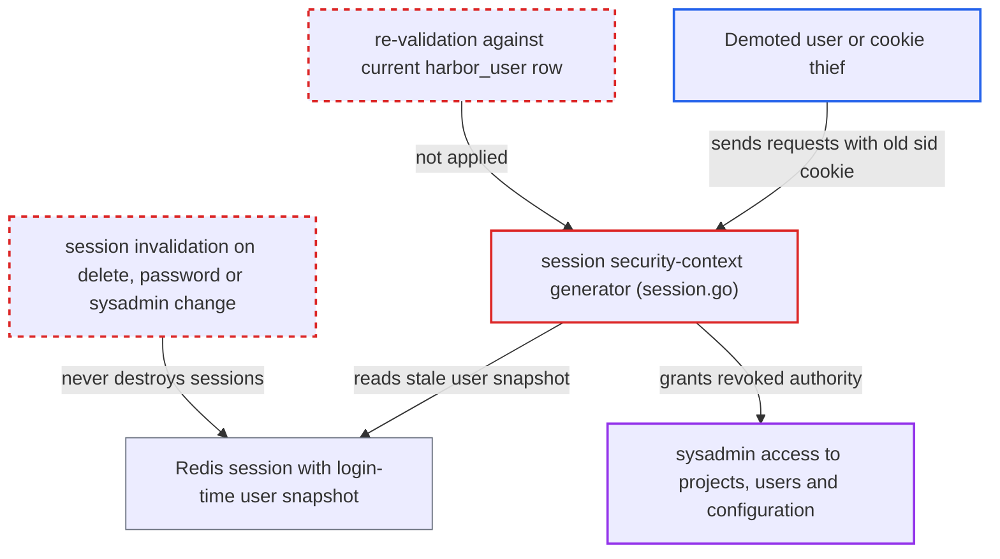

# Session security context trusts login-time user snapshot; demotion or deletion not re-validated

| Field | Value |
|---|---|
| ID | `find_01DPQL1LJXPz8Xgi8giMsoeh` |
| Severity | **High** |
| Status | open |
| CWE | CWE-613 — Insufficient session expiration |
| Created | 2026-10-27T21:21:06.819748Z |
| Claude Security | https://claude.ai/security/findings/find_01DPQL1LJXPz8Xgi8giMsoeh |

## Description

A demoted or deleted user, or anyone holding a stolen `sid` session cookie, keeps full access after an administrator revokes it. For a sysadmin this means read and write access to all projects, users and configuration. The attacker needs an already logged-in session and must keep sending requests. The `session` security-context generator builds permissions from a login-time snapshot and never re-checks the current user record.

1. **User or cookie thief** logs in and holds a session. `PopulateUserSession` stores the `models.User` struct in the Redis session at login, including `SysAdminFlag` and `AdminRoleInAuth`.
2. **Administrator** revokes the account. The administrator clears `sysadmin_flag` via `SetUserSysAdmin`, deletes the user with `controller.Delete`, or rotates the password with `UpdatePassword`. These calls only change the database and do not invalidate the user's sessions. ([`src/controller/user/controller.go:180-245`](https://github.com/cx-benchmark/harbor/blob/d822d80c2e6edb2c85538d4b9cd73c0c375a5596/src/controller/user/controller.go#L180-L245))
3. **the `session` generator** builds the security context from the stored snapshot. It passes the session's `models.User` unchanged to `local.NewSecurityContext(&user)` and never looks up the current `harbor_user` row. ([`src/server/middleware/security/session.go:38-48`](https://github.com/cx-benchmark/harbor/blob/d822d80c2e6edb2c85538d4b9cd73c0c375a5596/src/server/middleware/security/session.go#L38-L48))
4. **`local.SecurityContext.IsSysAdmin()`** still reports system administrator. It returns `user.SysAdminFlag || user.AdminRoleInAuth` from the stale snapshot, so the revoked flag has no effect. ([`src/common/security/local/context.go:77-82`](https://github.com/cx-benchmark/harbor/blob/d822d80c2e6edb2c85538d4b9cd73c0c375a5596/src/common/security/local/context.go#L77-L82))
5. **Attacker** keeps sending requests to `/api/v2.0/*`. `releaseSession` resets the session TTL on each request unless the no-renewal header is present, so the session stays alive as long as the attacker stays active. ([`src/core/session/session.go:87-107`](https://github.com/cx-benchmark/harbor/blob/d822d80c2e6edb2c85538d4b9cd73c0c375a5596/src/core/session/session.go#L87-L107))

## Assessment

The attacker is a user whose privileges an administrator is revoking (sysadmin flag removed, account deleted, or password rotated after suspected compromise). It can also be anyone holding that user's stolen `sid` cookie. The attacker needs a session opened before the change and must keep it active. Each request renews the TTL, so the access ends only after a full period of inactivity. The default timeout is 60 minutes. `SessionDestroy` is called only when the user logs out.

Impact: A demoted system administrator keeps full sysadmin read and write access to all projects, users and configuration while the session stays active. A thief of an admin's session cookie keeps access after the admin's password is reset. A deleted user keeps whatever access the snapshot grants. The window is bounded only by the attacker stopping activity for the session timeout.

## Recommendation

(1) Authorization attributes (existence, sysadmin flag, auth-mode admin role) come from a login-time snapshot stored in the session, not from the current user record.

Fix criteria: On each session-authenticated request the security context reflects the user's current state. A deleted or disabled user gets no authenticated context. A user whose `sysadmin_flag` was cleared is no longer `IsSysAdmin()`. To verify, demote or delete a logged-in user and confirm their next request is denied or limited without waiting for the session to expire.

(2) Deleting a user, changing a password or changing the sysadmin flag does not invalidate that user's existing sessions.

Fix criteria: User deletion, password changes and sysadmin-flag changes invalidate (or version-stamp) all sessions of the affected user, so a previously issued `sid` is rejected afterwards. To verify, confirm that a session cookie obtained before a password reset no longer authenticates.

## Evidence

**https://github.com/cx-benchmark/harbor**

- [`src/server/middleware/security/session.go:38-48`](https://github.com/cx-benchmark/harbor/blob/d822d80c2e6edb2c85538d4b9cd73c0c375a5596/src/server/middleware/security/session.go#L38-L48)
- [`src/common/security/local/context.go:77-82`](https://github.com/cx-benchmark/harbor/blob/d822d80c2e6edb2c85538d4b9cd73c0c375a5596/src/common/security/local/context.go#L77-L82)
- [`src/controller/user/controller.go:180-245`](https://github.com/cx-benchmark/harbor/blob/d822d80c2e6edb2c85538d4b9cd73c0c375a5596/src/controller/user/controller.go#L180-L245)
- [`src/core/session/session.go:87-107`](https://github.com/cx-benchmark/harbor/blob/d822d80c2e6edb2c85538d4b9cd73c0c375a5596/src/core/session/session.go#L87-L107)

