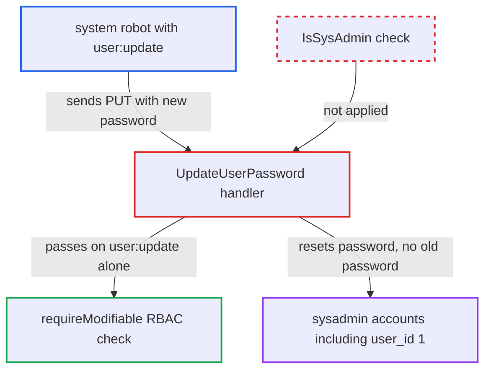

# System robot with user:update can reset sysadmin passwords and take over admin accounts

| Field | Value |
|---|---|
| ID | `find_01MgbANPk2oYbJ17wVvTUCyN` |
| Severity | **High** |
| Status | open |
| CWE | CWE-269 — Privilege escalation |
| Created | 2026-10-27T21:16:59.363208Z |
| Claude Security | https://claude.ai/security/findings/find_01MgbANPk2oYbJ17wVvTUCyN |

## Description

A system-level robot account that holds `user:update` can reset the password of any user, including the built-in super user, and then log in as that admin. The attacker needs only that robot's credential, in the default DB auth mode. The cause is that `requireModifiable` accepts the `user:update` permission alone and never checks `IsSysAdmin()`.

1. **attacker with a system robot** sends a password reset request for another user. The request is `PUT /api/v2.0/users/1/password` with Basic auth as the robot and a body containing `new_password`.
2. **`requireModifiable`** accepts the robot as an allowed caller. In DB auth mode a caller who is not the target user only has to pass `RequireSystemAccess(ctx, rbac.ActionUpdate, rbac.ResourceUser)`, and the robot's system `user:update` policy satisfies it. ([`src/server/v2.0/handler/user.go:411-428`](https://github.com/cx-benchmark/harbor/blob/d822d80c2e6edb2c85538d4b9cd73c0c375a5596/src/server/v2.0/handler/user.go#L411-L428))
3. **robot security context** reports that the caller is not a sysadmin. `IsSysAdmin()` always returns false for a robot, but no code on this path asks it. ([`src/common/security/robot/context.go:74-76`](https://github.com/cx-benchmark/harbor/blob/d822d80c2e6edb2c85538d4b9cd73c0c375a5596/src/common/security/robot/context.go#L74-L76))
4. **the handler `UpdateUserPassword`** skips old-password verification and sets the new password. `matchUserID` is false for a robot, so `u.ctl.UpdatePassword(ctx, uid, newPassword)` runs for whatever `user_id` is in the path, including `user_id` 1. ([`src/server/v2.0/handler/user.go:296-334`](https://github.com/cx-benchmark/harbor/blob/d822d80c2e6edb2c85538d4b9cd73c0c375a5596/src/server/v2.0/handler/user.go#L296-L334))
5. **attacker** logs in as `admin` with the new password. This gives the attacker full system administrator control of the registry.

## Assessment

The attacker holds a system-level robot account that has been granted `user:update`, for example a leaked CI credential created for user provisioning. No victim action is needed, and the report names no other precondition than the default DB auth mode. Two other routes use the same gate. A `user:update` robot can call `PUT /users/{id}` to rewrite a sysadmin's e-mail through `UpdateUserProfile`. Under OIDC auth it can call `PUT /users/{id}/cli_secret` to set any user's CLI secret through `requireForCLISecret`. The project clearly means `user:update` not to grant admin power, because `SetUserSysAdmin` adds an `IsSysAdmin()` check on top of the RBAC check. The password, e-mail and CLI-secret paths lack that check.

Impact: The attacker takes over the built-in admin or any other sysadmin account. That gives full control of Harbor: all projects and artifacts (push and delete), all configuration and all stored credentials. The only limit is that the robot must already hold `user:update`.

## Recommendation

`requireModifiable` and `requireForCLISecret` treat the `user:update` permission as enough to change another user's credentials. Robots can hold that permission without being sysadmins, so a non-admin credential can take over an admin identity.

Fix criteria: Changing another user's password, e-mail or CLI secret requires a real system administrator (`IsSysAdmin()`), as `SetUserSysAdmin` already does. A robot with system `user:update` calling `PUT /users/1/password` gets 403. Refusing credential changes on `sysadmin_flag` users from any non-sysadmin principal is also worth considering. A test with a system robot holding only `user:update` shows that password, profile and cli_secret updates of other users are all denied.

## Evidence

**https://github.com/cx-benchmark/harbor**

- [`src/server/v2.0/handler/user.go:296-334`](https://github.com/cx-benchmark/harbor/blob/d822d80c2e6edb2c85538d4b9cd73c0c375a5596/src/server/v2.0/handler/user.go#L296-L334)
- [`src/server/v2.0/handler/user.go:411-428`](https://github.com/cx-benchmark/harbor/blob/d822d80c2e6edb2c85538d4b9cd73c0c375a5596/src/server/v2.0/handler/user.go#L411-L428)
- [`src/server/v2.0/handler/user.go:337-352`](https://github.com/cx-benchmark/harbor/blob/d822d80c2e6edb2c85538d4b9cd73c0c375a5596/src/server/v2.0/handler/user.go#L337-L352)
- [`src/common/rbac/const.go:122-131`](https://github.com/cx-benchmark/harbor/blob/d822d80c2e6edb2c85538d4b9cd73c0c375a5596/src/common/rbac/const.go#L122-L131)
- [`src/common/security/robot/context.go:74-76`](https://github.com/cx-benchmark/harbor/blob/d822d80c2e6edb2c85538d4b9cd73c0c375a5596/src/common/security/robot/context.go#L74-L76)
- [`src/server/v2.0/handler/user.go:355-368`](https://github.com/cx-benchmark/harbor/blob/d822d80c2e6edb2c85538d4b9cd73c0c375a5596/src/server/v2.0/handler/user.go#L355-L368)

