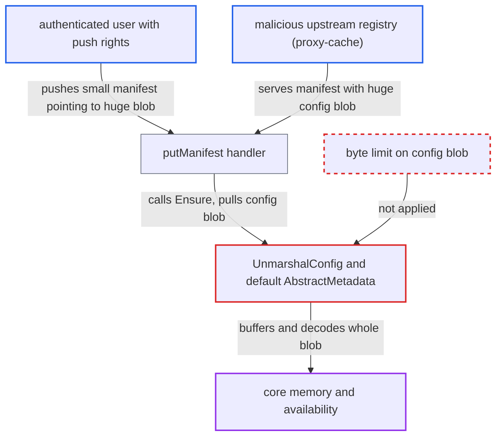

# Unbounded decode of pushed manifest config blob exhausts core memory

| Field | Value |
|---|---|
| ID | `find_018WgphZPqYppfdjfV4NLb4n` |
| Severity | **High** |
| Status | open |
| CWE | CWE-770 — Resource exhaustion |
| Created | 2026-10-27T21:12:51.067676Z |
| Claude Security | https://claude.ai/security/findings/find_018WgphZPqYppfdjfV4NLb4n |

## Description

Any authenticated user or robot with push rights can crash or stall Harbor core, which serves the API, the portal and the registry endpoint for every tenant. They upload a huge JSON config blob and push a small manifest that points to it. `UnmarshalConfig` and the default processor's `AbstractMetadata` decode the blob with no byte limit, so core runs out of memory. No data is disclosed or changed.

1. **attacker with push rights** uploads a multi-GB JSON config blob. Blob uploads are streamed, nginx has `client_max_body_size 0`, and the default project storage quota is unlimited (`storage_per_project` -1).
2. **attacker** pushes a small manifest that references the blob. The manifest body is capped at 4 MiB by `common.MaxManifestBodySize`, but the blob it points to is not capped. ([`src/server/registry/manifest.go:189-233`](https://github.com/cx-benchmark/harbor/blob/d822d80c2e6edb2c85538d4b9cd73c0c375a5596/src/server/registry/manifest.go#L189-L233))
3. **the handler `putManifest`** calls `artifact.Ctl.Ensure` during the push request. `ensureArtifact` runs `AbstractMetadata` before the artifact row is created, and the processor is chosen from the config media type or `artifactType` that the pusher controls. ([`src/controller/artifact/controller.go:227-249`](https://github.com/cx-benchmark/harbor/blob/d822d80c2e6edb2c85538d4b9cd73c0c375a5596/src/controller/artifact/controller.go#L227-L249))
4. **the processor code `UnmarshalConfig`** reads the blob and runs `json.NewDecoder(blob).Decode(v)` with no limit. The only check is that the declared `config.size` is non-zero, and the real blob is read whatever size it declares. ([`src/controller/artifact/processor/base/manifest.go:83-101`](https://github.com/cx-benchmark/harbor/blob/d822d80c2e6edb2c85538d4b9cd73c0c375a5596/src/controller/artifact/processor/base/manifest.go#L83-L101))
5. **the JSON decoder** buffers the whole value in memory before unmarshalling. The buffer grows by doubling. For the image processor the target is `v1.Image`, so every ordinary image push allocates at least the blob size. ([`src/controller/artifact/processor/image/manifest_v2.go:56-58`](https://github.com/cx-benchmark/harbor/blob/d822d80c2e6edb2c85538d4b9cd73c0c375a5596/src/controller/artifact/processor/image/manifest_v2.go#L56-L58))
6. **the default processor and the processors built without properties** decode the blob into `map[string]any` and keep it as `ExtraAttrs`. This costs several times the document size in heap, and the result is stored in `artifact.extra_attrs`. ([`src/controller/artifact/processor/default.go:105-118`](https://github.com/cx-benchmark/harbor/blob/d822d80c2e6edb2c85538d4b9cd73c0c375a5596/src/controller/artifact/processor/default.go#L105-L118))
7. **attacker** re-pushes the same manifest, or pushes many manifests that reference the one blob. A failed abstraction leaves no artifact row, so the same small manifest can be pushed again and each push repeats the large allocation until core is killed for lack of memory. ([`src/controller/artifact/controller.go:227-249`](https://github.com/cx-benchmark/harbor/blob/d822d80c2e6edb2c85538d4b9cd73c0c375a5596/src/controller/artifact/controller.go#L227-L249))

## Assessment

The attacker is any authenticated user or robot with push rights. By default any user can create a project, so such rights are easy to get. They upload a multi-GB config blob, for example a plain image config or one with a media type like `application/vnd.cncf.helm.config.v1+json`. Then they push a small manifest that references it, and repeat the push or send variants concurrently. A second way in is a malicious upstream registry that serves such a manifest through proxy-cache. The report says the same code also runs when replication pushes manifests into core.

Impact: The attacker can drive core out of memory, so it crashes or stalls for all tenants, and one stored blob makes this cheap to repeat. If core survives, an oversized `extra_attrs` row is stored. That row is re-read on artifact listings, and each `GET .../additions/build_history` request decodes the config again. No data is disclosed or modified.

## Recommendation

`UnmarshalConfig` and the default processor read and decode a config blob of attacker-chosen size with no byte limit, and keep the whole decoded document as `ExtraAttrs`.

Fix criteria: A config blob above a fixed cap is never fully buffered or decoded. Both the declared `config.size` and the bytes actually read are bounded, and reading fails as soon as the cap is exceeded. The data persisted to `extra_attrs` is bounded. Pushing a manifest whose config blob exceeds the cap is rejected, or recorded without metadata, and core memory stays bounded. Re-pushing it, or requesting build_history, does not grow memory. Normal image and chart configs are still abstracted.

## Evidence

**https://github.com/cx-benchmark/harbor**

- [`src/controller/artifact/processor/base/manifest.go:83-101`](https://github.com/cx-benchmark/harbor/blob/d822d80c2e6edb2c85538d4b9cd73c0c375a5596/src/controller/artifact/processor/base/manifest.go#L83-L101)
- [`src/controller/artifact/processor/base/manifest.go:45-54`](https://github.com/cx-benchmark/harbor/blob/d822d80c2e6edb2c85538d4b9cd73c0c375a5596/src/controller/artifact/processor/base/manifest.go#L45-L54)
- [`src/controller/artifact/processor/default.go:105-118`](https://github.com/cx-benchmark/harbor/blob/d822d80c2e6edb2c85538d4b9cd73c0c375a5596/src/controller/artifact/processor/default.go#L105-L118)
- [`src/controller/artifact/processor/image/manifest_v2.go:56-58`](https://github.com/cx-benchmark/harbor/blob/d822d80c2e6edb2c85538d4b9cd73c0c375a5596/src/controller/artifact/processor/image/manifest_v2.go#L56-L58)
- [`src/server/registry/manifest.go:189-233`](https://github.com/cx-benchmark/harbor/blob/d822d80c2e6edb2c85538d4b9cd73c0c375a5596/src/server/registry/manifest.go#L189-L233)
- [`src/controller/artifact/controller.go:227-249`](https://github.com/cx-benchmark/harbor/blob/d822d80c2e6edb2c85538d4b9cd73c0c375a5596/src/controller/artifact/controller.go#L227-L249)
- [`src/controller/artifact/abstractor.go:43-63`](https://github.com/cx-benchmark/harbor/blob/d822d80c2e6edb2c85538d4b9cd73c0c375a5596/src/controller/artifact/abstractor.go#L43-L63)

