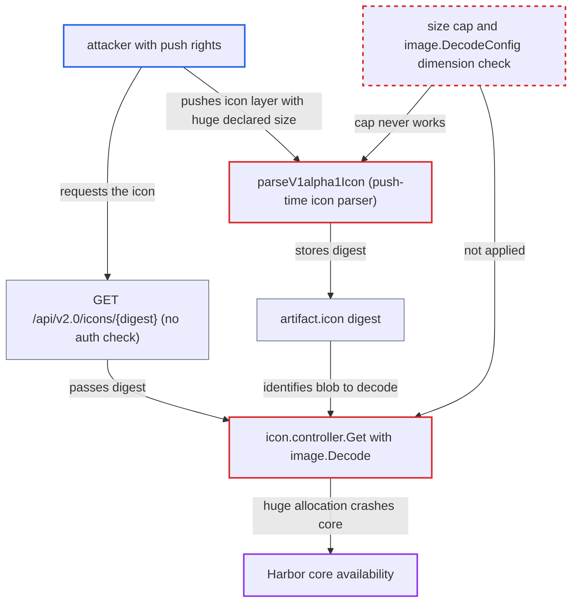

# Unbounded image decode of artifact icon lets a pusher crash Harbor core (image bomb)

| Field | Value |
|---|---|
| ID | `find_01ARmn6JWfP7JrNqz5XZfA3Y` |
| Severity | **High** |
| Status | open |
| CWE | CWE-409 — Decompression bomb |
| Created | 2026-10-27T21:08:40.619916Z |
| Claude Security | https://claude.ai/security/findings/find_01ARmn6JWfP7JrNqz5XZfA3Y |

## Description

A user with push rights on any project can crash Harbor core and take down the REST API, the portal backend, the token service and the `/v2` registry proxy until core restarts. The attacker pushes an artifact whose icon is a tiny image that declares huge dimensions. The icon controller `icon.controller.Get` then decodes it with `image.Decode` and no bound on dimensions or bytes read.

1. **attacker with push rights** pushes an OCI manifest with a booby-trapped icon layer. The manifest uses an unregistered config media type. One layer carries the `io.goharbor.artifact.v1alpha1.icon` annotation, and its blob is a tiny PNG whose IHDR declares, for example, 100000x100000 RGBA. ([`src/server/registry/manifest.go:228-233`](https://github.com/cx-benchmark/harbor/blob/d822d80c2e6edb2c85538d4b9cd73c0c375a5596/src/server/registry/manifest.go#L228-L233))
2. **default processor** routes the manifest to the annotation parser. `processor.Get` falls back to the default processor for any unregistered config media type, and that processor runs the annotation parser. ([`src/controller/artifact/processor/default.go:95-127`](https://github.com/cx-benchmark/harbor/blob/d822d80c2e6edb2c85538d4b9cd73c0c375a5596/src/controller/artifact/processor/default.go#L95-L127))
3. **the parser `parseV1alpha1Icon`** accepts the layer as the artifact's icon. The only working check is `http.DetectContentType` on the first bytes. The 1MB cap never applies because the `err == io.EOF` branch after `io.ReadAll` can never run, so the icon digest is stored in `artifact.icon`. ([`src/controller/artifact/annotation/v1alpha1.go:76-112`](https://github.com/cx-benchmark/harbor/blob/d822d80c2e6edb2c85538d4b9cd73c0c375a5596/src/controller/artifact/annotation/v1alpha1.go#L76-L112))
4. **attacker, the portal or any client** requests `GET /api/v2.0/icons/{digest}`. `GetIcon` has no `RequireAuthenticated` and no project-permission check. The portal also calls this endpoint for every artifact it lists. ([`src/server/v2.0/handler/icon.go:38-48`](https://github.com/cx-benchmark/harbor/blob/d822d80c2e6edb2c85538d4b9cd73c0c375a5596/src/server/v2.0/handler/icon.go#L38-L48))
5. **the controller `icon.controller.Get`** streams the blob into `image.Decode`. No `image.DecodeConfig` check and no byte limit come first. Go's PNG decoder allocates the whole pixel buffer from the header dimensions before it reads pixel data. ([`src/controller/icon/controller.go:152-162`](https://github.com/cx-benchmark/harbor/blob/d822d80c2e6edb2c85538d4b9cd73c0c375a5596/src/controller/icon/controller.go#L152-L162))
6. **Go runtime** ends the core process when the allocation is refused. The runtime fails with an unrecoverable `runtime: out of memory`. Failed decodes are not cached, so each request repeats the decode. ([`src/controller/icon/controller.go:152-162`](https://github.com/cx-benchmark/harbor/blob/d822d80c2e6edb2c85538d4b9cd73c0c375a5596/src/controller/icon/controller.go#L152-L162))

## Assessment

The attacker is a low-privileged user or robot with push rights on any project. By default every user may create projects. They push with a tool such as `oras`. Once the icon digest is stored, the attacker, the portal or any client can trigger the decode by requesting `GET /api/v2.0/icons/<digest>`, which needs no authorization. Any user who browses the repository in the portal triggers it too. The attacker can repeat this at will.

Impact: Each request can kill the core process through memory exhaustion. The REST API, the portal backend, the token service and the `/v2` registry proxy stay down until core restarts. Nothing is disclosed or modified. Where the allocation is granted, highly compressible pixel data fills it, and the blob size is not bounded.

## Recommendation

(1) `icon.controller.Get` decodes a pusher-supplied icon blob with `image.Decode`. It puts no bound on the declared dimensions or on the bytes read, so a header-only image bomb forces a huge allocation and crashes core.

Fix criteria: Before any full decode, the declared dimensions are read from a bounded reader with `image.DecodeConfig`. The icon is rejected when width\*height exceeds a small fixed budget. The stream also has a hard byte limit. Requesting `GET /api/v2.0/icons/{digest}` for an artifact whose icon is a PNG declaring 100000x100000 returns an error quickly, and core memory stays bounded.

(2) `parseV1alpha1Icon` is meant to cap icons at 1MB. It checks `err == io.EOF` after `io.ReadAll`, which never returns `io.EOF`, so oversized or malformed blobs are accepted as icons without validation.

Fix criteria: Push-time validation rejects icons over the size cap: it reads limit+1 bytes and fails if more than the limit arrive. It also rejects icons whose dimensions, read with `image.DecodeConfig`, exceed the budget. No non-conforming blob is stored as `artifact.icon`. Pushing such a layer does not set `artifact.icon`.

## Evidence

**https://github.com/cx-benchmark/harbor**

- [`src/controller/icon/controller.go:152-162`](https://github.com/cx-benchmark/harbor/blob/d822d80c2e6edb2c85538d4b9cd73c0c375a5596/src/controller/icon/controller.go#L152-L162)
- [`src/controller/artifact/annotation/v1alpha1.go:76-112`](https://github.com/cx-benchmark/harbor/blob/d822d80c2e6edb2c85538d4b9cd73c0c375a5596/src/controller/artifact/annotation/v1alpha1.go#L76-L112)
- [`src/controller/artifact/processor/default.go:95-127`](https://github.com/cx-benchmark/harbor/blob/d822d80c2e6edb2c85538d4b9cd73c0c375a5596/src/controller/artifact/processor/default.go#L95-L127)
- [`src/server/registry/manifest.go:228-233`](https://github.com/cx-benchmark/harbor/blob/d822d80c2e6edb2c85538d4b9cd73c0c375a5596/src/server/registry/manifest.go#L228-L233)
- [`src/server/v2.0/handler/icon.go:38-48`](https://github.com/cx-benchmark/harbor/blob/d822d80c2e6edb2c85538d4b9cd73c0c375a5596/src/server/v2.0/handler/icon.go#L38-L48)

