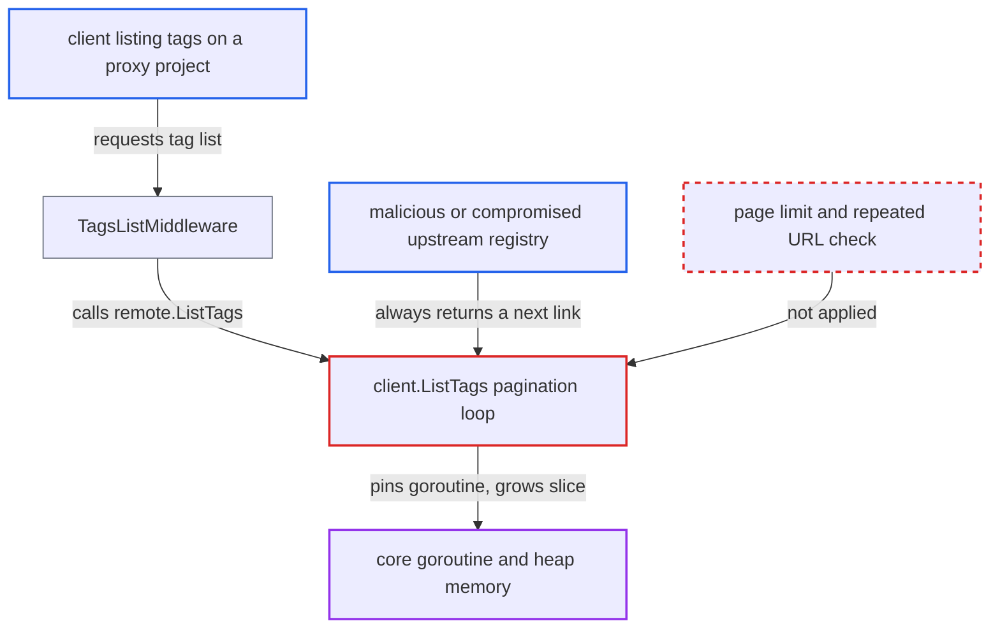

# Unbounded Link-header pagination lets upstream pin core goroutines in an endless tag-list loop

| Field | Value |
|---|---|
| ID | `find_01NfyZsdkbU8DvcXkTNmyPU9` |
| Severity | **High** |
| Status | open |
| CWE | CWE-835 — Infinite loop |
| Created | 2026-10-27T21:15:26.663750Z |
| Claude Security | https://claude.ai/security/findings/find_01NfyZsdkbU8DvcXkTNmyPU9 |

## Description

A malicious or compromised upstream registry can keep Harbor's core service busy forever and use up its memory, which takes the registry API and portal down for all users. The upstream must be configured for a proxy project. Any client allowed to list tags on that project can trigger it, and anonymous clients can if the project is public. The cause is `client.ListTags` and `client.Catalog`, which follow the `Link` header's `rel="next"` links with no page limit, no repeated-URL check and no cap on results.

1. **client** requests the tag list of a proxy project. The request is `GET /v2/<proxy-project>/<repo>/tags/list`. Anonymous access is enough if the project is public, and the attacker can be this client. ([`src/server/middleware/repoproxy/tag.go:89-100`](https://github.com/cx-benchmark/harbor/blob/d822d80c2e6edb2c85538d4b9cd73c0c375a5596/src/server/middleware/repoproxy/tag.go#L89-L100))
2. **the middleware `TagsListMiddleware`** calls `remote.ListTags` in the request goroutine. The call is synchronous, so the response is only sent after the call returns. ([`src/server/middleware/repoproxy/tag.go:89-100`](https://github.com/cx-benchmark/harbor/blob/d822d80c2e6edb2c85538d4b9cd73c0c375a5596/src/server/middleware/repoproxy/tag.go#L89-L100))
3. **the helper `remoteHelper.ListTags`** passes the call to the adapter's registry client. The proxy layer adds no page or size limit. ([`src/controller/proxy/remote.go:105-107`](https://github.com/cx-benchmark/harbor/blob/d822d80c2e6edb2c85538d4b9cd73c0c375a5596/src/controller/proxy/remote.go#L105-L107))
4. **malicious upstream** answers every page with a valid tag array and a new same-origin `Link` header with `rel="next"`. It can also return the same `last=` link forever. `nextPageURL` only checks that the link stays on the registry origin. ([`src/pkg/registry/client.go:203-223`](https://github.com/cx-benchmark/harbor/blob/d822d80c2e6edb2c85538d4b9cd73c0c375a5596/src/pkg/registry/client.go#L203-L223))
5. **`client.ListTags`** keeps fetching pages and appending every tag to an in-memory slice. The loop ends only when the remote stops sending a `next` link. There is no page cap, no repeated-URL detection and no cap on the number of tags. ([`src/pkg/registry/client.go:203-223`](https://github.com/cx-benchmark/harbor/blob/d822d80c2e6edb2c85538d4b9cd73c0c375a5596/src/pkg/registry/client.go#L203-L223))
6. **core service** stays pinned and runs out of memory. The page requests carry no context, so a client disconnect or the nginx `proxy_read_timeout` does not stop the loop. `http.Client.Timeout` applies to each page, not to the whole loop.

## Assessment

The attacker controls the upstream registry behind a proxy project, or has compromised it. The project's upstream registry is that registry. The request that triggers the loop can come from any client allowed to list tags on the project, including an anonymous one if the project is public. No user interaction is needed. The same unbounded loop also runs in core's replication flow, where `src/controller/replication/execution.go:147` starts a goroutine that calls `FetchArtifacts`, which reaches the native adapter's `Catalog` and `ListTags`. All proxy-capable adapters embed `native.Adapter`, so all of them use this client.

Impact: The attacker can hold core goroutines and upstream connections forever, and the heap grows with every page. This can exhaust memory and take the registry API and portal down for all users. Confidentiality and integrity are not affected, only availability.

## Recommendation

`client.ListTags` and `client.Catalog` follow the remote's `Link` pagination with no bound on page count, no repeated-URL detection and no limit on the accumulated result. The remote therefore decides how long the loop runs and how much memory it uses.

Fix criteria: Pagination stops with an error after a fixed maximum number of pages (or total entries). It also stops with an error when a `next` URL repeats one already fetched. The proxy tag-list path tolerates that error by falling back to local tags. To verify, point a proxy project at a test registry that always returns a `rel=next` link. The tag-list request must then return within bounded time and memory.

## Evidence

**https://github.com/cx-benchmark/harbor**

- [`src/pkg/registry/client.go:203-223`](https://github.com/cx-benchmark/harbor/blob/d822d80c2e6edb2c85538d4b9cd73c0c375a5596/src/pkg/registry/client.go#L203-L223)
- [`src/pkg/registry/client.go:157-177`](https://github.com/cx-benchmark/harbor/blob/d822d80c2e6edb2c85538d4b9cd73c0c375a5596/src/pkg/registry/client.go#L157-L177)
- [`src/server/middleware/repoproxy/tag.go:89-100`](https://github.com/cx-benchmark/harbor/blob/d822d80c2e6edb2c85538d4b9cd73c0c375a5596/src/server/middleware/repoproxy/tag.go#L89-L100)
- [`src/controller/proxy/remote.go:105-107`](https://github.com/cx-benchmark/harbor/blob/d822d80c2e6edb2c85538d4b9cd73c0c375a5596/src/controller/proxy/remote.go#L105-L107)

