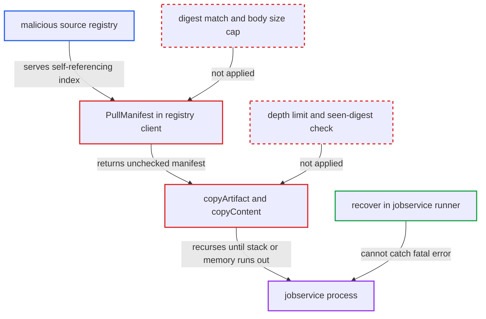

# Unbounded nested-index recursion in replication transfer exhausts jobservice stack/memory

| Field | Value |
|---|---|
| ID | `find_01PVKHk1mFK7gACgR38pSE4E` |
| Severity | **High** |
| Status | open |
| CWE | CWE-674 — Uncontrolled recursion |
| Created | 2026-10-27T21:12:51.001350Z |
| Claude Security | https://claude.ai/security/findings/find_01PVKHk1mFK7gACgR38pSE4E |

## Description

A malicious or compromised source registry can crash the whole Harbor jobservice process, which stops replication, garbage collection, scans, retention, webhooks and preheat until it restarts. The attacker needs no Harbor account. A Harbor admin must have set up a pull-replication policy that points at the attacker's registry. The cause is that `copyArtifact` and `copyContent` follow nested index manifests with no depth limit and no check for repeated digests.

1. **the replication job `Replication.Run`** starts a pull transfer from the configured source registry. The job runs inside the shared jobservice process and calls `trans.Transfer` when the policy fires, whether by schedule, manual run or event. ([`src/jobservice/job/impl/replication/replication.go:67-118`](https://github.com/cx-benchmark/harbor/blob/d822d80c2e6edb2c85538d4b9cd73c0c375a5596/src/jobservice/job/impl/replication/replication.go#L67-L118))
2. **the registry client `PullManifest`** fetches the manifest and trusts whatever the remote returns. It reads the body with an unbounded `io.ReadAll`, picks the unmarshaller from the remote's `Content-Type`, and returns the remote's `Docker-Content-Digest` header without comparing it to the requested digest. ([`src/pkg/registry/client.go:272-300`](https://github.com/cx-benchmark/harbor/blob/d822d80c2e6edb2c85538d4b9cd73c0c375a5596/src/pkg/registry/client.go#L272-L300))
3. **the malicious source registry** answers every by-digest manifest request with an OCI index whose only child is another index. A single self-referencing index is enough. A registry that does verify digests could instead serve a precomputed chain of correctly hashed nested indexes of any depth.
4. **the function `copyArtifact`** loops over `manifest.References()` and calls `copyContent` for each child. The destination does not have the manifest yet, so the `exist` short-circuit does not stop the copy. ([`src/controller/replication/transfer/image/transfer.go:210-257`](https://github.com/cx-benchmark/harbor/blob/d822d80c2e6edb2c85538d4b9cd73c0c375a5596/src/controller/replication/transfer/image/transfer.go#L210-L257))
5. **the function `copyContent`** calls `copyArtifact` again for each child whose declared media type is an index, manifest list or manifest. Nothing limits the depth and no set of already-seen digests is kept, so the remote's documents decide how deep the recursion goes. ([`src/controller/replication/transfer/image/transfer.go:260-285`](https://github.com/cx-benchmark/harbor/blob/d822d80c2e6edb2c85538d4b9cd73c0c375a5596/src/controller/replication/transfer/image/transfer.go#L260-L285))
6. **the function `copyArtifact`** keeps every frame and its parsed manifest alive while the recursion goes deeper. A parent manifest is pushed only after all of its children, so the destination never holds a digest of the chain and the `exist` check never fires. ([`src/controller/replication/transfer/image/transfer.go:210-257`](https://github.com/cx-benchmark/harbor/blob/d822d80c2e6edb2c85538d4b9cd73c0c375a5596/src/controller/replication/transfer/image/transfer.go#L210-L257))
7. **the jobservice process** dies when the goroutine stack limit or memory is exceeded. These are fatal runtime errors, so the `recover()` in `src/jobservice/runner/redis.go` does not catch them and every job in the process is lost. ([`src/jobservice/runner/redis.go:165-202`](https://github.com/cx-benchmark/harbor/blob/d822d80c2e6edb2c85538d4b9cd73c0c375a5596/src/jobservice/runner/redis.go#L165-L202))
8. **the job runner** reschedules the interrupted job after the restart. The runner reschedules jobs a crash interrupted, and `Replication.ShouldRetry()` returns true, so the job can crash the process again. ([`src/jobservice/runner/redis.go:165-202`](https://github.com/cx-benchmark/harbor/blob/d822d80c2e6edb2c85538d4b9cd73c0c375a5596/src/jobservice/runner/redis.go#L165-L202))

## Assessment

The attacker runs, or has compromised, a registry that a Harbor admin configured as a pull-replication source. No Harbor account is needed. The attacker cannot cause the policy to point at their registry. They only wait for the policy to run, by schedule, manual run or event trigger. Then they answer every manifest request with an OCI index whose only child declares the index media type. A registry that checks digests can still do this by serving a precomputed chain of correctly hashed nested indexes of any depth.

Impact: The attacker can crash the whole jobservice process, not only the replication job. Replication, GC, scans, retention, webhooks and preheat stay down until a restart, and the rescheduled job can crash it again. Nothing is disclosed or modified, because the attacker's chain is never pushed.

## Recommendation

(1) `copyContent` and `copyArtifact` follow nested manifest descriptors recursively with no depth limit and no detection of digests already on the current path. The remote's structure therefore controls the recursion depth and the memory the jobservice goroutine holds.

Fix criteria: Replicating from a registry that returns a self-referencing or very deeply nested index ends the task with a logged error, once a small fixed nesting depth is exceeded or a digest repeats on the path. The jobservice process stays up and keeps serving other jobs.

(2) `PullManifest` accepts any body size and does not check that a manifest fetched by digest hashes to that digest. The remote can therefore substitute arbitrary content for any digest.

Fix criteria: For a by-digest pull, a payload whose digest differs from the requested one is rejected. The body read is capped at a fixed manifest size. A remote that returns mismatched or oversized content produces an error, not a parsed manifest.

## Evidence

**https://github.com/cx-benchmark/harbor**

- [`src/controller/replication/transfer/image/transfer.go:260-285`](https://github.com/cx-benchmark/harbor/blob/d822d80c2e6edb2c85538d4b9cd73c0c375a5596/src/controller/replication/transfer/image/transfer.go#L260-L285)
- [`src/controller/replication/transfer/image/transfer.go:210-257`](https://github.com/cx-benchmark/harbor/blob/d822d80c2e6edb2c85538d4b9cd73c0c375a5596/src/controller/replication/transfer/image/transfer.go#L210-L257)
- [`src/pkg/registry/client.go:272-300`](https://github.com/cx-benchmark/harbor/blob/d822d80c2e6edb2c85538d4b9cd73c0c375a5596/src/pkg/registry/client.go#L272-L300)
- [`src/pkg/reg/adapter/native/adapter.go:59-77`](https://github.com/cx-benchmark/harbor/blob/d822d80c2e6edb2c85538d4b9cd73c0c375a5596/src/pkg/reg/adapter/native/adapter.go#L59-L77)
- [`src/jobservice/runner/redis.go:165-202`](https://github.com/cx-benchmark/harbor/blob/d822d80c2e6edb2c85538d4b9cd73c0c375a5596/src/jobservice/runner/redis.go#L165-L202)
- [`src/jobservice/job/impl/replication/replication.go:67-118`](https://github.com/cx-benchmark/harbor/blob/d822d80c2e6edb2c85538d4b9cd73c0c375a5596/src/jobservice/job/impl/replication/replication.go#L67-L118)
- [`src/controller/replication/flow/stage.go:60-74`](https://github.com/cx-benchmark/harbor/blob/d822d80c2e6edb2c85538d4b9cd73c0c375a5596/src/controller/replication/flow/stage.go#L60-L74)

