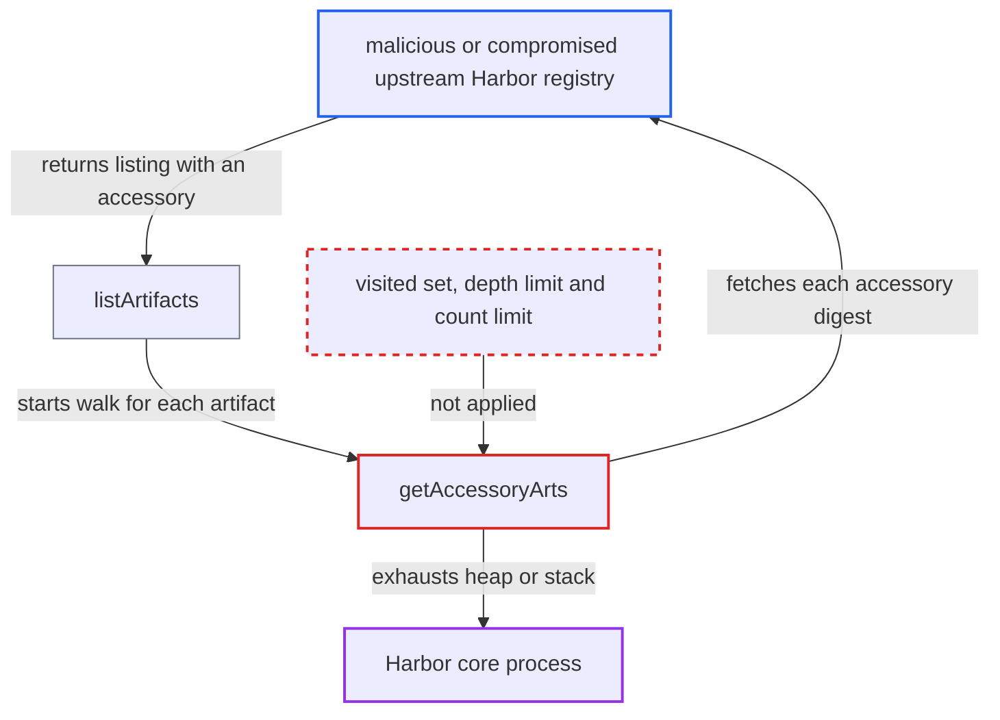

# Unbounded recursion over remote-supplied accessory graph in Harbor v2 replication adapter

| Field | Value |
|---|---|
| ID | `find_01VdqG7hYxxSmjckWttiYLZy` |
| Severity | **High** |
| Status | open |
| CWE | CWE-674 — Uncontrolled recursion |
| Created | 2026-10-27T21:12:05.282955Z |
| Claude Security | https://claude.ai/security/findings/find_01VdqG7hYxxSmjckWttiYLZy |

## Description

A malicious or compromised upstream Harbor registry can crash Harbor's core process. Core is the API server, token service and `/v2` front end, so all users lose it. The attack needs a replication policy whose source is that registry. The cause is `getAccessoryArts`, which keeps recursing on accessories the remote supplies, with no visited set, depth limit or count limit.

1. **upstream registry** answers the artifact listing with one artifact that has an accessory. The listing request is `/api/v2.0/projects/{p}/repositories/{r}/artifacts?with_accessory=true`, and one listed artifact is enough to start the walk. ([`src/pkg/reg/adapter/harbor/v2/client.go:50-102`](https://github.com/cx-benchmark/harbor/blob/d822d80c2e6edb2c85538d4b9cd73c0c375a5596/src/pkg/reg/adapter/harbor/v2/client.go#L50-L102))
2. **the method `listArtifacts`** calls `getAccessoryArts` for each listed artifact and each index reference. This happens before any policy filter is applied, so the filters cannot stop it. ([`src/pkg/reg/adapter/harbor/v2/client.go:50-102`](https://github.com/cx-benchmark/harbor/blob/d822d80c2e6edb2c85538d4b9cd73c0c375a5596/src/pkg/reg/adapter/harbor/v2/client.go#L50-L102))
3. **`Artifact.UnmarshalJSON`** fills `Accessories` from the remote `accessories` array. The remote server therefore fully controls the accessory graph that the code walks. ([`src/controller/artifact/model.go:43-70`](https://github.com/cx-benchmark/harbor/blob/d822d80c2e6edb2c85538d4b9cd73c0c375a5596/src/controller/artifact/model.go#L43-L70))
4. **the function `getAccessoryArts`** fetches each accessory digest from the remote and recurses into the result. It appends a new `model.Artifact` for each accessory and keeps no visited set, depth limit or count limit. ([`src/pkg/reg/adapter/harbor/v2/client.go:105-134`](https://github.com/cx-benchmark/harbor/blob/d822d80c2e6edb2c85538d4b9cd73c0c375a5596/src/pkg/reg/adapter/harbor/v2/client.go#L105-L134))
5. **upstream registry** answers every `/artifacts/{digest}?with_accessory=true` request with an artifact that lists an accessory again. The artifact can list itself, or a cycle of digests can be used, so the walk never ends. Each level adds an HTTP request, a stack frame and a retained `accArt` that copies tags and labels. ([`src/pkg/reg/adapter/harbor/v2/client.go:105-134`](https://github.com/cx-benchmark/harbor/blob/d822d80c2e6edb2c85538d4b9cd73c0c375a5596/src/pkg/reg/adapter/harbor/v2/client.go#L105-L134))
6. **core process** runs out of heap or goroutine stack and dies. The flow runs in a goroutine inside core, and a stack overflow is fatal, so the `recover()` at `execution.go:153` cannot catch it. ([`src/controller/replication/execution.go:147-171`](https://github.com/cx-benchmark/harbor/blob/d822d80c2e6edb2c85538d4b9cd73c0c375a5596/src/controller/replication/execution.go#L147-L171))

## Assessment

The attacker controls, or has compromised, a Harbor-type registry that an administrator set as the source of a pull-replication policy. A scheduled, event-triggered or manual run makes core call `FetchArtifacts`. No Harbor account and no victim action are needed, but the replication policy must exist. A genuine Harbor cannot produce such a cycle because content addressing prevents it, so only a malicious or compromised upstream can trigger this.

Impact: The attacker can take down core for all users, through an out-of-memory kill or a fatal stack overflow. The replication execution never completes and fails again on every scheduled rerun. No data is disclosed or modified.

## Recommendation

`getAccessoryArts` trusts the remote accessory graph to be a finite tree. It recurses on remote-returned accessories with no cycle detection, depth limit or total count limit.

Fix criteria: The accessory walk ends for any remote response. Digests already visited in the current artifact's walk are not fetched again. Recursion depth and total accessory count are capped, with a small bound because the content-addressed model implies one. Exceeding a cap fails the repository with an error instead of continuing. A test with a stub Harbor API that returns a self-referencing accessory shows `FetchArtifacts` returning an error after a bounded number of requests.

## Evidence

**https://github.com/cx-benchmark/harbor**

- [`src/pkg/reg/adapter/harbor/v2/client.go:105-134`](https://github.com/cx-benchmark/harbor/blob/d822d80c2e6edb2c85538d4b9cd73c0c375a5596/src/pkg/reg/adapter/harbor/v2/client.go#L105-L134)
- [`src/pkg/reg/adapter/harbor/v2/client.go:50-102`](https://github.com/cx-benchmark/harbor/blob/d822d80c2e6edb2c85538d4b9cd73c0c375a5596/src/pkg/reg/adapter/harbor/v2/client.go#L50-L102)
- [`src/controller/artifact/model.go:43-70`](https://github.com/cx-benchmark/harbor/blob/d822d80c2e6edb2c85538d4b9cd73c0c375a5596/src/controller/artifact/model.go#L43-L70)
- [`src/controller/replication/execution.go:147-171`](https://github.com/cx-benchmark/harbor/blob/d822d80c2e6edb2c85538d4b9cd73c0c375a5596/src/controller/replication/execution.go#L147-L171)

