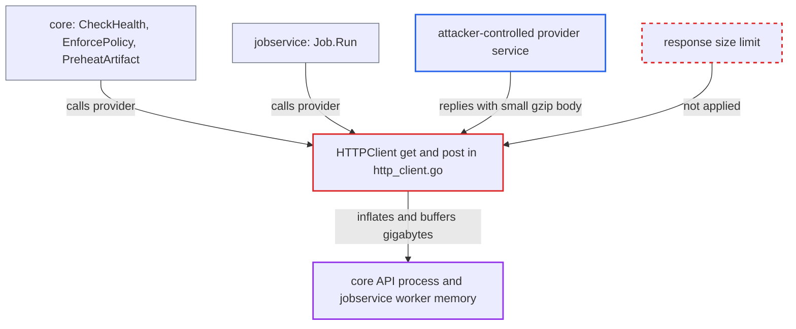

# Unbounded, gzip-inflated read of preheat provider responses exhausts core and jobservice memory

| Field | Value |
|---|---|
| ID | `find_017gw7yEbBXKS4hCyZhhGbCR` |
| Severity | **High** |
| Status | open |
| CWE | CWE-770 — Resource allocation without limits |
| Created | 2026-10-27T21:11:12.154497Z |
| Claude Security | https://claude.ai/security/findings/find_017gw7yEbBXKS4hCyZhhGbCR |

## Description

A party that controls the HTTP service behind a configured preheat provider can crash Harbor's core API process or its jobservice worker by running them out of memory. It needs no Harbor credentials, but a provider instance and policy must point at its service. This happens because `get` and `post` in `http_client.go` read each response with `io.ReadAll` and no size limit, after Go has inflated gzip.

1. **attacker** controls the HTTP service behind a configured preheat provider instance. This can be a compromised Dragonfly or Kraken manager, an outside upstream service, or a MITM on an `http://` or `insecure` endpoint.
2. **Harbor core or jobservice** calls the provider through the shared client. Core calls `GetHealth` on admin ping, on `EnforcePolicy`, and on `PreheatArtifact` for each matching push, scan-completed or label event. The jobservice `Job.Run` calls `GetHealth` and `Preheat`, then polls `CheckProgress` every 10s for up to 30 minutes. ([`src/controller/p2p/preheat/enforcer.go:310-322`](https://github.com/cx-benchmark/harbor/blob/d822d80c2e6edb2c85538d4b9cd73c0c375a5596/src/controller/p2p/preheat/enforcer.go#L310-L322))
3. **the HTTP client** asks for gzip and inflates the reply transparently. The transport is built without `DisableCompression`, so Go adds `Accept-Encoding: gzip` and decodes a `Content-Encoding: gzip` body before the code sees it. ([`src/pkg/p2p/preheat/provider/client/http_client.go:66-80`](https://github.com/cx-benchmark/harbor/blob/d822d80c2e6edb2c85538d4b9cd73c0c375a5596/src/pkg/p2p/preheat/provider/client/http_client.go#L66-L80))
4. **attacker's service** answers with a small gzip body that inflates to many GB. At a gzip ratio of about 1000:1, a few MB on the wire become gigabytes in memory. The 30s `clientTimeout` limits time, not inflated size. ([`src/pkg/p2p/preheat/provider/client/http_client.go:66-80`](https://github.com/cx-benchmark/harbor/blob/d822d80c2e6edb2c85538d4b9cd73c0c375a5596/src/pkg/p2p/preheat/provider/client/http_client.go#L66-L80))
5. **the methods `get` and `post`** read the whole inflated body into memory with `io.ReadAll(res.Body)`. The read has no size cap and happens before the status code is checked, so error responses are buffered too. ([`src/pkg/p2p/preheat/provider/client/http_client.go:126-146`](https://github.com/cx-benchmark/harbor/blob/d822d80c2e6edb2c85538d4b9cd73c0c375a5596/src/pkg/p2p/preheat/provider/client/http_client.go#L126-L146))
6. **the client's `Get` and `Post`** copy the buffered body again into strings. The body goes into the error string and the log, and on success `string(bytes)` is evaluated eagerly for `log.Debugf` whatever the log level. ([`src/pkg/p2p/preheat/provider/client/http_client.go:85-95`](https://github.com/cx-benchmark/harbor/blob/d822d80c2e6edb2c85538d4b9cd73c0c375a5596/src/pkg/p2p/preheat/provider/client/http_client.go#L85-L95))
7. **core or jobservice process** runs out of memory and is killed. The attack repeats on every later push or poll.

## Assessment

The attacker controls the HTTP service behind a configured preheat provider instance. That can be a compromised Dragonfly or Kraken manager, an outside upstream service, or a MITM on an `http://` or `insecure` endpoint. No Harbor credentials are needed. An instance and a policy must point at the attacker's service. Harbor then calls it on admin ping, on scheduled or manual preheats, and on every push, scan or label event matching an event-based policy (core). The jobservice worker also calls it every 10s while a job runs.

Impact: One response can get the core API process or the jobservice worker OOM-killed. That takes down the REST/registry API or all queued jobs until restart, and the attack repeats on every later push or poll. No data is disclosed or modified.

## Recommendation

`HTTPClient.get` and `post` buffer provider responses with `io.ReadAll` and no upper bound, after transparent gzip inflation. Error bodies are then copied into error and log strings, so a remote service decides how much memory core and jobservice allocate.

Fix criteria: Provider response bodies are read through a hard byte limit applied to the decoded (inflated) stream. Oversize bodies fail the call with an error instead of being buffered. Error and log messages include only a bounded prefix of the body. To verify, point an instance at a server that returns a small gzip body inflating to several GB on `/healthy` and `/oapi/v1/jobs`. Core and jobservice memory must stay bounded, and the call must return an error.

## Evidence

**https://github.com/cx-benchmark/harbor**

- [`src/pkg/p2p/preheat/provider/client/http_client.go:126-146`](https://github.com/cx-benchmark/harbor/blob/d822d80c2e6edb2c85538d4b9cd73c0c375a5596/src/pkg/p2p/preheat/provider/client/http_client.go#L126-L146)
- [`src/pkg/p2p/preheat/provider/client/http_client.go:66-80`](https://github.com/cx-benchmark/harbor/blob/d822d80c2e6edb2c85538d4b9cd73c0c375a5596/src/pkg/p2p/preheat/provider/client/http_client.go#L66-L80)
- [`src/pkg/p2p/preheat/provider/client/http_client.go:85-95`](https://github.com/cx-benchmark/harbor/blob/d822d80c2e6edb2c85538d4b9cd73c0c375a5596/src/pkg/p2p/preheat/provider/client/http_client.go#L85-L95)
- [`src/pkg/p2p/preheat/provider/dragonfly.go:199-221`](https://github.com/cx-benchmark/harbor/blob/d822d80c2e6edb2c85538d4b9cd73c0c375a5596/src/pkg/p2p/preheat/provider/dragonfly.go#L199-L221)
- [`src/controller/p2p/preheat/enforcer.go:310-322`](https://github.com/cx-benchmark/harbor/blob/d822d80c2e6edb2c85538d4b9cd73c0c375a5596/src/controller/p2p/preheat/enforcer.go#L310-L322)
- [`src/pkg/p2p/preheat/job.go:120-185`](https://github.com/cx-benchmark/harbor/blob/d822d80c2e6edb2c85538d4b9cd73c0c375a5596/src/pkg/p2p/preheat/job.go#L120-L185)

