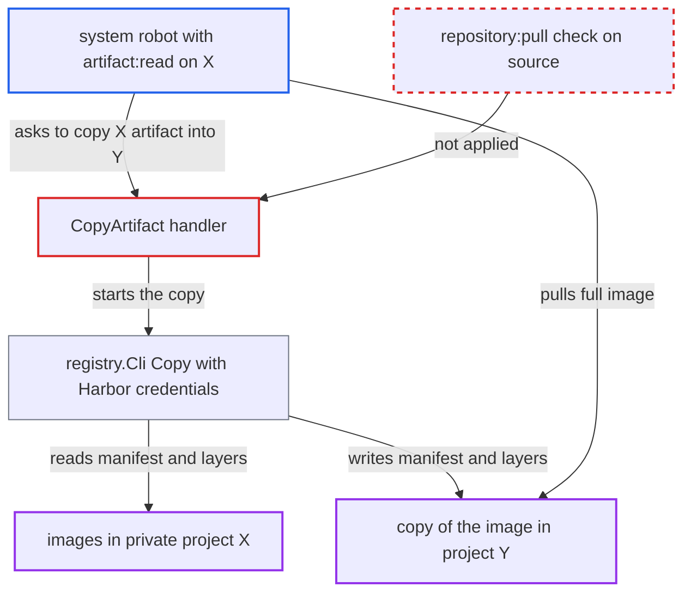

# Artifact copy API gives robots holding only artifact:read the source image content

| Field | Value |
|---|---|
| ID | `find_01HSshrgTYFJp7PrStUsNyg9` |
| Severity | **Medium** |
| Status | open |
| CWE | CWE-863 — Incorrect authorization |
| Created | 2026-10-27T21:24:10.474692Z |
| Claude Security | https://claude.ai/security/findings/find_01HSshrgTYFJp7PrStUsNyg9 |

## Description

A system robot that was deliberately given `artifact:read` but not `repository:pull` on a private project X can still get the full image content of X. It can copy any artifact of X into a project Y it can pull from, then pull it there. This needs an administrator to have set up that split grant set. The copy handler `CopyArtifact` checks only `artifact:read` on the source, and the copy then runs with Harbor's own registry credentials.

1. **the attacker's system robot** sends a copy request into project Y. The robot holds `artifact:read` on private project X but not `repository:pull`, and holds `artifact:create` on a project Y it can pull from (or a public Y). The request is `POST /api/v2.0/projects/Y/repositories/r/artifacts?from=X/secret:tag`.
2. **the handler `CopyArtifact`** checks only `artifact:read` on the source project and lets the copy go ahead. The check is `RequireProjectAccess(ctx, srcPro, rbac.ActionRead, rbac.ResourceArtifact)`. Nothing asks for `repository:pull`, although the operation moves the artifact's full content. ([`src/server/v2.0/handler/artifact.go:183-186`](https://github.com/cx-benchmark/harbor/blob/d822d80c2e6edb2c85538d4b9cd73c0c375a5596/src/server/v2.0/handler/artifact.go#L183-L186))
3. **the function `copyDeeply`** copies the artifact, its child artifacts and its accessories through the registry client. It calls `c.regCli.Copy(srcRepo, digest, dstRepo, digest, false)` and does not check the caller's permissions again. ([`src/controller/artifact/controller.go:556-583`](https://github.com/cx-benchmark/harbor/blob/d822d80c2e6edb2c85538d4b9cd73c0c375a5596/src/controller/artifact/controller.go#L556-L583))
4. **the global client `registry.Cli`** pulls the source manifest, mounts every layer into Y and pushes the manifest. It runs with Harbor's internal registry credentials, not the robot's own rights, so the missing pull right on X does not stop it. ([`src/pkg/registry/client.go:595-660`](https://github.com/cx-benchmark/harbor/blob/d822d80c2e6edb2c85538d4b9cd73c0c375a5596/src/pkg/registry/client.go#L595-L660))
5. **the attacker's system robot** pulls the full image from project Y. The robot may pull from Y. Its grants on X were set up to withhold this content, and a direct pull from X through `/v2/` is refused. ([`src/server/middleware/v2auth/auth.go:72-80`](https://github.com/cx-benchmark/harbor/blob/d822d80c2e6edb2c85538d4b9cd73c0c375a5596/src/server/middleware/v2auth/auth.go#L72-L80))

## Assessment

The attacker holds a system-robot credential. It has `artifact:read` on private project X but not `repository:pull`, and it has `artifact:create` on a project Y it can pull from, or on a public Y. An administrator must have configured this split grant set, which the attacker does not control. Robot creation accepts any subset of the permissions, and a system robot's project policies are evaluated exactly as granted. So nothing adds `repository:pull` for a robot holding `artifact:read`.

Impact: The attacker gets the full manifest and layer content of any artifact in every private project where the robot holds `artifact:read`. These are contents its grants were set up to withhold. The report finds no gain in write access, since writing to the destination is within `artifact:create`, and no availability impact.

## Recommendation

`CopyArtifact` moves an artifact's content out of the source repository but checks only the metadata permission `artifact:read` on the source project. This breaks the rule enforced in `/v2/` and in cross-repository blob mounts, which require `repository:pull` on the source.

Fix criteria: Copying also requires `repository:pull` on the source project for the calling principal. A system robot with `artifact:read` on X but no `repository:pull`, plus `artifact:create` and `repository:pull` on Y, is refused with 403 when it copies from X into Y. Principals that can pull from X can still copy.

## Evidence

**https://github.com/cx-benchmark/harbor**

- [`src/server/v2.0/handler/artifact.go:183-186`](https://github.com/cx-benchmark/harbor/blob/d822d80c2e6edb2c85538d4b9cd73c0c375a5596/src/server/v2.0/handler/artifact.go#L183-L186)
- [`src/controller/artifact/controller.go:556-583`](https://github.com/cx-benchmark/harbor/blob/d822d80c2e6edb2c85538d4b9cd73c0c375a5596/src/controller/artifact/controller.go#L556-L583)
- [`src/pkg/registry/client.go:595-660`](https://github.com/cx-benchmark/harbor/blob/d822d80c2e6edb2c85538d4b9cd73c0c375a5596/src/pkg/registry/client.go#L595-L660)
- [`src/server/middleware/v2auth/auth.go:72-80`](https://github.com/cx-benchmark/harbor/blob/d822d80c2e6edb2c85538d4b9cd73c0c375a5596/src/server/middleware/v2auth/auth.go#L72-L80)
- [`src/server/middleware/v2auth/access.go:104-111`](https://github.com/cx-benchmark/harbor/blob/d822d80c2e6edb2c85538d4b9cd73c0c375a5596/src/server/middleware/v2auth/access.go#L104-L111)
- [`src/server/v2.0/handler/robot.go:384-410`](https://github.com/cx-benchmark/harbor/blob/d822d80c2e6edb2c85538d4b9cd73c0c375a5596/src/server/v2.0/handler/robot.go#L384-L410)
- [`src/common/security/robot/context.go:100-118`](https://github.com/cx-benchmark/harbor/blob/d822d80c2e6edb2c85538d4b9cd73c0c375a5596/src/common/security/robot/context.go#L100-L118)
- [`src/common/rbac/const.go:255-265`](https://github.com/cx-benchmark/harbor/blob/d822d80c2e6edb2c85538d4b9cd73c0c375a5596/src/common/rbac/const.go#L255-L265)

