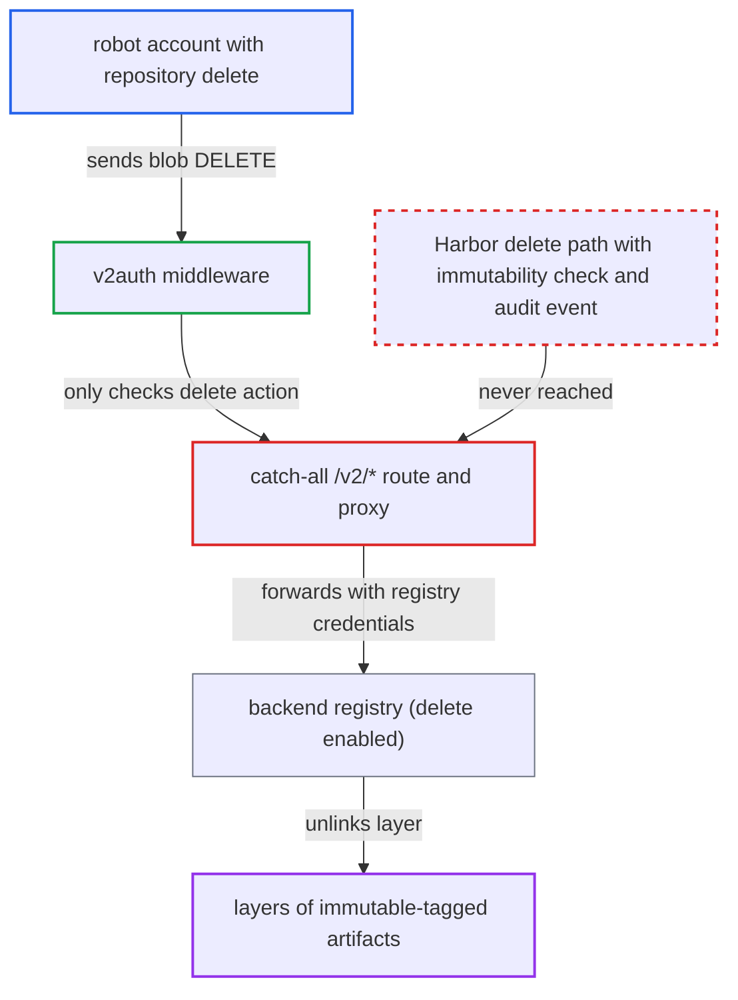

# Catch-all /v2/* proxy forwards blob DELETE to registry, bypassing immutability and audit

| Field | Value |
|---|---|
| ID | `find_01U4LcZ5Kc4kTXjxEMmmAYoD` |
| Severity | **Medium** |
| Status | open |
| CWE | CWE-424 — Unprotected alternate path |
| Created | 2026-10-27T21:22:06.752742Z |
| Claude Security | https://claude.ai/security/findings/find_01U4LcZ5Kc4kTXjxEMmmAYoD |

## Description

A user with delete rights on a project's repository can make that repository's artifacts unpullable, including immutable-tagged ones, and Harbor records nothing. For a robot account with `repository:delete` but no `immutable-tag` permission, this defeats the immutability rules. Content cannot be replaced, and the blob data stays in storage. The cause is that `DELETE` on blob paths falls through the method-agnostic `/v2/*` catch-all to the registry with its own credentials, skipping Harbor's delete logic.

1. **attacker with `repository:delete`** reads a layer digest from a manifest and sends a blob delete request. The request is `DELETE /v2/<proj>/<repo>/blobs/sha256:<layer>`, with basic or bearer auth.
2. **the `v2auth` middleware** allows the request after checking only the `delete` action. `getAction` maps DELETE to `rbac.ActionDelete`, and the only check is `securityCtx.Can` on the project's repository resource, so no immutable-tag permission is needed. ([`src/server/middleware/v2auth/auth.go:68-77`](https://github.com/cx-benchmark/harbor/blob/d822d80c2e6edb2c85538d4b9cd73c0c375a5596/src/server/middleware/v2auth/auth.go#L68-L77))
3. **the route table in `route.go`** sends the request to the `/v2/*` catch-all. `/v2/*/blobs/:digest` is registered only for HEAD and GET, and the catch-all is registered with `web.Any`, so it accepts DELETE and hands it to `proxy` with no immutability, quota or event handling. ([`src/server/registry/route.go:85-129`](https://github.com/cx-benchmark/harbor/blob/d822d80c2e6edb2c85538d4b9cd73c0c375a5596/src/server/registry/route.go#L85-L129))
4. **the registry proxy** forwards the request using the registry's own Basic credentials. The proxy director sets these credentials, so the backend runs the delete with full rights. ([`src/server/registry/proxy.go:52-62`](https://github.com/cx-benchmark/harbor/blob/d822d80c2e6edb2c85538d4b9cd73c0c375a5596/src/server/registry/proxy.go#L52-L62))
5. **the backend registry** unlinks the layer from the repository and returns 202. The shipped config has `storage.delete.enabled: true`, which Harbor's garbage collection needs. ([`make/photon/prepare/templates/registry/config.yml.jinja:24-25`](https://github.com/cx-benchmark/harbor/blob/d822d80c2e6edb2c85538d4b9cd73c0c375a5596/make/photon/prepare/templates/registry/config.yml.jinja#L24-L25))
6. **Harbor** records nothing about the deletion. Only `artifact.Ctl.Delete` emits the event that feeds the audit-log, webhook and replication handlers, and this path never reaches it, so Harbor's database rows stay unchanged while pulls fail with `BLOB_UNKNOWN`. ([`src/controller/artifact/controller.go:494`](https://github.com/cx-benchmark/harbor/blob/d822d80c2e6edb2c85538d4b9cd73c0c375a5596/src/controller/artifact/controller.go#L494))

## Assessment

The attacker needs a login with `repository:delete` on a project's repository. The report's main case is a robot account or leaked CI credential that has this permission but no `immutable-tag` permission, in a project with immutable-tag rules. Project maintainers and admins can also do it, but they can manage immutable-tag rules themselves, so for them the gain is unaudited deletion. The same catch-all also forwards `DELETE /v2/<name>/blobs/uploads/<uuid>`, which matters only if the upload UUID is known. The report assumes the registry's behaviour from the pinned `goharbor/distribution` `v2.8.3-patch-redis`, whose blob DELETE handler unlinks the blob when delete is enabled.

Impact: Every artifact in the repository that uses the deleted layer or config blob can no longer be pulled, including immutable-tagged artifacts that Harbor's own delete paths refuse to remove. Harbor's `artifact`, `blob` and `project_blob` rows stay unchanged, so the database no longer matches storage, and no audit log, webhook or replication event is produced. Content cannot be substituted because digests are verified, and blob data stays in storage, so re-pushing or cross-mounting the layer restores the artifact. The report finds no confidentiality impact.

## Recommendation

Mutating requests that Harbor does not implement, such as `DELETE` on `/v2/<name>/blobs/<digest>` and on blob upload sessions, fall through the method-agnostic `/v2/*` catch-all to the registry with administrative credentials. This skips Harbor's immutability checks, bookkeeping and audit events.

Fix criteria: Requests that delete blobs through `/v2/` are either refused by Harbor (for example with 405 or UNSUPPORTED) or handled by Harbor with the same immutability, quota and audit handling as artifact deletion. The catch-all no longer forwards mutating methods that Harbor has not explicitly routed. A `DELETE /v2/<proj>/<repo>/blobs/<digest>` from a robot with `repository:delete` is rejected, and the immutable artifact stays pullable.

## Evidence

**https://github.com/cx-benchmark/harbor**

- [`src/server/registry/route.go:85-129`](https://github.com/cx-benchmark/harbor/blob/d822d80c2e6edb2c85538d4b9cd73c0c375a5596/src/server/registry/route.go#L85-L129)
- [`src/server/router/router.go:95-96`](https://github.com/cx-benchmark/harbor/blob/d822d80c2e6edb2c85538d4b9cd73c0c375a5596/src/server/router/router.go#L95-L96)
- [`src/server/middleware/v2auth/access.go:65-107`](https://github.com/cx-benchmark/harbor/blob/d822d80c2e6edb2c85538d4b9cd73c0c375a5596/src/server/middleware/v2auth/access.go#L65-L107)
- [`src/server/middleware/v2auth/auth.go:68-77`](https://github.com/cx-benchmark/harbor/blob/d822d80c2e6edb2c85538d4b9cd73c0c375a5596/src/server/middleware/v2auth/auth.go#L68-L77)
- [`src/server/registry/proxy.go:52-62`](https://github.com/cx-benchmark/harbor/blob/d822d80c2e6edb2c85538d4b9cd73c0c375a5596/src/server/registry/proxy.go#L52-L62)
- [`make/photon/prepare/templates/registry/config.yml.jinja:24-25`](https://github.com/cx-benchmark/harbor/blob/d822d80c2e6edb2c85538d4b9cd73c0c375a5596/make/photon/prepare/templates/registry/config.yml.jinja#L24-L25)
- [`src/controller/tag/controller.go:206-224`](https://github.com/cx-benchmark/harbor/blob/d822d80c2e6edb2c85538d4b9cd73c0c375a5596/src/controller/tag/controller.go#L206-L224)
- [`src/common/rbac/const.go:255-298`](https://github.com/cx-benchmark/harbor/blob/d822d80c2e6edb2c85538d4b9cd73c0c375a5596/src/common/rbac/const.go#L255-L298)
- [`src/controller/artifact/controller.go:494`](https://github.com/cx-benchmark/harbor/blob/d822d80c2e6edb2c85538d4b9cd73c0c375a5596/src/controller/artifact/controller.go#L494)

