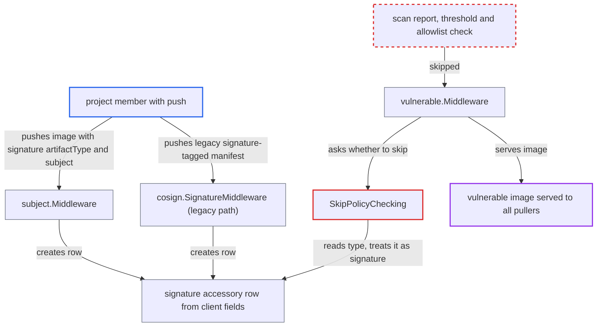

# Client-declared signature accessory exempts runnable images from vulnerability deploy-prevention

| Field | Value |
|---|---|
| ID | `find_01VdCBDDRjPvmcB6vruzW4UB` |
| Severity | **Medium** |
| Status | open |
| CWE | CWE-807 — Policy bypass |
| Created | 2026-10-27T21:20:18.299531Z |
| Claude Security | https://claude.ai/security/findings/find_01VdCBDDRjPvmcB6vruzW4UB |

## Description

A project member with only `push` rights can make Harbor's vulnerability deploy-prevention skip an ordinary runnable image, even when its scan shows CVEs above the project's threshold. Harbor then serves that image to every puller. `SkipPolicyChecking` trusts an accessory type taken from the pushed manifest's `artifactType` or config media type, and nothing checks that the artifact is really a signature.

1. **project member with `push`** pushes a normal runnable image manifest with a signature type and a `subject`. The manifest has a real image config and layers. It sets `artifactType` to `application/vnd.dev.sigstore.bundle.v0.3+json` and adds any `subject` descriptor, using `PUT /v2/<proj>/<repo>/manifests/<tag>`. ([`src/server/middleware/subject/subject.go:133-188`](https://github.com/cx-benchmark/harbor/blob/d822d80c2e6edb2c85538d4b9cd73c0c375a5596/src/server/middleware/subject/subject.go#L133-L188))
2. **the handler `subject.Middleware`** derives the accessory type from the client's manifest fields. It uses `artifactType`, or `config.mediaType` when that is absent, and maps it to `TypeCosignSignature` or `TypeNotationSignature` without checking the config or layer media types. ([`src/server/middleware/subject/subject.go:154-170`](https://github.com/cx-benchmark/harbor/blob/d822d80c2e6edb2c85538d4b9cd73c0c375a5596/src/server/middleware/subject/subject.go#L154-L170))
3. **the handler `subject.Middleware`** stores an accessory row for the pushed artifact itself. The row's `ArtifactID` is the pushed artifact. A subject that does not exist is only logged, so the push still succeeds. ([`src/server/middleware/subject/subject.go:133-188`](https://github.com/cx-benchmark/harbor/blob/d822d80c2e6edb2c85538d4b9cd73c0c375a5596/src/server/middleware/subject/subject.go#L133-L188))
4. **the handler `putManifest`** attaches the pushed tag to the artifact. This happens whatever the artifact's accessory status, so the image can be pulled by an ordinary tag. ([`src/server/registry/manifest.go:220-233`](https://github.com/cx-benchmark/harbor/blob/d822d80c2e6edb2c85538d4b9cd73c0c375a5596/src/server/registry/manifest.go#L220-L233))
5. **any puller** sends GET or HEAD for the manifest, by tag or by digest. Both routes run `vulnerable.Middleware` before the manifest is served. ([`src/server/registry/route.go:52-66`](https://github.com/cx-benchmark/harbor/blob/d822d80c2e6edb2c85538d4b9cd73c0c375a5596/src/server/registry/route.go#L52-L66))
6. **the function `SkipPolicyChecking`** returns `true` for the artifact. The first accessory row found for the artifact has type `signature.cosign` or `signature.notation`, and that stored type is treated as proof of a non-runnable signature. ([`src/server/middleware/util/util.go:83-88`](https://github.com/cx-benchmark/harbor/blob/d822d80c2e6edb2c85538d4b9cd73c0c375a5596/src/server/middleware/util/util.go#L83-L88))
7. **the handler `vulnerable.Middleware`** returns `nil` and lets the pull go through. It returns before reading the scan report, the severity threshold or the CVE allowlist, so an image with CVEs above the threshold is served. ([`src/server/middleware/vulnerable/vulnerable.go:72-79`](https://github.com/cx-benchmark/harbor/blob/d822d80c2e6edb2c85538d4b9cd73c0c375a5596/src/server/middleware/vulnerable/vulnerable.go#L72-L79))

## Assessment

The attacker is a project developer, maintainer or robot account with `push` on a project where the project admin has turned on deploy-prevention. They need no other user's action. The main route is a manifest `PUT` with a signature `artifactType` (or a signature `config.mediaType`) and a `subject` descriptor. A second route is the legacy `cosign.SignatureMiddleware`. A manifest pushed to the tag `sha256-<hex>.sig` that has a descriptor of media type `application/vnd.dev.cosign.simplesigning.v1+json` is also recorded as a `signature.cosign` accessory of itself. Only `projectAdmin` can change deploy-prevention or the CVE allowlist, so the bypass crosses a role boundary.

Impact: The attacker defeats the project admin's vulnerability deploy-prevention for images they choose, including images with CVEs above the threshold. Harbor serves them to all pullers and leaves them out of the normal artifact listing, because accessories are filtered out of it. No data is disclosed and service is not denied. The loss is limited to policy enforcement for images the attacker could already push. Content trust is also skipped, but that gives a pusher nothing new, since a pusher can already create a signature accessory for any image.

## Recommendation

(1) `SkipPolicyChecking` exempts an artifact from vulnerability prevention based only on an accessory type that comes from client-supplied manifest fields. It never confirms that the artifact is a non-runnable signature payload.

Fix criteria: The exemption applies only to artifacts that are provably signature payloads, meaning the config and every layer carry cosign or notation signature media types and no image config or image layer media types. Alternatively, the exemption is removed. Test: push a runnable image manifest with `artifactType: application/vnd.dev.sigstore.bundle.v0.3+json` and a `subject` to a project with deploy-prevention on and a failing scan, and confirm the pull is denied.

(2) `subject.Middleware` and the legacy `cosign.SignatureMiddleware` classify an artifact as a cosign or notation signature from `artifactType`, the config media type or a single descriptor media type alone.

Fix criteria: Classifying an artifact as a signature requires the manifest contents to match the declared type: signature config and layer media types, with no runnable image config or layers. Test: an image manifest with image config and image layers but a signature `artifactType` is not recorded as a signature accessory and stays subject to deploy-prevention.

## Evidence

**https://github.com/cx-benchmark/harbor**

- [`src/server/middleware/util/util.go:83-88`](https://github.com/cx-benchmark/harbor/blob/d822d80c2e6edb2c85538d4b9cd73c0c375a5596/src/server/middleware/util/util.go#L83-L88)
- [`src/server/middleware/subject/subject.go:154-170`](https://github.com/cx-benchmark/harbor/blob/d822d80c2e6edb2c85538d4b9cd73c0c375a5596/src/server/middleware/subject/subject.go#L154-L170)
- [`src/server/middleware/subject/subject.go:133-188`](https://github.com/cx-benchmark/harbor/blob/d822d80c2e6edb2c85538d4b9cd73c0c375a5596/src/server/middleware/subject/subject.go#L133-L188)
- [`src/server/middleware/vulnerable/vulnerable.go:72-79`](https://github.com/cx-benchmark/harbor/blob/d822d80c2e6edb2c85538d4b9cd73c0c375a5596/src/server/middleware/vulnerable/vulnerable.go#L72-L79)
- [`src/server/registry/route.go:52-66`](https://github.com/cx-benchmark/harbor/blob/d822d80c2e6edb2c85538d4b9cd73c0c375a5596/src/server/registry/route.go#L52-L66)
- [`src/server/registry/manifest.go:220-233`](https://github.com/cx-benchmark/harbor/blob/d822d80c2e6edb2c85538d4b9cd73c0c375a5596/src/server/registry/manifest.go#L220-L233)
- [`src/common/rbac/project/rbac_role.go:73-74`](https://github.com/cx-benchmark/harbor/blob/d822d80c2e6edb2c85538d4b9cd73c0c375a5596/src/common/rbac/project/rbac_role.go#L73-L74)
- [`src/server/middleware/cosign/cosign.go:116-139`](https://github.com/cx-benchmark/harbor/blob/d822d80c2e6edb2c85538d4b9cd73c0c375a5596/src/server/middleware/cosign/cosign.go#L116-L139)

