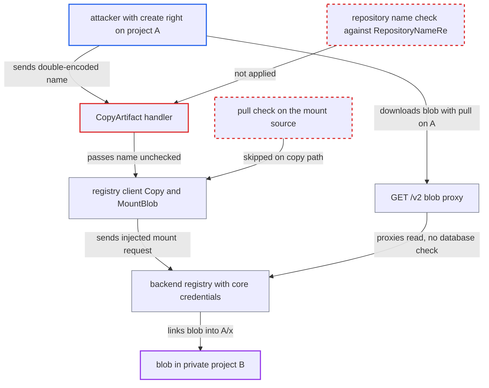

# Copy destination repository name injects query into backend blob-mount URL, enabling cross-project blob read

| Field | Value |
|---|---|
| ID | `find_019yaUt8wBkUXemdubu6VJNt` |
| Severity | **Medium** |
| Status | open |
| CWE | CWE-74 — Injection |
| Created | 2026-10-27T21:46:05.763797Z |
| Claude Security | https://claude.ai/security/findings/find_019yaUt8wBkUXemdubu6VJNt |

## Description

A user of one project can read any layer or config blob from another project's private repository. This includes environment variables, build arguments and labels stored in configs. The attacker needs `artifact:create` on a project they can write to, `artifact:read` on some source artifact, and the blob's digest and repository name. The cause is `CopyArtifact`, which never checks the destination repository name against `lib.RepositoryNameRe`, so `?`, `&` and `#` rewrite the backend registry requests.

1. **attacker** sends a copy request whose destination repository name is double-encoded. The name decodes to a path ending in `blobs/uploads/` followed by `?mount=sha256:<D>&from=<B>/<repo>#`, where `<D>` is the target digest and `<B>/<repo>` is the private repository holding it. The request is `POST /api/v2.0/projects/A/repositories/.../artifacts?from=A/src:tag`.
2. **the handler `Prepare`** decodes `RepositoryName` a second time. The router has already decoded once, so `%253F`, `%2526` and `%2523` arrive as a literal `?`, `&` and `#`. ([`src/server/v2.0/handler/artifact.go:76-82`](https://github.com/cx-benchmark/harbor/blob/d822d80c2e6edb2c85538d4b9cd73c0c375a5596/src/server/v2.0/handler/artifact.go#L76-L82))
3. **the handler `CopyArtifact`** builds the destination name and passes it on unchecked. It joins the project name and `RepositoryName` and hands the result to `repoCtl.Ensure` and `artCtl.Copy` without matching `lib.RepositoryNameRe`. The swagger parameter has no pattern either. ([`src/server/v2.0/handler/artifact.go:200-209`](https://github.com/cx-benchmark/harbor/blob/d822d80c2e6edb2c85538d4b9cd73c0c375a5596/src/server/v2.0/handler/artifact.go#L200-L209))
4. **the registry client** builds backend URLs by string concatenation. The `?` starts a query and the `#` turns Harbor's own suffix and its `mount`/`from` parameters into a dropped fragment. Every request of `client.Copy` therefore targets the upload route `/v2/<A>/x/blobs/uploads/` with the attacker's query. ([`src/pkg/registry/client.go:789-799`](https://github.com/cx-benchmark/harbor/blob/d822d80c2e6edb2c85538d4b9cd73c0c375a5596/src/pkg/registry/client.go#L789-L799))
5. **the registry client** treats the probe answers as absent and mounts each layer. The upload route answers the `HEAD` probes of `ManifestExist` and `BlobExist` with 404, read as not present. `MountBlob` then sends `POST` with `?mount=sha256:<D>&from=<B>/<repo>` for each layer of the attacker's source manifest. ([`src/pkg/registry/client.go:595-660`](https://github.com/cx-benchmark/harbor/blob/d822d80c2e6edb2c85538d4b9cd73c0c375a5596/src/pkg/registry/client.go#L595-L660))
6. **the backend registry** mounts the blob from the private repository into `<A>/x`. The request carries core's htpasswd credentials, which reach every repository, so the `from` repository is not restricted. `PushManifest` then fails and the database is rolled back, but the blob link in the backend stays. ([`make/photon/prepare/templates/registry/config.yml.jinja:69-72`](https://github.com/cx-benchmark/harbor/blob/d822d80c2e6edb2c85538d4b9cd73c0c375a5596/make/photon/prepare/templates/registry/config.yml.jinja#L69-L72))
7. **attacker** downloads the blob with `GET /v2/A/x/blobs/sha256:D`. This needs only pull on `A`. The request is proxied to the backend with core's credentials and no database check. ([`src/server/registry/route.go:92-97`](https://github.com/cx-benchmark/harbor/blob/d822d80c2e6edb2c85538d4b9cd73c0c375a5596/src/server/registry/route.go#L92-L97))

## Assessment

The attacker is an authenticated user or robot with `artifact:create` on any project A (the Developer role, or a project they created) and `artifact:read` on any source artifact, their own or a public one. They must also know the digest of the target layer or config blob and the name of a repository that holds it. Digests cannot be listed from Harbor without read access. They are not secrets and leak through build logs, `docker inspect` output, SBOMs and mirrored copies. The threat model lists `/api/v2.0/*` and `/v2/*` as internet-facing. The trace relies on two dependency behaviours read from the pinned versions and not run. Backend distribution `v2.8.3` answers `HEAD` and `PUT` on the upload route without an upload UUID with `BLOB_UPLOAD_UNKNOWN` (404) and handles `POST ?mount=&from=` as a mount. `go-openapi/runtime` `v0.33.2` decodes path parameters only once.

Impact: A member of another project can read any layer or config blob of any repository in any private project, as long as they know its digest and repository name. The attacker only adds a blob link to their own repository and changes nothing in the other project. The report rates integrity and availability as not affected. The same missing validation also lets a successful copy store repository records whose names contain `?`, `#` and `&`. The report does not rate that consequence.

## Recommendation

(1) `CopyArtifact` accepts a destination repository name that does not match the distribution repository grammar. Characters such as `?`, `&` and `#` reach the backend URLs and rewrite the requests sent with core's full-access credentials.

Fix criteria: The full destination name (`project/repository`) is rejected with 400 unless it matches `lib.RepositoryNameRe`, before `repoCtl.Ensure` or `artCtl.Copy` run. The double-encoded name from the attack path is refused and no request reaches the backend registry. Ordinary names such as `a/b` still copy.

(2) The registry client's URL builders (`buildManifestURL`, `buildBlobURL`, `buildMountBlobURL` and the other `fmt.Sprintf` builders) concatenate repository names and references into URLs. Any caller that passes an unvalidated name can change the path, query or fragment of a request sent with core's credentials.

Fix criteria: The registry client refuses a repository name that does not match the distribution grammar and a reference that is not a valid tag or digest. Alternatively, it builds URLs so that those values can only form path segments and `mount`/`from` are encoded query values. `MountBlob`, `BlobExist`, `ManifestExist` and `PushManifest` send nothing when given a name containing `?` or `#`.

## Evidence

**https://github.com/cx-benchmark/harbor**

- [`src/server/v2.0/handler/artifact.go:200-209`](https://github.com/cx-benchmark/harbor/blob/d822d80c2e6edb2c85538d4b9cd73c0c375a5596/src/server/v2.0/handler/artifact.go#L200-L209)
- [`src/server/v2.0/handler/artifact.go:76-82`](https://github.com/cx-benchmark/harbor/blob/d822d80c2e6edb2c85538d4b9cd73c0c375a5596/src/server/v2.0/handler/artifact.go#L76-L82)
- [`src/server/v2.0/handler/util.go:67-103`](https://github.com/cx-benchmark/harbor/blob/d822d80c2e6edb2c85538d4b9cd73c0c375a5596/src/server/v2.0/handler/util.go#L67-L103)
- [`api/v2.0/swagger.yaml:6647-6652`](https://github.com/cx-benchmark/harbor/blob/d822d80c2e6edb2c85538d4b9cd73c0c375a5596/api/v2.0/swagger.yaml#L6647-L6652)
- [`src/controller/artifact/controller.go:580-583`](https://github.com/cx-benchmark/harbor/blob/d822d80c2e6edb2c85538d4b9cd73c0c375a5596/src/controller/artifact/controller.go#L580-L583)
- [`src/pkg/registry/client.go:595-660`](https://github.com/cx-benchmark/harbor/blob/d822d80c2e6edb2c85538d4b9cd73c0c375a5596/src/pkg/registry/client.go#L595-L660)
- [`src/pkg/registry/client.go:789-799`](https://github.com/cx-benchmark/harbor/blob/d822d80c2e6edb2c85538d4b9cd73c0c375a5596/src/pkg/registry/client.go#L789-L799)
- [`src/pkg/registry/client.go:47-52`](https://github.com/cx-benchmark/harbor/blob/d822d80c2e6edb2c85538d4b9cd73c0c375a5596/src/pkg/registry/client.go#L47-L52)
- [`make/photon/prepare/templates/registry/config.yml.jinja:69-72`](https://github.com/cx-benchmark/harbor/blob/d822d80c2e6edb2c85538d4b9cd73c0c375a5596/make/photon/prepare/templates/registry/config.yml.jinja#L69-L72)
- [`src/server/registry/route.go:92-97`](https://github.com/cx-benchmark/harbor/blob/d822d80c2e6edb2c85538d4b9cd73c0c375a5596/src/server/registry/route.go#L92-L97)
- [`src/server/registry/proxy.go:56-64`](https://github.com/cx-benchmark/harbor/blob/d822d80c2e6edb2c85538d4b9cd73c0c375a5596/src/server/registry/proxy.go#L56-L64)
- [`src/server/middleware/v2auth/access.go:105-111`](https://github.com/cx-benchmark/harbor/blob/d822d80c2e6edb2c85538d4b9cd73c0c375a5596/src/server/middleware/v2auth/access.go#L105-L111)

