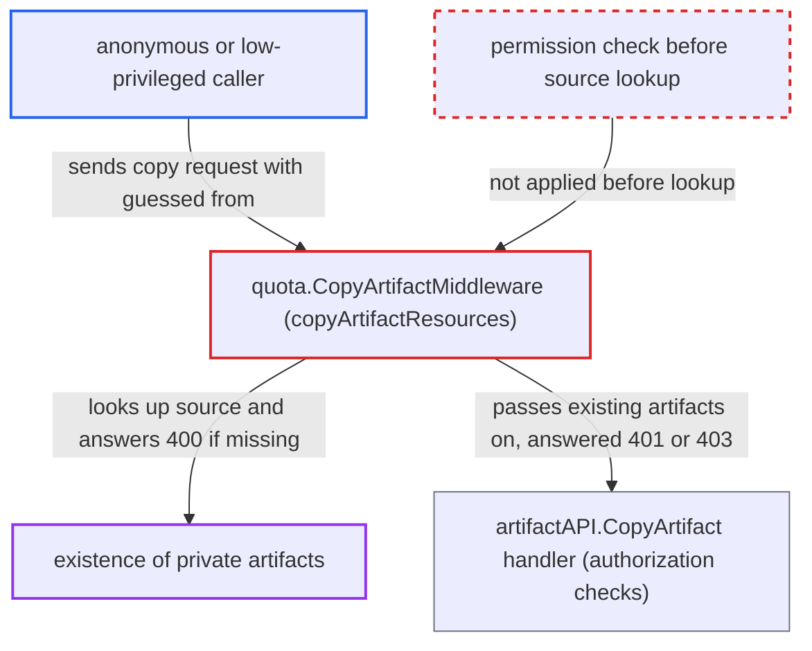

# Copy-artifact quota middleware reveals private artifact existence before authorization

| Field | Value |
|---|---|
| ID | `find_01FE712t1LPk2wMYGFjtpzMp` |
| Severity | **Medium** |
| Status | open |
| CWE | CWE-204 — Observable response discrepancy |
| Created | 2026-10-27T21:09:45.068076Z |
| Claude Security | https://claude.ai/security/findings/find_01FE712t1LPk2wMYGFjtpzMp |

## Description

Anyone on the network, even without credentials, can learn whether a repository, tag or digest exists in a private project. No artifact content is exposed and nothing is changed. The attack needs only an existing destination project such as `library`, and quota checking must be on (the default). The quota middleware `quota.CopyArtifactMiddleware()` looks up the `from` source before `artifactAPI.CopyArtifact` runs its permission checks.

1. **attacker** sends an unauthenticated copy request naming a guessed private source. The request is `POST /api/v2.0/projects/library/repositories/x/artifacts?from=victim/repo:tag`, and the destination only has to exist. ([`src/server/middleware/csrf/csrf.go:94-102`](https://github.com/cx-benchmark/harbor/blob/d822d80c2e6edb2c85538d4b9cd73c0c375a5596/src/server/middleware/csrf/csrf.go#L94-L102))
2. **quota middleware** runs before the operation handler. The generated wrapper puts `quota.CopyArtifactMiddleware()` around the whole operation, so it runs ahead of the authorization checks. ([`tools/swagger/templates/server/builder.gotmpl:394-403`](https://github.com/cx-benchmark/harbor/blob/d822d80c2e6edb2c85538d4b9cd73c0c375a5596/tools/swagger/templates/server/builder.gotmpl#L394-L403))
3. **the function `copyArtifactResources`** resolves the caller-supplied `from` reference with `GetByReference`. No permission check is made on the source project, and a miss returns `400` with `artifact <from> not found`. ([`src/server/middleware/quota/copy_artifact.go:86-95`](https://github.com/cx-benchmark/harbor/blob/d822d80c2e6edb2c85538d4b9cd73c0c375a5596/src/server/middleware/quota/copy_artifact.go#L86-L95))
4. **quota middleware** reserves quota for an existing artifact and passes the request on. The default `storage_per_project` is `-1` (unlimited), so the request reaches the handler. ([`src/server/middleware/quota/quota.go:79-99`](https://github.com/cx-benchmark/harbor/blob/d822d80c2e6edb2c85538d4b9cd73c0c375a5596/src/server/middleware/quota/quota.go#L79-L99))
5. **the handler `artifactAPI.CopyArtifact`** rejects the unauthorized caller with 401 or 403. Anonymous callers get 401 and authenticated non-members get 403, which differs from the 400 for a missing artifact. ([`src/server/v2.0/handler/base.go:108-124`](https://github.com/cx-benchmark/harbor/blob/d822d80c2e6edb2c85538d4b9cd73c0c375a5596/src/server/v2.0/handler/base.go#L108-L124))
6. **attacker** compares status codes and repeats with other guesses. A 400 means the reference does not exist and a 401 or 403 means it does, so repeated guesses list the contents of private projects.

## Assessment

The attacker is an anonymous internet client or any low-privileged user, and needs no victim action. CSRF protection is skipped for `/api/` requests without a session, so a plain anonymous POST reaches the middleware. The destination project only has to exist, for example the default `library`. Quota checking must be enabled, and `quota_per_project_enable` defaults to `true`. As a second route, if the destination quota is finite and would be exceeded, `quotaController.Request` fails before the handler. The 403 `ResourceOverflow` message then states the storage delta.

Impact: The attacker learns whether repositories, tags and digests exist in private projects without read permission. If the destination quota is finite and would be exceeded, the attacker also learns the size of the artifact's blobs. No content is disclosed and nothing is modified, because the quota reservation is rolled back when the handler fails.

## Recommendation

The copy-artifact quota middleware resolves the caller-supplied `from` source and reports the result before the handler has checked `artifact:create` on the destination and `artifact:read` on the source.

Fix criteria: The `from` lookup does not affect the response for a caller who lacks `artifact:create` on the destination or `artifact:read` on the source. Such callers get the same 401 or 403 whether or not the source exists. To verify, send anonymous and non-member copy requests with an existing and a non-existing private source reference. Confirm the status codes and bodies are identical, including when the destination quota is nearly full.

## Evidence

**https://github.com/cx-benchmark/harbor**

- [`src/server/middleware/quota/copy_artifact.go:86-95`](https://github.com/cx-benchmark/harbor/blob/d822d80c2e6edb2c85538d4b9cd73c0c375a5596/src/server/middleware/quota/copy_artifact.go#L86-L95)
- [`src/server/middleware/quota/quota.go:79-99`](https://github.com/cx-benchmark/harbor/blob/d822d80c2e6edb2c85538d4b9cd73c0c375a5596/src/server/middleware/quota/quota.go#L79-L99)
- [`tools/swagger/templates/server/builder.gotmpl:394-403`](https://github.com/cx-benchmark/harbor/blob/d822d80c2e6edb2c85538d4b9cd73c0c375a5596/tools/swagger/templates/server/builder.gotmpl#L394-L403)
- [`src/server/v2.0/handler/handler.go:79`](https://github.com/cx-benchmark/harbor/blob/d822d80c2e6edb2c85538d4b9cd73c0c375a5596/src/server/v2.0/handler/handler.go#L79)
- [`src/server/v2.0/handler/artifact.go:169-189`](https://github.com/cx-benchmark/harbor/blob/d822d80c2e6edb2c85538d4b9cd73c0c375a5596/src/server/v2.0/handler/artifact.go#L169-L189)
- [`src/server/v2.0/handler/base.go:108-124`](https://github.com/cx-benchmark/harbor/blob/d822d80c2e6edb2c85538d4b9cd73c0c375a5596/src/server/v2.0/handler/base.go#L108-L124)
- [`src/server/middleware/csrf/csrf.go:94-102`](https://github.com/cx-benchmark/harbor/blob/d822d80c2e6edb2c85538d4b9cd73c0c375a5596/src/server/middleware/csrf/csrf.go#L94-L102)
- [`src/lib/config/metadata/metadatalist.go:163-164`](https://github.com/cx-benchmark/harbor/blob/d822d80c2e6edb2c85538d4b9cd73c0c375a5596/src/lib/config/metadata/metadatalist.go#L163-L164)

