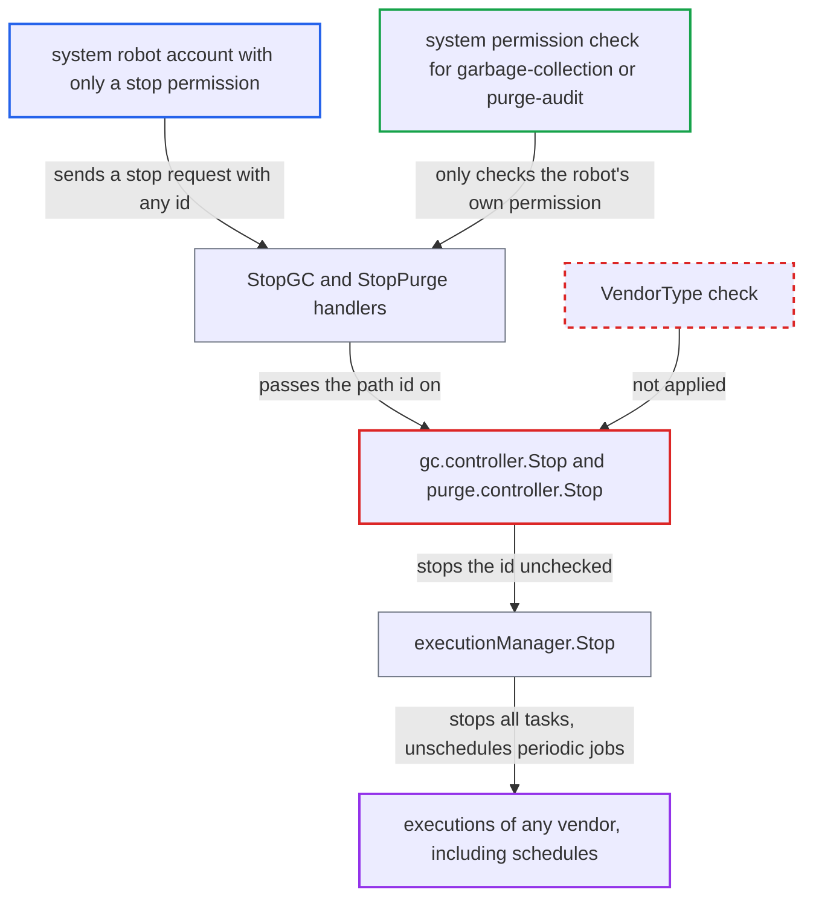

# GC and purge stop endpoints stop executions of any vendor, including schedules

| Field | Value |
|---|---|
| ID | `find_011ebPcgTo6tUkgTMkmZdvYs` |
| Severity | **Medium** |
| Status | open |
| CWE | CWE-639 — Authorization bypass via user-controlled key |
| Created | 2026-10-27T21:08:40.566486Z |
| Claude Security | https://claude.ai/security/findings/find_011ebPcgTo6tUkgTMkmZdvYs |

## Description

A system robot account that holds only `garbage-collection:stop` or `purge-audit:stop` can stop any background execution of any type. That includes replications, scan-all, retention, preheat and exports. It can also silently switch off scheduled jobs. The stop handlers check only the caller's system permission, and `gc.controller.Stop` and `purge.controller.Stop` stop whatever execution id the caller sends, without checking its `VendorType`. Nothing is disclosed or modified, so the impact is limited to stopping jobs.

1. **attacker with a system robot account** sends `PUT /api/v2.0/system/gc/{gc_id}` with a chosen id. The robot holds only `garbage-collection:stop`, and the ids are sequential integers, so the attacker can try every id in turn. The same attack works on `PUT /api/v2.0/system/purgeaudit/{purge_id}` with `purge-audit:stop`. ([`src/server/v2.0/handler/gc.go:280-289`](https://github.com/cx-benchmark/harbor/blob/d822d80c2e6edb2c85538d4b9cd73c0c375a5596/src/server/v2.0/handler/gc.go#L280-L289))
2. **the handler `StopGC`** passes the permission check and hands the path id on. It checks only `RequireSystemAccess(ActionStop, ResourceGarbageCollection)`. `StopPurge` does the same with `purge-audit:stop`. Neither looks at what the id refers to. ([`src/server/v2.0/handler/gc.go:280-289`](https://github.com/cx-benchmark/harbor/blob/d822d80c2e6edb2c85538d4b9cd73c0c375a5596/src/server/v2.0/handler/gc.go#L280-L289))
3. **the controllers `gc.controller.Stop` and `purge.controller.Stop`** call `exeMgr.Stop(ctx, id)` with the caller's id. Unlike `GetExecution`, `GetTask` and `ListTasks` in the same file, `Stop` does not restrict the id to `job.GarbageCollectionVendorType`. The purge controller likewise does not restrict it to `job.PurgeAuditVendorType`. ([`src/controller/gc/controller.go:103-106`](https://github.com/cx-benchmark/harbor/blob/d822d80c2e6edb2c85538d4b9cd73c0c375a5596/src/controller/gc/controller.go#L103-L106))
4. **`executionManager.Stop`** loads the execution by primary key and stops all of its tasks. It never checks `VendorType`, so an execution of any vendor is accepted, even one already in a final status. ([`src/pkg/task/execution.go:165-207`](https://github.com/cx-benchmark/harbor/blob/d822d80c2e6edb2c85538d4b9cd73c0c375a5596/src/pkg/task/execution.go#L165-L207))
5. **jobservice** stops the job and unschedules periodic ones. For a `KindPeriodic` task, `StopJob` calls `scheduler.UnSchedule`, which removes the periodic policy from Redis. ([`src/jobservice/worker/cworker/c_worker.go:329-345`](https://github.com/cx-benchmark/harbor/blob/d822d80c2e6edb2c85538d4b9cd73c0c375a5596/src/jobservice/worker/cworker/c_worker.go#L329-L345))
6. **the `SCHEDULER` execution of a schedule** is stopped, so the schedule stops firing. Each schedule is backed by a `SCHEDULER` execution in the shared `execution` table. Harbor's database still shows the schedule, so the failure is silent. ([`src/pkg/scheduler/scheduler.go:153-163`](https://github.com/cx-benchmark/harbor/blob/d822d80c2e6edb2c85538d4b9cd73c0c375a5596/src/pkg/scheduler/scheduler.go#L153-L163))

## Assessment

The attacker needs a system robot account granted only `garbage-collection:stop` or `purge-audit:stop`. The report notes that `validate` in `src/server/v2.0/handler/robot.go` accepts a robot with just one of these grants. With the robot's basic-auth credentials, the attacker sends stop requests to `PUT /api/v2.0/system/gc/{gc_id}` or `PUT /api/v2.0/system/purgeaudit/{purge_id}` for sequential ids. The attack needs no victim action and no special deployment. The report lists `/api/v2.0/*` as an internet entry point. The robot gets none of the permissions that stopping these executions normally requires: `replication:create`, `scan-all:stop`, project-level update rights or `jobservice-monitor:stop`.

Impact: The attacker can abort any running background execution system-wide. That covers replications, scan-all, tag retention, P2P preheat runs and scan-data exports. The attacker can also silently disable scheduled GC, scan-all, replication and retention by unscheduling their periodic policies. The impact is limited to stopping jobs: nothing is disclosed and no artifact is directly modified.

## Recommendation

`gc.controller.Stop` and `purge.controller.Stop` pass an untrusted execution id to `executionManager.Stop` without checking that the execution's `VendorType` matches the resource the caller was authorized for. This leaves the shared `execution` table without object-level authorization.

Fix criteria: A stop request through the GC endpoint succeeds only for executions whose `VendorType` is `GARBAGE_COLLECTION`. Through the purge endpoint it succeeds only for `PURGE_AUDIT_LOG`. Any other id returns 404. To verify, call `PUT /api/v2.0/system/gc/{id}` with a GC-stop-only robot, first with the id of a running replication execution and then with the id of a `SCHEDULER` execution. Both calls must be refused, the replication must keep running, and the schedule must still fire.

## Evidence

**https://github.com/cx-benchmark/harbor**

- [`src/controller/gc/controller.go:103-106`](https://github.com/cx-benchmark/harbor/blob/d822d80c2e6edb2c85538d4b9cd73c0c375a5596/src/controller/gc/controller.go#L103-L106)
- [`src/controller/purge/controller.go:65-68`](https://github.com/cx-benchmark/harbor/blob/d822d80c2e6edb2c85538d4b9cd73c0c375a5596/src/controller/purge/controller.go#L65-L68)
- [`src/server/v2.0/handler/gc.go:280-289`](https://github.com/cx-benchmark/harbor/blob/d822d80c2e6edb2c85538d4b9cd73c0c375a5596/src/server/v2.0/handler/gc.go#L280-L289)
- [`src/server/v2.0/handler/purge.go:329-337`](https://github.com/cx-benchmark/harbor/blob/d822d80c2e6edb2c85538d4b9cd73c0c375a5596/src/server/v2.0/handler/purge.go#L329-L337)
- [`src/pkg/task/execution.go:165-207`](https://github.com/cx-benchmark/harbor/blob/d822d80c2e6edb2c85538d4b9cd73c0c375a5596/src/pkg/task/execution.go#L165-L207)
- [`src/jobservice/worker/cworker/c_worker.go:329-345`](https://github.com/cx-benchmark/harbor/blob/d822d80c2e6edb2c85538d4b9cd73c0c375a5596/src/jobservice/worker/cworker/c_worker.go#L329-L345)
- [`src/pkg/scheduler/scheduler.go:153-163`](https://github.com/cx-benchmark/harbor/blob/d822d80c2e6edb2c85538d4b9cd73c0c375a5596/src/pkg/scheduler/scheduler.go#L153-L163)
- [`src/common/rbac/const.go:208-218`](https://github.com/cx-benchmark/harbor/blob/d822d80c2e6edb2c85538d4b9cd73c0c375a5596/src/common/rbac/const.go#L208-L218)
- [`src/controller/replication/execution.go:189-197`](https://github.com/cx-benchmark/harbor/blob/d822d80c2e6edb2c85538d4b9cd73c0c375a5596/src/controller/replication/execution.go#L189-L197)

