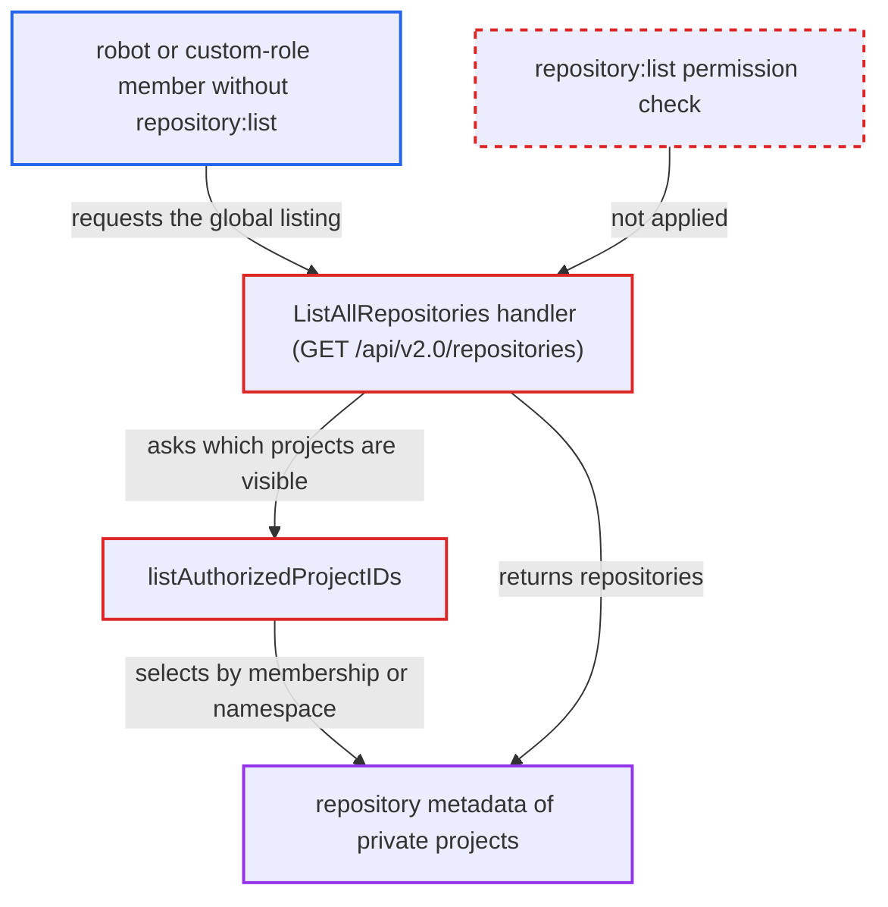

# Global repository listing skips repository:list check for robots and custom-role members

| Field | Value |
|---|---|
| ID | `find_01GQABYggDy94yzeeaNy1m4d` |
| Severity | **Medium** |
| Status | open |
| CWE | CWE-862 — Missing authorization |
| Created | 2026-10-27T21:20:31.366595Z |
| Claude Security | https://claude.ai/security/findings/find_01GQABYggDy94yzeeaNy1m4d |

## Description

A robot account or a custom-role project member that was deliberately not given `repository:list` can still list every repository in the private projects it can reach. Repository names, descriptions, pull counts, timestamps and artifact counts are exposed. A system robot with any `/project/*` permission sees every private project on the instance. The cause is `ListAllRepositories`, which picks projects through `listAuthorizedProjectIDs` by membership or namespace and never checks the permission.

1. **attacker** obtains a robot credential or a custom-role account without `repository:list`. For example a pull-only robot on private project P, a custom-role member, or a `/project/*` system robot granted only `scan:create`. ([`src/common/rbac/project/rbac_role.go:348-360`](https://github.com/cx-benchmark/harbor/blob/d822d80c2e6edb2c85538d4b9cd73c0c375a5596/src/common/rbac/project/rbac_role.go#L348-L360))
2. **attacker** sends `GET /api/v2.0/repositories?page_size=100` with those credentials. The endpoint is served by `ListAllRepositories`, which makes no `RequireProjectAccess` or `HasPermission` call. ([`src/server/v2.0/handler/repository.go:67-112`](https://github.com/cx-benchmark/harbor/blob/d822d80c2e6edb2c85538d4b9cd73c0c375a5596/src/server/v2.0/handler/repository.go#L67-L112))
3. **the function `listAuthorizedProjectIDs`** selects the visible projects by membership or robot namespace. A local user gets every project with a `project_member` row whatever the role. A robot gets the projects in its `Permissions[].Namespace` plus public ones. A `/project/*` robot gets no project filter at all. ([`src/server/v2.0/handler/repository.go:114-166`](https://github.com/cx-benchmark/harbor/blob/d822d80c2e6edb2c85538d4b9cd73c0c375a5596/src/server/v2.0/handler/repository.go#L114-L166))
4. **the handler `ListAllRepositories`** returns every repository in those projects with artifact counts. The robot's `Access` list is never evaluated through `robot.SecurityContext.Can`, so a missing `repository:list` is never noticed. ([`src/common/security/robot/context.go:84-127`](https://github.com/cx-benchmark/harbor/blob/d822d80c2e6edb2c85538d4b9cd73c0c375a5596/src/common/security/robot/context.go#L84-L127))
5. **attacker** reads the metadata of repositories they were not allowed to list. The project-scoped `ListRepositories` would have denied this through `RequireProjectAccess` with `rbac.ActionList` on `rbac.ResourceRepository`. ([`src/server/v2.0/handler/repository.go:168-171`](https://github.com/cx-benchmark/harbor/blob/d822d80c2e6edb2c85538d4b9cd73c0c375a5596/src/server/v2.0/handler/repository.go#L168-L171))

## Assessment

The attacker holds a robot credential, or a user account with a custom project role, whose grants leave out `repository:list`. Examples are a pull-only robot on a private project, or a `/project/*` system robot with only a narrow permission such as `scan:create`. They call `GET /api/v2.0/repositories` over the network on the `/api/v2.0/*` API. All built-in project roles include `repository:list`, so only robots and custom-role members gain anything.

Impact: The attacker learns names, descriptions, pull counts, creation and update times and artifact counts of repositories in private projects they had no listing right for. A `/project/*` robot can do this for every private project on the instance, without `catalog:read`. Artifact content, scan reports and writes stay protected, so the loss is limited to metadata.

## Recommendation

`ListAllRepositories` uses project membership or robot namespace presence in place of the `repository:list` permission, and treats `/project/*` robots as system admins. Fine-grained robot and custom-role permissions go unenforced on this endpoint.

Fix criteria: The global listing returns a project's repositories only if the caller would pass `RequireProjectAccess(project, rbac.ActionList, rbac.ResourceRepository)` for that project, or the project is public. This holds for robots, `/project/*` robots and custom-role members alike. Three callers are tested against `GET /api/v2.0/repositories`: a robot granted only `repository:pull` on a private project, a `/project/*` robot with only `scan:create`, and a member with a custom role lacking `repository:list`. None of them sees that project's repositories.

## Evidence

**https://github.com/cx-benchmark/harbor**

- [`src/server/v2.0/handler/repository.go:114-166`](https://github.com/cx-benchmark/harbor/blob/d822d80c2e6edb2c85538d4b9cd73c0c375a5596/src/server/v2.0/handler/repository.go#L114-L166)
- [`src/server/v2.0/handler/repository.go:67-112`](https://github.com/cx-benchmark/harbor/blob/d822d80c2e6edb2c85538d4b9cd73c0c375a5596/src/server/v2.0/handler/repository.go#L67-L112)
- [`src/server/v2.0/handler/repository.go:168-171`](https://github.com/cx-benchmark/harbor/blob/d822d80c2e6edb2c85538d4b9cd73c0c375a5596/src/server/v2.0/handler/repository.go#L168-L171)
- [`src/common/security/robot/context.go:84-127`](https://github.com/cx-benchmark/harbor/blob/d822d80c2e6edb2c85538d4b9cd73c0c375a5596/src/common/security/robot/context.go#L84-L127)
- [`src/common/rbac/const.go:242-260`](https://github.com/cx-benchmark/harbor/blob/d822d80c2e6edb2c85538d4b9cd73c0c375a5596/src/common/rbac/const.go#L242-L260)
- [`src/common/rbac/project/rbac_role.go:348-360`](https://github.com/cx-benchmark/harbor/blob/d822d80c2e6edb2c85538d4b9cd73c0c375a5596/src/common/rbac/project/rbac_role.go#L348-L360)
- [`src/server/middleware/v2auth/auth.go:59-63`](https://github.com/cx-benchmark/harbor/blob/d822d80c2e6edb2c85538d4b9cd73c0c375a5596/src/server/middleware/v2auth/auth.go#L59-L63)

