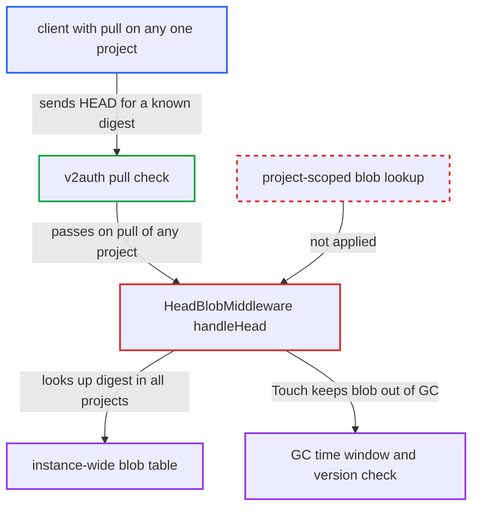

# HEAD blob checks digest instance-wide: cross-project blob existence oracle and GC pinning

| Field | Value |
|---|---|
| ID | `find_01PyjjD3FXqAD2fCBhBHCUq4` |
| Severity | **Medium** |
| Status | open |
| CWE | CWE-203 — Observable discrepancy |
| Created | 2026-10-27T21:43:25.899470Z |
| Claude Security | https://claude.ai/security/findings/find_01PyjjD3FXqAD2fCBhBHCUq4 |

## Description

Any client with pull access to one project can find out whether a blob with a known digest exists in any other project, including private ones. This includes an anonymous client using the default public `library` project. The same requests also stop garbage collection from deleting chosen blobs. The cause is `handleHead` in `HeadBlobMiddleware`, which looks the digest up across the whole instance and calls `Touch` without restricting to the requested project.

1. **attacker** gets a pull token for a project they can read. An anonymous client can get one for the default public `library` project from `/service/token`. Any authenticated user with pull on one project can do the same. ([`make/migrations/postgresql/0001_initial_schema.up.sql:119-120`](https://github.com/cx-benchmark/harbor/blob/d822d80c2e6edb2c85538d4b9cd73c0c375a5596/make/migrations/postgresql/0001_initial_schema.up.sql#L119-L120))
2. **attacker** sends `HEAD /v2/library/x/blobs/sha256:<digest>` for a digest they can compute. The digest can come from a known image layer, a known file packed as a layer, or a signature or SBOM blob. ([`src/server/registry/route.go:85-91`](https://github.com/cx-benchmark/harbor/blob/d822d80c2e6edb2c85538d4b9cd73c0c375a5596/src/server/registry/route.go#L85-L91))
3. **`v2auth`** lets the request through after a pull check on the URL's project. It only checks that an `Authorization` header is present and that the caller has `pull` on the project named in the path. The repository does not have to exist. ([`src/server/middleware/v2auth/auth.go:65-78`](https://github.com/cx-benchmark/harbor/blob/d822d80c2e6edb2c85538d4b9cd73c0c375a5596/src/server/middleware/v2auth/auth.go#L65-L78))
4. **the handler `handleHead`** looks up the digest in the instance-wide `blob` table. It calls `blob.Ctl.Get` with no project option, so rows from every project match. ([`src/server/middleware/blob/head_blob.go:52-77`](https://github.com/cx-benchmark/harbor/blob/d822d80c2e6edb2c85538d4b9cd73c0c375a5596/src/server/middleware/blob/head_blob.go#L52-L77))
5. **`HeadBlobMiddleware`** answers differently depending on whether any project holds the digest. If no project holds it, Harbor returns its own `NOT_FOUND` 404 without the `Docker-Distribution-Api-Version` header. If some project holds it, the request goes on to distribution, which returns a `BLOB_UNKNOWN` 404 with that header and a different Content-Length. Rows in `deleting` or `deletefailed` status get their own distinct messages. ([`src/lib/http/error.go:53-67`](https://github.com/cx-benchmark/harbor/blob/d822d80c2e6edb2c85538d4b9cd73c0c375a5596/src/lib/http/error.go#L53-L67))
6. **`handleHead`** calls `Touch` on a matching row before the request reaches distribution. `Touch` sets `update_time` to now, increments `version`, and moves `delete` or `deletefailed` back to `none`. ([`src/pkg/blob/dao/dao.go:185-214`](https://github.com/cx-benchmark/harbor/blob/d822d80c2e6edb2c85538d4b9cd73c0c375a5596/src/pkg/blob/dao/dao.go#L185-L214))
7. **attacker** repeats the probe within the GC `time_window`. A blob whose `update_time` keeps being refreshed is never an orphan candidate. A blob touched between mark and sweep fails the sweep's version check, so it is skipped. ([`src/pkg/blob/dao/dao.go:406-413`](https://github.com/cx-benchmark/harbor/blob/d822d80c2e6edb2c85538d4b9cd73c0c375a5596/src/pkg/blob/dao/dao.go#L406-L413))

## Assessment

The attacker needs only a pull token for any one project. An anonymous client can get one for the default public `library` project, since that project ships public. No victim action is needed. The attacker must already know or be able to compute the digest. The existence test relies on the pinned distribution (`v2.8.3-harbor` fork) answering a HEAD on a blob not linked in the requested repository with 404 `BLOB_UNKNOWN`. The report states this as an assumption.

Impact: The attacker can learn whether a digest they already know exists anywhere in the instance, including private projects. They cannot learn which project holds it. They can also keep chosen blobs, including ones project owners deleted, from being garbage collected, so the content stays in backend storage. They cannot read the blob through `/v2`, and storage cannot grow beyond blobs that already exist.

## Recommendation

(1) `handleHead` in `src/server/middleware/blob/head_blob.go` looks a blob up by digest alone. It acts on rows that do not belong to the request's project, by calling `Touch` and returning distinct error messages. This breaks project scoping and makes blob existence observable.

Fix criteria: The HEAD middleware only reads and changes blob rows associated with the project named in the request. A digest not associated with that project gets a response indistinguishable from the registry's own 'blob unknown' answer in status, headers and body length. To verify, HEAD a digest that exists only in another private project. The response must match the one for a non-existent digest. The row's `status`, `version` and `update_time` must be unchanged.

(2) A read-only HEAD from any principal with pull access triggers the GC-protection `Touch`. Unprivileged clients can therefore drive the GC time-window and version safeguards for blobs in other projects.

Fix criteria: A HEAD refreshes a blob's GC state only when the blob is associated with the probing project, or when the request is part of a push into it. A HEAD that ends in 'blob unknown' for the requested repository does not change `update_time`, `version` or `status`. To verify, probe a GC-eligible orphan blob repeatedly with an anonymous or pull-only token. Then confirm the next GC run deletes it.

## Evidence

**https://github.com/cx-benchmark/harbor**

- [`src/server/middleware/blob/head_blob.go:52-77`](https://github.com/cx-benchmark/harbor/blob/d822d80c2e6edb2c85538d4b9cd73c0c375a5596/src/server/middleware/blob/head_blob.go#L52-L77)
- [`src/server/registry/route.go:85-91`](https://github.com/cx-benchmark/harbor/blob/d822d80c2e6edb2c85538d4b9cd73c0c375a5596/src/server/registry/route.go#L85-L91)
- [`src/server/middleware/v2auth/auth.go:65-78`](https://github.com/cx-benchmark/harbor/blob/d822d80c2e6edb2c85538d4b9cd73c0c375a5596/src/server/middleware/v2auth/auth.go#L65-L78)
- [`src/controller/blob/controller.go:221-255`](https://github.com/cx-benchmark/harbor/blob/d822d80c2e6edb2c85538d4b9cd73c0c375a5596/src/controller/blob/controller.go#L221-L255)
- [`src/lib/http/error.go:53-67`](https://github.com/cx-benchmark/harbor/blob/d822d80c2e6edb2c85538d4b9cd73c0c375a5596/src/lib/http/error.go#L53-L67)
- [`src/pkg/blob/dao/dao.go:185-214`](https://github.com/cx-benchmark/harbor/blob/d822d80c2e6edb2c85538d4b9cd73c0c375a5596/src/pkg/blob/dao/dao.go#L185-L214)
- [`src/pkg/blob/dao/dao.go:406-413`](https://github.com/cx-benchmark/harbor/blob/d822d80c2e6edb2c85538d4b9cd73c0c375a5596/src/pkg/blob/dao/dao.go#L406-L413)
- [`src/jobservice/job/impl/gc/garbage_collection.go:328-338`](https://github.com/cx-benchmark/harbor/blob/d822d80c2e6edb2c85538d4b9cd73c0c375a5596/src/jobservice/job/impl/gc/garbage_collection.go#L328-L338)
- [`make/migrations/postgresql/0001_initial_schema.up.sql:119-120`](https://github.com/cx-benchmark/harbor/blob/d822d80c2e6edb2c85538d4b9cd73c0c375a5596/make/migrations/postgresql/0001_initial_schema.up.sql#L119-L120)

