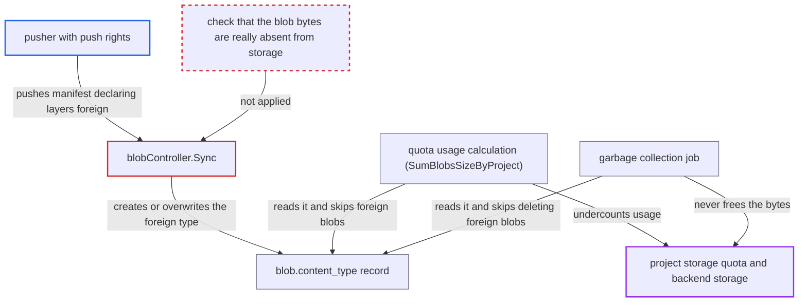

# Manifest-declared foreign-layer media type exempts stored blobs from project quota and GC

| Field | Value |
|---|---|
| ID | `find_01VdpV2ZyfnBcTPLjGnYqYqG` |
| Severity | **Medium** |
| Status | open |
| CWE | CWE-807 — Reliance on untrusted input |
| Created | 2026-10-27T21:16:08.069065Z |
| Claude Security | https://claude.ai/security/findings/find_01VdpV2ZyfnBcTPLjGnYqYqG |

## Description

A project member who can push can store unlimited data in a project that has a finite storage quota, while the quota shows almost no usage. They can also relabel other projects' blobs by naming their digests, which corrupts those projects' accounting. The attack needs push rights, and the quota only matters where an operator has set a finite `storage_per_project` (the default is `-1`). The cause is that `blobController.Sync` lets the client's manifest set a blob's `content_type` to the foreign-layer type, and quota and GC then treat that type as proof the bytes are not stored.

1. **pusher** pushes a schema2 manifest that lists a digest D as a foreign layer. D is the digest of data not uploaded yet, and the layer carries any http(s) `urls` value. The bundled registry runs with `validation.disabled: true`, so it accepts the manifest without checking that the layer exists. ([`make/photon/prepare/templates/registry/config.yml.jinja:73-74`](https://github.com/cx-benchmark/harbor/blob/d822d80c2e6edb2c85538d4b9cd73c0c375a5596/make/photon/prepare/templates/registry/config.yml.jinja#L73-L74))
2. **the manifest middleware** passes the manifest's references to `Sync` after the registry returns success. The references come straight from the request body, and every referenced digest is associated with the pusher's project. ([`src/server/middleware/blob/put_manifest.go:83-93`](https://github.com/cx-benchmark/harbor/blob/d822d80c2e6edb2c85538d4b9cd73c0c375a5596/src/server/middleware/blob/put_manifest.go#L83-L93))
3. **`blobController.Sync`** creates D with the declared foreign media type and size. For a digest that already exists it overwrites the global `content_type` instead. It never checks whether the bytes are in storage. ([`src/controller/blob/controller.go:261-322`](https://github.com/cx-benchmark/harbor/blob/d822d80c2e6edb2c85538d4b9cd73c0c375a5596/src/controller/blob/controller.go#L261-L322))
4. **the quota check `putManifestResources`** skips the descriptor marked foreign. Declaring the digest foreign therefore costs nothing. ([`src/server/middleware/quota/put_manifest.go:66-85`](https://github.com/cx-benchmark/harbor/blob/d822d80c2e6edb2c85538d4b9cd73c0c375a5596/src/server/middleware/quota/put_manifest.go#L66-L85))
5. **pusher** uploads the real bytes for D. `putBlobUploadResources` sees that D is already associated with the project and charges nothing. ([`src/server/middleware/quota/put_blob_upload.go:55-66`](https://github.com/cx-benchmark/harbor/blob/d822d80c2e6edb2c85538d4b9cd73c0c375a5596/src/server/middleware/quota/put_blob_upload.go#L55-L66))
6. **`Ensure`** returns the existing row for D unchanged. The blob keeps its foreign `content_type`, so its bytes are never counted. ([`src/controller/blob/controller.go:155-166`](https://github.com/cx-benchmark/harbor/blob/d822d80c2e6edb2c85538d4b9cd73c0c375a5596/src/controller/blob/controller.go#L155-L166))
7. **quota refresh and GC** leave the blob out of usage and keep its bytes after the artifact is deleted. Usage is a sum over blobs whose `content_type` is not the foreign type. GC skips `DeleteBlob` for foreign blobs but still removes their database rows, so the bytes stay in backend storage permanently. ([`src/jobservice/job/impl/gc/garbage_collection.go:428-432`](https://github.com/cx-benchmark/harbor/blob/d822d80c2e6edb2c85538d4b9cd73c0c375a5596/src/jobservice/job/impl/gc/garbage_collection.go#L428-L432))

## Assessment

The attacker is a project member with push rights (a Developer, or a robot with `repository:push`) on a project that has a finite storage quota. The report gives the default `storage_per_project` as `-1`. In the first route, the attacker pre-declares: they upload a config blob and push a manifest that lists digest D as a foreign layer with any `http://` URL, then upload D's real bytes. In the second route, the attacker relabels: they upload layers normally, then push a manifest that re-declares them as foreign. The next quota refresh subtracts those layers. Refreshes are triggered by artifact, manifest or repository deletion, retention, or the refresh after GC (`RefreshForProjects`). Because `content_type` is global and foreign descriptors are not checked against the pusher's repository, the attacker can also relabel blobs belonging to other projects just by naming their digests. Repeating either route stores unlimited data while usage stays near zero.

Impact: The attacker can defeat the project storage quota set by the system admin and fill the shared registry storage, which breaks pushes for every project. GC cannot reclaim relabelled blobs even after their artifacts are deleted. Relabelling other projects' digests also corrupts their quota accounting and blob GC handling. No artifact content is disclosed.

## Recommendation

(1) `Sync` lets a manifest descriptor's media type overwrite the recorded `content_type` of an existing blob, and create foreign-typed rows for any digest. Quota and GC then treat that recorded type as proof the blob is not stored.

Fix criteria: A manifest cannot classify as foreign a blob that exists in, or is later uploaded or mounted into, registry storage. Test: upload layers, push a manifest that marks them foreign, and trigger a quota refresh. Project usage must still include those layers. GC must delete their bytes once they are unreferenced.

(2) The blob-upload quota check `putBlobUploadResources` skips the charge whenever the digest is already associated with the project. That happens even when the association came only from a manifest-declared foreign layer with no stored bytes.

Fix criteria: Uploading real bytes for a digest is charged to the project unless those bytes were already counted. Test: push a manifest that declares digest D foreign, then upload D's bytes. Project usage must increase by D's size. The upload must be refused when it would exceed the quota.

(3) The manifest-push and copy reservations (`putManifestResources`, `copyArtifactResources`) exempt descriptors just because the client or the database marks them foreign.

Fix criteria: The foreign-layer exemption applies only to blobs the registry does not hold. A manifest that declares a stored blob as foreign is either rejected or has the blob counted. Test: copy or push an artifact whose layers are stored but labelled foreign. It must consume quota.

## Evidence

**https://github.com/cx-benchmark/harbor**

- [`src/controller/blob/controller.go:261-322`](https://github.com/cx-benchmark/harbor/blob/d822d80c2e6edb2c85538d4b9cd73c0c375a5596/src/controller/blob/controller.go#L261-L322)
- [`src/server/middleware/blob/put_manifest.go:83-93`](https://github.com/cx-benchmark/harbor/blob/d822d80c2e6edb2c85538d4b9cd73c0c375a5596/src/server/middleware/blob/put_manifest.go#L83-L93)
- [`src/server/middleware/quota/put_manifest.go:66-85`](https://github.com/cx-benchmark/harbor/blob/d822d80c2e6edb2c85538d4b9cd73c0c375a5596/src/server/middleware/quota/put_manifest.go#L66-L85)
- [`src/server/middleware/quota/put_blob_upload.go:55-66`](https://github.com/cx-benchmark/harbor/blob/d822d80c2e6edb2c85538d4b9cd73c0c375a5596/src/server/middleware/quota/put_blob_upload.go#L55-L66)
- [`src/controller/blob/controller.go:155-166`](https://github.com/cx-benchmark/harbor/blob/d822d80c2e6edb2c85538d4b9cd73c0c375a5596/src/controller/blob/controller.go#L155-L166)
- [`src/pkg/blob/dao/dao.go:289-311`](https://github.com/cx-benchmark/harbor/blob/d822d80c2e6edb2c85538d4b9cd73c0c375a5596/src/pkg/blob/dao/dao.go#L289-L311)
- [`src/controller/quota/driver/project/project.go:109-120`](https://github.com/cx-benchmark/harbor/blob/d822d80c2e6edb2c85538d4b9cd73c0c375a5596/src/controller/quota/driver/project/project.go#L109-L120)
- [`src/jobservice/job/impl/gc/garbage_collection.go:428-432`](https://github.com/cx-benchmark/harbor/blob/d822d80c2e6edb2c85538d4b9cd73c0c375a5596/src/jobservice/job/impl/gc/garbage_collection.go#L428-L432)
- [`src/server/middleware/quota/copy_artifact.go:127-133`](https://github.com/cx-benchmark/harbor/blob/d822d80c2e6edb2c85538d4b9cd73c0c375a5596/src/server/middleware/quota/copy_artifact.go#L127-L133)
- [`make/photon/prepare/templates/registry/config.yml.jinja:73-74`](https://github.com/cx-benchmark/harbor/blob/d822d80c2e6edb2c85538d4b9cd73c0c375a5596/make/photon/prepare/templates/registry/config.yml.jinja#L73-L74)

