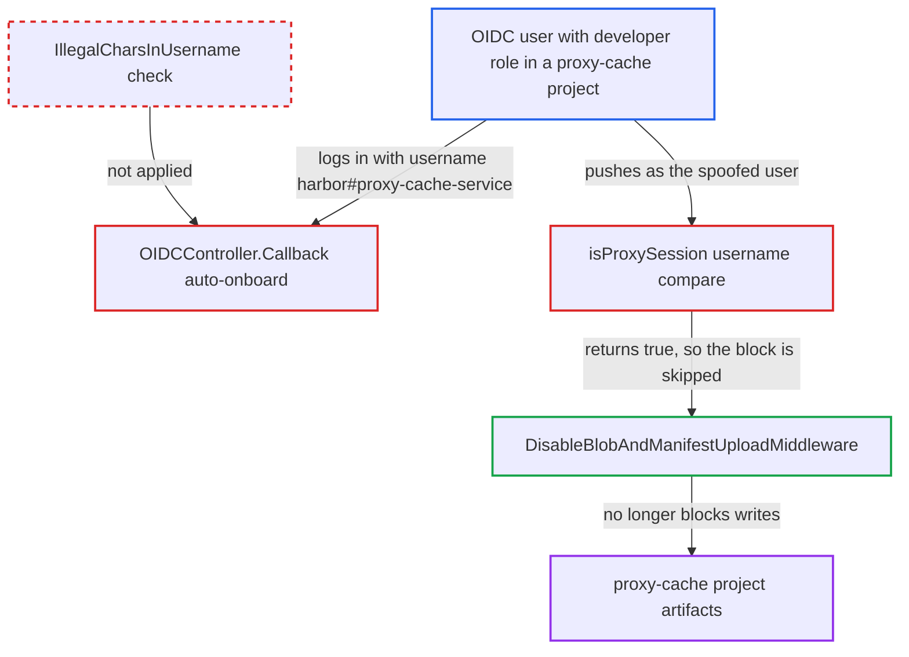

# OIDC auto-onboard accepts reserved username that spoofs proxy-cache service identity

| Field | Value |
|---|---|
| ID | `find_01QLLu7o7wweHYSdXnz5V5vv` |
| Severity | **Medium** |
| Status | open |
| CWE | CWE-290 — Identity spoofing |
| Created | 2026-10-27T21:34:29.760985Z |
| Claude Security | https://claude.ai/security/findings/find_01QLLu7o7wweHYSdXnz5V5vv |

## Description

An ordinary OIDC user can push their own images into a proxy-cache project, which should only hold content mirrored from upstream. Other users who pull from that project can then receive the pushed content. The attack needs OIDC auto-onboard enabled, an IdP where the user can edit the attribute used as the username, and a developer, maintainer or admin role in the project. The cause is that `OIDCController.Callback` stores the username claim without the `common.IllegalCharsInUsername` check. As a result, the name `harbor#proxy-cache-service` passes the `isProxySession` check.

1. **OIDC user** sets the IdP attribute that Harbor maps to the username to `harbor#proxy-cache-service`. The default attribute is the `name` claim, which is often editable by the user at the IdP.
2. **the callback `OIDCController.Callback`** auto-onboards the user and keeps the claim as the Harbor username. It replaces only spaces and applies no `common.IllegalCharsInUsername` check, unlike the manual `Onboard()` handler and `validateUserProfile`. ([`src/core/controllers/oidc.go:171-192`](https://github.com/cx-benchmark/harbor/blob/d822d80c2e6edb2c85538d4b9cd73c0c375a5596/src/core/controllers/oidc.go#L171-L192))
3. **`user.Manager.Create`** inserts the account with the reserved name. It rewrites only commas, so `#` survives. The `#` is what Harbor assumed no real account could contain. ([`src/pkg/user/manager.go:182-189`](https://github.com/cx-benchmark/harbor/blob/d822d80c2e6edb2c85538d4b9cd73c0c375a5596/src/pkg/user/manager.go#L182-L189))
4. **OIDC user** pushes an image to a proxy-cache project with `docker push`. The user needs a developer, maintainer or admin role in that project and can authenticate with the CLI secret. `isProxySession` compares `GetUsername()` with the proxy-cache service name and returns true. ([`src/server/middleware/repoproxy/proxy.go:429-437`](https://github.com/cx-benchmark/harbor/blob/d822d80c2e6edb2c85538d4b9cd73c0c375a5596/src/server/middleware/repoproxy/proxy.go#L429-L437))
5. **`DisableBlobAndManifestUploadMiddleware`** is skipped for the push. This is the only control that blocks writes to proxy-cache projects, and it lets the request through when `isProxySession` is true. ([`src/server/middleware/repoproxy/proxy.go:473-490`](https://github.com/cx-benchmark/harbor/blob/d822d80c2e6edb2c85538d4b9cd73c0c375a5596/src/server/middleware/repoproxy/proxy.go#L473-L490))
6. **`UseLocalManifest`** serves the pushed manifest to other users who pull from the project. Local content is preferred when the upstream is rate-limited, when `ProxyCacheLocalOnNotFound` is set, when the upstream is marked unhealthy, and always for pulls by digest. ([`src/controller/proxy/controller.go:172-197`](https://github.com/cx-benchmark/harbor/blob/d822d80c2e6edb2c85538d4b9cd73c0c375a5596/src/controller/proxy/controller.go#L172-L197))

## Assessment

The attacker is an ordinary OIDC end user. Harbor must have OIDC auto-onboard enabled. The IdP must let the user edit the attribute that Harbor maps to the username (default `name`, set by `oidc_user_claim`). The user must also hold a developer, maintainer or admin role in a proxy-cache project. The token service's `repositoryFilter` grants push scope to developers on proxy projects without any proxy check. No victim interaction is needed. The same fake identity works for a browser session, the OIDC CLI-secret basic auth in `oidc_cli.go`, and the registry bearer token. The LDAP, UAA and auth-proxy onboarding paths also skip the reserved-character check. There the name is set by the directory or IdP administrator rather than the end user, so the report files the OIDC path.

Impact: The attacker can write arbitrary manifests, tags and blobs into a proxy-cache project. They appear as legitimate cached images in the UI and can be served to everyone who pulls from that project. The same name compare in `subject.go` also labels the attacker's accessories as created by the proxy-cache service. The report states no loss of confidentiality and no availability impact beyond the cost of the pushes.

## Recommendation

(1) The OIDC auto-onboard path in `oidc.go` saves an IdP-controlled claim as the Harbor username. It does not apply `common.IllegalCharsInUsername`, so reserved characters such as `#` can end up in account names.

Fix criteria: Every onboarding path that creates a user from an external identity rejects or normalizes usernames containing reserved characters before insertion. This covers OIDC auto-onboard and, for consistency, LDAP, UAA and auth-proxy `OnBoardUser` or `user.Manager.Create`. An ID token whose username claim is `harbor#proxy-cache-service` (or `robot$x+y`) does not produce a user with that name. The manual and automatic onboard flows accept the same character set.

(2) `repoproxy.isProxySession` and `subject.Middleware` identify the internal proxy-cache service by comparing the username string. They do not check the kind of security context that the proxy-cache secret generator produces.

Fix criteria: The proxy-cache service identity is established from the security context type (for example `*proxycachesecret.SecurityContext`) or an equivalent unforgeable marker, never from `GetUsername()`. A session, CLI-secret or v2-token context for a local user named `harbor#proxy-cache-service` is still blocked by `DisableBlobAndManifestUploadMiddleware`. That user's accessories are not tagged `source=proxycache`.

## Evidence

**https://github.com/cx-benchmark/harbor**

- [`src/core/controllers/oidc.go:171-192`](https://github.com/cx-benchmark/harbor/blob/d822d80c2e6edb2c85538d4b9cd73c0c375a5596/src/core/controllers/oidc.go#L171-L192)
- [`src/server/middleware/repoproxy/proxy.go:429-437`](https://github.com/cx-benchmark/harbor/blob/d822d80c2e6edb2c85538d4b9cd73c0c375a5596/src/server/middleware/repoproxy/proxy.go#L429-L437)
- [`src/server/middleware/repoproxy/proxy.go:473-490`](https://github.com/cx-benchmark/harbor/blob/d822d80c2e6edb2c85538d4b9cd73c0c375a5596/src/server/middleware/repoproxy/proxy.go#L473-L490)
- [`src/common/security/proxycachesecret/context.go:29-32`](https://github.com/cx-benchmark/harbor/blob/d822d80c2e6edb2c85538d4b9cd73c0c375a5596/src/common/security/proxycachesecret/context.go#L29-L32)
- [`src/pkg/user/manager.go:182-189`](https://github.com/cx-benchmark/harbor/blob/d822d80c2e6edb2c85538d4b9cd73c0c375a5596/src/pkg/user/manager.go#L182-L189)
- [`src/controller/proxy/controller.go:172-197`](https://github.com/cx-benchmark/harbor/blob/d822d80c2e6edb2c85538d4b9cd73c0c375a5596/src/controller/proxy/controller.go#L172-L197)
- [`src/server/middleware/subject/subject.go:176-180`](https://github.com/cx-benchmark/harbor/blob/d822d80c2e6edb2c85538d4b9cd73c0c375a5596/src/server/middleware/subject/subject.go#L176-L180)

