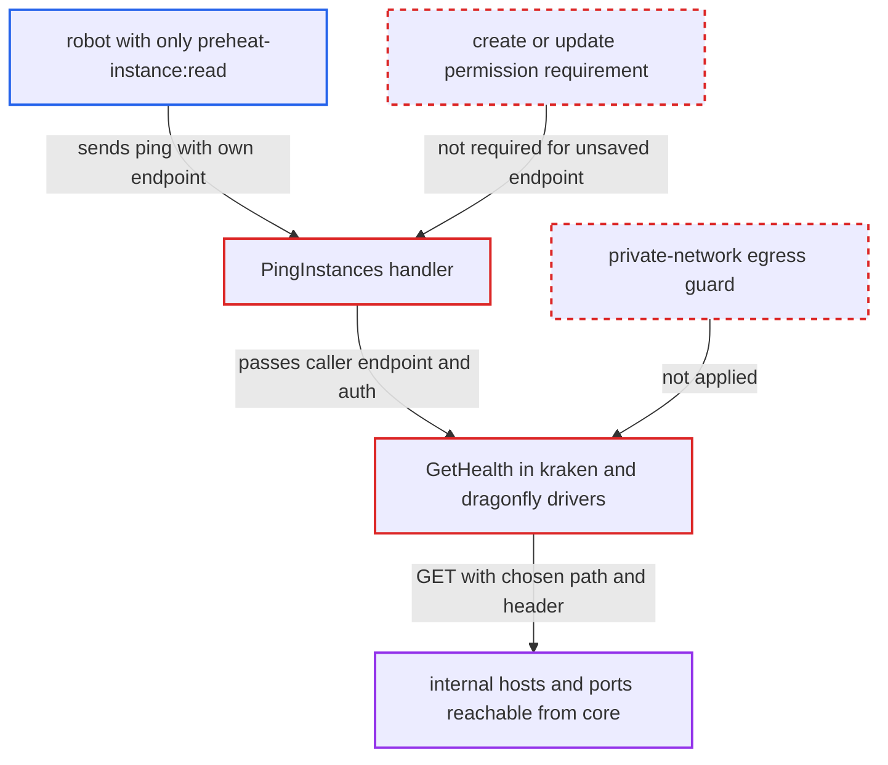

# Preheat instance ping lets preheat-instance-read robots probe arbitrary hosts

| Field | Value |
|---|---|
| ID | `find_01CGnXbqNyKmja8RzpAfzq2F` |
| Severity | **Medium** |
| Status | open |
| CWE | CWE-918 — Server-Side Request Forgery |
| Created | 2026-10-27T21:33:16.850067Z |
| Claude Security | https://claude.ai/security/findings/find_01CGnXbqNyKmja8RzpAfzq2F |

## Description

A system robot holding only the read permission `preheat-instance:read` can make Harbor core send GET requests to any host and port the core container can reach. The caller learns only whether the answer was a 2xx and how long it took, and no response body is returned. The cause is `PingInstances`, which accepts a caller-supplied endpoint under that read-level permission and applies no check on where the endpoint points.

1. **robot holder** sends a ping request with an endpoint of their choice. The body of `POST /api/v2.0/p2p/preheat/instances/ping` carries `endpoint`, `vendor`, `insecure`, `auth_mode` and `auth_info`, and no `id` is given. ([`src/server/v2.0/handler/preheat.go:451-486`](https://github.com/cx-benchmark/harbor/blob/d822d80c2e6edb2c85538d4b9cd73c0c375a5596/src/server/v2.0/handler/preheat.go#L451-L486))
2. **the handler `PingInstances`** turns the body into an unsaved `Instance` and passes it to `CheckHealth`. The only gate is `RequireSystemAccess` with `rbac.ActionRead` on `rbac.ResourcePreatInstance`, which a robot with only `preheat-instance:read` passes. ([`src/server/v2.0/handler/preheat.go:451-486`](https://github.com/cx-benchmark/harbor/blob/d822d80c2e6edb2c85538d4b9cd73c0c375a5596/src/server/v2.0/handler/preheat.go#L451-L486))
3. **the controller `CheckHealth`** builds the provider driver for the unsaved instance and calls `GetHealth`. The caller's endpoint is used as given, and any error from `GetHealth` is passed back up. ([`src/controller/p2p/preheat/controller.go:514-541`](https://github.com/cx-benchmark/harbor/blob/d822d80c2e6edb2c85538d4b9cd73c0c375a5596/src/controller/p2p/preheat/controller.go#L514-L541))
4. **the driver `GetHealth`** appends the health path to the endpoint and sends a GET. The URL goes through `lib.NormalizeAndValidateHTTPURL`, which checks only the scheme and writes the decoded path back out, so `%3F` in the endpoint becomes `?` and pushes the `/health` suffix into the query string, letting the caller choose the exact path. ([`src/lib/endpoint.go:27-46`](https://github.com/cx-benchmark/harbor/blob/d822d80c2e6edb2c85538d4b9cd73c0c375a5596/src/lib/endpoint.go#L27-L46))
5. **the HTTP client** performs the request and reports the outcome. It follows redirects and times out after 30 s. A 2xx answer gives 200 OK. Any other status or a connection error becomes an uncoded error and a 500 response. ([`src/pkg/p2p/preheat/provider/client/http_client.go:96-150`](https://github.com/cx-benchmark/harbor/blob/d822d80c2e6edb2c85538d4b9cd73c0c375a5596/src/pkg/p2p/preheat/provider/client/http_client.go#L96-L150))
6. **the auth handler** adds a caller-chosen header to the outbound request. With `auth_mode` set to `custom` the caller sets one header name and value. With `basic` or `oauth` the caller can set an arbitrary `Authorization` header. ([`src/pkg/p2p/preheat/provider/auth/custom_handler.go:33-45`](https://github.com/cx-benchmark/harbor/blob/d822d80c2e6edb2c85538d4b9cd73c0c375a5596/src/pkg/p2p/preheat/provider/auth/custom_handler.go#L33-L45))

## Assessment

The attacker holds a system robot token granted only `preheat-instance:read`. The report notes that this permission can be granted without create or update, and the robot security context honours it. The attacker reaches the internet-facing REST API and needs no user interaction or special deployment state. They send a ping request such as `POST /api/v2.0/p2p/preheat/instances/ping` with `vendor` set to `kraken` and an `endpoint` pointing at an internal host, port and path ending in `%3F`. With `auth_mode` set to `custom` they add one header of their choice. The request is blind, so the attacker reads the result from the 200 or 500 status and the response time.

Impact: The robot can make the core container send a GET request with one controlled header to any host and port it can reach. That lets it find which internal hosts, ports and paths answer with a 2xx, and from timing which are alive. No response body is disclosed and nothing in Harbor is modified.

Subsequent-system impact: The requests can reach services on the docker network or cluster that core can address, such as registry, jobservice, registryctl and metadata endpoints. Only their liveness and whether they answer 2xx are learned. A GET with a caller-chosen header could trigger side effects on such services if they accept unauthenticated GETs, but the report establishes only the probe.

## Recommendation

(1) `PingInstances` opens a connection to a caller-chosen endpoint under the read-level permission `preheat-instance:read`, so a robot meant only to view instances can make core send requests.

Fix criteria: Pinging an unsaved endpoint requires `preheat-instance:create` or `update`, and read-level callers can only ping stored instances by id. A system robot holding only `preheat-instance:read` gets 403 when the body names an endpoint.

(2) Endpoint validation applies no egress policy, and the decoded `%3F` lets the caller move the fixed health suffix into the query string.

Fix criteria: Caller-supplied provider endpoints must pass a private-network egress guard, as webhooks do, and the path stays percent-encoded so the health suffix cannot be moved into the query. Loopback and link-local endpoints are rejected. `%3F` no longer changes the requested path.

## Evidence

**https://github.com/cx-benchmark/harbor**

- [`src/server/v2.0/handler/preheat.go:451-486`](https://github.com/cx-benchmark/harbor/blob/d822d80c2e6edb2c85538d4b9cd73c0c375a5596/src/server/v2.0/handler/preheat.go#L451-L486)
- [`src/controller/p2p/preheat/controller.go:514-541`](https://github.com/cx-benchmark/harbor/blob/d822d80c2e6edb2c85538d4b9cd73c0c375a5596/src/controller/p2p/preheat/controller.go#L514-L541)
- [`src/pkg/p2p/preheat/provider/kraken.go:57-78`](https://github.com/cx-benchmark/harbor/blob/d822d80c2e6edb2c85538d4b9cd73c0c375a5596/src/pkg/p2p/preheat/provider/kraken.go#L57-L78)
- [`src/pkg/p2p/preheat/provider/client/http_client.go:96-150`](https://github.com/cx-benchmark/harbor/blob/d822d80c2e6edb2c85538d4b9cd73c0c375a5596/src/pkg/p2p/preheat/provider/client/http_client.go#L96-L150)
- [`src/pkg/p2p/preheat/provider/auth/custom_handler.go:33-45`](https://github.com/cx-benchmark/harbor/blob/d822d80c2e6edb2c85538d4b9cd73c0c375a5596/src/pkg/p2p/preheat/provider/auth/custom_handler.go#L33-L45)
- [`src/lib/endpoint.go:27-46`](https://github.com/cx-benchmark/harbor/blob/d822d80c2e6edb2c85538d4b9cd73c0c375a5596/src/lib/endpoint.go#L27-L46)
- [`src/common/rbac/const.go:174-178`](https://github.com/cx-benchmark/harbor/blob/d822d80c2e6edb2c85538d4b9cd73c0c375a5596/src/common/rbac/const.go#L174-L178)

