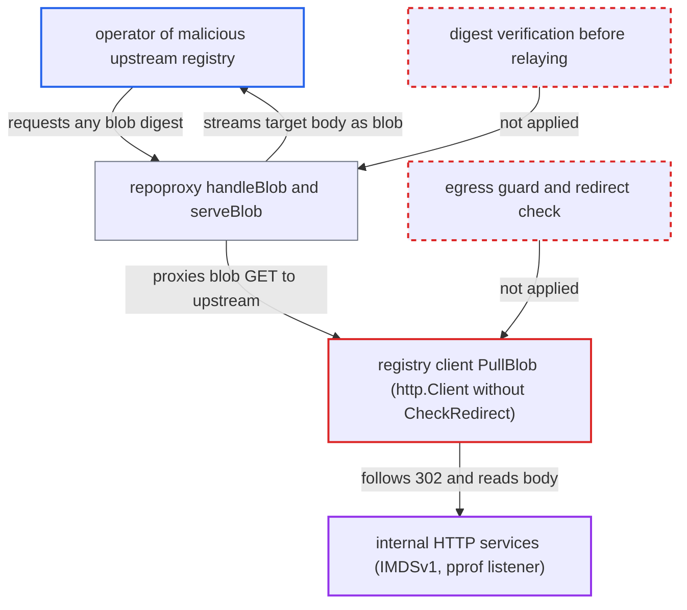

# Proxy-cache blob fetch follows upstream redirects to internal hosts and relays the body

| Field | Value |
|---|---|
| ID | `find_01TVhWr9emyphHLu9Mi6dQQz` |
| Severity | **Medium** |
| Status | open |
| CWE | CWE-918 — Server-Side Request Forgery |
| Created | 2026-10-27T21:33:16.912353Z |
| Claude Security | https://claude.ai/security/findings/find_01TVhWr9emyphHLu9Mi6dQQz |

## Description

A malicious or compromised upstream registry can make Harbor core fetch internal URLs and send the response bodies back to the caller as if they were image blobs. The attacker needs a proxy-cache project that points at their upstream. They also need pull access to that project, which is anonymous if the project is public. The registry client follows redirects to any host, and `serveBlob` streams the body without checking its digest.

1. **attacker** requests a blob from the proxy-cache project. The request is `GET /v2/<proxy-project>/<repo>/blobs/sha256:<any>` for any digest. It needs only pull access to the project, and the upstream must count as healthy (`canProxy`). ([`src/server/middleware/repoproxy/proxy.go:90-192`](https://github.com/cx-benchmark/harbor/blob/d822d80c2e6edb2c85538d4b9cd73c0c375a5596/src/server/middleware/repoproxy/proxy.go#L90-L192))
2. **the handler `handleBlob`** passes the request on to the upstream through `ProxyBlob` and `remoteHelper.BlobReader`. The blob is not held locally, so it is proxied, and `ProxyBlob` hands the remote reader straight to the middleware. ([`src/controller/proxy/controller.go:285-318`](https://github.com/cx-benchmark/harbor/blob/d822d80c2e6edb2c85538d4b9cd73c0c375a5596/src/controller/proxy/controller.go#L285-L318))
3. **the method `PullBlob`** sends `GET <upstream>/v2/<repo>/blobs/<digest>` to the upstream. The attacker's upstream answers `302 Location: http://<internal-target>/<path>`, for example `169.254.169.254/latest/meta-data/iam/security-credentials/<role>`. ([`src/pkg/registry/client.go:359-384`](https://github.com/cx-benchmark/harbor/blob/d822d80c2e6edb2c85538d4b9cd73c0c375a5596/src/pkg/registry/client.go#L359-L384))
4. **the `http.Client` built in `NewClientWithAuthorizer`** follows the redirect to the internal host. The client has no `CheckRedirect` and its transport has no egress guard, so Go follows up to ten redirects to any scheme, host and port. It strips `Authorization` on the cross-host hop. ([`src/pkg/registry/client.go:119-134`](https://github.com/cx-benchmark/harbor/blob/d822d80c2e6edb2c85538d4b9cd73c0c375a5596/src/pkg/registry/client.go#L119-L134))
5. **the method `do()`** accepts the internal target's response as the blob. It rejects only non-2xx final statuses and does not check which host answered. ([`src/pkg/registry/client.go:665-700`](https://github.com/cx-benchmark/harbor/blob/d822d80c2e6edb2c85538d4b9cd73c0c375a5596/src/pkg/registry/client.go#L665-L700))
6. **the function `serveBlob`** streams the target's body to the attacker with status 200. It sends exactly `Content-Length` bytes and sets the requested digest in `Docker-Content-Digest`, without hashing the content. ([`src/server/middleware/repoproxy/proxy.go:90-192`](https://github.com/cx-benchmark/harbor/blob/d822d80c2e6edb2c85538d4b9cd73c0c375a5596/src/server/middleware/repoproxy/proxy.go#L90-L192))

## Assessment

The attacker runs, or has compromised, a registry that is the upstream of a Harbor proxy-cache project. The deployment must have such a project. The attacker, or anyone working with them, requests a blob from Harbor over the network, anonymously if the proxy project is public. The upstream passes the health check simply by answering `/v2/`. The same redirect following also applies to replication transfers in jobservice, which use the same client. There the destination registry verifies the digest, so replication gives no way to read the data.

Impact: Harbor core becomes a read-only HTTP GET proxy into its own network. It returns every 2xx response that carries a `Content-Length`. Chunked responses come back as an empty 200. On Harbor itself this exposes internal topology and, when `metric.enabled` is set, the registry's unauthenticated pprof and metrics listener (`/debug/pprof/cmdline`, `goroutine?debug=2`, CPU profile trigger). Harbor's `registry:5000`, `jobservice`, `registryctl` and core internal APIs answer 401 to the unauthenticated request, so their data is not readable. Nothing in Harbor is modified.

Subsequent-system impact: Any HTTP service reachable from core that answers GET with a `Content-Length` body can be read in full. Examples are cloud instance-metadata credentials (AWS IMDSv1), link-local and intranet services, and other containers on the docker or cluster network. The code does not establish any change to or outage of those systems, because the requests are GET only.

## Recommendation

(1) The upstream registry client follows redirects to any host with no policy. The egress guard exists only for webhooks, so an untrusted upstream can steer core's GET to internal addresses.

Fix criteria: Redirects from an upstream are validated before they are followed. The target must pass the same egress and private-network policy as webhooks: loopback, link-local, RFC1918/ULA and metadata addresses are refused unless allow-listed. The number of redirect hops stays bounded. A proxy-cache blob request whose upstream answers `302 Location: http://169.254.169.254/...` fails with an error, and no bytes of the target are streamed.

(2) `serveBlob` relays whatever bytes the remote returned under the digest the client asked for, without verifying them. This lets the client see a redirected body.

Fix criteria: Content sent to the client as blob `<digest>` is digest-verified, or is served only after the local registry has accepted it. A response that does not hash to the requested digest is never delivered. A mismatching upstream body produces an error response, not a 200 with the mismatching bytes.

## Evidence

**https://github.com/cx-benchmark/harbor**

- [`src/pkg/registry/client.go:119-134`](https://github.com/cx-benchmark/harbor/blob/d822d80c2e6edb2c85538d4b9cd73c0c375a5596/src/pkg/registry/client.go#L119-L134)
- [`src/pkg/registry/client.go:359-384`](https://github.com/cx-benchmark/harbor/blob/d822d80c2e6edb2c85538d4b9cd73c0c375a5596/src/pkg/registry/client.go#L359-L384)
- [`src/pkg/registry/client.go:665-700`](https://github.com/cx-benchmark/harbor/blob/d822d80c2e6edb2c85538d4b9cd73c0c375a5596/src/pkg/registry/client.go#L665-L700)
- [`src/server/middleware/repoproxy/proxy.go:90-192`](https://github.com/cx-benchmark/harbor/blob/d822d80c2e6edb2c85538d4b9cd73c0c375a5596/src/server/middleware/repoproxy/proxy.go#L90-L192)
- [`src/controller/proxy/controller.go:285-318`](https://github.com/cx-benchmark/harbor/blob/d822d80c2e6edb2c85538d4b9cd73c0c375a5596/src/controller/proxy/controller.go#L285-L318)
- [`src/controller/proxy/remote.go:54-100`](https://github.com/cx-benchmark/harbor/blob/d822d80c2e6edb2c85538d4b9cd73c0c375a5596/src/controller/proxy/remote.go#L54-L100)
- [`src/common/http/transport.go:62-84`](https://github.com/cx-benchmark/harbor/blob/d822d80c2e6edb2c85538d4b9cd73c0c375a5596/src/common/http/transport.go#L62-L84)
- [`make/photon/prepare/templates/registry/config.yml.jinja:60-68`](https://github.com/cx-benchmark/harbor/blob/d822d80c2e6edb2c85538d4b9cd73c0c375a5596/make/photon/prepare/templates/registry/config.yml.jinja#L60-L68)

