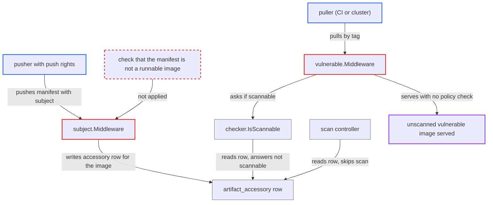

# Pusher-added subject field exempts runnable image from vulnerability deploy-prevention

| Field | Value |
|---|---|
| ID | `find_01WT5oYuezARRhgCVNPZDXF1` |
| Severity | **Medium** |
| Status | open |
| CWE | CWE-807 — Reliance on untrusted input |
| Created | 2026-10-27T21:20:03.945872Z |
| Claude Security | https://claude.ai/security/findings/find_01WT5oYuezARRhgCVNPZDXF1 |

## Description

A user or robot with push rights can make a vulnerable image skip a project's vulnerability deploy-prevention policy. Pullers then receive the image unscanned, and it is hidden from the artifact list. The attacker needs only `push` rights (developer role) in a project with `prevent_vul` on. The cause is that `vulnerable.Middleware` lets a pull through when no report exists and `IsScannable` is false, and the pusher controls that answer by adding a `subject` field to the manifest.

1. **pusher** re-pushes a vulnerable image manifest with an added `subject` descriptor. The request is `PUT /v2/<proj>/<repo>/manifests/<tag>`, and the `subject` digest can be any value, even one that does not exist. ([`src/server/registry/route.go:51-66`](https://github.com/cx-benchmark/harbor/blob/d822d80c2e6edb2c85538d4b9cd73c0c375a5596/src/server/registry/route.go#L51-L66))
2. **the handler `subject.Middleware`** records the pushed image as an accessory of itself. After a successful push it writes an `artifact_accessory` row of type `subject.accessory` with `ArtifactID: art.ID`. A missing subject is only logged, and an ordinary image config keeps that type. ([`src/server/middleware/subject/subject.go:133-190`](https://github.com/cx-benchmark/harbor/blob/d822d80c2e6edb2c85538d4b9cd73c0c375a5596/src/server/middleware/subject/subject.go#L133-L190))
3. **the scan controller** skips the image for scanning. `collectScanningArtifacts` skips accessories, so auto-scan does nothing, a manual scan is refused, and `GetReport` returns NotFound. The image never gets a report. ([`src/controller/scan/base_controller.go:188-195`](https://github.com/cx-benchmark/harbor/blob/d822d80c2e6edb2c85538d4b9cd73c0c375a5596/src/controller/scan/base_controller.go#L188-L195))
4. **a puller (CI or a cluster robot)** pulls the manifest by tag. The pull is `GET /v2/<proj>/<repo>/manifests/<tag>`. Nothing beyond this routine pull is needed. ([`src/server/registry/route.go:51-66`](https://github.com/cx-benchmark/harbor/blob/d822d80c2e6edb2c85538d4b9cd73c0c375a5596/src/server/registry/route.go#L51-L66))
5. **the handler `vulnerable.Middleware`** finds no report and asks `IsScannable`. `GetVulnerable` returns NotFound, so the middleware asks `scan.Checker.IsScannable` whether the artifact could be scanned. ([`src/server/middleware/vulnerable/vulnerable.go:84-97`](https://github.com/cx-benchmark/harbor/blob/d822d80c2e6edb2c85538d4b9cd73c0c375a5596/src/server/middleware/vulnerable/vulnerable.go#L84-L97))
6. **`checker.IsScannable`** answers false for the image. Its walk function returns early without setting `scannable` for any artifact that has an accessory row pointing at itself, even though the type is IMAGE. ([`src/controller/scan/checker.go:76-121`](https://github.com/cx-benchmark/harbor/blob/d822d80c2e6edb2c85538d4b9cd73c0c375a5596/src/controller/scan/checker.go#L76-L121))
7. **the handler `vulnerable.Middleware`** returns nil and lets the pull through. Because the answer is false, the policy check is skipped and the manifest is served. Docker and containerd ignore `subject` and run the image normally. ([`src/server/middleware/vulnerable/vulnerable.go:84-97`](https://github.com/cx-benchmark/harbor/blob/d822d80c2e6edb2c85538d4b9cd73c0c375a5596/src/server/middleware/vulnerable/vulnerable.go#L84-L97))

## Assessment

The attacker is a user or robot with repository `push` (developer role) in a project where deploy-prevention (`prevent_vul`) is on. That role cannot change `prevent_vul` or the CVE allowlist. The attacker re-pushes any vulnerable image's manifest with a `subject` descriptor added. Any later puller then triggers the bypass with a normal pull, and no other victim action is needed. The report corrects an earlier claim: an in-toto layer route does not work at this commit, because `checker.go` tests `hasCapability` before `HasUnscannableLayer`. A different route through the `artifactType` field reaches the same fail-open and is tracked separately.

Impact: The pusher defeats the project admin's vulnerability deploy-prevention policy for any image they choose. Unscanned, arbitrarily vulnerable images are served to pullers in a project whose policy forbids it. An orphan accessory with a non-existent subject is also hidden from the project's artifact list, so the missing scan is not visible to project admins. The report limits this to a loss of policy enforcement: no Harbor data is disclosed or destroyed beyond what a pusher may already write.

## Recommendation

(1) `vulnerable.Middleware` fails open. With no report and `IsScannable` false, it allows the pull, although that answer rests on accessory rows the pusher creates.

Fix criteria: In a project with deploy-prevention enabled, a pull of a runnable image manifest (an IMAGE-type OCI or Docker manifest) is denied with `PROJECTPOLICYVIOLATION` unless a successful scan report under the threshold exists. This holds whether or not the artifact has an accessory row. To check, push an image manifest with a `subject` field to a protected project, then pull it by tag. The pull must be refused until a scan has succeeded.

(2) `subject.Middleware` registers any manifest with a `subject` descriptor as an accessory. `checker.isAccessory` and `basicController.isAccessory` then exempt it from scanning, without checking whether the manifest is a runnable image.

Fix criteria: Only artifacts of a recognised non-executable accessory kind (signature, SBOM, other non-image artifact types) are exempt from scanning. An image manifest with an image config media type stays scannable and is auto-scanned on push, even when it carries a `subject`. To check, push such an image. It must be scanned, get a report, and appear in the project's artifact list.

## Evidence

**https://github.com/cx-benchmark/harbor**

- [`src/server/middleware/vulnerable/vulnerable.go:84-97`](https://github.com/cx-benchmark/harbor/blob/d822d80c2e6edb2c85538d4b9cd73c0c375a5596/src/server/middleware/vulnerable/vulnerable.go#L84-L97)
- [`src/controller/scan/checker.go:76-121`](https://github.com/cx-benchmark/harbor/blob/d822d80c2e6edb2c85538d4b9cd73c0c375a5596/src/controller/scan/checker.go#L76-L121)
- [`src/server/middleware/subject/subject.go:133-190`](https://github.com/cx-benchmark/harbor/blob/d822d80c2e6edb2c85538d4b9cd73c0c375a5596/src/server/middleware/subject/subject.go#L133-L190)
- [`src/controller/scan/base_controller.go:188-195`](https://github.com/cx-benchmark/harbor/blob/d822d80c2e6edb2c85538d4b9cd73c0c375a5596/src/controller/scan/base_controller.go#L188-L195)
- [`src/server/registry/route.go:51-66`](https://github.com/cx-benchmark/harbor/blob/d822d80c2e6edb2c85538d4b9cd73c0c375a5596/src/server/registry/route.go#L51-L66)
- [`src/pkg/artifact/dao/dao.go:468-474`](https://github.com/cx-benchmark/harbor/blob/d822d80c2e6edb2c85538d4b9cd73c0c375a5596/src/pkg/artifact/dao/dao.go#L468-L474)

