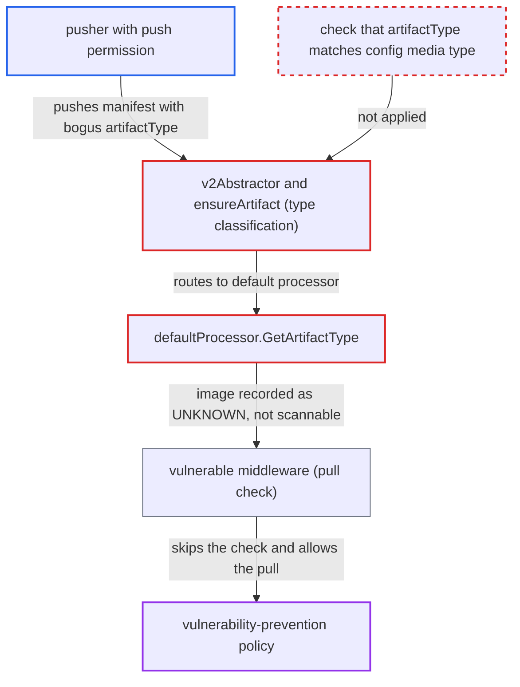

# Pusher-controlled artifactType reclassifies runnable image as UNKNOWN, bypassing vulnerability prevention

| Field | Value |
|---|---|
| ID | `find_01JdaxC8UrHVX4oayA8wCehs` |
| Severity | **Medium** |
| Status | open |
| CWE | CWE-693 — Protection mechanism failure |
| Created | 2026-10-27T21:17:51.255190Z |
| Claude Security | https://claude.ai/security/findings/find_01JdaxC8UrHVX4oayA8wCehs |

## Description

A user with push permission can make Harbor skip vulnerability scanning and the "Prevent images with vulnerability severity of X or higher from running" policy for a normal, runnable Docker image. This works in a project where an admin enabled vulnerability prevention and auto-scan. The pusher adds an `artifactType` field to the manifest. Harbor trusts it over the config media type and records the image as `UNKNOWN`. Only images the attacker pushes are affected.

1. **pusher** pushes a manifest with a Docker image config and an extra `artifactType`. The config media type is `application/vnd.docker.container.image.v1+json` and `artifactType` is a value such as `application/vnd.example.x`. Docker, containerd and the backend registry ignore or accept the extra field, so the image still pulls and runs.
2. **`v2Abstractor`** copies the pusher's `artifactType` into `art.ArtifactType`. The value is copied unchanged, for both OCI and Docker schema2 manifests, with no check against `config.mediaType`. ([`src/controller/artifact/manifest/v2.go:44-61`](https://github.com/cx-benchmark/harbor/blob/d822d80c2e6edb2c85538d4b9cd73c0c375a5596/src/controller/artifact/manifest/v2.go#L44-L61))
3. **`ensureArtifact`** picks the processor from `ResolveArtifactType()`. `ResolveArtifactType()` prefers `ArtifactType` over the config media type. An `artifactType` with no registered processor selects `DefaultProcessor`. ([`src/controller/artifact/controller.go:214-217`](https://github.com/cx-benchmark/harbor/blob/d822d80c2e6edb2c85538d4b9cd73c0c375a5596/src/controller/artifact/controller.go#L214-L217))
4. **`defaultProcessor.GetArtifactType`** returns `UNKNOWN` for the image. It matches the config media type with `artifactTypeRegExp`, and `application/vnd.docker.container.image.v1+json` has no `.config.` segment, so it does not match. ([`src/controller/artifact/processor/default.go:45-65`](https://github.com/cx-benchmark/harbor/blob/d822d80c2e6edb2c85538d4b9cd73c0c375a5596/src/controller/artifact/processor/default.go#L45-L65))
5. **scan checker** treats the artifact as not scannable. `hasCapability` only checks scanner capabilities when the type is `IMAGE`, so `IsScannable` is false and scan-on-push produces no report. ([`src/controller/scan/checker.go:125-134`](https://github.com/cx-benchmark/harbor/blob/d822d80c2e6edb2c85538d4b9cd73c0c375a5596/src/controller/scan/checker.go#L125-L134))
6. **vulnerable middleware** allows the pull on `GET /v2/<repo>/manifests/<ref>`. It finds no report, sees the artifact is not scannable, logs 'skip the checking' and returns nil, so the pull goes ahead. ([`src/server/middleware/vulnerable/vulnerable.go:84-98`](https://github.com/cx-benchmark/harbor/blob/d822d80c2e6edb2c85538d4b9cd73c0c375a5596/src/server/middleware/vulnerable/vulnerable.go#L84-L98))

## Assessment

The attacker is a project developer or a robot account with push permission. The project's admin must have enabled vulnerability prevention and auto-scan. The attacker pushes a vulnerable but ordinary image whose manifest (schema2 or OCI) uses a Docker config media type and carries an unregistered `artifactType`. Any client, including the attacker or CI, can then pull it by tag or digest. No code in the push middleware chain under `src/server/middleware` validates `artifactType` against the config media type.

Impact: The attacker's image skips scanning and the deploy-prevention policy and its CVE allowlist, so vulnerable images can be pulled and run. The artifact is also shown as `UNKNOWN` and unscannable in the API and UI. Harbor's own stored data and other projects are not affected, and nothing is disclosed.

## Recommendation

(1) Artifact type and processor choice trust the pusher's `artifactType` over the config media type. A runnable image can therefore be classified as a non-image and escape scanning and the vulnerability-prevention policy.

Fix criteria: An artifact whose config media type is `application/vnd.oci.image.config.v1+json` or `application/vnd.docker.container.image.v1+json` is classified `IMAGE` whatever its `artifactType`. For example, fall back to the config media type when `artifactType` has no registered processor, or reject or ignore a conflicting `artifactType`. Pushing such a manifest with a bogus `artifactType` gives `type=IMAGE`, is scanned on push, and is blocked by the vulnerability-prevention policy like any other image.

(2) `defaultProcessor.GetArtifactType` does not recognize the Docker image config media type, so artifacts routed to it are reported `UNKNOWN` instead of `IMAGE`.

Fix criteria: The default classification maps both standard image config media types to `IMAGE`, not only those matching the `*.config.*` regex. A manifest whose config is `application/vnd.docker.container.image.v1+json` results in `artifact.type` being `IMAGE`.

## Evidence

**https://github.com/cx-benchmark/harbor**

- [`src/controller/artifact/controller.go:214-217`](https://github.com/cx-benchmark/harbor/blob/d822d80c2e6edb2c85538d4b9cd73c0c375a5596/src/controller/artifact/controller.go#L214-L217)
- [`src/controller/artifact/manifest/v2.go:44-61`](https://github.com/cx-benchmark/harbor/blob/d822d80c2e6edb2c85538d4b9cd73c0c375a5596/src/controller/artifact/manifest/v2.go#L44-L61)
- [`src/controller/artifact/processor/default.go:45-65`](https://github.com/cx-benchmark/harbor/blob/d822d80c2e6edb2c85538d4b9cd73c0c375a5596/src/controller/artifact/processor/default.go#L45-L65)
- [`src/controller/scan/checker.go:125-134`](https://github.com/cx-benchmark/harbor/blob/d822d80c2e6edb2c85538d4b9cd73c0c375a5596/src/controller/scan/checker.go#L125-L134)
- [`src/server/middleware/vulnerable/vulnerable.go:84-98`](https://github.com/cx-benchmark/harbor/blob/d822d80c2e6edb2c85538d4b9cd73c0c375a5596/src/server/middleware/vulnerable/vulnerable.go#L84-L98)

