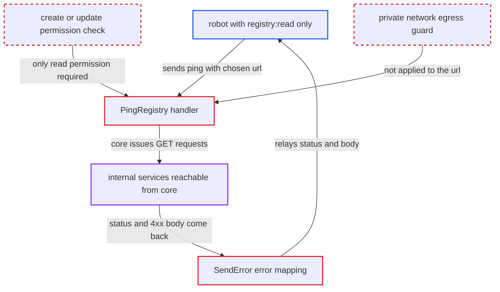

# Registry ping lets registry-read robots issue outbound requests and read 4xx bodies

| Field | Value |
|---|---|
| ID | `find_01MVTWRHN6YKk9KH56y8YX6v` |
| Severity | **Medium** |
| Status | open |
| CWE | CWE-918 — Server-Side Request Forgery |
| Created | 2026-10-27T21:33:26.575001Z |
| Claude Security | https://claude.ai/security/findings/find_01MVTWRHN6YKk9KH56y8YX6v |

## Description

A system robot account that only has `registry:read` can make Harbor's core container send GET requests to any internal http/https address. For 3xx and 4xx answers other than 404, the robot also reads the remote status and response body. The weak point is `PingRegistry`, which needs only `registry:read`, accepts a caller-supplied URL, and returns the remote error body unchanged.

1. **attacker with a robot token** sends `POST /api/v2.0/registries/ping` with `type` set to `harbor` and an internal `url`. The caller needs only a system robot account granted `registry:read`, and `PingRegistry` builds a registry object from the supplied type, url, insecure, CA and credentials. ([`src/server/v2.0/handler/registry.go:238-308`](https://github.com/cx-benchmark/harbor/blob/d822d80c2e6edb2c85538d4b9cd73c0c375a5596/src/server/v2.0/handler/registry.go#L238-L308))
2. **`NormalizeAndValidateHTTPURL`** accepts the URL after checking only the scheme and lowercasing the host. It allows only http or https and has no private-address filter. It also re-serialises the decoded path, so `%3F` becomes a literal `?` and the adapter's fixed suffix lands in the query string, which lets the caller pick the requested path. ([`src/lib/endpoint.go:27-46`](https://github.com/cx-benchmark/harbor/blob/d822d80c2e6edb2c85538d4b9cd73c0c375a5596/src/lib/endpoint.go#L27-L46))
3. **the Harbor adapter factory** issues `GET <url>/api/version` from the core container while building the adapter. `GetAPIVersion` returns a `*common_http.Error` holding the remote status and body for every non-2xx status except 404. ([`src/pkg/reg/adapter/harbor/base/client.go:27-56`](https://github.com/cx-benchmark/harbor/blob/d822d80c2e6edb2c85538d4b9cd73c0c375a5596/src/pkg/reg/adapter/harbor/base/client.go#L27-L56))
4. **`do()` in the HTTP client** wraps the remote status and full body in an `Error`. The body is read in full and stored as `Message` for non-2xx responses. ([`src/common/http/client.go:163-176`](https://github.com/cx-benchmark/harbor/blob/d822d80c2e6edb2c85538d4b9cd73c0c375a5596/src/common/http/client.go#L163-L176))
5. **`IsHealthy` and the adapter factory `Create`** pass the error up to the handler unchanged. Neither wraps nor sanitises it. ([`src/controller/registry/controller.go:172-182`](https://github.com/cx-benchmark/harbor/blob/d822d80c2e6edb2c85538d4b9cd73c0c375a5596/src/controller/registry/controller.go#L172-L182))
6. **`SendError`** returns the remote status code and body to the robot. The error is treated as a legacy error, so only codes of 500 and above are replaced by a generic message, and 3xx/4xx bodies reach the caller. ([`src/lib/http/error.go:53-100`](https://github.com/cx-benchmark/harbor/blob/d822d80c2e6edb2c85538d4b9cd73c0c375a5596/src/lib/http/error.go#L53-L100))

## Assessment

The attacker holds a system robot account token granted only `registry:read`, for example a CI credential meant for listing registries. No user interaction or special deployment state is needed, and the API is the normal REST API. Besides the status and 3xx/4xx bodies, 2xx answers tell the attacker whether the body is JSON, since a parse failure gives a 500. A 404 falls through to the native ping, which shows whether `/v2/` answers. Connection failures surface as 500, and timeouts (`REGISTRY_HTTP_CLIENT_TIMEOUT`, minutes) give a timing signal. With `type` set to `docker-registry` the result is only a healthy or unhealthy answer. The HTTP clients have no `CheckRedirect`, so redirects are followed. The `gitlab`, `aliacr` and `tencentcr` factories call `util.Ping` with an `http.Client` that has no timeout.

Impact: The robot can use the core container to send GET requests to internal targets. It can map those services by status and timing, and read the bodies of 3xx and 4xx (non-404) responses. It cannot change Harbor data this way, since the requests are GET only and `Authorization` is stripped on a cross-host redirect. Bodies of 2xx responses are not disclosed.

Subsequent-system impact: The requests go from core to hosts it can reach, such as `registry:5000`, `jobservice:8080`, `registryctl`, the Kubernetes API and cloud metadata. The robot sees their status codes, timing and 3xx/4xx bodies. The code establishes no change to those services, because the requests are GET only.

## Recommendation

(1) `PingRegistry` makes an outbound connection to a caller-chosen URL under the read-level `registry:read` permission, so a robot meant only to view registries can cause outbound requests.

Fix criteria: A ping with caller-supplied connection settings (url, insecure, ca, credentials) requires the same privilege as creating or updating a registry (`registry:create` or `update`), or ping is limited to stored registry IDs for read-level callers. A system robot holding only `registry:read` gets 403 for a ping that names a URL.

(2) Adapter-construction errors (`*commonhttp.Error`) carry the remote response body and `SendError` returns them verbatim, so the ping leaks part of the remote response.

Fix criteria: The ping response is a fixed healthy or unhealthy result, and remote status codes and bodies are never relayed to the API caller. A target that answers 401 or 403 with a body produces only the generic unhealthy error.

(3) `NormalizeAndValidateHTTPURL` applies no egress policy and re-serialises the decoded path, which allows internal targets and caller-chosen paths.

Fix criteria: Outbound targets supplied through the API pass the same private-network egress guard used for webhooks. The normalised URL keeps the path percent-encoded, so a fixed suffix cannot be displaced into the query. `%3F` no longer alters the requested path, and loopback and link-local targets are refused.

## Evidence

**https://github.com/cx-benchmark/harbor**

- [`src/server/v2.0/handler/registry.go:238-308`](https://github.com/cx-benchmark/harbor/blob/d822d80c2e6edb2c85538d4b9cd73c0c375a5596/src/server/v2.0/handler/registry.go#L238-L308)
- [`src/pkg/reg/adapter/harbor/base/client.go:27-56`](https://github.com/cx-benchmark/harbor/blob/d822d80c2e6edb2c85538d4b9cd73c0c375a5596/src/pkg/reg/adapter/harbor/base/client.go#L27-L56)
- [`src/common/http/client.go:163-176`](https://github.com/cx-benchmark/harbor/blob/d822d80c2e6edb2c85538d4b9cd73c0c375a5596/src/common/http/client.go#L163-L176)
- [`src/lib/http/error.go:53-100`](https://github.com/cx-benchmark/harbor/blob/d822d80c2e6edb2c85538d4b9cd73c0c375a5596/src/lib/http/error.go#L53-L100)
- [`src/lib/endpoint.go:27-46`](https://github.com/cx-benchmark/harbor/blob/d822d80c2e6edb2c85538d4b9cd73c0c375a5596/src/lib/endpoint.go#L27-L46)
- [`src/common/rbac/const.go:195-199`](https://github.com/cx-benchmark/harbor/blob/d822d80c2e6edb2c85538d4b9cd73c0c375a5596/src/common/rbac/const.go#L195-L199)
- [`src/pkg/reg/adapter/harbor/adaper.go:37-50`](https://github.com/cx-benchmark/harbor/blob/d822d80c2e6edb2c85538d4b9cd73c0c375a5596/src/pkg/reg/adapter/harbor/adaper.go#L37-L50)
- [`src/controller/registry/controller.go:172-182`](https://github.com/cx-benchmark/harbor/blob/d822d80c2e6edb2c85538d4b9cd73c0c375a5596/src/controller/registry/controller.go#L172-L182)
- [`src/pkg/reg/util/util.go:41-56`](https://github.com/cx-benchmark/harbor/blob/d822d80c2e6edb2c85538d4b9cd73c0c375a5596/src/pkg/reg/util/util.go#L41-L56)

