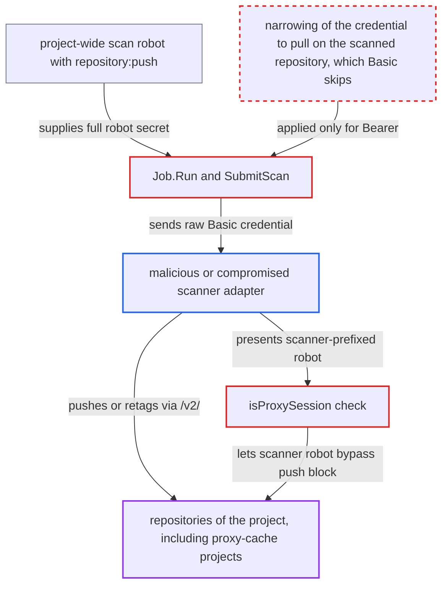

# SBOM scan hands the external scanner a project-wide push-capable robot credential

| Field | Value |
|---|---|
| ID | `find_01CXavfTEHC4EAFuJnuQfVWM` |
| Severity | **Medium** |
| Status | open |
| CWE | CWE-266 — Incorrect privilege assignment |
| Created | 2026-10-27T21:13:29.649340Z |
| Claude Security | https://claude.ai/security/findings/find_01CXavfTEHC4EAFuJnuQfVWM |

## Description

A malicious or compromised external scanner adapter can push or retag images in every repository of a Harbor project, including proxy-cache projects. It needs to be the project's SBOM-capable scanner, registered by an admin, and to advertise no registry-authorization-type or `Basic`. `launchScanJob` mints a project-wide robot with `repository:push`, and `Job.Run` sends its raw Basic credential to the scanner.

1. **the SBOM handler `RequiredPermissions()`** adds `repository:push` to the scan robot's policies. The vulnerability handler grants only `pull` and `scanner-pull`, so SBOM scans give the robot more than vulnerability scans do. ([`src/pkg/scan/sbom/sbom.go:117-133`](https://github.com/cx-benchmark/harbor/blob/d822d80c2e6edb2c85538d4b9cd73c0c375a5596/src/pkg/scan/sbom/sbom.go#L117-L133))
2. **the function `launchScanJob`** creates a project-level robot with the handler's permissions and puts it in the job parameters. `makeRobotAccount` scopes the robot to `/project/<id>` with `Duration: -1`, so its policies apply to every repository of the project, and the job parameters include its `secret`. ([`src/controller/scan/base_controller.go:920-976`](https://github.com/cx-benchmark/harbor/blob/d822d80c2e6edb2c85538d4b9cd73c0c375a5596/src/controller/scan/base_controller.go#L920-L976))
3. **the scanner adapter** advertises no registry-authorization-type or `Basic` in its `/metadata`. `GetRegistryAuthorizationType` reads this value from the scanner's own metadata and defaults to `Basic`, so the scanner chooses whether it gets the full robot. ([`src/pkg/scan/dao/scanner/model.go:189-203`](https://github.com/cx-benchmark/harbor/blob/d822d80c2e6edb2c85538d4b9cd73c0c375a5596/src/pkg/scan/dao/scanner/model.go#L189-L203))
4. **the method `Job.Run`** sends `Basic base64(name:secret)` of the full robot to the scanner in `SubmitScan`. Only the `Bearer` branch narrows the credential to `repository:<repo>:pull`; any other auth type sends the full robot. ([`src/pkg/scan/job.go:194-218`](https://github.com/cx-benchmark/harbor/blob/d822d80c2e6edb2c85538d4b9cd73c0c375a5596/src/pkg/scan/job.go#L194-L218))
5. **the scanner adapter** uses the robot's Basic credential against `/v2/` to push or retag manifests. The robot security middleware accepts Basic credentials of a `robot$` account on any request and checks only that it is not disabled or expired. ([`src/server/middleware/security/robot.go:33-72`](https://github.com/cx-benchmark/harbor/blob/d822d80c2e6edb2c85538d4b9cd73c0c375a5596/src/server/middleware/security/robot.go#L33-L72))
6. **the scanner adapter** pushes into proxy-cache projects as well. `isProxySession` treats an invisible robot with `CreatorRef == 0` and the scanner prefix as a proxy session, so `DisableBlobAndManifestUploadMiddleware` lets it through. ([`src/server/middleware/repoproxy/proxy.go:429-490`](https://github.com/cx-benchmark/harbor/blob/d822d80c2e6edb2c85538d4b9cd73c0c375a5596/src/server/middleware/repoproxy/proxy.go#L429-L490))
7. **the scanner adapter** delays its report so the credential stays valid. `scanTaskStatusChange` deletes the robot only when the task reaches a final state, and the scanner controls when its report becomes ready. ([`src/controller/scan/callback.go:95-104`](https://github.com/cx-benchmark/harbor/blob/d822d80c2e6edb2c85538d4b9cd73c0c375a5596/src/controller/scan/callback.go#L95-L104))

## Assessment

The attacker is a malicious or compromised scanner adapter that an admin registered and that is the project's scanner with an SBOM capability. It advertises no registry-authorization-type or `Basic`. The attack starts when a project member generates an SBOM, or when something is pushed into a project with `auto_sbom_generation`. The adapter can then use the credential until the robot is deleted, and it controls when its report becomes ready.

Impact: The scanner can overwrite non-immutable tags or add manifests in every repository of the project, including proxy-cache projects, and so poison artifacts that downstream clusters pull. Its own clean reports hide the change. Immutable-tag rules still apply and delete is not granted. The extra read access is limited, because project-wide pull is already given for vulnerability scans.

## Recommendation

(1) The SBOM scan robot carries `repository:push` for Harbor's own accessory push. The same robot's raw credential is sent to the external scanner on the Basic path.

Fix criteria: The credential sent to the scanner in `SubmitScan` never grants push and grants no more than pull on the scanned repository, whatever registry-authorization-type the scanner advertises. Any push-capable identity used by `GenAccessoryArt` stays inside Harbor. Capture the authorization an SBOM scan request carries and confirm it is refused for a manifest PUT in the scanned repository, in another repository of the project, and in a proxy-cache project.

(2) `isProxySession` lets any scanner-prefixed invisible robot push into proxy-cache projects, which widens what a leaked scan credential can write.

Fix criteria: Only Harbor's own SBOM accessory push for the scanned artifact can bypass the proxy-cache push block. A scanner-held credential cannot push arbitrary manifests or tags into a proxy-cache project.

(3) The scan robot is created with `Duration: -1` and removed only by the task status hook. Its lifetime is unbounded and depends on the scanner and the hook.

Fix criteria: Scan credentials expire within a bound no longer than the scan timeout. Orphaned scan robots are reclaimed independently of the status hook. A credential from a stalled scan stops authenticating after the bound.

## Evidence

**https://github.com/cx-benchmark/harbor**

- [`src/pkg/scan/sbom/sbom.go:117-133`](https://github.com/cx-benchmark/harbor/blob/d822d80c2e6edb2c85538d4b9cd73c0c375a5596/src/pkg/scan/sbom/sbom.go#L117-L133)
- [`src/pkg/scan/job.go:194-218`](https://github.com/cx-benchmark/harbor/blob/d822d80c2e6edb2c85538d4b9cd73c0c375a5596/src/pkg/scan/job.go#L194-L218)
- [`src/pkg/scan/dao/scanner/model.go:189-203`](https://github.com/cx-benchmark/harbor/blob/d822d80c2e6edb2c85538d4b9cd73c0c375a5596/src/pkg/scan/dao/scanner/model.go#L189-L203)
- [`src/controller/scan/base_controller.go:856-898`](https://github.com/cx-benchmark/harbor/blob/d822d80c2e6edb2c85538d4b9cd73c0c375a5596/src/controller/scan/base_controller.go#L856-L898)
- [`src/controller/scan/base_controller.go:920-976`](https://github.com/cx-benchmark/harbor/blob/d822d80c2e6edb2c85538d4b9cd73c0c375a5596/src/controller/scan/base_controller.go#L920-L976)
- [`src/pkg/scan/util.go:93-94`](https://github.com/cx-benchmark/harbor/blob/d822d80c2e6edb2c85538d4b9cd73c0c375a5596/src/pkg/scan/util.go#L93-L94)
- [`src/server/middleware/security/robot.go:33-72`](https://github.com/cx-benchmark/harbor/blob/d822d80c2e6edb2c85538d4b9cd73c0c375a5596/src/server/middleware/security/robot.go#L33-L72)
- [`src/server/middleware/repoproxy/proxy.go:429-490`](https://github.com/cx-benchmark/harbor/blob/d822d80c2e6edb2c85538d4b9cd73c0c375a5596/src/server/middleware/repoproxy/proxy.go#L429-L490)
- [`src/controller/scan/callback.go:95-104`](https://github.com/cx-benchmark/harbor/blob/d822d80c2e6edb2c85538d4b9cd73c0c375a5596/src/controller/scan/callback.go#L95-L104)

