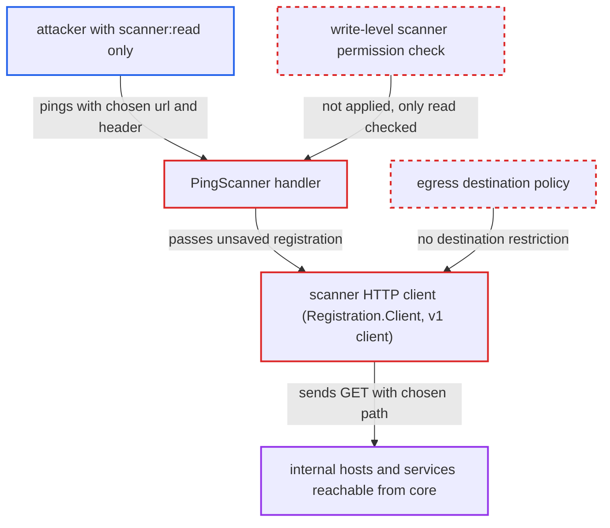

# Scanner ping lets read-only scanner holders send blind SSRF GETs to internal hosts

| Field | Value |
|---|---|
| ID | `find_01QwKwSN4boFqr5YtRb1HGUR` |
| Severity | **Medium** |
| Status | open |
| CWE | CWE-918 — Server-side request forgery |
| Created | 2026-10-27T21:15:10.595012Z |
| Claude Security | https://claude.ai/security/findings/find_01QwKwSN4boFqr5YtRb1HGUR |

## Description

A user or system robot holding only the read-only system `scanner:read` permission can make Harbor core send GET requests to any internal host, port or path. The attacker sees no response content, only whether the host answered in time. `PingScanner` checks only that read permission, and the scanner client has no limit on where it connects.

1. **attacker with `scanner:read`** posts to `/api/v2.0/scanners/ping` with a chosen `url`, `auth` and `access_credential`. A system robot can be given `scanner:read` on its own, so a non-admin account is enough. ([`src/common/rbac/const.go:223`](https://github.com/cx-benchmark/harbor/blob/d822d80c2e6edb2c85538d4b9cd73c0c375a5596/src/common/rbac/const.go#L223))
2. **the handler `PingScanner`** checks only `scanner:read` and builds an unsaved `Registration` from the request. The check is the permission for viewing scanners, not a write-level permission, and the caller's values go into the registration unchanged. ([`src/server/v2.0/handler/scanner.go:170-190`](https://github.com/cx-benchmark/harbor/blob/d822d80c2e6edb2c85538d4b9cd73c0c375a5596/src/server/v2.0/handler/scanner.go#L170-L190))
3. **the function `lib.NormalizeAndValidateHTTPURL`** accepts the caller's URL. It requires only `http` or `https` and lower-cases the host, so loopback, RFC1918, link-local and metadata addresses and any port pass. ([`src/lib/endpoint.go:27-45`](https://github.com/cx-benchmark/harbor/blob/d822d80c2e6edb2c85538d4b9cd73c0c375a5596/src/lib/endpoint.go#L27-L45))
4. **the method `Registration.Client`** runs `Validate` a second time on the same URL. The path is decoded twice, so a double-encoded `%253F` or `%2523` turns the appended `/api/v1/metadata` into a query or fragment and the caller controls the full request path. ([`src/pkg/scan/dao/scanner/model.go:105-141`](https://github.com/cx-benchmark/harbor/blob/d822d80c2e6edb2c85538d4b9cd73c0c375a5596/src/pkg/scan/dao/scanner/model.go#L105-L141))
5. **the method `Ping`** skips the cache and calls `getScannerAdapterMetadata`. The registration has `ID == 0`, so every call sends a fresh outbound request. ([`src/controller/scanner/base_controller.go:306-360`](https://github.com/cx-benchmark/harbor/blob/d822d80c2e6edb2c85538d4b9cd73c0c375a5596/src/controller/scanner/base_controller.go#L306-L360))
6. **the scanner HTTP client** sends `GET <url>/api/v1/metadata` from core to the chosen destination. The client has no destination check, a 5 second timeout and no redirects, and it adds the caller-chosen `Authorization` (Basic or Bearer) or `X-ScannerAdapter-API-Key` header. ([`src/pkg/scan/rest/v1/client.go:82-138`](https://github.com/cx-benchmark/harbor/blob/d822d80c2e6edb2c85538d4b9cd73c0c375a5596/src/pkg/scan/rest/v1/client.go#L82-L138))
7. **the error mapping in `src/lib/http/error.go`** returns a 500 `internal server error` on failure. The caller gets no response body, but an immediate failure versus a 5 second timeout shows whether the host is reachable. ([`src/lib/http/error.go:53-67`](https://github.com/cx-benchmark/harbor/blob/d822d80c2e6edb2c85538d4b9cd73c0c375a5596/src/lib/http/error.go#L53-L67))

## Assessment

The attacker needs a user or system robot with system `scanner:read` and nothing more; no admin rights and no victim action are needed. They send one `POST /api/v2.0/scanners/ping` request, for example with a `url` such as `http://10.0.0.5:8080/admin%2523` and a chosen `auth` and `access_credential`. Core then issues `GET http://10.0.0.5:8080/admin` with the chosen header. The report also says the same read-gated ping pattern exists in `PingRegistry` (`registry.go:238`) and `PingInstances` (`preheat.go:451`).

Impact: Core becomes a relay: the attacker can make it send GET requests with a chosen path, query and authorization header to any host and port it can reach. The attacker learns host and port reachability from timing, but not response content. Harbor's own data is not read or changed.

Subsequent-system impact: Internal services reachable from core receive attacker-chosen GET requests with an Authorization header of the attacker's choosing. This can trigger whatever a GET does on services that trust their network position, with limited effect on their confidentiality and integrity. Availability is not affected.

## Recommendation

(1) The ping operation makes core contact any caller-supplied URL, but it is authorised by the read-only `scanner:read` permission instead of a write-level scanner permission.

Fix criteria: A caller holding only system `scanner:read` gets 403 from `POST /api/v2.0/scanners/ping`. Probing an arbitrary URL requires the same write-level scanner permission as creating or updating a registration.

(2) Scanner adapter URLs are not restricted by destination, so core's scanner client can be pointed at loopback, link-local, cloud-metadata and other internal addresses. A double-decoded path also lets the caller replace the fixed API suffix.

Fix criteria: The scanner client applies an operator-configurable egress policy that blocks at least loopback, link-local and metadata destinations by default, checked at dial time against the resolved IP. URL normalisation is idempotent, so the request path always ends in the expected adapter API route. Pinging `http://127.0.0.1:<port>/` or `http://169.254.169.254/` is refused before any connection is made.

## Evidence

**https://github.com/cx-benchmark/harbor**

- [`src/server/v2.0/handler/scanner.go:170-190`](https://github.com/cx-benchmark/harbor/blob/d822d80c2e6edb2c85538d4b9cd73c0c375a5596/src/server/v2.0/handler/scanner.go#L170-L190)
- [`src/lib/endpoint.go:27-45`](https://github.com/cx-benchmark/harbor/blob/d822d80c2e6edb2c85538d4b9cd73c0c375a5596/src/lib/endpoint.go#L27-L45)
- [`src/pkg/scan/dao/scanner/model.go:105-141`](https://github.com/cx-benchmark/harbor/blob/d822d80c2e6edb2c85538d4b9cd73c0c375a5596/src/pkg/scan/dao/scanner/model.go#L105-L141)
- [`src/controller/scanner/base_controller.go:306-360`](https://github.com/cx-benchmark/harbor/blob/d822d80c2e6edb2c85538d4b9cd73c0c375a5596/src/controller/scanner/base_controller.go#L306-L360)
- [`src/pkg/scan/rest/v1/client.go:82-138`](https://github.com/cx-benchmark/harbor/blob/d822d80c2e6edb2c85538d4b9cd73c0c375a5596/src/pkg/scan/rest/v1/client.go#L82-L138)
- [`src/lib/http/error.go:53-67`](https://github.com/cx-benchmark/harbor/blob/d822d80c2e6edb2c85538d4b9cd73c0c375a5596/src/lib/http/error.go#L53-L67)
- [`src/common/rbac/const.go:223`](https://github.com/cx-benchmark/harbor/blob/d822d80c2e6edb2c85538d4b9cd73c0c375a5596/src/common/rbac/const.go#L223)

